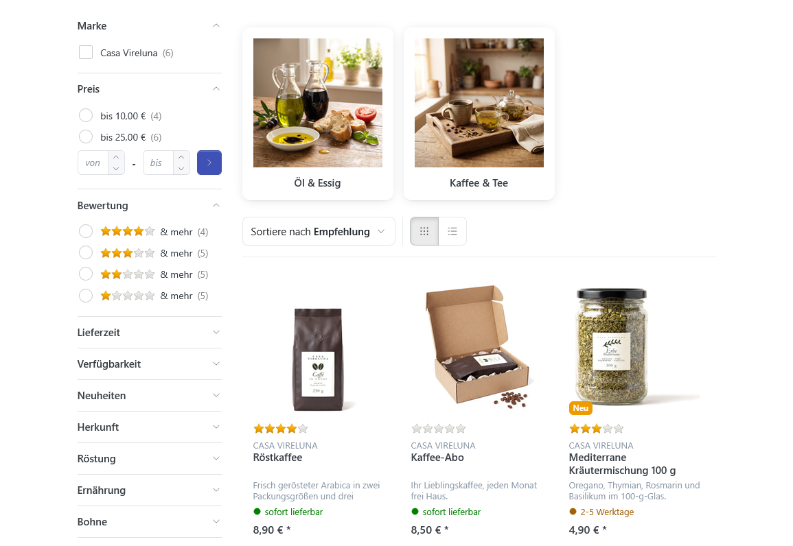
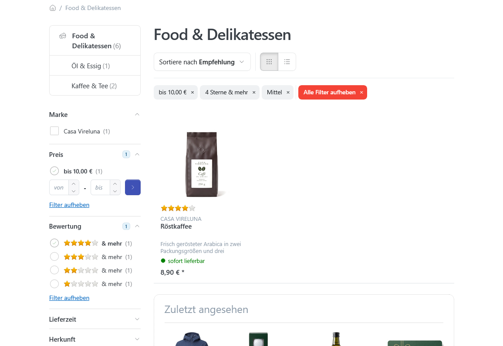
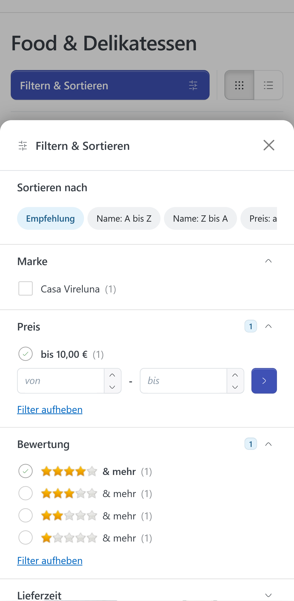

# Filter-Seitenleiste

Die Frontend-Suche zeigt Produkte als Trefferliste an, die Kunden mithilfe der Filter-Seitenleiste eingrenzen können. Dieselbe Seitenleiste erscheint auch auf Warengruppen- und Markenseiten sowie bei Schlagwörtern. Welche Filtergruppen und Werte angeboten werden, hängt von der aktuellen Produktliste und den Einstellungen des Shops ab.

## Produkte filtern

Die Seitenleiste ordnet Filter in aufklappbaren Gruppen an. Je nach Seite und Angebot können folgende Gruppen erscheinen:

| Filtergruppe | Funktion |
| --- | --- |
| Warengruppe | Produkte aus einer oder mehreren Warengruppen auswählen. Auf einer Warengruppenseite wird diese Gruppe nicht angeboten. |
| Marke | Produkte nach einer oder mehreren Marken eingrenzen. Auf einer Markenseite wird diese Gruppe nicht angeboten. |
| Preis | Eine angebotene Preisspanne auswählen oder einen eigenen Mindest- und Höchstpreis eingeben. |
| Bewertung | Produkte ab einer bestimmten Sternebewertung anzeigen. |
| Lieferzeit | Eine oder mehrere Lieferzeiten auswählen. |
| Verfügbarkeit | Nicht verfügbare Produkte ein- oder ausblenden. Die Bedeutung der Auswahl richtet sich nach der Standardeinstellung des Shops. |
| Neuheiten | Produkte anzeigen, die innerhalb des festgelegten Zeitraums als neu gelten. Die Gruppe setzt einen konfigurierten Zeitraum voraus. |

Bei Warengruppe, Marke und Lieferzeit können Kunden mehrere Werte auswählen. Für die Filter Preis und Bewertung ist jeweils nur eine Einzelauswahl möglich.


Filterwerte können die Anzahl passender Produkte anzeigen. Enthält eine Gruppe viele Werte, erscheint ein Suchfeld, mit dem sich die Werte innerhalb dieser Gruppe finden lassen.


### Aktive Filter entfernen

Nach der Auswahl werden die aktiven Filter oberhalb der Produktliste angezeigt. Kunden können dort einzelne Filter oder alle Filter entfernen. Innerhalb der Seitenleiste lässt sich außerdem die Auswahl einer ganzen Gruppe zurücksetzen. Wenn eine Filterkombination keine Produkte liefert, bleiben die aktiven Filter sichtbar, damit sie wieder entfernt werden können.

### Mobile Ansicht


{% column width="50%" %}
Auf kleineren Bildschirmen öffnen Kunden die Seitenleiste über **Filtern und sortieren**. Die Filter erscheinen dann in einem ausklappbaren Bereich.



<figure><figcaption></figcaption></figure>



## Konfiguration

Unter **Konfiguration > Einstellungen > Suche > Ergebnisfilterung** legen Sie fest, wie viele Treffer ein Filterwert mindestens benötigt und wie viele Werte pro Gruppe höchstens angezeigt werden. Die Gruppen **Marke**, **Preis**, **Bewertung**, **Lieferzeit**, **Verfügbarkeit** und **Neuheit** lassen sich einzeln deaktivieren und in ihrer Reihenfolge ändern.

Weitere Informationen finden Sie unter [Suche](../konfiguration/einstellungen/suche.md#ergebnisfilterung).


Nicht jede eingerichtete Gruppe erscheint auf jeder Produktliste: Beispielsweise wird der Preisfilter nur angeboten, wenn der Kunde Preise sehen darf. Die Gruppe **Neuheiten** setzt einen Zeitraum für die Kennzeichnung neuer Produkte voraus.


## Erweiterungen

Das Plugin [MegaSearch Plus](../plugins/megasearch.md) ergänzt die Seitenleiste um Filter für **Produktattribute** wie Farbe oder Größe und **Spezifikationsattribute** wie Material. Je nach Attribut können Werte als Liste, Farb- oder Bildmuster oder als numerischer Bereich erscheinen.


MegaSearch Plus setzt das Plugin [MegaSearch](../plugins/megasearch.md) voraus.


Ob ein Attribut tatsächlich als Filter erscheint, hängt von den Plugin-Einstellungen, der Freigabe des Attributs und den passenden Produkten ab. Die Einrichtung wird in den Abschnitten [Produktattribute vorbereiten](../../verwalten/katalog/produktattribute-verwalten.md#megasearch-felder) und [Spezifikationsattribute verwalten](../../verwalten/katalog/spezifikationsattribute-verwalten.md#suchfilter-mit-megasearch-plus) erläutert. Wie die Vorgaben für Spezifikationsattribute zusammenspielen, ist in [Facettensuche / Filter](../konfiguration/einstellungen/facettensuche-filter.md) beschrieben.
