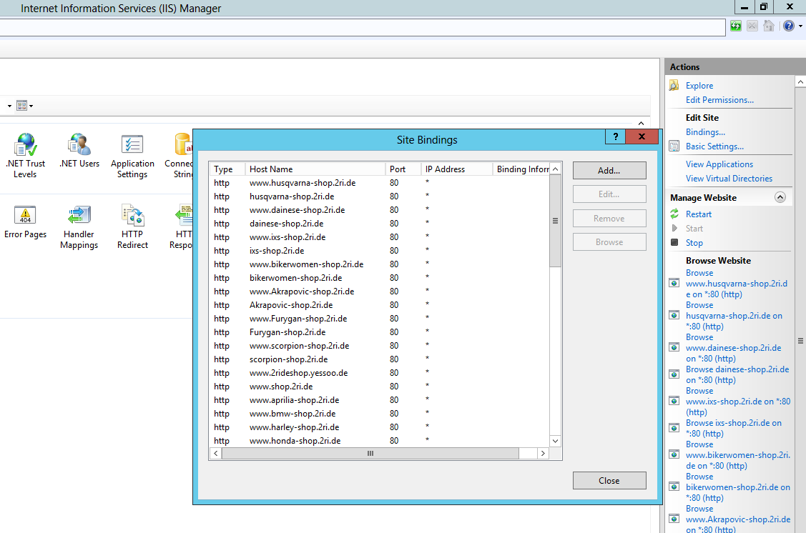

# Mit mehreren Shops arbeiten

Mit einer Multi-Shop-Konfiguration richten Sie Produktangebot und Darstellung gezielt auf unterschiedliche Zielgruppen aus. Jeder Shop kann über eine eigene Domain erreichbar sein und [individuell konfiguriert](../konfiguration/einstellungen/den-einstellungsbereich-festlegen.md) werden.

## Anwendungsszenario

Betreiben Sie beispielsweise ein Modelabel, können Sie getrennte Shops für unterschiedliche Zielgruppen oder Marken einrichten. Mit eigenen Farben und Layouts erhält jeder Shop eine passende Ansprache.

## Voraussetzung

Alle verwendeten Domains müssen auf dieselbe Smartstore-Installation zeigen. Wenn Sie IIS verwenden, legen Sie dafür passende Sitebindungen für die Hostnamen an. Richten Sie für HTTPS zudem gültige Zertifikate ein.

## Einen neuen Shop anlegen

Öffnen Sie im Administrationsbereich **Konfiguration > Shops** und klicken Sie auf **Neu**. Erfassen Sie die Shopdaten und speichern Sie den neuen Shop. Eine Beschreibung der Eingabefelder finden Sie unter [Shops verwalten](../konfiguration/shops-verwalten.md).

## Verfügbarkeit je Shop festlegen

Nach dem Anlegen bestimmen Sie, welche Einträge in welchen Shops verfügbar sind. Das betrifft Produkte, Warengruppen und Hersteller ebenso wie Seiten, Menüs und Menüeinträge. Auch Sprachen, Währungen, Länder, Kundenkonten, Zahlungs- und Versandarten, Checkout-Attribute, Kampagnen und Nachrichtenvorlagen lassen sich auf Shops begrenzen.

Öffnen Sie den jeweiligen Eintrag und wählen Sie im Feld **Auf Shops begrenzt** die gewünschten Shops. Ohne Auswahl ist der Eintrag in allen Shops verfügbar.

Die Shop-Zuordnung einer Warengruppe gilt nicht automatisch für ihre Unterwarengruppen und Produkte. Im Warengruppen-Editor können Sie die gespeicherte Zuordnung auf diese Einträge übertragen. Dabei werden deren vorhandene Shop-Zuordnungen überschrieben. Prüfen Sie die Auswahl deshalb vor dem Übertragen.

Installierte Plugins können Sie in der Plugin-Übersicht über **Verfügbar für** auf ausgewählte Shops begrenzen. Ohne Begrenzung stehen sie in allen Shops zur Verfügung. Weitere Informationen finden Sie unter [Plugins verwalten](../plugins/plugins-verwalten.md).

## Einstellungen je Shop anpassen

Sie können unterschiedliche Einstellungen für jeden Ihrer angelegten Shops vornehmen. Für weitere Informationen lesen Sie bitte [den Einstellungsbereich festlegen](../konfiguration/einstellungen/den-einstellungsbereich-festlegen.md).
