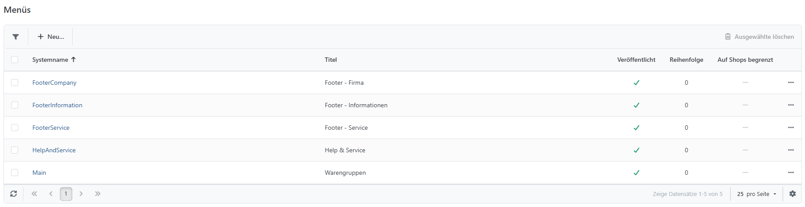
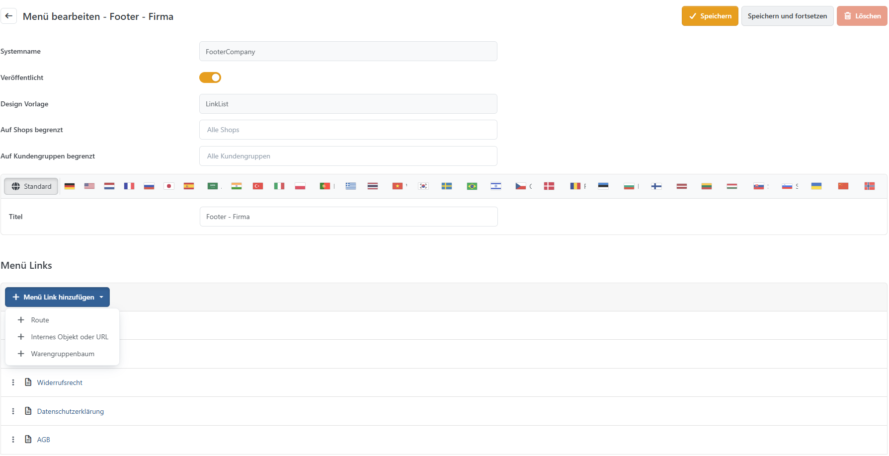

# Menüs

Mit dem Menü-Builder unter **CMS > Menüs** erstellen Sie neue Menüs und bearbeiten oder erweitern bestehende Menüs.\


## Bestehende Menüs bearbeiten / erweitern

Öffnen Sie ein Menü über seinen Systemnamen. Zu den vorgegebenen Menüs gehören **Main** für die Hauptnavigation mit Warengruppenbaum sowie **FooterInformation**, **FooterService** und **FooterCompany** für die Footer-Bereiche. Die Einträge dieser Menüs können Sie bearbeiten und ergänzen. Die Systemmenüs selbst können nicht gelöscht werden.



## Eigenes Menü anlegen

Über **Neu** legen Sie ein eigenes Menü an. Vergeben Sie den Systemnamen und wählen Sie eine Design-Vorlage. Für die automatische Ausgabe im Shop wählen Sie eine oder mehrere Widget-Zonen und veröffentlichen das Menü. Speichern Sie es, bevor Sie Menüelemente hinzufügen.

| **Eingabefeld**            | **Beschreibung**                                                                                                                                                                                                                                                              |
| -------------------------- | ----------------------------------------------------------------------------------------------------------------------------------------------------------------------------------------------------------------------------------------------------------------------------- |
| Systemname                 | Technische Kennung, über die das Menü im Theme angesprochen wird. Bei Systemmenüs nicht änderbar.                                                                                                                                                                             |
| Veröffentlicht             | Aktiviert die Anzeige des Menüs, sofern die weiteren Anzeigevoraussetzungen erfüllt sind. Bei Systemmenüs nicht bearbeitbar.                                                                                                                                                  |
| Design Vorlage             | Bestimmt die Darstellung: LinkList, ListGroup, Dropdown oder Navbar. Welche Menüebenen und Gestaltungselemente dargestellt werden, hängt von der Vorlage ab. Eigene Vorlagen setzen eine entsprechende Umsetzung im Theme voraus. Bei Systemmenüs ist die Vorlage festgelegt. |
| Widget Zone                | Positionen im Theme, an denen ein eigenes Menü erscheinen soll. Mehrere Zonen sind möglich. Diese Einstellung steht für Systemmenüs nicht zur Verfügung.                                                                                                                      |
| Reihenfolge                | Reihenfolge eigener Menüs innerhalb einer Widget-Zone. Kleinere Werte stehen weiter vorn.                                                                                                                                                                                     |
| Auf Shops begrenzt         | Zeigt das Menü nur in ausgewählten Shops. Ohne Auswahl besteht keine Einschränkung auf bestimmte Shops.                                                                                                                                                                       |
| Auf Kundengruppen begrenzt | Zeigt das Menü nur Mitgliedern mindestens einer ausgewählten Kundengruppe. Ohne Auswahl besteht keine Einschränkung auf bestimmte Kundengruppen.                                                                                                                              |
| Titel                      | Beschriftung des Menüs, beispielsweise für die Schaltfläche eines Dropdown-Menüs. Die Ausgabe hängt von der Vorlage ab. Für weitere Sprachen können Sie eigene Titel hinterlegen.                                                                                             |

Die verfügbaren Positionen erläutert [Widget-Zonen](widget-zonen.md). Wählen Sie eine Widget-Zone, um festzulegen, an welcher Stelle im Shop das Menü erscheint. Soll das Menü an einer anderen Stelle erscheinen, muss ein Entwickler es im Theme einbinden.

## Menüelemente hinzufügen und strukturieren

Öffnen Sie das gewünschte Menü und wählen Sie **Menüelement hinzufügen** sowie den passenden Typ. Legen Sie das Ziel und die Anzeigeoptionen fest und speichern Sie den Eintrag. Wählen Sie im Feld **Übergeordnetes Menüelement** den Eintrag aus, unter dem der neue Menüpunkt erscheinen soll. Lassen Sie das Feld leer, erscheint der Menüpunkt auf der ersten Ebene. Mit **Reihenfolge** bestimmen Sie die Position innerhalb derselben Ebene: Kleinere Werte stehen weiter vorn. Ob Untermenüs angezeigt werden, hängt von der gewählten Design-Vorlage ab.

## Menü-Typen

Beim Hinzufügen wählen Sie zwischen drei Menüelement-Typen. **Internes Objekt oder URL** eignet sich für normale Links, **Route** für technisch konfigurierte Routen und **Warengruppenbaum** für die dynamische Warengruppennavigation.

**Internes Objekt oder URL**

| **Eingabefeld**            | **Beschreibung**                                                                                                                                                                    |
| -------------------------- | ----------------------------------------------------------------------------------------------------------------------------------------------------------------------------------- |
| Ziel                       | Verlinktes Produkt, Warengruppe, Hersteller, eigene Seite, Datei oder beliebige URL. Bei internen Objekten wird der Link für den aktuellen Shop und die aktuelle Sprache aufgelöst. |
| Übergeordnetes Menüelement | Ordnet den Eintrag einem bestehenden Menüelement unter. Ohne Auswahl entsteht ein Eintrag auf der ersten Ebene.                                                                     |
| Veröffentlicht             | Schaltet die Anzeige des Eintrags ein. Einschränkungen des Menüs, des Eintrags und des verlinkten Ziels gelten zusätzlich.                                                          |
| Titel                      | Beschriftung des Links. Bei einem internen Objekt kann das Feld leer bleiben; dann wird dessen ermittelter Titel verwendet. Sprachabhängige Titel sind möglich.                     |
| Kurzbeschreibung           | Optionaler Hinweis als title-Attribut. Bei Gruppe beginnen kann sie zusätzlich als Gruppenüberschrift dienen. Sprachabhängige Angaben sind möglich.                                 |
| Erforderliche Rechte       | Der Besucher muss mindestens eines der ausgewählten Zugriffsrechte besitzen, damit der Eintrag angezeigt wird. Ohne Auswahl besteht keine zusätzliche Rechteprüfung.                |
| Reihenfolge                | Position innerhalb derselben Menüebene. Kleinere Werte stehen weiter vorn.                                                                                                          |
| Auf Shops begrenzt         | Beschränkt diesen Eintrag auf ausgewählte Shops.                                                                                                                                    |
| Auf Kundengruppen begrenzt | Beschränkt diesen Eintrag auf Mitglieder mindestens einer ausgewählten Kundengruppe.                                                                                                |
| Gruppe beginnen            | Beginnt vor dem Eintrag eine neue Gruppe. Trennung und optionale Überschrift aus der Kurzbeschreibung werden abhängig von der Design-Vorlage dargestellt.                           |
| Icon                       | Optionales Icon aus der Icon-Auswahl.                                                                                                                                               |
| nofollow                   | Ergänzt am Link das Attribut rel="nofollow".                                                                                                                                        |
| In neuem Browsertab öffnen | Öffnet den Link in einem neuen Browsertab.                                                                                                                                          |
| HTML ID                    | Optionales HTML-ID-Attribut des Menüelements.                                                                                                                                       |
| CSS-Klasse                 | Optionale CSS-Klasse für die Gestaltung im Theme.                                                                                                                                   |

**Route**


Der Menüelement-Typ **Route** richtet sich an Entwickler. Er setzt Kenntnisse über die im Shop registrierten Routen und deren Parameter voraus. Um Produkte, Warengruppen, Seiten oder eine Webadresse zu verlinken, wählen Sie **Internes Objekt oder URL**.


Dieser Typ verlinkt auf eine registrierte Route oder auf eine Controller-/Action-Kombination. Er erzeugt eine Ziel-URL; die Menüverwaltung führt die verlinkte Action nicht selbst aus.

Geben Sie im oberen Feld den **Routennamen** und darunter die **Routenwerte** als gültiges JSON-Objekt ein. Bei einer benannten Route benötigen Sie nur deren Parameter. Ohne Routennamen werden Controller, Action und gegebenenfalls Area als Routenwerte angegeben.

| **Eingabefeld**  | **Beschreibung**                                                                                                                                         |
| ---------------- | -------------------------------------------------------------------------------------------------------------------------------------------------------- |
| Routenname       | Name einer im Shop registrierten Route, beispielsweise Homepage oder ManufacturerList. Das ist nicht der SEO-Name eines Inhalts.                         |
| Routenwerte      | Parameter der Route als JSON-Objekt. Ohne zusätzliche Parameter genügt {}.                                                                               |
| Weitere Optionen | Entsprechen den allgemeinen Optionen von Internes Objekt oder URL, beispielsweise Titel, Veröffentlichungsstatus, Hierarchie und Zugriffsbeschränkungen. |

### Beispiel: Startseite <a href="#beispiel-devtools" id="beispiel-devtools"></a>

Routenname: **Homepage**. Routenwerte:


```json
{}
```


### Beispiel: Eine Warengruppe verlinken <a href="#beispiel-menuitem" id="beispiel-menuitem"></a>

Routenname: **Category**. Routenwerte: Ersetzen Sie beispiel-warengruppe durch den SEO-Namen einer vorhandenen Warengruppe.


```json
{"SeName":"beispiel-warengruppe"}
```


**Warengruppenbaum**

| **Eingabefeld**  | **Beschreibung**                                                                                                                                                                                                                                                                                                |
| ---------------- | --------------------------------------------------------------------------------------------------------------------------------------------------------------------------------------------------------------------------------------------------------------------------------------------------------------- |
| Ziel             | Fügt an dieser Position die verfügbaren Warengruppen mit ihren Untergruppen dynamisch ein. Die Einträge werden aus der Warengruppenstruktur erzeugt und nicht einzeln im Menü gepflegt.                                                                                                                         |
| Weitere Optionen | Übergeordnetes Menüelement, Veröffentlicht, Erforderliche Rechte, Reihenfolge, Shop- und Kundengruppeneinschränkungen, Gruppe beginnen, nofollow und das Öffnen in einem neuen Browsertab stehen zur Verfügung. Eigener Titel, Kurzbeschreibung, Icon, HTML ID und CSS-Klasse sind bei diesem Typ ausgeblendet. |

Den Warengruppenbaum ändern Sie über [Warengruppen organisieren](../../verwalten/katalog/warengruppen-organisieren.md). Dort bestimmen unter anderem Veröffentlichung, Hierarchie, Reihenfolge und die Einstellung zum Ausblenden in Menüs, welche Warengruppen angeboten werden.

## Sichtbarkeit und Zugriff

Menü und Menüelemente können jeweils auf Shops und Kundengruppen begrenzt werden. Ein ausgeblendeter übergeordneter Eintrag verhindert auch die Anzeige seiner Untereinträge im Menü. Erforderliche Rechte können die Anzeige zusätzlich einschränken.


Eine Einschränkung des Menülinks schützt nicht automatisch die verlinkte Seite, Warengruppe oder das Produkt. Richten Sie erforderliche Zugriffsbeschränkungen auch am Ziel ein. Umgekehrt kann ein nicht verfügbares internes Ziel dazu führen, dass der Menülink nicht angezeigt wird. Weitere Informationen: [Zugriffsbeschränkungen (ACL)](../allgemeine-konzepte/zugriffsbeschrankungen-acl.md).


## Plugin-Funktionen

Das kostenpflichtige Enterprise-Plugin [Mega Menu](../plugins/mega-menu.md) ergänzt bei Menüelementen einen eigenen Bereich zur Gestaltung erweiterter Dropdowns. Seine Optionen sind auf der verlinkten Plugin-Seite beschrieben.
