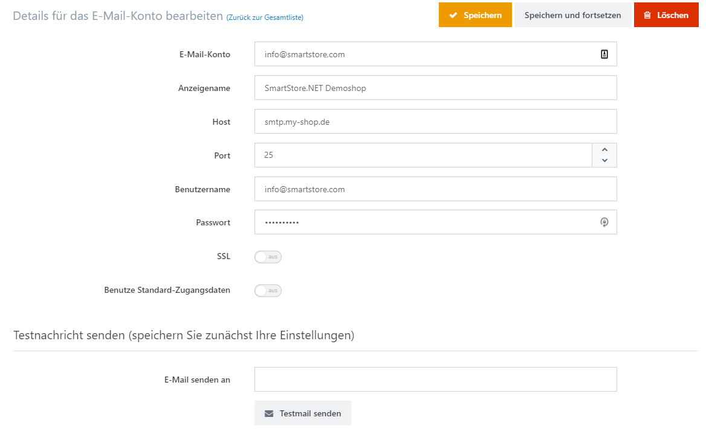

# E-Mail Konten einrichten

Smartstore informiert Ihre Kunden und Sie als Shopbetreiber automatisch per E-Mail über wichtige Vorgänge im Shop. Nach einer Bestellung erhält der Kunde beispielsweise eine Auftragsbestätigung, während Sie über den neuen Auftrag benachrichtigt werden. Für den Versand richten Sie unter **Konfiguration > E-Mail** mindestens ein E-Mail-Konto ein. Sie können beliebig viele Konten anlegen und diese unterschiedlichen Nachrichtenvorlagen zuordnen. Wie Sie die Zuordnung vornehmen, erfahren Sie unter [Nachrichtenvorlagen anpassen](../content-management/nachrichtenvorlagen-anpassen.md).

## Ein E-Mail-Konto einrichten


**Wo erhalte ich die notwendigen Daten?**

Die benötigten Zugangsdaten und SMTP-Einstellungen erhalten Sie von Ihrem E-Mail- oder Hosting-Anbieter. Häufig finden Sie diese im Kundenbereich des Anbieters bei den Einstellungen Ihres E-Mail-Kontos oder in der E-Mail zur Einrichtung Ihres Hosting-Pakets. Falls die Angaben dort fehlen, wenden Sie sich an den Support Ihres Anbieters.


Legen Sie unter **Konfiguration > E-Mail** ein neues Konto an und tragen Sie die SMTP-Daten Ihres Anbieters ein. Smartstore verwendet dieses Konto zum Versenden von Nachrichten; ein Postfach beim Anbieter wird dadurch nicht angelegt.

|                               |                                                                                                                                                                                                                                                                                                                      |
| ----------------------------- | -------------------------------------------------------------------------------------------------------------------------------------------------------------------------------------------------------------------------------------------------------------------------------------------------------------------- |
| E-Mail-Konto                  | Absenderadresse für E-Mails, die über dieses Konto versendet werden, z. B. bestellungen@meinshop.de.                                                                                                                                                                                                                 |
| Anzeigename                   | Angezeigter Absendername für dieses Konto, z. B. Mein Shop - Verkaufsabteilung.                                                                                                                                                                                                                                      |
| Host                          | Servername oder IP-Adresse des E-Mail-Servers.                                                                                                                                                                                                                                                                       |
| Port                          | SMTP-Port laut Vorgabe Ihres E-Mail-Anbieters. Smartstore trägt bei neuen Konten 25 vor; übernehmen Sie den für Ihren Server und die gewählte Verschlüsselung vorgesehenen Port.                                                                                                                                     |
| Benutzername                  | Benutzername für das E-Mail-Konto mit welchem Sie sich bei Ihrem Server authentifizieren                                                                                                                                                                                                                             |
| Passwort                      | Passwort für Ihren E-Mail-Server mit welchem Sie sich bei Ihrem Server authentifizieren                                                                                                                                                                                                                              |
| Verschlüsselung               | Wählen Sie die für Ihren SMTP-Server vorgesehene Verschlüsselung. Die verfügbaren Optionen sind unterhalb der Tabelle erklärt.                                                                                                                                                                                       |
| Benutze Standard-Zugangsdaten | Verwendet die Netzwerk-Zugangsdaten des Kontos, unter dem die Shop-Anwendung läuft, anstelle des eingetragenen Benutzernamens und Passworts. Aktivieren Sie dies nur, wenn Ihr SMTP-Server diese Anmeldung unterstützt. Für die Anmeldung mit den Zugangsdaten Ihres E-Mail-Anbieters bleibt die Option deaktiviert. |

Unter **Verschlüsselung** stehen folgende Optionen zur Verfügung:

* **Keine Verschlüsselung**: Die SMTP-Verbindung wird unverschlüsselt aufgebaut.
* **Automatisch**: Die Verschlüsselung wird automatisch gewählt. Wenn der Server keine Verschlüsselung unterstützt, kann die Verbindung unverschlüsselt fortgesetzt werden.
* **Sofort**: Die Verbindung wird von Beginn an mit SSL oder TLS verschlüsselt.
* **StartTLS**: Nach der Begrüßung durch den Server wird zwingend auf TLS umgestellt. Unterstützt der Server STARTTLS nicht, schlägt die Verbindung fehl.
* **StartTLS optional**: Nach der Begrüßung wird auf TLS umgestellt, sofern der Server dies unterstützt. Andernfalls bleibt die Verbindung unverschlüsselt.


**Test-E-Mail senden**

Speichern Sie das Konto zuerst. Anschließend steht in der Bearbeitungsansicht der Testversand zur Verfügung. Tragen Sie unter **E-Mail senden an** eine Empfängeradresse ein und senden Sie die Testnachricht. Der Test verwendet die bereits gespeicherten Kontodaten. Speichern Sie daher auch spätere Änderungen vor einem erneuten Test.

Eine Erfolgsmeldung bestätigt, dass der SMTP-Server die Nachricht angenommen hat. Prüfen Sie zusätzlich den Eingang beim Empfänger, gegebenenfalls auch im Spamordner. Bei einem Fehler zeigt Smartstore die Fehlermeldung unter dem Formular an.


## Standardkonto und Nachrichtenvorlagen

Das Standardkonto wählen Sie unter **Konfiguration > Einstellungen > Allgemeine Einstellungen**. In der Bearbeitungsansicht eines bestehenden E-Mail-Kontos führt **Ändern** neben der Standardkonto-Anzeige zu diesen Einstellungen. Weitere Informationen finden Sie unter [Allgemeine Einstellungen](einstellungen/allgemeine-einstellungen.md).

Nachrichtenvorlagen können ein eigenes E-Mail-Konto verwenden, bei Bedarf auch je Sprache. Das Standardkonto ersetzt diese Zuordnung nicht; es dient unter anderem als Ersatz, wenn das zugeordnete Konto nicht mehr vorhanden ist.

Ein als Standard verwendetes Konto und das letzte vorhandene Konto können nicht gelöscht werden. Prüfen Sie vor dem Löschen eines anderen Kontos die zugehörigen Nachrichtenvorlagen und weisen Sie ihnen bei Bedarf ein anderes Konto zu.
