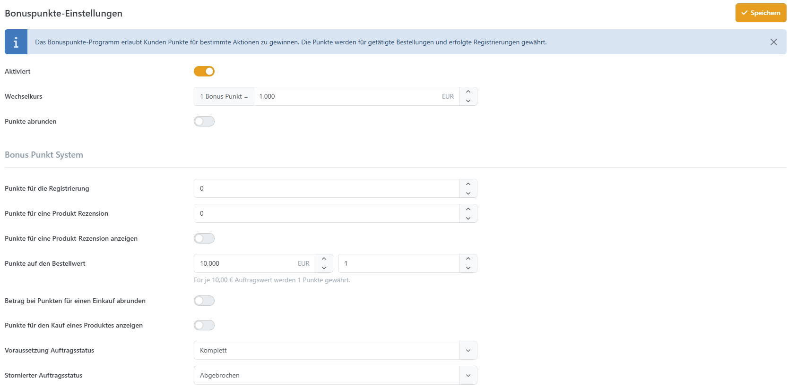

# Bonuspunkte-Einstellungen

Unter Konfiguration > Einstellungen > Bonuspunkte-Einstellungen legen Sie fest, wie Kunden Bonuspunkte sammeln und welchen Geldwert diese beim Einlösen haben.

| Einstellung                                   | Beschreibung                                                                                                                                                                                                                                                                                                                                                                                                           |
| --------------------------------------------- | ---------------------------------------------------------------------------------------------------------------------------------------------------------------------------------------------------------------------------------------------------------------------------------------------------------------------------------------------------------------------------------------------------------------------- |
| Aktiviert                                     | Aktiviert das Bonuspunkte-Programm. Kunden können Punkte sammeln und im Checkout einlösen.                                                                                                                                                                                                                                                                                                                             |
| Wechselkurs                                   | Legt den Geldwert eines Bonuspunkts in der primären Shopwährung fest, beispielsweise 1 Bonuspunkt = 0,10 EUR. Die Punkte für einen Einkauf werden unabhängig davon unter „Punkte auf den Bestellwert“ festgelegt.                                                                                                                                                                                                      |
| Punkte abrunden                               | Wenn aktiviert, wird die Anzahl der beim Einlösen benötigten Punkte abgerundet, andernfalls aufgerundet. Dies gilt, wenn das Punkteguthaben den verbleibenden Auftragsbetrag vollständig abdeckt. Die Berechnung der Punkte für einen Einkauf bleibt davon unberührt.                                                                                                                                                  |
| Punkte für die Registrierung                  | Anzahl der Bonuspunkte, die für eine erfolgreiche Registrierung gewährt werden. Bei 0 werden keine Punkte vergeben.                                                                                                                                                                                                                                                                                                    |
| Punkte für eine Produkt Rezension             | Anzahl der Bonuspunkte für eine genehmigte Produktrezension. Ist eine Freigabe erforderlich, werden die Punkte erst nach der Genehmigung gutgeschrieben. Wird die Genehmigung zurückgenommen, werden die Punkte wieder abgezogen.                                                                                                                                                                                      |
| Punkte für eine Produkt-Rezension anzeigen    | Zeigt auf der Produktdetailseite an, wie viele Punkte Kunden für eine Rezension erhalten und welchem Geldwert diese entsprechen. Dafür müssen Produktrezensionen erlaubt und Punkte für Rezensionen festgelegt sein.                                                                                                                                                                                                   |
| Punkte für das Abonnieren des Newsletters     | Anzahl der Bonuspunkte, die registrierte Kunden einmalig für das Abonnieren des Newsletters erhalten. Ist eine Bestätigung erforderlich, werden die Punkte erst danach gutgeschrieben. Erneutes Abonnieren bringt keine weiteren Punkte. Bei einer Abmeldung werden die Punkte nicht wieder abgezogen.                                                                                                                 |
| Punkte auf den Bestellwert                    | Legt fest, wie viele Punkte für einen bestimmten Einkaufsbetrag vergeben werden, beispielsweise 5 Punkte je 10,00 EUR. Grundlage ist die Netto-Zwischensumme in der primären Shopwährung, ohne Versand- und Zahlungsgebühren und vor Rabatten auf die Zwischensumme oder den Gesamtbetrag. Bei 0 Punkten werden keine Einkaufspunkte vergeben. Der Einkaufsbetrag muss größer als 0 sein, wenn Punkte vergeben werden. |
| Betrag bei Punkten für einen Einkauf abrunden | Wenn aktiviert, werden Punkte nur für vollständige Vielfache des eingetragenen Einkaufsbetrags vergeben. Andernfalls werden sie anteilig berechnet und auf ganze Punkte abgerundet. Ein Beispiel finden Sie unterhalb der Tabelle.                                                                                                                                                                                     |
| Punkte für den Kauf eines Produktes anzeigen  | Zeigt auf der Produktdetailseite an, wie viele Punkte Kunden für den Kauf erhalten und welchem Geldwert diese entsprechen. Die Anzeige berücksichtigt den Produktpreis und die ausgewählte Menge. Die Gutschrift erfolgt erst beim festgelegten Auftragsstatus.                                                                                                                                                        |
| Voraussetzung Auftragsstatus                  | Die Einkaufspunkte werden gutgeschrieben, sobald der Auftrag diesen Status erreicht, beispielsweise „Komplett“. Dies gilt nur für registrierte Kunden. Der Status „Unerledigt“ kann nicht verwendet werden.                                                                                                                                                                                                            |
| Stornierter Auftragsstatus                    | Bereits gutgeschriebene Einkaufspunkte werden wieder abgezogen, sobald der Auftrag diesen Status erreicht, beispielsweise „Abgebrochen“. Punkte für Registrierung, Rezensionen und Newsletter bleiben davon unberührt. Der Status „Unerledigt“ kann nicht verwendet werden.                                                                                                                                            |

## Beispiel: Punkte für einen Einkauf

Sie vergeben **5 Punkte je 10,00 EUR**. Die Netto-Zwischensumme des Auftrags beträgt **25,00 EUR**.

Die Einstellung „Betrag bei Punkten für einen Einkauf abrunden“ bestimmt die Berechnung:

| Einstellung | Berechnung                                                                   | Gutschrift |
| ----------- | ---------------------------------------------------------------------------- | ---------- |
| Aktiviert   | Nur volle 10-EUR-Beträge zählen: 2 × 5 Punkte.                               | 10 Punkte  |
| Deaktiviert | Anteilig: 25 ÷ 10 × 5 = 12,5 Punkte. Anschließend auf ganze Punkte abrunden. | 12 Punkte  |

## Beispiel: Punkte einlösen

Ein Bonuspunkt entspricht **0,10 EUR**. Der verbleibende Auftragsbetrag beträgt **1,05 EUR**. Das Punkteguthaben reicht aus, um diesen Betrag vollständig zu bezahlen.

Rechnerisch benötigt: **1,05 ÷ 0,10 = 10,5 Punkte**.

| „Punkte abrunden“ | Rundung                | Eingelöste Punkte |
| ----------------- | ---------------------- | ----------------- |
| Aktiviert         | 10,5 wird abgerundet.  | 10 Punkte         |
| Deaktiviert       | 10,5 wird aufgerundet. | 11 Punkte         |

Wie Kunden ihre Punkte einlösen, beschreibt [Mit Bonuspunkten arbeiten](../../kunden/mit-bonuspunkten-arbeiten.md). Informationen zur Punktehistorie und zu manuellen Gutschriften oder Abzügen finden Sie unter [Kunden verwalten](../../kunden/kunden-verwalten.md).
