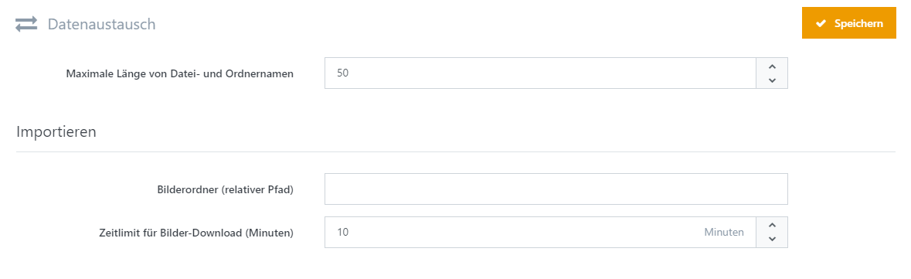

# Datenaustausch-Einstellungen

|                                           |                                                                                                                                                                                                                                                                                                                                                                                                                                      |
| ----------------------------------------- | ------------------------------------------------------------------------------------------------------------------------------------------------------------------------------------------------------------------------------------------------------------------------------------------------------------------------------------------------------------------------------------------------------------------------------------ |
| Maximale Länge von Datei- und Ordnernamen | Begrenzt die Namen automatisch angelegter Import- und Exportordner sowie erzeugter Exportdateien. Standard: 50 Zeichen; der Wert muss mindestens 4 betragen. Dateiendungen und automatisch ergänzte Kennungen können zusätzlich hinzukommen.                                                                                                                                                                                         |
| Bilderordner (relativer Pfad)             | Legt fest, wo Smartstore auf dem Server nach Bildern sucht, die in der Importdatei mit einem relativen Pfad angegeben sind. Der Ordner ist relativ zum Verzeichnis des jeweiligen Importprofils. Bei Content\Bilder wird beispielsweise artikel.jpg aus dem Unterordner Content\Bilder dieses Profils eingelesen. Bleibt das Feld leer, dient das Profilverzeichnis als Ausgangspunkt. Bild-URLs werden stattdessen heruntergeladen. |
| Zeitlimit für Bilder-Download (Minuten)   | Legt fest, wie lange Smartstore bei einer Bildanforderung auf die Antwort des Servers wartet. Standard: 10 Minuten; der Wert muss größer als 0 sein. Dies ist kein Zeitlimit für den gesamten Import.                                                                                                                                                                                                                                |
| E-Mail zum Importabschluss                | Wählen Sie Immer, Bei einem Fehler oder Nie. Standard ist Immer. Die Abschluss-E-Mail enthält eine Zusammenfassung der importierten Datensätze sowie der Fehler und Warnungen. Bei einem Fehler wird sie nur gesendet, wenn der Import Fehler meldet; Warnungen allein lösen keine E-Mail aus.                                                                                                                                       |


Die Abschluss-E-Mail wird über das Standard-E-Mail-Konto versendet. Empfänger ist die in den Kontaktdaten hinterlegte Webmaster-Adresse. Fehlt sie, verwendet Smartstore die Firmenadresse und andernfalls die Adresse des Standard-E-Mail-Kontos. Für den Versand muss das Standard-E-Mail-Konto eingerichtet sein.

