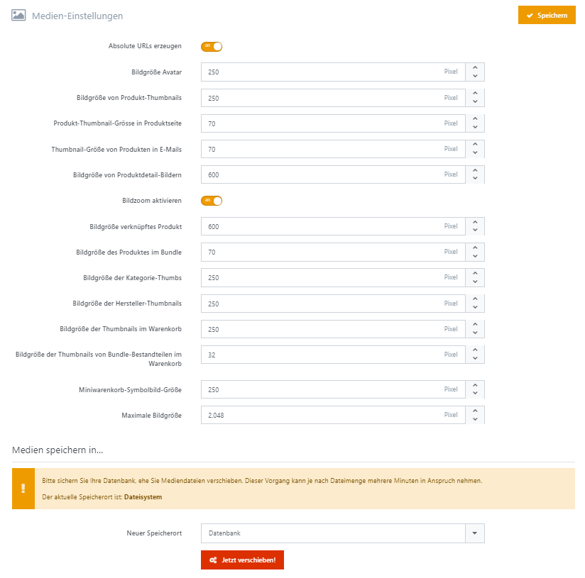

# Medien-Einstellungen

Unter **Konfiguration > Einstellungen > Medien-Einstellungen** steuern Sie die Anzeige, Verarbeitung und Speicherung von Mediendateien. Die Einstellungen verteilen sich auf die Registerkarten Allgemein, Dateispeicher und Erweitert.

## Allgemein

|                                                 |                                                                                                                                                                                                                                                                                  |
| ----------------------------------------------- | -------------------------------------------------------------------------------------------------------------------------------------------------------------------------------------------------------------------------------------------------------------------------------- |
| Absolute URLs erzeugen                          | Erzeugt absolute URLs für Mediendateien, indem der aktuelle Hostname vorangestellt wird (z. B. [http://meinshop.de/media/image/1.jpg](http://meinshop.de/media/image/1.jpg) statt /media/image/1.jpg). Hat keine Auswirkung, wenn für den Store eine CDN-URL eingerichtet wurde. |
| Verwaiste Dateien automatisch löschen           | Markiert Mediendateien zur Bereinigung, wenn ihre letzte von Smartstore erfasste Zuordnung entfernt wird. Die geplante Bereinigung löscht solche Dateien erst, wenn sie seit mindestens drei Stunden vorübergehend gespeichert sind.                                             |
| Bildzoom aktivieren                             | Aktiviert die Vergrößerung von Produktdetailbildern beim Bewegen des Mauszeigers über das Bild.                                                                                                                                                                                  |
| Maximale Dateigröße                             | Begrenzt die Größe einer hochgeladenen Mediendatei in KB. Der Standardwert 102400 entspricht 100 MB.                                                                                                                                                                             |
| Maximale Bildgröße                              | Begrenzt die längste Bildseite in Pixeln. Größere Bilder werden beim Upload auf diese Größe verkleinert, sofern das Bildformat verarbeitet werden kann.                                                                                                                          |
| Gallerie-Thumbnail                              | Größe der kleinen Vorschaubilder zur Bildauswahl auf der Produktdetailseite, in Pixeln.                                                                                                                                                                                          |
| Produktliste                                    | Größe der Produktbilder in Produktlisten, in Pixeln.                                                                                                                                                                                                                             |
| Produktdetail                                   | Größe des großen Bildes in der Bildergalerie auf der Produktdetailseite, in Pixeln.                                                                                                                                                                                              |
| Verknüpftes (Gruppen)-Produkt                   | Größe des Detailbildes eines mit einem Gruppenprodukt verknüpften Produkts, in Pixeln.                                                                                                                                                                                           |
| Verknüpftes (Gruppen)-Produkt in der Titelzeile | Größe des Vorschaubildes eines verknüpften Produkts in der Titelzeile, in Pixeln.                                                                                                                                                                                                |
| Bundle Stückliste                               | Größe der Produktbilder in der Bundle-Stückliste, in Pixeln.                                                                                                                                                                                                                     |
| Produkte in E-Mails                             | Größe der Produktvorschaubilder in E-Mails, in Pixeln.                                                                                                                                                                                                                           |
| Warengruppen                                    | Größe der Warengruppenbilder, in Pixeln. Gemeint sind die Bilder der Warengruppen selbst.                                                                                                                                                                                        |
| Marken                                          | Größe der Markenbilder, in Pixeln. Gemeint sind die Bilder beziehungsweise Logos der Marken selbst.                                                                                                                                                                              |
| Warenkorb                                       | Standardgröße in Pixeln für Produktthumbnails im Warenkorb und auf dem Wunschzettel.                                                                                                                                                                                             |
| Bundle Stückliste im Warenkorb                  | Standardgröße in Pixeln der Produktthumbnails von Bundle-Bestandteilen im Warenkorb und auf dem Wunschzettel.                                                                                                                                                                    |
| Mini-Warenkorb                                  | Größe der Produktvorschaubilder im Mini-Warenkorb, in Pixeln.                                                                                                                                                                                                                    |
| Kundenavatar                                    | Standardgröße in Pixeln für den Avatar.                                                                                                                                                                                                                                          |

## Medientypen

Die Felder **Bild, Video, Audio, Dokument, Text und Sonstige** legen die erlaubten Dateiendungen der jeweiligen Mediengruppe fest. Tragen Sie die Endungen ohne Punkt und durch Leerzeichen getrennt ein, beispielsweise jpg png webp für Bilder. Ein leeres Feld verwendet wieder die Standardendungen dieser Gruppe. Einzelne Uploadfelder können die Auswahl zusätzlich einschränken.

## Dateispeicher

Die Registerkarte **Dateispeicher** zeigt den aktuellen Speicheranbieter. Unter **Speicher wechseln** wählen Sie das Ziel aus, etwa Datenbank oder Dateisystem. Mit **Jetzt verschieben** und der anschließenden Bestätigung übertragen Sie die vorhandenen Mediendateien zum neuen Anbieter. Der Wechsel betrifft den gemeinsamen Medienspeicher aller Shops; er wird erst nach erfolgreicher Übertragung übernommen.


Sichern Sie vor dem Speicherwechsel die Datenbank und die Mediendateien. Je nach Dateimenge kann die Übertragung mehrere Minuten dauern.


## Erweitert

Hier legen Sie fest, wie Smartstore Bilder verarbeitet und wie Browser Mediendateien zwischenspeichern. Die Bildverarbeitungsoptionen wirken beim Erzeugen beziehungsweise erneuten Verarbeiten von Bildern.

| Einstellung                                           | Wirkung                                                                                                                                                                                                                                                              |
| ----------------------------------------------------- | -------------------------------------------------------------------------------------------------------------------------------------------------------------------------------------------------------------------------------------------------------------------- |
| Resampling                                            | Bestimmt das Verfahren zur Neuberechnung der Bildpunkte beim Skalieren. Standard ist Bicubic.                                                                                                                                                                        |
| Bildqualität                                          | JPEG-Qualität beim Verarbeiten von Bildern. Ein höherer Wert erhält mehr Details, führt aber meist zu größeren Dateien. Standard ist 85.                                                                                                                             |
| JPEG-Farbtyp                                          | Bestimmt die Farbdarstellung und Farbunterabtastung beim Speichern von JPEG-Bildern.                                                                                                                                                                                 |
| PNG-Kompressionsstufe                                 | Bestimmt die Kompression von PNG-Bildern. Höhere Kompression kann mehr Verarbeitungszeit benötigen.                                                                                                                                                                  |
| PNG-Quantisierung                                     | Wählt das Verfahren zur Bildung einer Farbpalette für PNG-Bilder.                                                                                                                                                                                                    |
| PNG-Interlacing                                       | Ermöglicht den schrittweisen Bildaufbau beim Laden von PNG-Bildern.                                                                                                                                                                                                  |
| PNG-Metadaten ignorieren                              | Lässt Metadaten beim Kodieren von PNG-Bildern weg.                                                                                                                                                                                                                   |
| GIF-Quantisierung                                     | Wählt das Verfahren zur Bildung der Farbpalette für GIF-Bilder.                                                                                                                                                                                                      |
| Eingebettete Base64-Bilder beim Speichern extrahieren | Lagert direkt im HTML eingebettete Bilder in den Medienspeicher aus und ersetzt die eingebetteten Daten durch einen Medienpfad. Dies geschieht beim Anlegen oder Ändern der langen Beschreibung von Produkten, Warengruppen und Marken sowie des Inhalts von Seiten. |

**Response Caching** steuert die Cache-Vorgaben für ausgelieferte Mediendateien:

| Einstellung                  | Wirkung                                                                                                                                                                      |
| ---------------------------- | ---------------------------------------------------------------------------------------------------------------------------------------------------------------------------- |
| Cache-Dauer                  | Gültigkeitsdauer in Sekunden. Standard sind 604800 Sekunden, also sieben Tage. Bei 0 verwendet Smartstore eine Minute.                                                       |
| Cache-Ort                    | Any erlaubt das Zwischenspeichern im Browser und in gemeinsamen Caches; Client nur im Browser. None verlangt eine erneute Prüfung beim Server vor der Wiederverwendung.      |
| Nicht speichern              | Sendet die Vorgabe no-store: Browser und vorgeschaltete Caches sollen die Antwort nicht speichern. Die Cache-Dauer wird dabei ignoriert.                                     |
| Dateiversion an URL anhängen | Ergänzt die Medien-URL um eine Kennung aus Änderungsdatum und Dateigröße. Ändert sich die Datei, entsteht eine neue URL, damit der Browser nicht seine alte Kopie verwendet. |
