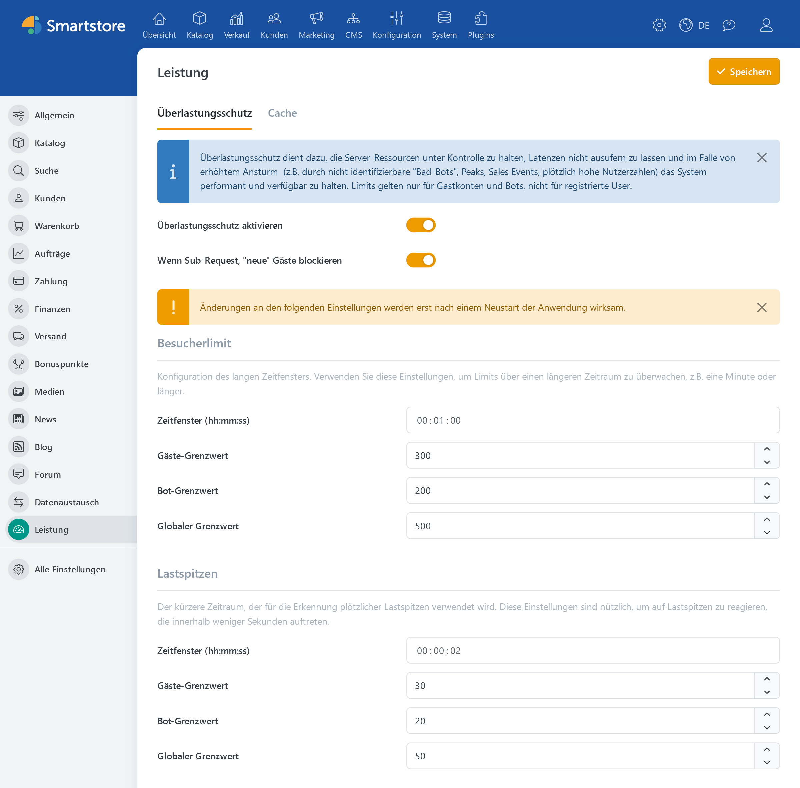

# Überlastungsschutz

Der Überlastungsschutz ist seit Smartstore v6 verfügbar und befindet sich unter **Konfiguration > Einstellungen > Leistung** auf der Registerkarte **Überlastungsschutz**.

Diese leistungsstarke Funktion stellt die Stabilität und Leistung des Systems auch unter hoher Belastung sicher. Er schützt vor einer Überlastung der Serverressourcen, verhindert ein starkes Ansteigen der Latenzzeiten und hält die Plattform auch bei plötzlichen Lastspitzen wie Werbeaktionen, unerwarteten Besucheranstiegen oder Bot-Attacken funktionsfähig. Dabei konzentriert sich der Überlastungsschutz auf die Verwaltung und Beschränkung des Zugriffs von Gastbenutzern und Bots, während angemeldete Benutzer von den Einschränkungen ausgenommen bleiben. Mit flexibel einstellbaren Zeitfenstern und Grenzwerten für unterschiedliche Nutzergruppen können sowohl längerfristige Besucherströme als auch kurzfristige Lastspitzen effektiv gesteuert werden. Das Feature bietet somit eine maßgeschneiderte Möglichkeit, das Nutzererlebnis zu verbessern und die Verfügbarkeit der Plattform zu gewährleisten.

Typische Anwendungsfälle:

* Abwehr von „Bad-Bots“
* Management von plötzlichen Nutzeranstiegen (z.B. durch Verkaufsveranstaltungen)
* Schutz vor Performance-Einbußen durch unerwartet hohen Traffic

Ein zentrales Problem, das durch den Überlastungsschutz adressiert wird, ist die massenhafte Generierung von Gastkonten durch nicht identifizierbare „Bad-Bots“. Diese Bots umgehen häufig herkömmliche Erkennungsmechanismen, indem sie Cookies nicht akzeptieren und bei jeder Anfrage neue Sessions erzeugen. Der Überlastungsschutz kann diese Aktivität zwar nicht vollständig verhindern, aber durch die Begrenzung der Anzahl von Gästeanfragen pro Zeitfenster und die Reduzierung unnötiger Systembelastung wirksam abfedern. Insbesondere das Blockieren neuer Gäste für sekundäre Anfragen wie AJAX-Anfragen oder Skriptaufrufe reduziert die durch Bots verursachte Systembelastung.

## Allgemeine Einstellungen

| **Option**                                    | **Beschreibung**                                                                                                                                                                                                                                                                                                |
| --------------------------------------------- | --------------------------------------------------------------------------------------------------------------------------------------------------------------------------------------------------------------------------------------------------------------------------------------------------------------- |
| **Überlastungsschutz aktivieren**             | Wendet die definierten Richtlinien an. Wenn diese Option deaktiviert ist, werden keine Zugriffsbeschränkungen für Gäste und Bots angewendet. Die Begrenzung des E-Mail-Versands gilt unabhängig davon.                                                                                                          |
| **Wenn Sub-Request, "neue" Gäste blockieren** | Blockiert neue Gastbenutzer für untergeordnete Anfragen (z. B. AJAX, POST, Skripte, Mediendateien). Diese Einstellung verhindert, dass "Bad Bots", die keine Cookies akzeptieren und sich durch wechselnde IP-Adressen oder User-Agent-Strings tarnen, neue Gastsitzungen für untergeordnete Anfragen erzeugen. |


Änderungen an den Einstellungen für **Besucherlimit**, **Lastspitzen** und **E-Mail-Versand** werden erst nach einem Neustart der Anwendung wirksam.


## Besucherlimit (Langzeitüberwachung)

Mit diesen Einstellungen können Grenzwerte über einen längeren Zeitraum (z. B. eine Minute oder länger) konfiguriert werden.

| **Option**             | **Beschreibung**                                                                                                                                                                                                         |
| ---------------------- | ------------------------------------------------------------------------------------------------------------------------------------------------------------------------------------------------------------------------ |
| **Zeitfenster**        | Dauer des Zeitfensters (hh:mm:ss), in dem der anhaltende Traffic gemessen wird.                                                                                                                                          |
| **Gäste-Grenzwert**    | Maximale Anzahl von Hauptanfragen aller Gäste zusammen innerhalb des festgelegten Zeitfensters. Ein leerer Wert bedeutet: keine Begrenzung.                                                                              |
| **Bot-Grenzwert**      | Maximale Anzahl von Hauptanfragen aller erkannten Bots zusammen innerhalb des festgelegten Zeitfensters. Ein leerer Wert bedeutet: keine Begrenzung.                                                                     |
| **Globaler Grenzwert** | Kombiniertes Limit für die Hauptanfragen von Gästen und erkannten Bots. Wenn die kumulierten Anfragen beider Typen dieses Limit überschreiten, werden weitere Anfragen abgewiesen. Ein leerer Wert bedeutet: kein Limit. |

## Lastspitzen (Kurzzeitüberwachung)

Diese Einstellungen werden bei plötzlichen Traffic-Spitzen über einen sehr kurzen Zeitraum (z.B. einige Sekunden) wirksam.

| **Option**             | **Beschreibung**                                                                                                                                                                                                         |
| ---------------------- | ------------------------------------------------------------------------------------------------------------------------------------------------------------------------------------------------------------------------ |
| **Zeitfenster**        | Dauer des Zeitfensters (hh:mm:ss), in dem Lastspitzen erkannt werden.                                                                                                                                                    |
| **Gäste-Grenzwert**    | Maximale Anzahl von Hauptanfragen aller Gäste zusammen innerhalb des festgelegten Zeitfensters. Ein leerer Wert bedeutet: keine Begrenzung.                                                                              |
| **Bot-Grenzwert**      | Maximale Anzahl von Hauptanfragen aller erkannten Bots zusammen innerhalb des festgelegten Zeitfensters. Ein leerer Wert bedeutet: keine Begrenzung.                                                                     |
| **Globaler Grenzwert** | Kombiniertes Limit für die Hauptanfragen von Gästen und erkannten Bots. Wenn die kumulierten Anfragen beider Typen dieses Limit überschreiten, werden weitere Anfragen abgewiesen. Ein leerer Wert bedeutet: kein Limit. |


**Globaler Grenzwert**: Dieses Limit gilt unabhängig von den separaten Limits für Gäste und Bots. Sobald dieses Limit erreicht ist, blockiert das System weitere Hauptanfragen von Gästen und Bots, auch wenn die anderen Limits nicht überschritten sind.


## Wenn ein Grenzwert erreicht ist

Besucherlimit und Lastspitzen werden gemeinsam angewendet. Eine Anfrage muss sowohl das jeweilige Gäste- oder Bot-Limit als auch das globale Limit in beiden Zeitfenstern erfüllen. Ist ein erforderliches Kontingent erschöpft, antwortet Smartstore mit HTTP 429 (Too many requests). Die Anfrage wird nicht in eine Warteschlange gestellt.

Die Kontingente werden nach Ablauf ihres jeweiligen Zeitfensters wieder aufgefüllt. Danach sind erneut Anfragen möglich, sofern auch die übrigen Limits dies zulassen. Ein erschöpftes Langzeitkontingent wird deshalb nicht schon durch den Ablauf des kurzen Lastspitzenfensters freigegeben.

## E-Mail-Versand

Dieser Bereich begrenzt den automatischen Versand von E-Mails aus der Nachrichtenwarteschlange. So können Sie Versandspitzen abfangen und die Versandrate an die Vorgaben Ihres E-Mail-Anbieters anpassen. Bei ausgeschöpftem Kontingent bleiben ausstehende Nachrichten in der Warteschlange und können bei einem späteren Lauf der Versandaufgabe versendet werden.

| **Option**                 | **Beschreibung**                                                                                                                      |
| -------------------------- | ------------------------------------------------------------------------------------------------------------------------------------- |
| **Zeitfenster (hh:mm:ss)** | Zeitraum, nach dem das Versandkontingent wieder aufgefüllt wird. Der Wert muss größer als null sein.                                  |
| **Grenzwert**              | Maximale Anzahl der automatisch zu versendenden E-Mails innerhalb des Zeitfensters. Ein leerer Wert hebt diese Versandbegrenzung auf. |


Die E-Mail-Begrenzung gilt auch bei ausgeschaltetem Überlastungsschutz für Gäste und Bots. Zum Ändern der Versandwerte blenden Sie die Felder über **Überlastungsschutz aktivieren** ein. Wenn Sie die Versandbegrenzung aufheben möchten, leeren Sie deren Grenzwert und starten Sie die Anwendung nach dem Speichern neu.

