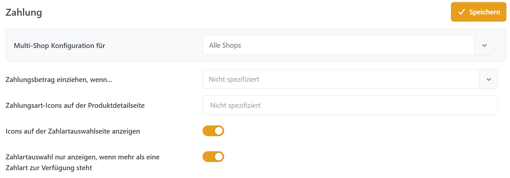

# Zahlung

Unter **Konfiguration > Einstellungen > Zahlung** legen Sie fest, wann autorisierte Zahlungen eingezogen werden und wie Zahlungsarten im Shop angezeigt werden. Die einzelnen Zahlungsarten aktivieren und konfigurieren Sie unter [Zahlungsarten einrichten](../zahlungsarten-einrichten.md).

|                                                                             |                                                                                                                                                                                                                                                                                                                                                                                                                     |
| --------------------------------------------------------------------------- | ------------------------------------------------------------------------------------------------------------------------------------------------------------------------------------------------------------------------------------------------------------------------------------------------------------------------------------------------------------------------------------------------------------------- |
| Zahlungsbetrag einziehen, wenn…                                             | Legt fest, wann eine zuvor autorisierte Zahlung automatisch gebucht wird: wenn der Auftrag als versendet, ausgeliefert oder abgeschlossen markiert wird. Ohne Auswahl erfolgt über diese Einstellung kein automatischer Einzug. Die Zahlungsart muss Buchungen unterstützen; die Zahlung muss noch autorisiert sein und der Auftrag darf weder ausstehend noch storniert sein.                                      |
| Zahlungsart-Icons auf der Produktdetailseite                                | Wählen Sie die aktiven Zahlungsarten, deren Symbole auf Produktdetailseiten erscheinen sollen. Ohne Auswahl werden dort keine Zahlungsart-Icons angezeigt. Angezeigt werden nur Symbole, die das jeweilige Plugin bereitstellt. Die Auswahl dient der Information; welche Zahlungsarten ein Kunde tatsächlich nutzen kann, wird erst im Checkout anhand des Warenkorbs und der geltenden Einschränkungen ermittelt. |
| Icons auf der Zahlartauswahlseite anzeigen                                  | Zeigt die von den Zahlungsarten bereitgestellten Symbole zusätzlich zu deren Namen auf der Zahlartauswahlseite im Checkout an. Diese Einstellung ist unabhängig von den Icons auf der Produktdetailseite.                                                                                                                                                                                                           |
| Zahlartauswahl nur anzeigen, wenn mehr als eine Zahlart zur Verfügung steht | Überspringt die Zahlartauswahl im Checkout und wählt die einzige verfügbare Zahlungsart automatisch aus. Maßgeblich sind die für den aktuellen Warenkorb verfügbaren Zahlungsarten. Erfordert die Zahlungsart Eingaben des Kunden oder ausdrücklich die Auswahlseite, bleibt der Schritt auch bei nur einer Zahlart sichtbar.                                                                                       |
