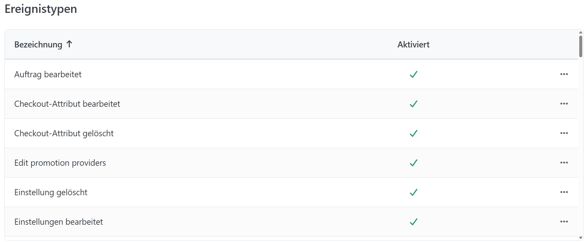

# Ereignistypen einrichten

Mit Ereignistypen legen Sie fest, welche Vorgänge Smartstore im **Aktivitätslog** protokolliert. Dazu gehören Aktionen im Backend und im öffentlichen Shop. Die Liste enthält die von Smartstore und installierten Plugins bereitgestellten Ereignistypen.

Bei der Installation von Smartstore werden verschiedene Ereignistypen angelegt. Bei einer Neuinstallation sind viele administrative Ereignisse bereits aktiviert, während Ereignisse aus dem öffentlichen Shop standardmäßig deaktiviert sind.

Unter **Konfiguration > Ereignistypen** aktivieren oder deaktivieren Sie die Protokollierung der gewünschten Vorgänge über **Aktiviert**. Damit steuern Sie die Aufzeichnung für alle Kunden, bei denen der jeweilige Vorgang auftritt.


Eine Aktivierung erfasst nur künftig auftretende Vorgänge. Vergangene Aktivitäten werden nicht nachträglich ergänzt. Wenn Sie einen Ereignistyp deaktivieren, bleiben bereits protokollierte Einträge erhalten.


Die aufgezeichneten Vorgänge finden Sie unter **Kunden > Aktivitätslog**. Die Auswertung beschreibt die Seite [Kundenverhalten analysieren](../kunden/kundenverhalten-analysieren.md).

## Einige interessante Ereignistypen

| Ereignistyp                                            | Protokollierte Aktivität                                                                                  |
| ------------------------------------------------------ | --------------------------------------------------------------------------------------------------------- |
| Öffentlicher Shop. Produktrezension hinzugefügt        | Fügt ein Ereignis zum Log hinzu, sobald eine Produktrezension zu einem Ihrer Produkte geschrieben wurde.  |
| Öffentlicher Shop. Hat einen neuen Auftrag erteilt     | Fügt ein Ereignis zum Log hinzu, sobald ein Kunde eine Bestellung aufgegeben hat.                         |
| Öffentlicher Shop. Produkt zur Wunschliste hinzugefügt | Fügt ein Ereignis zum Log hinzu, sobald ein Produkt auf die Wunschliste eines Ihrer Kunden gesetzt wurde. |

