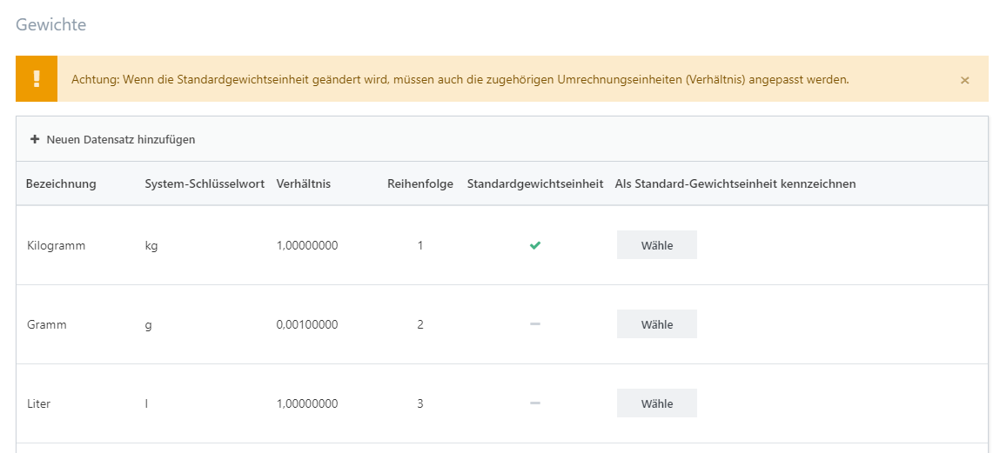
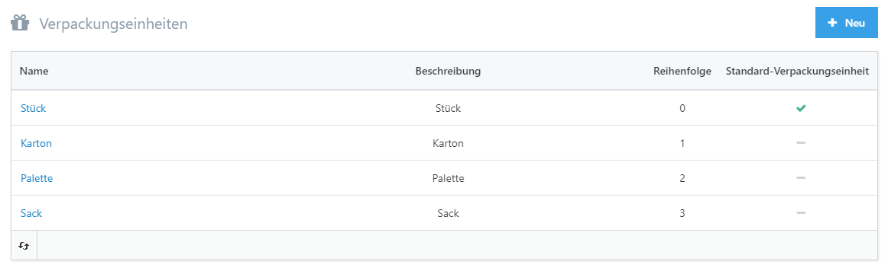
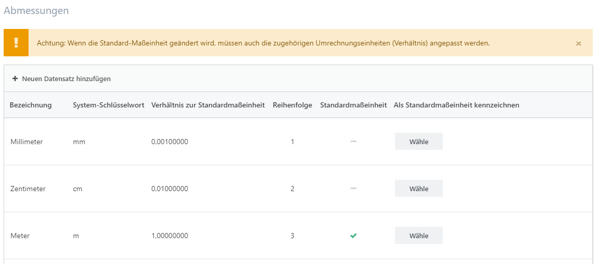

# Gewichte, Verpackungseinheiten & Abmessungen verwalten

## Gewichte verwalten

Sie können Gewichte verwalten, indem Sie zu **Konfiguration > Listen > Gewichte** gehen. Die Gewichtseinheit, die Sie beim Konfigurieren von Produkten und Versandarten verwenden, ist immer die **Standardgewichtseinheit**. Das **Verhältnis** wird verwendet, wenn Gewichtswerte in andere Gewichtseinheiten konvertiert werden müssen (z. B. wenn bestimmte Versandarten den Gewichtswert in einer Einheit übermitteln müssen, die von der **Standardgewichtseinheit** abweicht).

Beim Anlegen oder Bearbeiten hinterlegen Sie den **Namen** der Einheit und das **System-Schlüsselwort** als technische Kennung. Den Namen können Sie für die Shopsprachen übersetzen. Das **Verhältnis** gibt an, wie viele Einheiten einer Standardgewichtseinheit entsprechen. Ist Kilogramm der Standard, tragen Sie für Gramm 1000 ein: 1 kg = 1000 g. Für die Standardeinheit selbst gilt das Verhältnis 1.

Mit **Reihenfolge** bestimmen Sie die Sortierung in der Liste. Die Standardeinheit wählen Sie im Bearbeitungsdialog oder über **Als Standard festlegen** in der Liste. Die aktuelle Standardeinheit kann nicht gelöscht werden.


Wenn Sie Ihre **Standardgewichtseinheit** wechseln, müssen auch die zugehörigen Umrechnungsverhältnisse (Spalte: **Verhältnis**) angepasst werden. Bereits gespeicherte Produktgewichte und gewichtsabhängige Versandbedingungen werden dabei nicht automatisch umgerechnet. Passen Sie auch diese Werte an die neue Einheit an. Aus einem Produktgewicht von 2 kg muss beim Wechsel zu Gramm beispielsweise der Wert 2000 werden.


## Verpackungseinheiten verwalten

Sie können Verpackungseinheiten verwalten, indem Sie zu **Konfiguration > Listen > Verpackungseinheiten** navigieren. Die Verpackungseinheiten, die Sie hier anlegen, können bei Produkten in der Registerkarte [Allgemein](../../verwalten/katalog/produkte-verwalten/produkte-erstellen-und-bearbeiten.md) verwendet werden.

Eine Verpackungseinheit bezeichnet die bestellbare Einheit eines Produkts, etwa eine Flasche oder einen Karton. Sie erscheint bei der Mengenauswahl im Shop. Die Bezeichnung Karton legt dabei noch nicht fest, wie viele Stück ein Karton enthält. Eine abweichende Verpackungseinheit können Sie auch für eine Variantenkombination hinterlegen.

Unter **Name** geben Sie die Einzahl ein, beispielsweise Flasche, und unter **Name Mehrzahl** die Mehrzahl Flaschen. Damit kann der Shop passend zur Bestellmenge 1 Flasche oder 2 Flaschen anzeigen. Eine **Beschreibung** können Sie zusätzlich hinterlegen. Name, Mehrzahl und Beschreibung lassen sich je Shopsprache übersetzen. Mit **Reihenfolge** legen Sie die Sortierung in der Liste fest.

Mit **Standard-Verpackungseinheit** beziehungsweise **Als Standard festlegen** bestimmen Sie die Einheit für Produkte ohne eigene Zuordnung. Sie wird dort verwendet, wenn in den Katalogeinstellungen die Option **Standard-Verpackungseinheit verwenden** aktiviert ist. Einer ausdrücklich zugewiesenen Verpackungseinheit wird stets Vorrang gegeben.

Die Standard-Verpackungseinheit sowie Einheiten, die noch Produkten oder Variantenkombinationen zugewiesen sind, können nicht gelöscht werden. Legen Sie gegebenenfalls zuerst einen anderen Standard fest und ändern Sie die betreffenden Zuordnungen.

Weitere Informationen zur Standardauswahl finden Sie in den [Katalogeinstellungen](einstellungen/katalogeinstellungen.md).

## Abmessungen verwalten

Sie können Abmessungen verwalten, indem Sie zu **Konfiguration > Listen > Abmessungen** gehen. Die Maßeinheit, die verwendet wird, wenn Sie Produkte konfigurieren, ist stets die **Standardmaßeinheit**. Das **Verhältnis zur Standardmaßeinheit** wird verwendet, wenn die Werte der Abmessungen in andere Maßeinheiten konvertiert werden müssen (z. B. wenn bestimmte Versandarten Länge, Breite und Höhe in einer Einheit übermitteln müssen, die von der **Standardmaßeinheit** abweicht).

Wie bei den Gewichtseinheiten hinterlegen Sie **Name**, **System-Schlüsselwort**, **Verhältnis zur Standardmaßeinheit** und **Reihenfolge** und wählen bei Bedarf die Standardeinheit. Bei Zentimeter als Standard beträgt das Verhältnis für Millimeter 10 und für Meter 0,01: 1 cm = 10 mm = 0,01 m. Die aktuelle Standardmaßeinheit kann nicht gelöscht werden.


Wenn die **Standard-Maßeinheit** geändert wird, müssen auch die zugehörigen Umrechnungsverhältnisse (Verhältnis) angepasst werden. Bereits gespeicherte Produktabmessungen werden dabei nicht automatisch umgerechnet. Beim Wechsel von Zentimeter zu Millimeter muss beispielsweise eine Länge von 20 auf 200 angepasst werden. Prüfen Sie Länge, Breite und Höhe Ihrer Produkte entsprechend.


