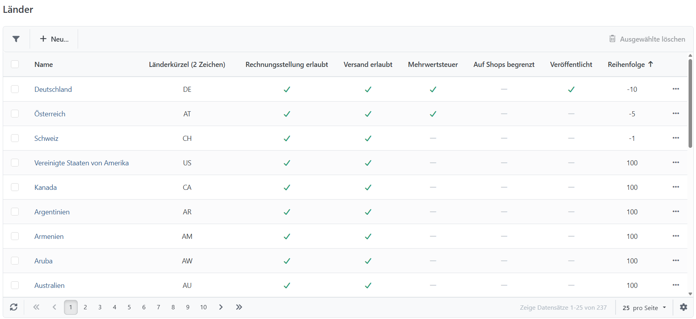
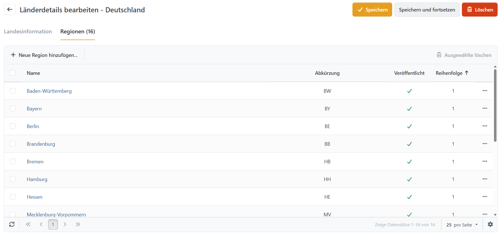

# Länder und Regionen verwalten

Einige Shopfunktionen beziehen oder liefern Daten auf Grundlage Ihrer Ländereinstellungen. So legen Sie fest, welche Länder für Rechnungs- und Lieferadressen zur Verfügung stehen. Auch die Steuer- und Versandkostenberechnung kann das Land einer Adresse berücksichtigen. Um Länder in Ihrem Shop zu verwalten, gehen Sie zu **Konfiguration > Regionale Einstellungen > Länder**.



## Landesinformationen

|                           |                                                                                                                                                                                                                                                                                        |
| ------------------------- | -------------------------------------------------------------------------------------------------------------------------------------------------------------------------------------------------------------------------------------------------------------------------------------- |
| Name                      | Name des Landes. Für die verschiedenen Shopsprachen können Sie übersetzte Namen hinterlegen.                                                                                                                                                                                           |
| Veröffentlicht            | Legt fest, ob das Land in den Länderauswahllisten des Shops angeboten wird.                                                                                                                                                                                                            |
| Anzeigereihenfolge        | Kleinere Werte erscheinen vor größeren. Bei gleichem Wert wird nach dem Landesnamen sortiert; der Wert 1 garantiert daher nicht den ersten Platz.                                                                                                                                      |
| Rechnungsstellung erlaubt | Legt fest, ob Kunden dieses Land für ihre Rechnungsadresse im Checkout verwenden können.                                                                                                                                                                                               |
| Versand erlaubt           | Legt fest, ob Kunden dieses Land für ihre Lieferadresse im Checkout verwenden können. Verfügbare Versandarten und Versandkosten werden separat eingerichtet.                                                                                                                           |
| Mehrwertsteuer            | Kennzeichnet das Land für die EU-Umsatzsteuerbehandlung. Bei aktivierter EU-Umsatzsteuerfunktion werden Kunden steuerbefreit, wenn das Land der für die Steuerberechnung verwendeten Adresse nicht dieser Mehrwertsteuerzone zugeordnet ist. Das Feld legt keinen Steuersatz fest.     |
| Cookie-Manager anzeigen   | Legt fest, ob der Cookie-Manager Besuchern aus diesem Land angezeigt wird, wenn seine Anzeige in den Datenschutzeinstellungen vom Land abhängt. Smartstore ermittelt das Land anhand der IP-Adresse. Bei deaktivierter Option wird der Cookie-Manager für dieses Land nicht angezeigt. |
| Standardwährung           | Währung, die Smartstore anhand des über die IP-Adresse ermittelten Landes vorauswählt. Sie muss veröffentlicht und für den aktuellen Shop verfügbar sein. Eine bereits gewählte Kundenwährung hat Vorrang.                                                                             |
| Auf Shops begrenzt        | Beschränkt die Verfügbarkeit des Landes auf die ausgewählten Shops. Ohne Auswahl ist das Land in allen Shops verfügbar.                                                                                                                                                                |
| Länderkürzel (2 Zeichen)  | Zweibuchstabiges Länderkürzel nach ISO 3166-1, beispielsweise DE für Deutschland. Eine komplette Liste befindet sich unter [http://de.wikipedia.org/wiki/ISO-3166-1-Kodierliste](http://de.wikipedia.org/wiki/ISO-3166-1-Kodierliste).                                                 |
| Länderkürzel (3 Zeichen)  | Dreibuchstabiges Länderkürzel nach ISO 3166-1, beispielsweise DEU für Deutschland.                                                                                                                                                                                                     |
| ISO-Code                  | Der numerische ISO-Code für dieses Land. Eine komplette Liste der ISO-Codes finden Sie auf [http://en.wikipedia.org/wiki/ISO\_3166-1\_numeric](http://en.wikipedia.org/wiki/ISO_3166-1_numeric).                                                                                       |
| Adressenformat            | Bestimmt, in welcher Reihenfolge und mit welchen Zeilenumbrüchen gespeicherte Adressen dieses Landes angezeigt werden. Ein Beispiel finden Sie im folgenden Abschnitt. Ohne eigene Vorlage verwendet Smartstore das Standardformat.                                                    |

## Adressenformat anpassen

Smartstore liefert bereits passende Adressformate mit: Für Deutschland, Österreich, die Schweiz, die USA, Kanada, Brasilien, China, Frankreich, Italien, Japan und Russland werden bei der Installation landesspezifische Vorlagen hinterlegt. Für die übrigen Länder steht ein Standardformat zur Verfügung. Sie müssen die Adressformate daher nicht selbst einrichten, sondern nur bei Bedarf anpassen.

Mit **Adressenformat** passen Sie die Darstellung einer Adresse an die Schreibweise des jeweiligen Landes an. In Deutschland steht die Postleitzahl üblicherweise vor dem Ort. Bei einer US-Adresse stehen dagegen Ort, Bundesstaat und Postleitzahl gemeinsam in einer Zeile.

Smartstore verwendet diese Vorlage für die Adressblöcke im Kundenkonto, bei der Auswahl vorhandener Rechnungs- und Lieferadressen im Checkout sowie in den Bestell- und Sendungsdetails. Entscheidend ist das Land der jeweiligen Adresse.

Öffnen Sie unter **Konfiguration > Regionale Einstellungen > Länder** das betreffende Land. Tragen Sie die Vorlage im Reiter **Landesinformationen** in das Feld **Adressenformat** ein und speichern Sie das Land. Die Vorlage gilt anschließend für die Ausgabe der Adressen dieses Landes.

Beispiel: Für die USA können Sie folgende Vorlage verwenden. Die Angaben in doppelten geschweiften Klammern sind Platzhalter, die Smartstore durch die Daten der jeweiligen Adresse ersetzt:


```
{{ FirstName }} {{ LastName }}
{{ Company }}
{{ Street1 }}
{{ Street2 }}
{{ City }}, {{ StateAbbrev }} {{ ZipCode }}
{{ Country | Upcase }}
```


Bei einer Adresse mit dem Namen Anna Beispiel, der Firma Example Inc., der Straße 123 Example Street, dem Adresszusatz Suite 4, dem Ort Boston, der Region Massachusetts mit der Abkürzung MA und der Postleitzahl 02108 ergibt sich beispielsweise folgende Ausgabe. In diesem Beispiel lautet der hinterlegte Landesname Vereinigte Staaten:


```
Anna Beispiel
Example Inc.
123 Example Street
Suite 4
Boston, MA 02108
VEREINIGTE STAATEN
```



Das Adressenformat ändert nur die Ausgabe gespeicherter Adressen. Welche Felder Kunden beim Eingeben einer Adresse sehen und ausfüllen müssen, legen Sie in den Kunden-Einstellungen fest. Ein Platzhalter kann nur Daten ausgeben, die für die Adresse vorhanden und in den Adress-Einstellungen aktiviert sind. Ohne eigene Vorlage verwendet Smartstore sein Standardformat.


## Regionen



Sie können für jedes Land beliebig viele Regionen anlegen. Speichern Sie ein neues Land zunächst, bevor Sie im Reiter Regionen Einträge hinzufügen. Für eine Region hinterlegen Sie den Namen mit optionalen Übersetzungen, eine Abkürzung, den Veröffentlichungsstatus und die Anzeigereihenfolge. Kleinere Werte erscheinen zuerst.

Regionen sind beispielsweise die Bundesländer Deutschlands oder die Bundesstaaten der USA. Legen Sie für Deutschland etwa Bayern und Hessen an und veröffentlichen Sie diese, können Kunden nach der Auswahl von Deutschland die passende Region zu ihrer Adresse auswählen. Voraussetzung ist, dass das Regionsfeld in den Kunden-Einstellungen für das betreffende Formular aktiviert ist.

Die gespeicherte Region kann auch bei den Versandkosten berücksichtigt werden. So lassen sich beispielsweise unterschiedliche Versandkosten für einzelne US-Bundesstaaten einrichten. Die Regeln dafür legen Sie im verwendeten Versand-Plugin fest, sofern es die Auswahl von Regionen unterstützt.

In den Länder- und Regionenlisten können Sie mehrere Einträge direkt bearbeiten und die Änderungen gemeinsam speichern. Länder, die bereits in Adressen verwendet werden, lassen sich nicht löschen. Deaktivieren Sie stattdessen die Veröffentlichung, wenn das Land künftig nicht mehr zur Auswahl stehen soll.
