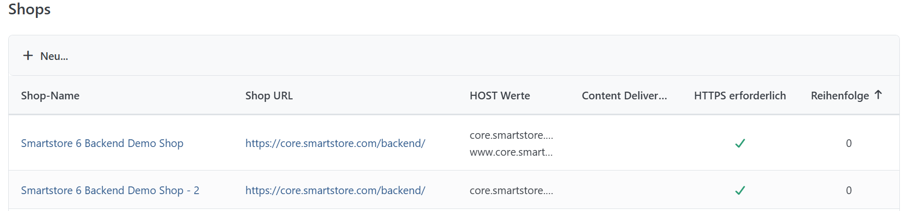

# Shops verwalten

Unter **Konfiguration > Shops** können Sie in Smartstore mehrere Shops anlegen und verwalten. Für weitere Informationen über die Arbeit in einer Multishop-Umgebung lesen Sie bitte das Thema [Mit mehreren Shops arbeiten](../allgemeine-konzepte/mit-mehreren-shops-arbeiten.md).

## Ansicht Shopdetails

Mit **Neu** legen Sie einen Shop an. Zum Bearbeiten klicken Sie in der Shopliste auf seinen Namen. Im Formular können Sie folgende Angaben festlegen:

| **Eingabefeld**              | **Beschreibung**                                                                                                                                                                                                                                                                                               |
| ---------------------------- | -------------------------------------------------------------------------------------------------------------------------------------------------------------------------------------------------------------------------------------------------------------------------------------------------------------- |
| Shoplogo                     | Logo für diesen Shop. Lassen Sie das Feld leer, wenn Sie kein eigenes Shoplogo verwenden möchten.                                                                                                                                                                                                              |
| Name                         | Name des Shops im Administrationsbereich.                                                                                                                                                                                                                                                                      |
| Shop URL                     | Stamm-URL des Shops einschließlich eines gegebenenfalls verwendeten Basispfads, zum Beispiel `https://mein-shop.de/`.                                                                                                                                                                                          |
| HTTPS erforderlich           | Leitet Aufrufe über HTTP automatisch zu HTTPS weiter. Aktivieren Sie dies erst, wenn ein gültiges Zertifikat für die Domain eingerichtet ist.                                                                                                                                                                  |
| HTTPS Port                   | Optionaler HTTPS-Port für Weiterleitungen, falls Sie keinen Standardport verwenden. Das Feld erscheint bei aktiviertem HTTPS.                                                                                                                                                                                  |
| HOST-Werte                   | Tragen Sie die Domains dieses Shops ohne Protokoll, getrennt durch Kommas, ein, zum Beispiel [mein-shop.com](http://mein-shop.com) und [www.mein-shop.de](http://www.mein-shop.de). Smartstore ordnet Anfragen anhand des Hostnamens dem Shop zu. Die Domains müssen am Webserver auf die Installation zeigen. |
| Content Delivery Network URL | Basis-URL eines für diesen Shop eingerichteten CDN, das die Smartstore-Mediendateien ausliefert. Smartstore verwendet diese Adresse bei der Erzeugung von Medien-URLs.                                                                                                                                         |
| Standardwährung              | Legt fest, welche Währung im Frontend dieses Shops vorausgewählt ist.                                                                                                                                                                                                                                          |
| ID des HTML-Body             | Optionaler Bezeichner im `body`-Element. Damit können Sie CSS und JavaScript gezielt auf diesen Shop anwenden, zum Beispiel über `#my-first-shop`.                                                                                                                                                             |
| Reihenfolge                  | Bestimmt die Sortierung der Shops. Der erste Shop dient außerdem als Standardshop, wenn ein Aufruf keinem konfigurierten Hostnamen zugeordnet werden kann.                                                                                                                                                     |
| Favicon                      | Optionales Icon im `.ico`-Format für diesen Shop.                                                                                                                                                                                                                                                              |
| PNG-Icon                     | Optionales Icon im `.png`-Format für diesen Shop.                                                                                                                                                                                                                                                              |
| Apple-Touch-Icon             | Optionales Icon für Verknüpfungen auf Apple-Geräten.                                                                                                                                                                                                                                                           |
| Microsoft-Kachelbild         | Optionales Bild für eine angeheftete Microsoft-Kachel.                                                                                                                                                                                                                                                         |
| Microsoft-Kachelfarbe        | Optionaler Hintergrundfarbwert für die Microsoft-Kachel.                                                                                                                                                                                                                                                       |

Im Bearbeitungsformular können Sie einen Shop auch über **Löschen** entfernen. Der letzte verbleibende Shop sowie ein Shop mit Wallet-Buchungen können nicht gelöscht werden.
