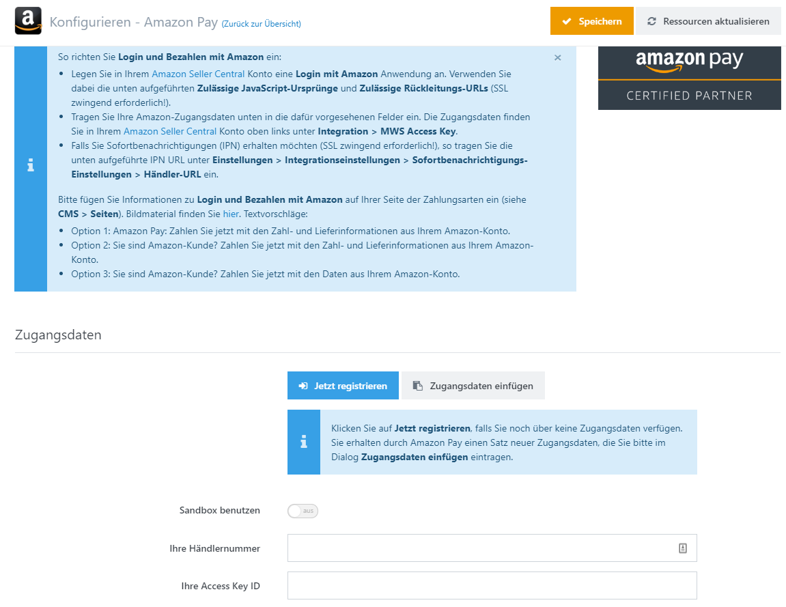
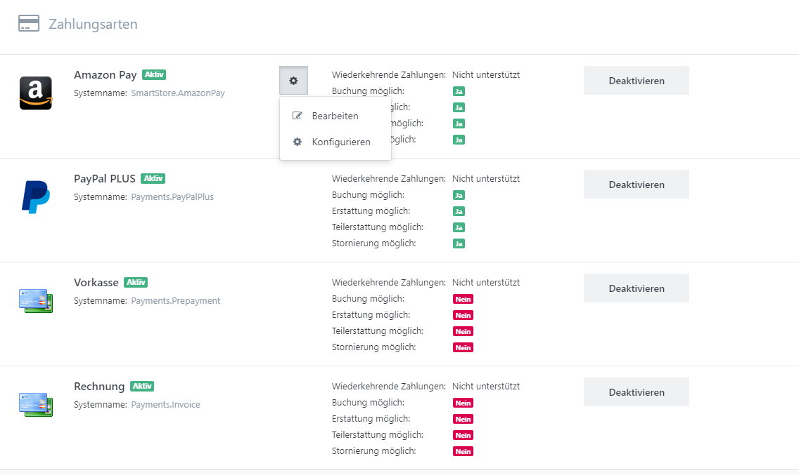
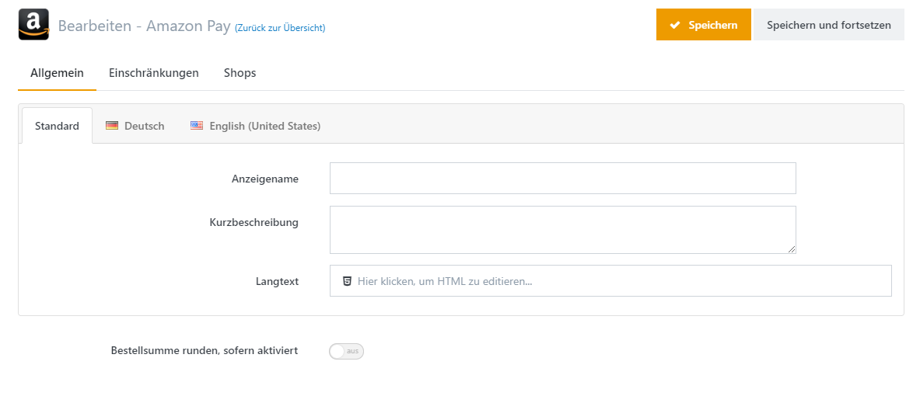
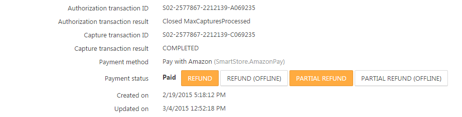

# Zahlungsarten einrichten

Einer der wichtigsten Bereiche beim Einrichten eines Onlineshops ist die Konfiguration der Zahlungsarten. Die Auswahl der Zahlungsarten beeinflusst die Kaufentscheidung in Ihrem Shop. Zahlungsvorgänge werden in Smartstore von so genannten Zahlart-Plugins abgewickelt. Abhängig von der Anzahl der installierten Zahlart-Plugins werden Ihren Kunden unterschiedliche Optionen für die Bezahlung zur Auswahl angeboten.

## Wie Sie die Zahlungsarten konfigurieren

Sie können Ihre Zahlungsarten einrichten indem Sie im Administrationsbereich zu **Konfiguration > Zahlungsarten** navigieren. In diesem Bereich können Sie die Zahlungsarten Ihrer installierten Zahlart-Plugins **aktivieren** oder **deaktivieren**, indem Sie die den zugehörigen Button drücken. Sie können direkt in die Konfigurationsansicht eines jeden Zahlart-Plugins wechseln, indem Sie den Button **Konfigurieren** auswählen.\
In der Konfigurationsansicht werden Ihnen weitere hilfreiche Tipps zur Einrichtung der Zahlarten angezeigt. Hier werden auch die erforderlichen Zugangsdaten für die entsprechenden Konten der Zahlungsanbieter eingetragen.

In der Zahlartenübersicht können Sie auch die Anzeigenreihenfolge durch _Drag & Drop_ auf der Zahlartauswahlseite, die Ihren Kunden beim Checkout angezeigt wird, auswählen. Um die Anzeigenreihenfolge zu verändern, fahren Sie über die Zahlungsart, und klicken Sie auf das Grip-Element. Nun können Sie die Zahlungsart auf die gewünschte Position ziehen und dort ablegen.

Wenn Sie in der Zahlartenübersicht bei einer Zahlungsart auf **Bearbeiten** klicken, öffnet sich die Bearbeitungsseite. Hier können Sie Namen, Kurzbeschreibung und Langtext der Zahlungsart eingeben. Der Langtext wird Ihrem Kunden auf der Auswahlseite für die Zahlungsarten beim Checkout angezeigt. Sie können diese Angaben auch für die in Ihrem Shop konfigurierten Sprachen hinterlegen.

Mit **Bestellsumme runden, sofern aktiviert** wird die Bestellsumme bei Auswahl dieser Zahlungsart gemäß der Währungs-Konfiguration gerundet. Dafür muss die Rundung auch bei der verwendeten Währung aktiviert sein. Über **Auf Shops begrenzt** können Sie die Zahlungsart auf bestimmte Shops begrenzen. Ohne Auswahl gilt sie für alle Shops.

## Funktionen von Zahlart-Plugins

In der Übersicht der Zahlungsarten finden Sie die unterschiedlichen Funktionen der Plugins. Weitere Informationen zu diesen Funktionen entnehmen Sie bitte der nachfolgenden Liste.

|                          |                                                                                                                                                                                                                                                                                                                      |
| ------------------------ | -------------------------------------------------------------------------------------------------------------------------------------------------------------------------------------------------------------------------------------------------------------------------------------------------------------------- |
| Wiederkehrende Zahlungen | Wenn ein Zahlart-Plugin wiederkehrende Zahlungen unterstützt, zeigt die Übersicht an, ob die Verarbeitung manuell oder automatisch erfolgt. Für weitere Informationen zu wiederkehrenden Zahlungen lesen Sie bitte [Mit Abonnements umgehen](../../verwalten/katalog/produkte-verwalten/mit-abonnements-umgehen.md). |
| Buchung                  | Wenn ein Zahlart-Plugin die manuelle Buchung von Beträgen unterstützt, wird ein zusätzlicher Button in den Bestelldetails (Administrationsbereich) angezeigt, mit dem eine zuvor autorisierte Zahlung manuell gebucht werden kann.                                                                                   |
| Erstattung               | Wenn ein Zahlart-Plugin eine vollständige Rückerstattung unterstützt, wird ein zusätzlicher Button in den Bestelldetails (Administrationsbereich) angezeigt, mit dem die Bestellsumme rückerstattet werden kann.                                                                                                     |
| Teilerstattung           | Wenn ein Zahlart-Plugin eine Teilerstattung unterstützt, wird ein zusätzlicher Button in den Bestelldetails (Administrationsbereich) angezeigt, mit dem ein Teil der Bestellsumme rückerstattet werden kann.                                                                                                         |
| Stornierung              | Wenn ein Zahlart-Plugin die Stornierung einer Zahlung unterstützt, wird ein zusätzlicher Button in den Bestelldetails (Administrationsbereich) angezeigt, mit dem eine autorisierte, noch nicht gebuchte Zahlung storniert werden kann.                                                                              |
|                          |                                                                                                                                                                                                                                                                                                                      |

Welche Zahlungsaktionen tatsächlich verfügbar sind, hängt neben der Unterstützung durch das Plugin auch vom aktuellen Zahlungs- und Bestellstatus ab.


Auch wenn eine Zahlungsart Buchungen, Erstattungen oder Stornierungen nicht unterstützt, stehen je nach Zahlungsstatus nicht-hervorgehobene Buttons für diese Vorgänge in den Bestelldetails im Administrationsbereich zur Verfügung, um den Statuswechsel der Zahlung "offline" zu ermöglichen, d.h.: ohne das Gateway der Zahlungsart zu kontaktieren.


## Zahlart Widgets

Die meisten Plugins werden auf der Auswahlseite für Zahlarten angezeigt, allerdings integrieren einige ihren eigenen Checkoutprozess. Das Amazon Zahlart-Plugin beispielsweise zeigt einen Checkout-Button direkt im Warenkorb an. Die Kunden wählen ihre bei Amazon hinterlegten Adressen und Zahlungsarten im Amazon-Pay-Checkout aus. Anschließend werden diese Daten in den Shop übernommen, wodurch die entsprechende Eingabe im normalen Checkout entfällt. Beim Aktivieren oder Deaktivieren einer Zahlungsart wird das zugehörige Widget automatisch mit aktiviert oder deaktiviert, sofern das Plugin eines bereitstellt. Für weitere Informationen über die Konfiguration von Widgets lesen Sie bitte [Widgets anordnen](../content-management/widgets-anordnen.md).

## Einschränken der Zahlungsarten

Zahlungsarten können auf mehrere Arten eingeschränkt werden, so dass sie nicht beim Checkout angeboten werden. Gehen Sie zu **Konfiguration > Zahlungsarten** und klicken Sie für die gewünschte Zahlungsart **Bearbeiten.** Unter **Allgemein > Voraussetzungen** wählen Sie die Regeln, bei deren Erfüllung die Zahlungsart beim Checkout angeboten werden soll. Bei mehreren ausgewählten Regeln genügt es, wenn eine davon erfüllt ist. Ohne Auswahl besteht keine Einschränkung durch Regeln. Sie können Zahlungsarten beispielsweise nach folgenden Kriterien einschränken:

* Kundengruppen
* Versandarten
* Länder (unterschieden zwischen Rechnungs- und Lieferadresse des Kunden)
* Mindest- und Höchstbetrag der Bestellung (unterschieden zwischen Gesamt- und Zwischenbestellwert)

Weitere Kriterien können durch Zahlungsfilter-Plugins hinzukommen. Wie Sie Regeln anlegen und kombinieren, lesen Sie unter [Regeln](regeln.md).

## Wie Sie weitere Zahlungsarten-Plugins bekommen

Weitere Zahlart-Plugins können Sie im [Smartstore Community Marketplace](http://community.smartstore.com/index.php?/files/) herunterladen. Der **Smartstore Community Marketplace** ist der Ort, wo alle Ressourcen, die für Smartstore geschaffen wurden, angeboten werden. Diese können entweder kostenlos heruntergeladen oder gekauft werden. Für weitere Informationen, wie Sie Plugins kaufen und installieren können, lesen Sie bitte [Wie kaufe ich eine Erweiterung?](../../loslegen/community-marketplace/wie-kaufe-ich-eine-erweiterung.md) und [Wie installiere ich eine Erweiterung?](../../loslegen/community-marketplace/wie-installiere-ich-eine-erweiterung.md).
