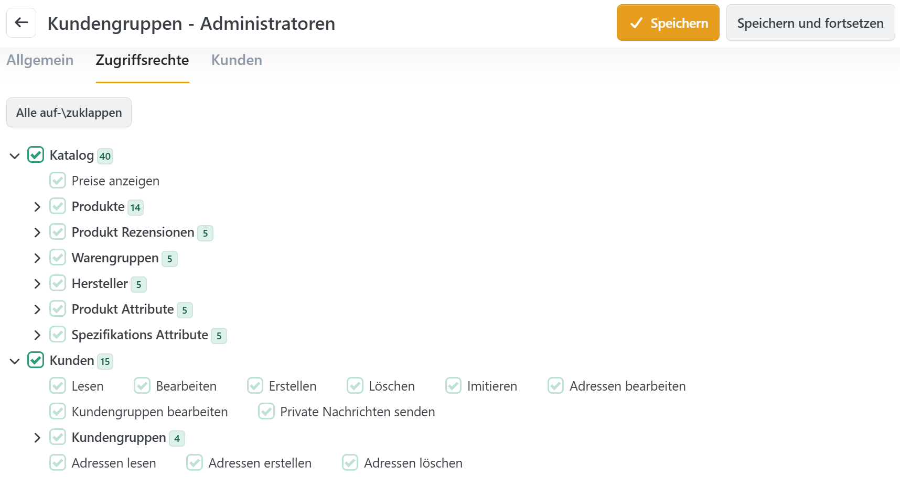

# Zugriffsrechte kontrollieren

Zugriffsrechte legen fest, welche Funktionen ein Kunde oder Mitarbeiter im Shop und im Backend nutzen darf. Sie vergeben die Rechte an **Kundengruppen**. Die Mitglieder erhalten die Rechte ihrer aktiven Gruppen.

## Rechte einer Kundengruppe bearbeiten

Öffnen Sie unter **Kunden > Kundengruppen** die gewünschte Gruppe und wechseln Sie zu **Zugriffsrechte**. Bei einer neuen Gruppe speichern Sie zuerst die allgemeinen Angaben. Wählen Sie im Rechtebaum die benötigten Rechte und speichern Sie die Kundengruppe.

Ordnen Sie die Gruppe anschließend den gewünschten Kunden oder Mitarbeitern zu. Die Zuordnung und automatische Gruppenzuweisung beschreibt [Kundengruppen verwalten](../kunden/kundengruppen-verwalten.md).

## Erlauben, verweigern und vererben

Die Rechte sind nach Funktionsbereichen geordnet. Unter einem Bereich liegen einzelne Aktionen wie Lesen, Bearbeiten, Erstellen oder Löschen. Eine Einstellung für einen übergeordneten Bereich gilt auch für seine untergeordneten Rechte, solange Sie dort keine abweichende Einstellung wählen.

| **Zustand**         | **Bedeutung**                                                                                                                            |
| ------------------- | ---------------------------------------------------------------------------------------------------------------------------------------- |
| Erlaubt             | Diese Kundengruppe erhält das Recht ausdrücklich.                                                                                        |
| Verweigert          | Diese Kundengruppe erhält das Recht ausdrücklich nicht. Eine geerbte Erlaubnis wird an dieser Stelle aufgehoben.                         |
| Erlaubt (geerbt)    | Das Recht ist hier nicht gesondert festgelegt. Es wird von einer übergeordneten Einstellung erlaubt.                                     |
| Verweigert (geerbt) | Das Recht ist hier nicht gesondert festgelegt. Eine übergeordnete Einstellung verweigert es, oder es gibt keine übergeordnete Erlaubnis. |

Beispiel: Sie erlauben in einer Kundengruppe den Bereich **Katalog > Produkte**. Damit sind auch die darunterliegenden Aktionen erlaubt. Setzen Sie **Löschen** ausdrücklich auf **Verweigert**, darf diese Gruppe Produkte weiterhin lesen und bearbeiten, aber nicht löschen.

Soll eine individuelle Einstellung wieder der übergeordneten Einstellung folgen, wählen Sie den geerbten Zustand. Ohne eigene Einstellung gilt die nächstgelegene übergeordnete Erlaubnis oder Verweigerung. Ist nirgends eine Erlaubnis festgelegt, wird der Zugriff verweigert.

## Mehrere Kundengruppen berücksichtigen


Eine Verweigerung in einer Gruppe hebt eine Erlaubnis aus einer anderen aktiven Gruppe nicht auf. Beispiel: Die Gruppe Redaktion verweigert das Löschen von Produkten. Ist derselbe Mitarbeiter zusätzlich Mitglied einer Gruppe, die dies erlaubt, darf er Produkte trotzdem löschen.


Prüfen Sie deshalb bei eingeschränkten Mitarbeiterkonten sämtliche Gruppenzuordnungen. Die allgemeine Gruppe Administratoren besitzt umfangreiche Rechte und eignet sich nicht als zusätzliche Gruppe für ein Konto, dessen Rechte Sie gezielt begrenzen möchten.

## Rechte eines Kunden kontrollieren

Öffnen Sie das Kundenkonto unter **Kunden > Kunden** und wechseln Sie zu **Zugriffsrechte**. Hier sehen Sie die Rechte, die sich aus seinen aktiven Kundengruppen ergeben. Die Ansicht ist schreibgeschützt. Änderungen nehmen Sie in den Kundengruppen vor. Weitere Informationen: [Kunden verwalten](../kunden/kunden-verwalten.md).

## Anwendungsszenario

Ein Mitarbeiter soll **Seiten & Inhalte** bearbeiten dürfen, jedoch keine Produkte verwalten. Legen Sie dafür eine eigene Kundengruppe an. Erlauben Sie unter **System** das Recht **Auf Backend zugreifen**. Erlauben Sie unter **CMS > Seiten & Inhalte** die Rechte **Lesen** und **Bearbeiten**. Ergänzen Sie **Erstellen** oder **Löschen** nur, wenn der Mitarbeiter diese Funktionen benötigt.

Erlauben Sie nicht pauschal den gesamten Bereich CMS, wenn nur einzelne Funktionen benötigt werden. Ordnen Sie das Mitarbeiterkonto der neuen Gruppe zu und prüfen Sie seine weiteren Gruppenzuordnungen. Der Backendzugang allein gewährt noch keine Bearbeitungsrechte für die einzelnen Arbeitsbereiche.

## Weitere Anwendungsszenarien

Für Preise, die nur registrierte Kunden sehen sollen, verweigern Sie in der Kundengruppe **Gäste** unter **Katalog** das Recht **Preise anzeigen** und erlauben es in der Gruppe **Registriert**. Prüfen Sie dabei auch weitere Gruppen des Kunden: Eine dort erteilte Erlaubnis bleibt wirksam.

Für einen Shop als Produktkatalog ohne Bestellmöglichkeit verweigern Sie den betreffenden Kundengruppen unter **Warenkorb** das Recht **Auf Warenkorb zugreifen**. Der Zugriff auf die Wunschliste wird über ein eigenes Recht gesteuert.

## Einzelne Shop-Inhalte beschränken

Die hier beschriebenen Rechte steuern Funktionen, beispielsweise die Bearbeitung von Produkten oder die Anzeige von Preisen. Soll nur eine bestimmte Warengruppe, ein Produkt oder eine Inhaltsseite für ausgewählte Kundengruppen zugänglich sein, verwenden Sie die [Zugriffsbeschränkungen (ACL)](../allgemeine-konzepte/zugriffsbeschrankungen-acl.md) am jeweiligen Inhalt.
