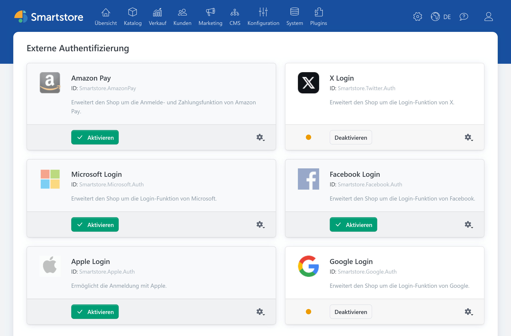
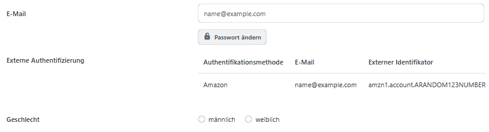

# Externe Authentifizierungsmethoden

Unter **Kunden > Externe Authentifizierungsmethoden** verwalten Sie die Anbieter, über die sich Kunden mit einem externen Konto im Shop anmelden können. Die Übersicht zeigt die in Ihrer Installation registrierten Methoden. Welche Anbieter verfügbar sind, hängt von den installierten Plugins ab.

Wie Sie einen Anbieter einrichten, Zugangsdaten hinterlegen und die Anmeldung testen, beschreibt [Externe Authentifizierung einrichten](../plugins/external-auth.md).

## Anbieterübersicht

Jeder Anbieter erscheint als eigener Eintrag mit Anzeigename und System-ID. Sofern vorhanden, sehen Sie eine Beschreibung und den Aktivstatus. Abhängig vom Anbieter und Ihren Zugriffsrechten stehen folgende Aktionen zur Verfügung:

| Aktion | Funktion |
| --- | --- |
| **Aktivieren / Deaktivieren** | Schaltet die externe Anmeldemethode ein oder aus. |
| **Konfigurieren** | Öffnet die Einstellungen des Anbieters, beispielsweise für Zugangsdaten und die Weiterleitungs-URL. |
| **Bearbeiten** | Öffnet bei bearbeitbaren Anbietern einen Dialog für Anzeigename und Beschreibung. |

Ein Anbieter muss konfiguriert und aktiviert sein, damit Kunden seine Anmeldeschaltfläche nutzen können. Prüfen Sie nach der Aktivierung die Anmeldung im Shop. Die [allgemeine Einrichtungsanleitung](../plugins/external-auth.md#allgemeiner-einrichtungsablauf) führt durch beide Schritte.


Bei bearbeitbaren Anbietern können Sie im Dialog **Bearbeiten** den Anzeigenamen und die Beschreibung ändern. Ein Ziehgriff an der Anbieterkarte zeigt an, dass sich ihre Position in der Liste ändern lässt.


### Aktivierung

Klicken Sie am Anbietereintrag auf **Aktivieren**, nachdem Sie dessen Konfiguration abgeschlossen haben. Bei einem aktiven Anbieter zeigt die Schaltfläche **Deaktivieren**. Durch Deaktivieren wird die zugehörige Anmeldeschaltfläche im Shop nicht mehr angeboten. Vorhandene Verknüpfungen zwischen externen Identitäten und Kundenkonten bleiben gespeichert und können nach einer erneuten Aktivierung wieder verwendet werden.


Stellen Sie vor einer dauerhaften Deaktivierung sicher, dass betroffene Kunden eine andere Möglichkeit zur Anmeldung haben. Weitere Hinweise finden Sie unter [Verhalten bei der Kundenanmeldung](../plugins/external-auth.md#verhalten-bei-der-kundenanmeldung).


### Konfiguration

Wählen Sie im Aktionsmenü **Konfigurieren**, um die Einstellungsseite des jeweiligen Plugins zu öffnen. Dort hinterlegen Sie die vom Anbieter benötigten Zugangsdaten und übernehmen die von Smartstore angezeigte Weiterleitungs-URL unverändert in die Anwendung beim Anbieter. Achten Sie bei mehreren Shops auf [den passenden Geltungsbereich](../konfiguration/einstellungen/den-einstellungsbereich-festlegen.md) und die zugehörige Domain.

## Kundenkonto

Öffnen Sie unter **Kunden > Kunden** ein Kundenkonto. Wenn für dieses Konto externe Anmeldungen verknüpft sind, zeigt die Detailansicht den Bereich **Externe Authentifizierung**. Dort sehen Sie die Authentifizierungsmethode, die übermittelte E-Mail-Adresse und den externen Identifikator. In diesem Bereich sind keine Aktionen zum Bearbeiten oder Löschen der Verknüpfung vorgesehen.

Die übrigen Bereiche der Detailansicht erklärt [Kunden verwalten](kunden-verwalten.md). Eine übereinstimmende E-Mail-Adresse allein verknüpft ein bestehendes Kundenkonto nicht automatisch mit einer externen Anmeldung. Weitere Hinweise dazu stehen unter [Verhalten bei der Kundenanmeldung](../plugins/external-auth.md#verhalten-bei-der-kundenanmeldung).

## Zugriffsrechte

Ob Mitarbeiter die Anbieterübersicht sehen, Anbieter konfigurieren oder Methoden aktivieren und deaktivieren dürfen, wird über getrennte Zugriffsrechte gesteuert. Die Rechte vergeben Sie an Kundengruppen. Das Vorgehen beschreibt [Zugriffsrechte kontrollieren](../konfiguration/zugriffsrechte-kontrollieren.md).

Ausführliche Informationen zur Einrichtung, zum Verhalten bei der Anmeldung und zur Fehlerbehebung finden Sie unter [Externe Authentifizierung einrichten](../plugins/external-auth.md).
