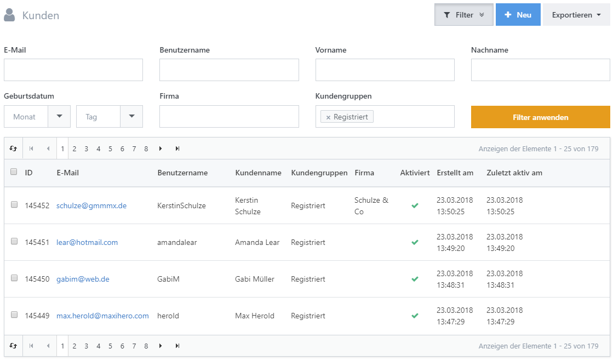
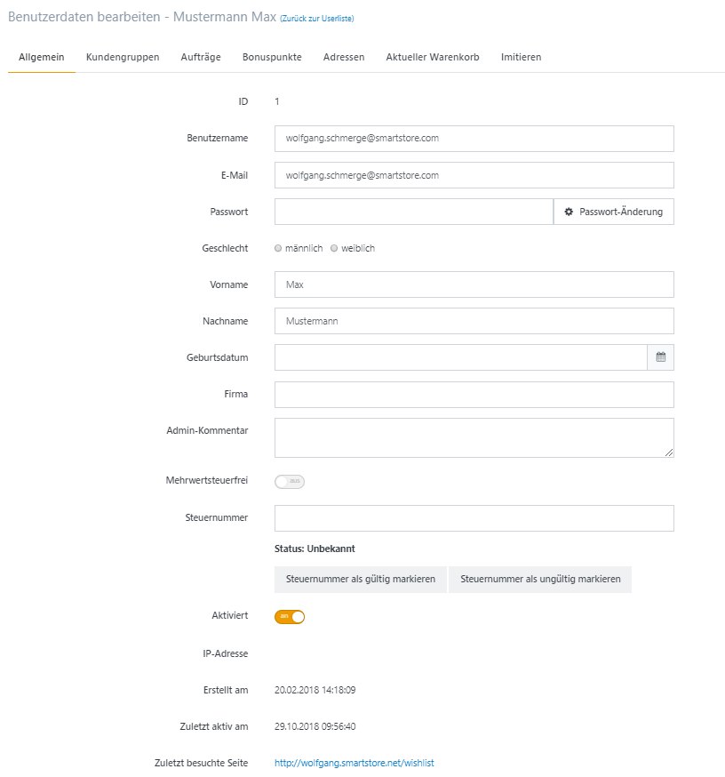
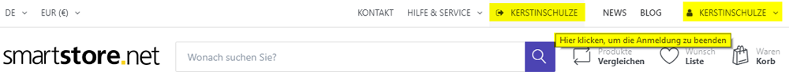

# Kunden verwalten

Jedes im Shop angelegte Konto ist ein Kundenkonto. Dazu gehören auch Konten von Gästen, Administratoren und registrierten Besuchern, die noch nichts bestellt haben. Unter **Kunden > Kunden** suchen und verwalten Sie diese Konten. Über **Neu** legen Sie ein Kundenkonto an; standardmäßig ist die Kundengruppe Registriert ausgewählt. Weitere Bereiche der Kundenbearbeitung stehen nach dem ersten Speichern zur Verfügung.

## Kunden-Detailansicht

Öffnen Sie das gewünschte Kundenkonto in der Kundenübersicht. In der Detailansicht bearbeiten Sie Stammdaten, verwalten Zuordnungen und Adressen und sehen Aufträge sowie Bonuspunkte ein.

Über **E-Mail senden** verfassen Sie eine Nachricht mit Betreff und Inhalt an die gespeicherte Kundenadresse. Smartstore legt die Nachricht in die E-Mail-Warteschlange. Voraussetzung sind eine gültige Kundenadresse und ein Standard-E-Mail-Konto. Den Versand verfolgen Sie unter [E-Mail-Korrespondenz analysieren](../system-wartung/e-mail-korrespondenz-analysieren.md).

Mit **Export** laden Sie die Kundendaten als JSON-Datei herunter. Der Export enthält neben Stammdaten unter anderem Kundengruppen, vorhandene Bestellungen und Rezensionen. Ein Benutzerprofil lässt sich zusätzlich öffnen, wenn die Profilanzeige aktiviert ist und der Kunde registriert ist.

### Allgemein 

| **Feld**                   | **Beschreibung**                                                                                                                                                                                                                                          |
| -------------------------- | --------------------------------------------------------------------------------------------------------------------------------------------------------------------------------------------------------------------------------------------------------- |
| Benutzername               | Anmeldename des Kunden. Das Feld erscheint, wenn die Anmeldung per Benutzername vorgesehen ist. Bei bestehenden Konten ist er nur änderbar, wenn die Kunden-Einstellungen dies erlauben.                                                                  |
| E-Mail                     | E-Mail-Adresse für Anmeldung und Kundenkommunikation.                                                                                                                                                                                                     |
| Passwort                   | Beim Anlegen vergeben Sie ein Passwort. Bei einem bestehenden Konto verwenden Sie Passwort ändern und bestätigen das neue Passwort im Dialog. Das bisherige Passwort wird nicht angezeigt.                                                                |
| Anrede und Geschlecht      | Optionale Angaben, sofern sie in den Kunden-Einstellungen aktiviert sind.                                                                                                                                                                                 |
| Vorname und Nachname       | Name des Kunden. Welche Angaben erforderlich sind, bestimmen die Kunden-Einstellungen.                                                                                                                                                                    |
| Geburtsdatum               | Optionales Geburtsdatum, sofern in den Kunden-Einstellungen aktiviert.                                                                                                                                                                                    |
| Unternehmen                | Name des Unternehmens, sofern in den Kunden-Einstellungen aktiviert.                                                                                                                                                                                      |
| Kundennummer               | Kennung des Kunden. Das Feld erscheint, wenn Kundennummern aktiviert sind. Eine automatische Vergabe hängt von der konfigurierten Nummernvergabe ab.                                                                                                      |
| Anschrift und Kontaktdaten | Straße, Adresszusatz, Postleitzahl, Stadt, Land, Bundesland, Telefon und Fax erscheinen entsprechend den Kunden-Einstellungen. Dies sind Angaben des Kundenprofils; die gespeicherten Rechnungs- und Lieferadressen verwalten Sie separat unter Adressen. |
| Admin-Kommentar            | Kommentar für internen Gebrauch. Wird nicht veröffentlicht.                                                                                                                                                                                               |
| Auf Shops begrenzt         | Beschränkt das Kundenkonto auf ausgewählte Shops. Ohne Auswahl ist es nicht auf bestimmte Shops begrenzt.                                                                                                                                                 |
| Kundengruppen              | Manuelle Zuordnung zu einer oder mehreren Kundengruppen. Die Auswahl ist nur mit der Berechtigung zur Verwaltung von Kundengruppenzuordnungen bearbeitbar. Weitere Hinweise stehen unterhalb der Tabelle.                                                 |
| Mehrwertsteuerfrei         | Befreit den Kunden bei der Steuerberechnung von der Mehrwertsteuer. Diese Einstellung ist von der Anzeige von Netto- oder Bruttopreisen und der Prüfung der Umsatzsteuer-Identifikationsnummer zu unterscheiden.                                          |
| Zeitzone                   | Zeitzone des Kunden. Das Feld erscheint, wenn Kunden eine eigene Zeitzone verwenden dürfen.                                                                                                                                                               |
| Bevorzugte Versandart      | Vorauswahl für den Schnell-Checkout. Erscheint bei aktiviertem Schnell-Checkout und vorhandenen Versandarten. Die Versandart muss für die jeweilige Bestellung weiterhin verfügbar sein.                                                                  |
| Bevorzugte Zahlungsart     | Vorauswahl für den Schnell-Checkout. Erscheint bei aktiviertem Schnell-Checkout und vorhandenen Zahlungsarten. Die Zahlungsart muss für die jeweilige Bestellung weiterhin verfügbar sein.                                                                |
| Affiliate                  | Zeigt den zugeordneten Affiliate, sofern eine Zuordnung besteht. Sie können ihn öffnen oder die Zuordnung entfernen. Weitere Informationen: [Partnerprogramme verwalten](../marketing-promotion/partnerprogramme-verwalten.md).                           |
| Steuernummer               | Die so bezeichnete Eingabe ist für die Umsatzsteuer-Identifikationsnummer bestimmt. Sie erscheint bei aktivierter EU-Umsatzsteuerfunktion. Eine Änderung wird beim Speichern geprüft.                                                                     |
| Status der Steuernummer    | Zeigt das Prüfergebnis der Umsatzsteuer-Identifikationsnummer. Über die zugehörige Auswahl können Sie die Nummer erneut prüfen oder den Status manuell als gültig beziehungsweise ungültig markieren.                                                     |
| Aktiviert                  | Legt fest, ob das Kundenkonto aktiv ist. Ein deaktivierter Kunde kann sich nicht regulär anmelden.                                                                                                                                                        |


Welche persönlichen Angaben angezeigt werden und verpflichtend sind, legen Sie unter [Kunden-Einstellungen](../konfiguration/einstellungen/kunden-einstellungen.md) fest. Unter Allgemein sehen Sie außerdem vorhandene externe Anmeldungen, Cookie-Einwilligungen sowie Informationen zur letzten Aktivität, beispielsweise IP-Adresse, Browser und zuletzt besuchte Seite. Diese Angaben sind keine zusätzlichen Eingabefelder.


#### Kundengruppen 

Ein Kunde muss entweder der Gruppe Gäste oder Registriert angehören, niemals beiden gleichzeitig. Weitere Gruppen können Sie ergänzen. Die Auswahl unter Allgemein verwaltet manuelle Zuordnungen; regelbasierte Zuordnungen bleiben davon getrennt. Die Gruppen und ihre automatische Zuordnung beschreibt [Kundengruppen verwalten](kundengruppen-verwalten.md).

### Zugriffsrechte

Hier sehen Sie die Berechtigungen, die sich aus den Kundengruppen des Kunden ergeben. Die Anzeige ist schreibgeschützt. Ändern Sie die Berechtigungen bei der jeweiligen Kundengruppe; die Grundlagen beschreibt [Zugriffsrechte kontrollieren](../konfiguration/zugriffsrechte-kontrollieren.md).

### Aufträge 

Hier sehen Sie die Aufträge des Kunden und deren Auftrags-, Zahlungs- und Versandstatus. Weitere Informationen zur Bearbeitung finden Sie unter [Aufträge verwalten](../../verwalten/verkauf/auftrage-verwalten.md).

### Bonuspunkte 

Dieser Bereich erscheint bei aktiviertem Bonuspunkte-Programm und zeigt die Buchungshistorie. Über **Bonuspunkte hinzufügen** legen Sie eine Buchung an. Geben Sie eine positive Punktzahl für eine Gutschrift oder eine negative Punktzahl für einen Abzug sowie eine Begründung ein und bestätigen Sie mit **Änderungen speichern**. Die Punktzahl verändert den bestehenden Kontostand, sie ersetzt ihn nicht. Weitere Informationen: [Mit Bonuspunkten arbeiten](mit-bonuspunkten-arbeiten.md).

### Adressen 

Hier verwalten Sie die gespeicherten Kundenadressen. Sie können Adressen hinzufügen, bearbeiten oder löschen. Bei aktiviertem Schnell-Checkout lassen sich Standardadressen festlegen. **Als Standard festlegen** setzt die ausgewählte Adresse als Rechnungs- und Lieferadresse voraus, sofern ihr Land für beide Zwecke zugelassen ist. Bereits gespeicherte Auftragsadressen werden dadurch nicht geändert.

### Aktueller Warenkorb 

Dieser Bereich zeigt die aktuellen Warenkorb- und Wunschlistenpositionen des Kunden. Um für den Kunden einzukaufen oder seinen Warenkorb im Shop zu bearbeiten, verwenden Sie Imitieren.

### Imitieren 

Mit **Auftragserteilung beginnen** wechseln Sie in den Shop und arbeiten mit dem Konto des Kunden, beispielsweise für eine telefonische Bestellung. Änderungen am Warenkorb und abgeschlossene Bestellungen betreffen dieses Kundenkonto. Der Kunde muss aktiv und darf nicht gelöscht sein. Sie benötigen die Berechtigung zum Imitieren; ohne Administratorzuordnung können Sie kein Administratorkonto imitieren. Über den Link zum Beenden der Imitation im Shop-Header kehren Sie zur Kundendetailansicht zurück.

### Attribute

Dieser Bereich enthält technische Zusatzdaten des Kundenkontos, die Smartstore oder Plugins verwenden. Sie können Einträge als Schlüssel-Wert-Paare hinzufügen, bearbeiten oder entfernen. Er ist von den persönlichen Angaben unter Allgemein und von Produktattributen zu unterscheiden.

### Plugin-Funktionen

Kostenpflichtige Enterprise-Plugins können zusätzliche Bereiche ergänzen: Wallet für das Guthabenkonto sowie OCI und cXml PunchOut für die jeweilige Beschaffungsanbindung. Diese Bereiche setzen das betreffende Plugin voraus. Eine Übersicht finden Sie unter [Plugins](../plugins/).

## Kundenkonto löschen

Mit **Kunde löschen** entfernen Sie ein Konto aus der regulären Kundenverwaltung. Registrierte Kundenkonten werden dabei als gelöscht markiert; ihre Datensätze und zugeordneten Aufträge bleiben erhalten. Diese Funktion führt keine vollständige Datenlöschung oder Anonymisierung durch.

Systemkonten sowie Konten mit aktiver Administrator- oder Superadministratorzuordnung werden nicht gelöscht. Gastkonten ohne Benutzernamen, E-Mail-Adresse, Bestellungen und eigene Inhalte können dagegen vollständig entfernt werden. Beim manuellen Löschen schützt ein vorhandener Warenkorb diese Gastkonten nicht.

## Gastkonten löschen

Die geplante Aufgabe **Gastbenutzer löschen** bereinigt standardmäßig alle zehn Minuten veraltete Gastkonten. Berücksichtigt werden Konten ohne Benutzernamen und E-Mail-Adresse, ohne Bestellungen oder eigene Inhalte und ohne aktive Warenkorb- oder Wunschlistenpositionen. Wie lange ein Gastkonto bereits bestehen muss, bevor es automatisch gelöscht werden kann, richtet sich nach der Konfiguration. Standardmäßig werden Konten berücksichtigt, die vor mindestens 24 Stunden angelegt wurden. Weitere Informationen: [Geplante Aufgaben verwalten](../system-wartung/geplante-aufgaben-verwalten.md) und [Grundlegende Wartungsaufgaben ausführen](../system-wartung/grundlegende-wartungsaufgaben-ausfuhren.md).
