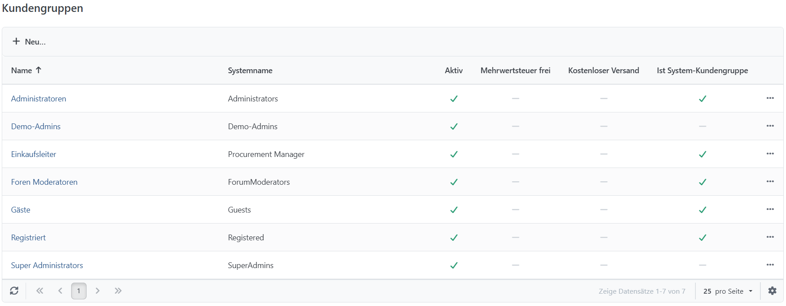

# Kundengruppen verwalten

Mit **Kundengruppen** wenden Sie gemeinsame Regeln auf mehrere Kunden an. Dazu gehören beispielsweise Mehrwertsteuerbefreiung, kostenloser Versand, Rabatte sowie Sichtbarkeitsbeschränkungen für Warengruppen und Produkte. Weitere Informationen zu Sichtbarkeitsregeln finden Sie unter [Zugriffsbeschränkungen (ACL)](../allgemeine-konzepte/zugriffsbeschrankungen-acl.md) und [Zugriffsrechte kontrollieren](../konfiguration/zugriffsrechte-kontrollieren.md).

Ein Kunde kann mehreren Kundengruppen angehören. Unter **Kunden > Kundengruppen** sehen Sie vorhandene Gruppen und legen über **Neu** weitere an.

## Allgemein 

| **Feld**                | **Beschreibung**                                                                                                                                                                                                                                                                                                                                                                                                                                                                                                                                                                   |
| ----------------------- | ---------------------------------------------------------------------------------------------------------------------------------------------------------------------------------------------------------------------------------------------------------------------------------------------------------------------------------------------------------------------------------------------------------------------------------------------------------------------------------------------------------------------------------------------------------------------------------- |
| Name                    | Name der Kundengruppe                                                                                                                                                                                                                                                                                                                                                                                                                                                                                                                                                              |
| Systemname              | Technischer Name der Kundengruppe, der beispielsweise von Plugins verwendet wird. Bei System-Kundengruppen kann er nicht geändert werden.                                                                                                                                                                                                                                                                                                                                                                                                                                          |
| Aktiv                   | Legt fest, ob diese Kundengruppe aktiv ist.                                                                                                                                                                                                                                                                                                                                                                                                                                                                                                                                        |
| Kostenloser Versand     | Gewährt den Mitgliedern kostenlosen Versand. Bei mehreren Kundengruppen genügt eine aktive Gruppe mit dieser Einstellung.                                                                                                                                                                                                                                                                                                                                                                                                                                                          |
| Mindestbestellwert      | Untergrenze für die Bestellung in der primären Shopwährung. Berücksichtigt werden die aktiven Warenkorbpositionen vor einem Rabatt auf die Warenkorb-Zwischensumme, ohne Versand- und Zahlungsgebühren. Ob der Betrag Steuern enthält, richtet sich nach der Steueranzeige des Kunden. Leer oder 0 bedeutet, dass diese Gruppe keine Untergrenze vorgibt.                                                                                                                                                                                                                          |
| Höchstbestellwert       | Obergrenze für die Bestellung in der primären Shopwährung. Die Berechnungsgrundlage entspricht dem Mindestbestellwert. Leer oder 0 bedeutet, dass diese Gruppe keine Obergrenze vorgibt. Ein eingetragener Höchstbestellwert muss größer als der Mindestbestellwert sein.                                                                                                                                                                                                                                                                                                          |
| Steueranzeige           | Legt fest, ob Mitglieder dieser Kundengruppe Preise inklusive oder zuzüglich Mehrwertsteuer sehen. Bleibt das Feld leer, wird die Preisanzeige durch diese Kundengruppe nicht verändert. Ist der Kunde Mitglied einer weiteren Kundengruppe, kann deren Einstellung gelten. Ist in keiner seiner Kundengruppen eine Steueranzeige ausgewählt, gelten die allgemeinen Steuereinstellungen des Shops. Beispiel: Ein Kunde gehört zu zwei Gruppen. In einer ist „Inkl. Mehrwertsteuer“ gewählt, in der anderen „Zzgl. Mehrwertsteuer“. Dann sieht er Preise zuzüglich Mehrwertsteuer. |
| Mehrwertsteuer frei     | Befreit die Mitglieder von der Mehrwertsteuer. Bei mehreren Kundengruppen genügt eine aktive Gruppe mit dieser Einstellung.                                                                                                                                                                                                                                                                                                                                                                                                                                                        |
| Ist System-Kundengruppe | Zeigt an, ob die Gruppe für grundlegende Shopfunktionen benötigt wird, beispielsweise Gäste oder Registriert. Diese Angabe ist nicht bearbeitbar. System-Kundengruppen können weder gelöscht noch deaktiviert werden.                                                                                                                                                                                                                                                                                                                                                              |

Wenn mehrere Kundengruppen Bestellwertgrenzen vorgeben, gilt normalerweise der höchste Mindestbestellwert und der niedrigste Höchstbestellwert. Ist die Einstellung „Kundengruppen erweitern den Wertebereich“ aktiviert, gilt umgekehrt der niedrigste Mindestbestellwert und der höchste Höchstbestellwert. Fehlt für eine Grenze eine positive Gruppenvorgabe, verwendet Smartstore die jeweilige Grenze aus den Bestelleinstellungen.

Eine vom Kunden selbst gewählte Steueranzeige oder die Behandlung einer gültigen Umsatzsteuer-Identifikationsnummer kann Vorrang vor der Gruppenvorgabe haben. Die Steueranzeige bestimmt die Darstellung der Preise; sie befreit den Kunden nicht von Steuern.

## **Zugriffsrechte**

Unter **Zugriffsrechte** legen Sie fest, welche Funktionen die Mitglieder dieser Gruppe nutzen dürfen. Speichern Sie eine neue Kundengruppe zuerst, damit dieser Bereich verfügbar ist. Die Bedeutung der Berechtigungen ist unter [**Zugriffsrechte** kontrollieren](../konfiguration/zugriffsrechte-kontrollieren.md) beschrieben.

## Kunden

Dieser Bereich zeigt die der Gruppe zugeordneten Kunden. Er steht nach dem ersten Speichern zur Verfügung. Sie können Zuordnungen entfernen; das Kundenkonto bleibt dabei erhalten.

Eine manuelle Zuordnung nehmen Sie beim jeweiligen Kunden unter **Allgemein** über die Auswahl **Kundengruppen** vor. Ein Kunde kann mehreren Gruppen angehören.

### Automatische Zuordnung

Unter **Regeln für automatische Zuordnung** wählen Sie Kundenregelsätze aus und speichern die Kundengruppe. Die Bedingungen legen Sie unter **Kunden > Kundenregeln** fest. Wie Sie Regelsätze aufbauen, ist unter [Regeln](../konfiguration/regeln.md) beschrieben.

Für die automatische Zuordnung müssen die Kundengruppe und mindestens ein zugewiesener Regelsatz aktiv sein. Ein Kunde wird zugeordnet, wenn er einen der aktiven Regelsätze erfüllt.

Die geplante Aufgabe „Zuordnungen von Kunden zu **Kundengruppen** aktualisieren“ berechnet die regelbasierten Zuordnungen neu. Mit **Regeln neu anwenden** können Sie die Auswertung auch unmittelbar anstoßen. Speichern Sie Änderungen an der Regelauswahl vorher.

Beim erneuten Auswerten werden bisherige regelbasierte Zuordnungen entfernt und anhand der aktuellen Bedingungen neu angelegt. Kunden, die keine passende Regel mehr erfüllen, verlieren dadurch ihre automatische Zuordnung. Manuelle Zuordnungen bleiben bestehen. Eine entfernte automatische Zuordnung kann beim nächsten Lauf wieder entstehen, solange die Bedingungen erfüllt sind.

Die Ausführung und den Zeitplan der Aufgabe verwalten Sie unter [Geplante Aufgaben verwalten](../system-wartung/geplante-aufgaben-verwalten.md).
