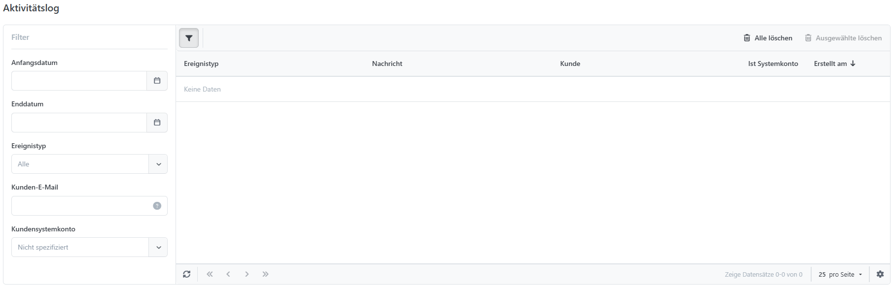
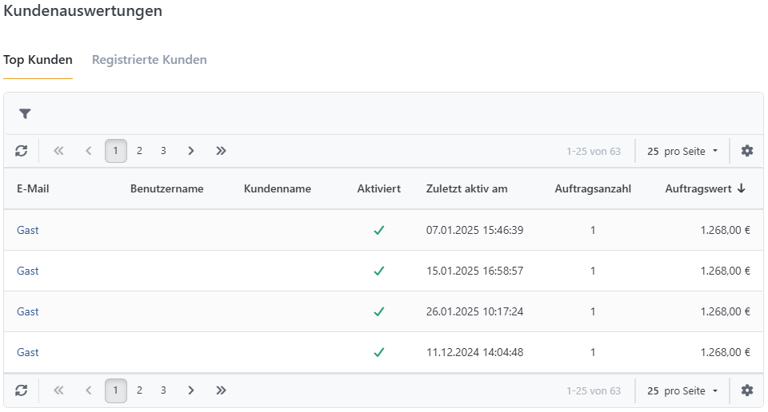
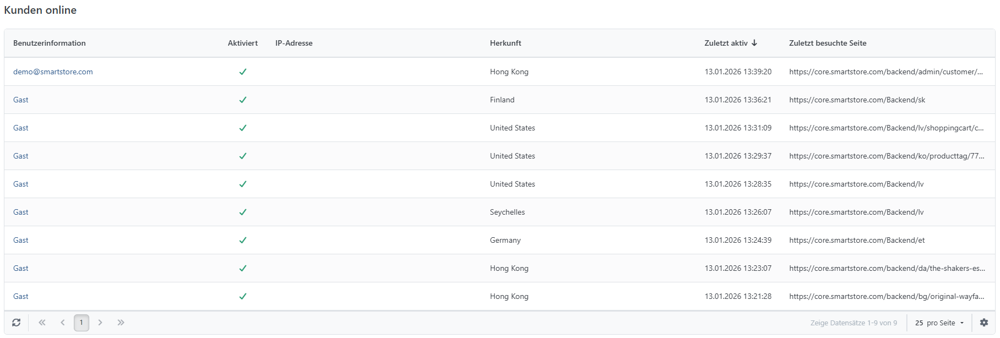

# Kundenverhalten analysieren

Die Auswertungen zum Kundenverhalten helfen Ihnen, Nutzungsmuster zu erkennen und Ihren Shop gezielt zu verbessern.

## Aktivitätslog

Unter **Kunden > Aktivitätslog** finden Sie protokollierte Vorgänge aus dem Backend und dem öffentlichen Shop. Dazu gehören beispielsweise die Bearbeitung eines Produkts, das Hinzufügen zum Warenkorb oder das Aufgeben einer Bestellung. Die Einträge enthalten den Ereignistyp, eine Beschreibung, den zugehörigen Kunden und den Zeitpunkt.

Welche Vorgänge aufgezeichnet werden, legen Sie unter **Konfiguration > Ereignistypen** fest. Nur aktivierte Ereignistypen erzeugen neue Einträge; eine nachträgliche Aktivierung ergänzt keine vergangenen Aktivitäten. Die Einrichtung beschreibt die Seite [Ereignistypen einrichten](../konfiguration/ereignistypen-einrichten.md).

## Kunden online

Unter **Kunden > Kunden online** sehen Sie registrierte Kunden und Gäste, deren letzte Aktivität innerhalb des eingestellten Zeitfensters liegt. Standardmäßig beträgt dieses Zeitfenster 20 Minuten. Die Anzeige bedeutet daher nicht, dass der Besucher die Seite in diesem Moment noch geöffnet hat.

Die Übersicht zeigt unter anderem den Zeitpunkt der letzten Aktivität, die zuletzt gespeicherte IP-Adresse und die zuletzt besuchte Seite. **Herkunft** bezeichnet das anhand der IP-Adresse ermittelte Land, sofern es bestimmt werden kann.

Welche Angaben gespeichert werden, hängt von den Kunden- und Datenschutzeinstellungen ab. Ist die Speicherung der zuletzt besuchten Seite oder der IP-Adresse deaktiviert, werden diese Angaben nicht mehr laufend aktualisiert.

## Kundenauswertungen

Unter **Kunden > Kundenauswertungen** finden Sie die Bereiche **Top Kunden** und **Registrierte Kunden**.

### Top Kunden

**Top Kunden** fasst die Bestellungen je Kunde zusammen. Angezeigt werden die **Auftragsanzahl** und der **Auftragswert**. Der Auftragswert ist die Summe der Auftragsgesamtbeträge in der primären Shopwährung. Auch darin enthaltene Steuern, Versand- und Zahlungsgebühren fließen ein.

Mit **Erstellt am** grenzen Sie die Auswertung nach dem Erstellungsdatum der Aufträge ein. Zusätzlich stehen **Auftragsstatus**, **Zahlungsstatus** und **Versandstatus** zur Verfügung. Ohne Statusauswahl werden auch offene, unbezahlte oder stornierte Aufträge berücksichtigt. Für eine Auswertung bezahlter Bestellungen wählen Sie beispielsweise den Zahlungsstatus **Bezahlt**.

### Registrierte Kunden

**Registrierte Kunden** zeigt die Anzahl registrierter Kundenkonten für die letzten 7, 14, 30 und 365 Tage. Maßgeblich ist das Erstellungsdatum des Kundenkontos. Die Angaben **Im letzten Monat** und **Im letzten Jahr** beziehen sich auf die zurückliegenden 30 beziehungsweise 365 Tage, nicht auf den vorherigen Kalendermonat oder das vorherige Kalenderjahr. Die Zeit- und Statusfilter aus **Top Kunden** gelten hier nicht.

