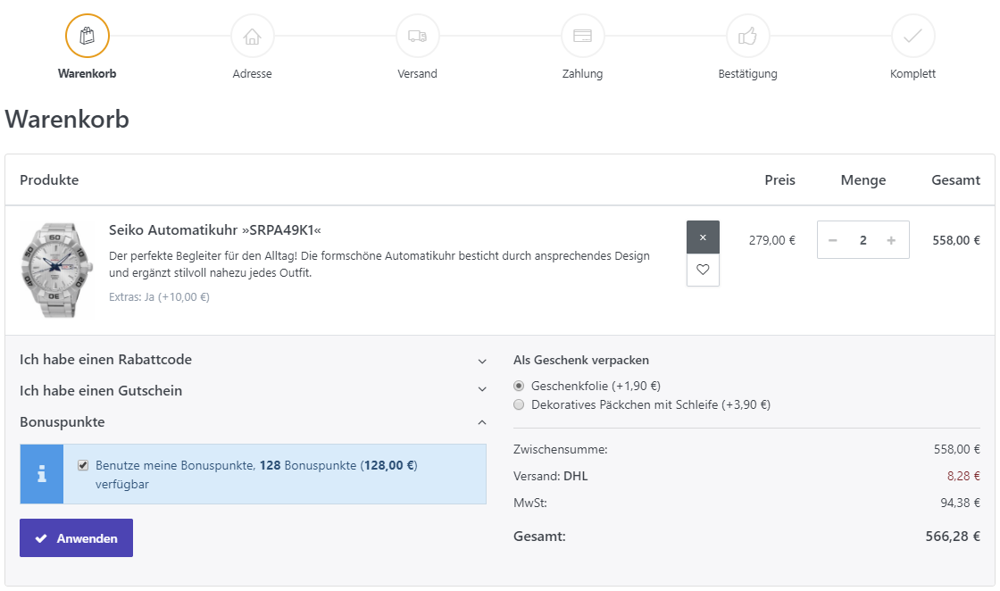
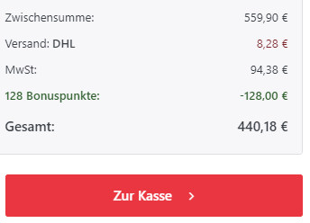

# Mit Bonuspunkten arbeiten

Das **Bonuspunkte-Programm** belohnt Kunden mit Punkten für Einkäufe und weitere Aktionen, beispielsweise Registrierung, Produktrezensionen oder Newsletter-Abonnement. Die verfügbaren Regeln und Werte konfigurieren Sie unter [Bonuspunkte-Einstellungen](../konfiguration/einstellungen/bonuspunkte-einstellungen.md).

Kunden sammeln Punkte auf ihrem Kundenkonto und können ihr verfügbares Guthaben bei einer späteren Bestellung einlösen. Die Punkte für einen Einkauf werden erst gutgeschrieben, wenn der Auftrag den in den Bonuspunkte-Einstellungen festgelegten Status erreicht.

## Bonuspunkte einlösen

Die Auswahl zum Einlösen erscheint im Warenkorb, wenn der Kunde angemeldet ist, über ein Punkteguthaben mit positivem Geldwert verfügt und der Warenkorb keine Produkte mit wiederkehrenden Zahlungen enthält. Für Gastbestellungen steht die Auswahl nicht zur Verfügung.

Im Bereich **Bonuspunkte** aktiviert der Kunde **Benutze meine Bonuspunkte** und bestätigt mit **Anwenden**. Der Warenkorb zeigt den verfügbaren Punktestand und dessen Geldwert. Die Zusammenfassung weist den angerechneten Betrag aus.

Smartstore verrechnet das verfügbare Punkteguthaben bis zur Höhe des verbleibenden Auftragsbetrags. Eine frei wählbare Anzahl von Punkten kann der Kunde nicht eingeben. Nicht benötigte Punkte bleiben auf dem Kundenkonto. Der Punktestand wird beim Absenden der Bestellung belastet.

## Punktestand und Buchungen ansehen

Angemeldete Kunden finden unter **Mein Konto > Bonuspunkte** ihren aktuellen Punktestand und dessen Geldwert. Die Historie zeigt Gutschriften und Abzüge mit Datum, Begründung und dem Punktestand nach der jeweiligen Buchung.

Im Backend finden Sie die Buchungen beim jeweiligen Kunden im Bereich **Bonuspunkte**. Dort können Sie auch Punkte manuell gutschreiben oder abziehen, beispielsweise um eine fehlerhafte Buchung zu korrigieren. Die Vorgehensweise beschreibt [Kunden verwalten](kunden-verwalten.md).

## Bonuspunkte bei stornierten Bestellungen

Die **Bonuspunkte-Einstellungen** legen fest, bei welchem Auftragsstatus bereits gutgeschriebene Einkaufspunkte wieder abgezogen werden. Dies betrifft die Punkte, die der Kunde für diesen Einkauf erhalten hat.


Punkte, die der Kunde zum Bezahlen der Bestellung eingelöst hat, werden bei einer Stornierung nicht automatisch zurückgebucht. Soll der Kunde sie zurückerhalten, schreiben Sie sie beim Kunden manuell wieder gut.


## Anwendungsszenario

Wenn Sie nach der Aktivierung von Produktrezensionen schnell mehr Rückmeldungen erhalten möchten, können Sie das Schreiben einer Rezension mit Bonuspunkten belohnen. Ist eine Freigabe erforderlich, erhält der Kunde die Punkte erst nach der Genehmigung der Rezension.
