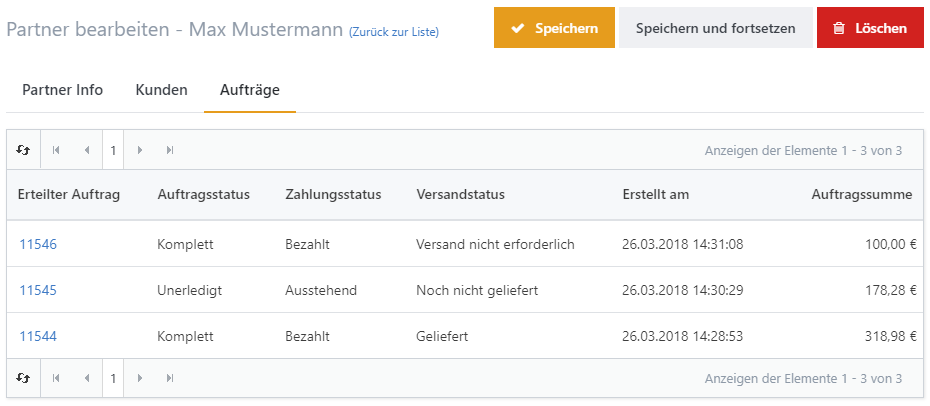

# Partnerprogramme verwalten

Beim Affiliate-Marketing vergüten Sie Partner für vermittelte Besucher, Kunden oder Bestellungen. Mit **Marketing > Partnerprogramme** verwalten Sie die Kontaktdaten Ihrer Partner und verfolgen, welche Kunden und Bestellungen ihnen zugeordnet sind. Jeder Partner erhält dafür eine eigene Partner-URL.

Die Funktion dient der Zuordnung und Auswertung. Provisionssätze, Provisionsabrechnungen und Auszahlungen verwalten Sie außerhalb dieser Funktion.

## Einen Partner einrichten

1. Öffnen Sie **Marketing > Partnerprogramme** und klicken Sie auf **Neu**.
2. Aktivieren Sie unter **Partner Info** die Option **Aktiv**, damit Besuche und neue Bestellungen dem Partner zugeordnet werden können.
3. Erfassen Sie die Kontakt- und Adressdaten. Das Formular bietet Firma, Vorname, Nachname, E-Mail-Adresse, Land, Bundesland, Stadt, Straße, Adresszusatz, Postleitzahl, Telefon und Fax.
4. Klicken Sie auf **Speichern und fortsetzen**. Erst nach dem ersten Speichern werden die Partner-ID, die **URL** sowie die Registerkarten **Kunden** und **Aufträge** angezeigt.
5. Kopieren Sie die angezeigte **URL** und übermitteln Sie sie Ihrem Partner. Dieser kann sie beispielsweise auf seiner Website verlinken.

## Wie die Partner-URL funktioniert

Eine Partner-URL sieht beispielsweise so aus: `https://www.example.com/?affiliateid=1`. Die Domain steht für Ihren Shop; `1` ist die ID des Partners. Verwenden Sie für die Weitergabe die URL aus dem gespeicherten Partnerdatensatz.

Ruft ein Besucher den Shop über diese URL auf, hinterlegt Smartstore den Partner am aktuell verwendeten Kundendatensatz. Dafür muss die Partner-ID gültig und der Partner aktiv sein. Ein späterer Aufruf mit der gültigen URL eines anderen aktiven Partners ersetzt die bisherige Zuordnung. Ein Besuch ohne Partner-ID entfernt sie nicht.

Beim Anlegen einer Bestellung übernimmt Smartstore die dann am Kunden gespeicherte Partnerzuordnung, sofern der Partner weiterhin aktiv ist. Eine spätere Änderung der Kundenzuordnung verändert bereits angelegte Bestellungen nicht.

## Kunden und Aufträge auswerten

* **Kunden:** Zeigt die aktuell zugeordneten Kundendatensätze mit E-Mail-Adresse, Benutzername, vollständigem Namen und Erstellungsdatum. Das Datum gehört zum Kundendatensatz und bezeichnet nicht den Zeitpunkt der Vermittlung. Über den Eintrag öffnen Sie die Kundenbearbeitung.
* **Aufträge:** Zeigt die diesem Partner zugeordneten Bestellungen mit Auftrags-, Zahlungs- und Versandstatus, Erstellungsdatum und Auftragssumme. Über die Auftragsnummer öffnen Sie die Bestellung.

Die Registerkarte **Kunden** ist keine Klickstatistik. In **Aufträge** erscheinen auch noch nicht bezahlte oder stornierte Bestellungen. Berücksichtigen Sie deshalb den Auftrags- und Zahlungsstatus, bevor Sie die Liste als Grundlage für eine Vergütung verwenden.

## Zuordnungen und Partner verwalten

Um eine einzelne Kundenzuordnung aufzuheben, öffnen Sie den Kunden und verwenden beim Feld **Partner** die Aktion **Zuordnung zum Partner entfernen**. Bereits zugeordnete Bestellungen bleiben davon unberührt.

Deaktivieren Sie **Aktiv**, wenn einem Partner vorerst keine neuen Besucher oder Bestellungen zugeordnet werden sollen. Die bisherigen Zuordnungen bleiben erhalten. Sie können den Partner später wieder aktivieren.

Über die Partnerübersicht öffnen und bearbeiten Sie vorhandene Partner. Einzelne Partner lassen sich in der Bearbeitung löschen; in der Übersicht können Sie auch mehrere Einträge markieren und gemeinsam löschen.

## Partner in Warenkorbregeln verwenden

In Warenkorbregeln steht die Bedingung **Partner** zur Verfügung. Damit können Sie beispielsweise einen Rabatt auf Kunden eines bestimmten aktiven Partners begrenzen. Die Regel prüft die Kundenzuordnung; den Rabatt selbst richten Sie separat ein. Weitere Informationen finden Sie unter [Regeln](../konfiguration/regeln.md).
