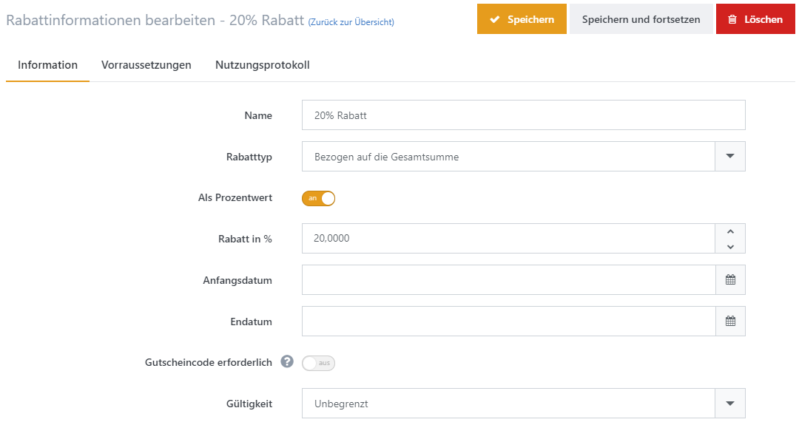
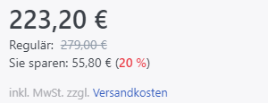
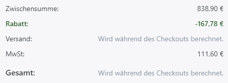
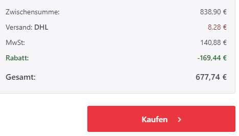
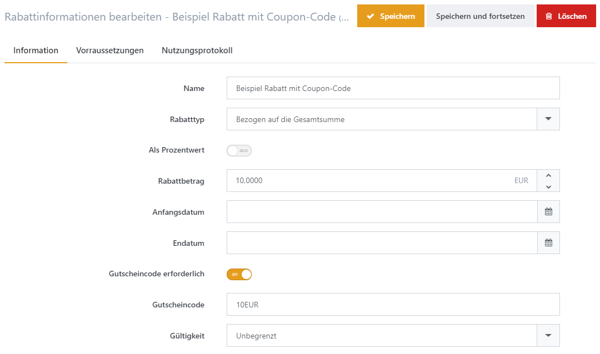
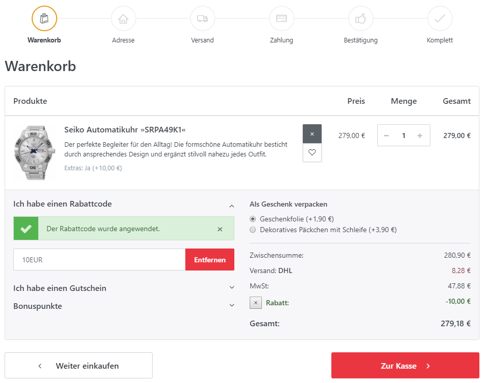
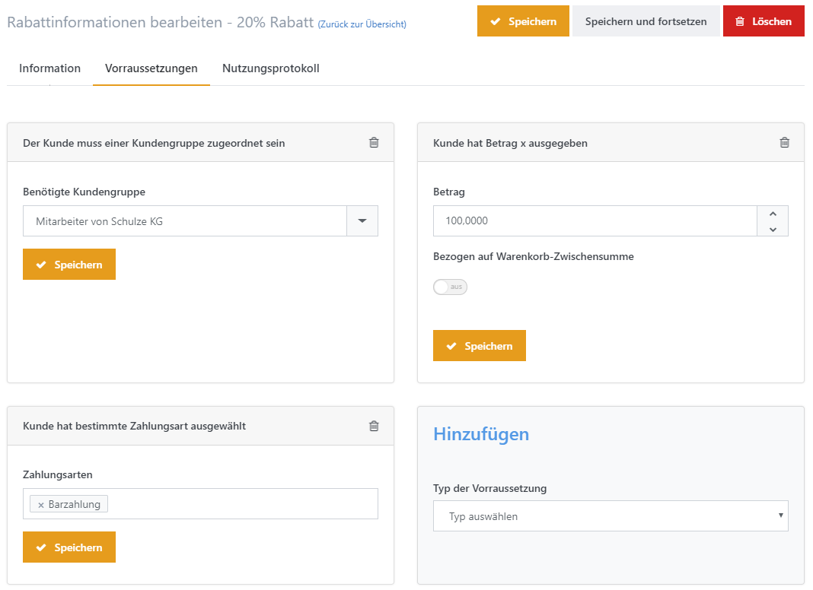

# Rabatte verwalten

Rabatte schaffen Kaufanreize für Ihre Shopbesucher und können so Ihren Umsatz steigern. Sie können beispielsweise saisonale Schlussverkäufe anbieten oder Produkte mit geringer Nachfrage hervorheben. Weitere Anregungen finden Sie in den **Beispielszenarien** weiter unten.

Sie können Rabatte über **Admin > Marketing > Rabatte** verwalten. Klicken Sie auf **Neu**, um einen neuen Rabatt anzulegen.

## Registerkarte Information

| Feld                           | Beschreibung                                                                                                                                                                                                                                                                                                                                                                                                                                                                                                   |
| ------------------------------ | -------------------------------------------------------------------------------------------------------------------------------------------------------------------------------------------------------------------------------------------------------------------------------------------------------------------------------------------------------------------------------------------------------------------------------------------------------------------------------------------------------------- |
| **Name**                       | Legt den internen Namen des Rabatts fest.                                                                                                                                                                                                                                                                                                                                                                                                                                                                      |
| **Rabatttyp**                  | Legt den Rabatttyp fest. Eine detaillierte Auflistung der Optionen finden Sie in der Tabelle unten.                                                                                                                                                                                                                                                                                                                                                                                                            |
| **Als Prozentwert**            | Legt fest, ob der Wert prozentual oder als fester Wert angewendet wird.                                                                                                                                                                                                                                                                                                                                                                                                                                        |
| **Rabatt in % / Rabattbetrag** | Der Prozentsatz beziehungsweise der Betrag, der als Rabatt angewendet wird.                                                                                                                                                                                                                                                                                                                                                                                                                                    |
| **Anfangsdatum**               | Das Anfangsdatum für die Gültigkeit des Rabatts.                                                                                                                                                                                                                                                                                                                                                                                                                                                               |
| **Enddatum**                   | Das Enddatum für die Gültigkeit des Rabatts.                                                                                                                                                                                                                                                                                                                                                                                                                                                                   |
| **Gutscheincode erforderlich** | Macht die Angabe eines Gutscheincodes durch den Kunden erforderlich, damit der Rabatt angewendet wird.                                                                                                                                                                                                                                                                                                                                                                                                         |
| **Gutscheincode**              | Der Gutscheincode. Weitere Informationen finden Sie im Abschnitt „Gutscheincodes einsetzen“ unterhalb dieser Tabelle.                                                                                                                                                                                                                                                                                                                                                                                          |
| **Gültigkeit**                 | 
Mit der Gültigkeit legen Sie fest, wie oft ein Gutscheincode verwendet werden darf: unbegrenzt, insgesamt eine bestimmte Anzahl von Malen oder eine bestimmte Anzahl von Malen pro Kunde.  - <strong>Unbegrenzt</strong>: Unbegrenzte Nutzung eines Gutscheincodes - <strong>Nur N mal</strong>: Der Gutscheincode darf nur <strong>N</strong> mal angewendet werden. - <strong>N mal pro Benutzer:</strong> Der Gutscheincode darf nur <strong>N mal</strong> pro Kunde angewendet werden.
 |
| **N mal**                      | Die Anzahl der zulässigen Anwendungen eines Rabatts.                                                                                                                                                                                                                                                                                                                                                                                                                                                           |

### Rabatttyp - Optionen

| Rabatttyp                       | Beschreibung                                                                                                                                                                                                                                                                                                                                                                                                                                                                                                                                                                            |
| ------------------------------- | --------------------------------------------------------------------------------------------------------------------------------------------------------------------------------------------------------------------------------------------------------------------------------------------------------------------------------------------------------------------------------------------------------------------------------------------------------------------------------------------------------------------------------------------------------------------------------------- |
| _Produkten zugewiesen_          | 
Der Rabatt wird auf den Preis jedes Produkts angewendet, dem er zugeordnet ist. Wenn Sie diesen Rabatttyp auswählen, erscheint im Bearbeitungsbereich des Produkts eine neue Registerkarte. Dort können Sie dem Produkt einen Rabatt dieses Typs zuweisen. Ein Link zu den zugewiesenen Produkten wird unterhalb des Felds „Rabatttyp“ angezeigt. In der Produktdetailansicht im Frontend erscheint der normale Preis durchgestrichen und der rabattierte Preis daneben hervorgehoben.  
                   |
| _Bezogen auf die Kategorien_    | 
Der Rabatt wird auf den Preis jedes Produkts einer Warengruppe angewendet, der er zugeordnet ist. Wenn Sie diesen Rabatttyp auswählen, erscheint im Bearbeitungsbereich der Warengruppe eine neue Registerkarte. Dort können Sie der Warengruppe einen Rabatt dieses Typs zuweisen. Ein Link zu den zugewiesenen Warengruppen wird unterhalb des Felds „Rabatttyp“ angezeigt. In der Produktdetailansicht des Shops erscheint der normale Preis durchgestrichen und der rabattierte Preis hervorgehoben.  
 |
| _Bezogen auf die Zwischensumme_ | 
Der Rabatt wird auf die Zwischensumme (exklusive Versandkosten und Bezahlgebühren) angewendet und wird in der Warenkorbzusammenfassung angezeigt.  
                                                                                                                                                                                                                                                                                                                                                        |
| _Bezogen auf die Versandkosten_ | Der Rabatt wird auf alle Versandkosten angewendet, die dem Kunden angezeigt werden.                                                                                                                                                                                                                                                                                                                                                                                                                                                                                                     |
| _Bezogen auf die Gesamtsumme_   | 
Der Rabatt wird auf die Gesamtsumme des Auftrags angewendet und auf der Auftragsbestätigung-Seite (letzte Seite des Checkout-Prozesses) dargestellt, nachdem der Kunde die Zahlungsart und die Versandmethode ausgewählt hat (die Gesamtsumme enthält Versandkosten und Zahlartgebühren).  
                                                                                                                                                                                                    |

## Gutscheincodes einsetzen

Gutscheincodes können Sie an Ihre Kunden weitergeben. Diese geben den Code während des Checkouts ein und erhalten den zugehörigen Rabatt. Für jeden angelegten Rabatt können Sie einen Gutscheincode festlegen.

## Voraussetzungen

Sie können eine unbegrenzte Anzahl an Voraussetzungen definieren, die erfüllt sein müssen, bevor der Rabatt angewendet werden kann.

| Rabatt Voraussetzung                                           | Beschreibung                                                                                                                                                                                                                                                                                                                                                                                                                                                                                                                                                                                                                                                         |
| -------------------------------------------------------------- | -------------------------------------------------------------------------------------------------------------------------------------------------------------------------------------------------------------------------------------------------------------------------------------------------------------------------------------------------------------------------------------------------------------------------------------------------------------------------------------------------------------------------------------------------------------------------------------------------------------------------------------------------------------------- |
| **Der Kunde muss einer Kundengruppe zugeordnet sein**          | Dieser Rabatt wird nur angewendet, wenn der Kunde der definierten Kundengruppe zugeordnet ist. Wenn diese _Voraussetzung_ aktiviert wurde, erscheint eine Dropdown-Liste unterhalb der _Voraussetzung_, aus der Sie die zugehörige Kundengruppe auswählen können. Um mehrere Kundengruppen zu berücksichtigen, fügen Sie für jede Kundengruppe eine eigene _Voraussetzung_ hinzufügen.                                                                                                                                                                                                                                                                               |
| **Land der Rechnungsadresse ist**                              | Der Rabatt wird nur angewendet, wenn der Kunde das definierte Land in der Rechnungsadresse angegeben hat. Wenn diese _Voraussetzung_ aktiviert wurde, erscheint eine Dropdown-Liste unterhalb der _Voraussetzung_, aus der Sie das Land der Rechnungsadresse auswählen können. Für jedes weitere Land fügen Sie eine eigene _Voraussetzung_ für den Rabatt hinzufügen.                                                                                                                                                                                                                                                                                               |
| **Land der Lieferadresse ist**                                 | Der Rabatt wird nur angewendet, wenn der Kunde das definierte Land in der Lieferadresse angegeben hat. Wenn diese _Voraussetzung_ aktiviert wurde, erscheint eine Dropdown-Liste unterhalb der _Voraussetzung_, aus der Sie das Land der Lieferadresse auswählen können. Für jedes weitere Land fügen Sie eine eigene _Voraussetzung_ für den Rabatt hinzufügen.                                                                                                                                                                                                                                                                                                     |
| **Kunde hat eines der folgenden Produkte in seinem Warenkorb** | Der Rabatt wird nur angewendet, wenn sich eines der angegebenen Produkte im Warenkorb des Kunden befindet. Wenn diese _Voraussetzung_ aktiviert wurde, spezifizieren Sie die Produkte, die zu der _Voraussetzung_ gehören. Geben Sie dazu im darunter angezeigten Feld eine durch Kommas getrennte Liste von Produkt-IDs ein (z. B. 77, 123, 156). Die Produktnummer finden Sie auf der Bearbeitungsseite des jeweiligen Produkts. Sie können für jede Produktnummer auch eine Menge angeben ({Produktnummer}:{Menge}, z. B. 77:1, 123:2, 156:3) oder einen Mengenbereich festlegen ({Produktnummer}:{Mindestmenge}-{Maximalmenge}, z. B. 77:1-3, 123:2-5, 156:3-8). |
| **Kunde hat folgende Produkte in seinem Warenkorb**            | Der Rabatt wird nur angewendet, wenn der Kunde alle der angegebenen Produkte im Warenkorb hat. Wenn diese _Voraussetzung_ aktiviert wurde, spezifizieren Sie die Produkte, die zu der _Voraussetzung_ gehören. Geben Sie dazu im darunter angezeigten Feld eine durch Kommas getrennte Liste von Produktnummern ein (z. B. 77, 123, 156). Die Produktnummer finden Sie auf der Bearbeitungsseite des jeweiligen Produkts. Sie können für jede Produktnummer auch eine Menge angeben ({Produktnummer}:{Menge}, z. B. 77:1, 123:2, 156:3) oder einen Mengenbereich festlegen ({Produktnummer}:{Mindestmenge}-{Maximalmenge}, z. B. 77:1-3, 123:2-5, 156:3-8).          |
| **Kunde hat Betrag x ausgegeben**                              | Der Rabatt wird angewendet, wenn der Kunde den angegebenen Betrag ausgegeben hat.                                                                                                                                                                                                                                                                                                                                                                                                                                                                                                                                                                                    |
| **Auf bestimmten Shop begrenzt**                               | Der Rabatt wird nur angewendet, wenn der Kunde Produkte aus dem angegebenen Shop erwirbt. Wenn diese _Voraussetzung_ ausgewählt wurde, erscheint eine Dropdown-Liste unterhalb der _Voraussetzung_, aus der Sie den jeweiligen Shop auswählen können. Wenn Sie mehrere Shops hinzufügen möchten, müssen Sie eine _Voraussetzung_ für jeden Shop anlegen, für den der Rabatt gelten soll.                                                                                                                                                                                                                                                                             |
| **Kunde hat bestimmte Zahlungsart ausgewählt**                 | Der Rabatt wird nur angewendet, wenn der Kunde die angegebene Zahlungsart wählt. Wenn diese _Voraussetzung_ ausgewählt wurde, erscheint eine Dropdown-Liste unterhalb der _Voraussetzung_, aus der Sie die jeweilige Zahlungsart auswählen können.                                                                                                                                                                                                                                                                                                                                                                                                                   |
| **Kunde hat bestimmte Versandart ausgewählt**                  | Der Rabatt wird nur angewendet, wenn der Kunde die angegebene Versandart wählt. Wenn diese _Voraussetzung_ ausgewählt wurde, erscheint eine Dropdown-Liste unterhalb der _Voraussetzung_, aus der Sie die jeweilige Versandart auswählen können.                                                                                                                                                                                                                                                                                                                                                                                                                     |
| **Der Kunde hat bereits eines der folgenden Produkte gekauft** | Der Rabatt wird nur angewendet, wenn der Kunde zuvor bereits eines der angegebenen Produkte gekauft hat. Wenn diese _Voraussetzung_ ausgewählt wurde, geben Sie unterhalb der _Voraussetzung_ eine durch Kommata getrennte Liste der Produktnummern ein (z. B. 77, 123, 156). Sie finden die Produktnummern auf der Bearbeitungsseite für das jeweilige Produkt.                                                                                                                                                                                                                                                                                                     |
| **Kunde hat bereits folgende Produkte gekauft**                | Der Rabatt wird nur angewendet, wenn der Kunde zuvor bereits alle der folgenden Produkte gekauft hat. Wenn diese _Voraussetzung_ ausgewählt wurde, geben Sie unterhalb der _Voraussetzung_ eine durch Kommata getrennte Liste der Produktnummern ein (z. B. 77, 123, 15). Sie finden die Produktnummern auf der Bearbeitungsseite für das jeweilige Produkt.                                                                                                                                                                                                                                                                                                         |

## Nutzungsprotokoll

Auf der Registerkarte „Nutzungsprotokoll“ sehen Sie die Aufträge, bei denen der Rabatt angewendet wurde.

## Beispielszenarien

### Allgemeine Rabatte für Produkte & Warengruppen für unterschiedliche Kundengruppen

Wenn Sie beispielsweise Wiederverkäufern einen Sonderrabatt auf bestimmte Produkte oder ganze Warengruppen gewähren möchten, wählen Sie den **Rabatttyp** _Produkten zugewiesen_ oder **Bezogen auf die Kategorien** aus, spezifizieren Sie die Produkte und Warengruppen, für die der Rabatt gilt, und fügen Sie die **Voraussetzung** _Der Kunde muss einer Kundengruppe zugeordnet sein_ hinzu.

### Spezielle Rabatte für Kunden, die eine bestimmte Auftragssumme erreicht haben

Ein Rabatt ab einer bestimmten Bestellsumme kann Ihre Kunden zu einem höheren Einkaufswert motivieren. Der **Rabatttyp**, den Sie dafür anlegen, heißt _Bezogen auf die Gesamtsumme_ oder _Bezogen auf die Zwischensumme_, und die entsprechende **Voraussetzung** wäre _Kunde hat Betrag X ausgegeben_.

### Zeitlich befristete Rabatte für spezielle Werbeaktionen (z. B. Schlussverkäufe oder Lagerräumungen)

Für einen zeitlich befristeten Rabatt, etwa bei einem Sommerschlussverkauf oder einer Weihnachtsaktion, wählen Sie den **Rabatttyp** _Bezogen auf die Gesamtsumme_ oder _Bezogen auf die Zwischensumme_ und legen ein **Anfangsdatum** und ein **Enddatum**.

### 100% Rabatt für spezielle Werbeaktionen: "Kaufe eins, erhalte ein zweites umsonst"

Wenn Kunden beim Kauf eines Produkts ein anderes kostenlos erhalten sollen, wählen Sie den **Rabatttyp** _Produkten zugewiesen_ aus. Wählen Sie dann die Option **Als Prozentwert** und setzen Sie **Rabatt in Prozent** auf 100 %. Stellen Sie anschließend **Typ der Voraussetzung** unter **Voraussetzungen** auf _Kunde hat eines der folgenden Produkte in seinem Warenkorb_ ein und geben Sie die Produktnummer des Produkts ein, das gekauft werden muss. Weisen Sie den Rabatt anschließend dem Produkt zu, das kostenlos zur Bestellung hinzugefügt werden soll. Öffnen Sie dazu in der [Produktdetailansicht](../../verwalten/katalog/produkte-verwalten/produkte-erstellen-und-bearbeiten.md) im Administrationsbereich die Registerkarte „Rabatte“ und aktivieren Sie dort den Rabatt.

### Einmaliger Rabatt, wenn ein Produkt, das vergriffen war, wieder erhältlich ist

Wenn ein vergriffenes Produkt wieder lieferbar ist, können Sie interessierte Kunden per E-Mail darüber informieren und ihnen einen Gutscheincode als Kaufanreiz senden (_Customer.BackInStock_-Nachrichtenvorlage).

### Direktrabatt für bestimmte Zahlungsarten

Wenn Sie eine bestimmte Zahlungsart bevorzugen, etwa Vorkasse, können Sie Kunden mit einem Rabatt dazu ermuntern, diese Zahlungsart zu wählen. Wählen Sie dafür den **Rabatttyp** _Bezogen auf die Gesamtsumme_ oder _Bezogen auf die Zwischensumme_ und als **Voraussetzung** _Kunde hat bestimmte Zahlungsart ausgewählt_ ein und geben Sie bei dieser Voraussetzung die gewünschte Zahlungsart an.

### Einmaliger Rabatt für die Eintragung in die Newsletterliste

Mit Newsletter-Kampagnen erreichen Sie Ihre Kunden regelmäßig. Als Anreiz für eine Newsletter-Anmeldung können Sie einen Rabatt für eine der nächsten Bestellungen anbieten. Wählen Sie dafür den **Rabatttyp** _Bezogen auf die Gesamtsumme_ oder _Bezogen auf die Zwischensumme_. Aktivieren Sie außerdem die Option **Gutscheincode erforderlich** und geben Sie den Gutscheincode an, den Sie in das [Message Template](../content-management/nachrichtenvorlagen-anpassen.md) _NewsLetterSubscription.ActivationMessage_ eintragen.
