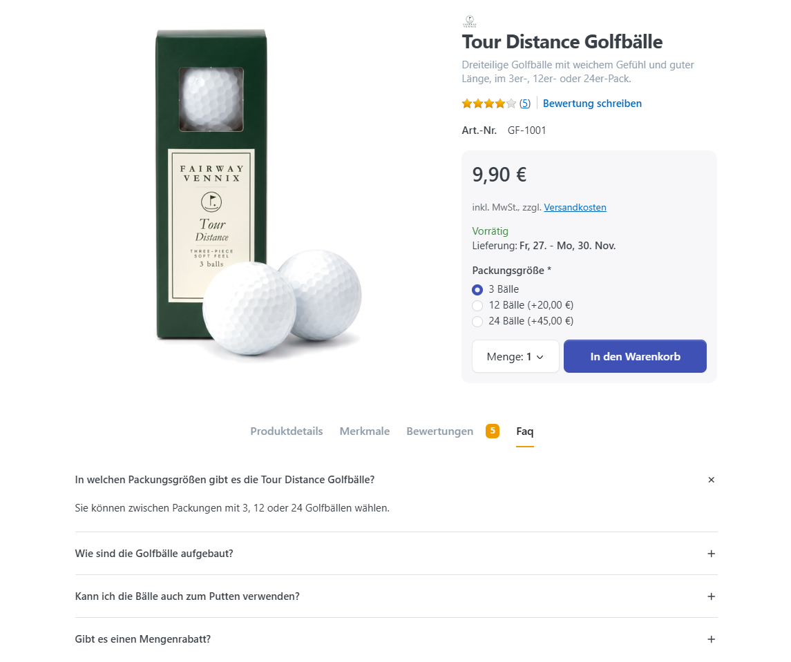
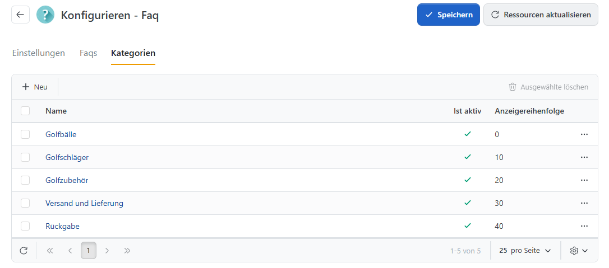
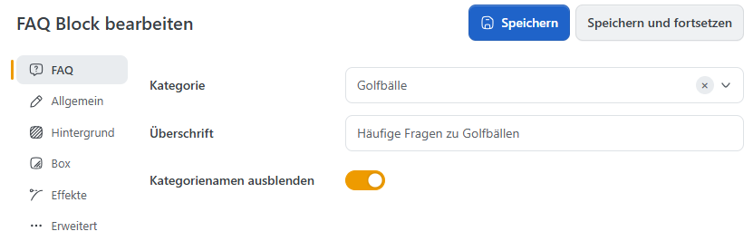
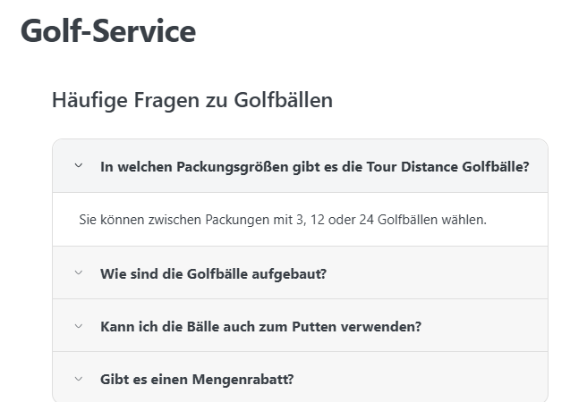

# FAQ

Mit dem Plugin **FAQ** zeigen Sie häufig gestellte Fragen und Antworten auf Produktdetailseiten oder auf Seiten, die Sie mit dem **Page Builder** gestaltet haben. Fragen und Antworten pflegen Sie zentral. Wenn Sie eine Antwort ändern, wird sie überall aktualisiert, wo diese Frage verwendet wird.

Allgemeine Fragen, etwa zur Auswahl von Golfausrüstung, können Sie einer Warengruppe zuordnen. Deren Produkte können diese Fragen übernehmen. Auch Fragen aus übergeordneten Warengruppen lassen sich übernehmen. Für ein bestimmtes Modell können Sie zusätzlich eigene Fragen am Produkt hinterlegen.

## Fragen anlegen

Damit Sie Fragen anlegen können, benötigen Sie eine Lizenz für das Plugin **FAQ**. [Installieren](plugins-installieren.md) Sie das Plugin und schalten Sie es frei. Öffnen Sie anschließend **CMS > FAQ**. Alternativ erreichen Sie dieselbe Seite über **Plugins > Plugins verwalten** in der Konfiguration des FAQ-Plugins.

Legen Sie zuerst eine **FAQ-Kategorie** an. In einer FAQ-Kategorie wie „Golfbälle“ sammeln Sie Fragen zu einem Thema. Unter **Katalog > Warengruppen** organisieren Sie Ihre Produkte. Dort legen Sie fest, welche Fragen die Produkte einer Warengruppe übernehmen können.

1. Wechseln Sie unter **CMS > FAQ** zum Tab **Kategorien** und klicken Sie auf **Neu**. Geben Sie der FAQ-Kategorie einen Namen, schalten Sie **Ist aktiv** ein und klicken Sie auf **Speichern**.

   

2. Wechseln Sie zum Tab **Faqs** und klicken Sie auf **Neu…**. Wählen Sie im Feld **Kategorie** die angelegte FAQ-Kategorie aus, geben Sie **Frage** und **Antwort** ein und schalten Sie **Ist aktiv** ein. Speichern Sie die Frage.

Über die **Anzeigereihenfolge** legen Sie fest, in welcher Reihenfolge die FAQ-Kategorien und die Fragen innerhalb einer Kategorie im Shop erscheinen. Kleinere Zahlen stehen zuerst. Namen, Fragen und Antworten können Sie auch in [mehreren Sprachen](../allgemeine-konzepte/mit-mehreren-sprachen-arbeiten.md) pflegen.

## Anzeige

### Für Produkte

Öffnen Sie unter **Katalog > Produkte** das gewünschte [Produkt](../../verwalten/katalog/produkte-verwalten/produkte-erstellen-und-bearbeiten.md) und wechseln Sie zum Tab **Faq**. Dort können Sie [Fragen direkt zuordnen](#bearbeiten) und festlegen, ob das Produkt zusätzlich Fragen aus seinen Warengruppen übernimmt.

- Schalten Sie **FAQs auf der Produktseite anzeigen** ein. Der Tab erscheint im Shop, sobald für das Produkt mindestens eine aktive Frage aus einer aktiven FAQ-Kategorie verfügbar ist.
- Schalten Sie **Zusätzlich FAQs aus Warengruppen übernehmen** ein, wenn auch Fragen aus den Warengruppen des Produkts erscheinen sollen. Ist dieselbe Frage mehrmals zugeordnet, wird sie nur einmal angezeigt.

Klicken Sie auf **Speichern**, damit die Schalter für die Produktdetailseite gelten. Öffnen Sie dann **Vorschau**. Dort können Sie im Tab **Faq** eine Frage anklicken, um die Antwort einzublenden.

### Für Warengruppen

Fragen, die Sie einer Warengruppe zuordnen, erscheinen auf den Produktdetailseiten der zugehörigen Produkte, sofern diese Fragen aus Warengruppen übernehmen. Auf der Warengruppenseite im Shop wird kein FAQ-Bereich eingeblendet.

Öffnen Sie unter **Katalog > Warengruppen** die gewünschte [Warengruppe](../../verwalten/katalog/warengruppen-organisieren.md) und wechseln Sie zum Tab **Faq**. Die Liste zeigt die Fragen, die Sie dieser Warengruppe direkt zugeordnet haben.

Mit **FAQs übergeordneter Warengruppen übernehmen** ergänzen Sie diese Fragen um Fragen aus den darüberliegenden Warengruppen. Der Schalter erscheint nur, wenn die Warengruppe eine übergeordnete Warengruppe hat. Klicken Sie nach einer Änderung auf **Speichern**.

**Beispiel:** Die Warengruppe „Golfbälle“ liegt unter „Golf & Sport“. Wenn „Golfbälle“ Fragen aus der übergeordneten Warengruppe übernimmt, können die Tour Distance Golfbälle auch Fragen aus „Golf & Sport“ anzeigen. Schalten Sie die Übernahme bei der Warengruppe „Golfbälle“ aus, entfallen die Fragen aus „Golf & Sport“. Fragen, die Sie der Warengruppe „Golfbälle“ direkt zugeordnet haben, können die Produkte weiterhin übernehmen.

## Bearbeiten

Im Tab **Faq** eines Produkts oder einer Warengruppe können Sie Fragen anlegen, zuordnen und Zuordnungen entfernen. Diese Änderungen werden sofort gespeichert. Geerbte Fragen sehen Sie in der Produktvorschau. In der Zuordnungsliste stehen nur die direkt zugeordneten Fragen.

- **Neue Frage anlegen:** Klicken Sie auf **Neu…**, füllen Sie das Formular aus und speichern Sie. Die Frage erscheint in der zentralen FAQ-Verwaltung und ist dem Produkt oder der Warengruppe direkt zugeordnet.
- **Vorhandene Fragen zuordnen:** Klicken Sie auf **Vorhandene FAQs zuordnen…**. Über den Trichter können Sie nach **Frage** und **Kategorie** filtern. Setzen Sie ein Häkchen bei den gewünschten Fragen und klicken Sie auf **Vorhandene FAQs zuordnen**.
- **Zuordnungen entfernen:** Öffnen Sie bei einer Frage das Menü mit den drei Punkten und wählen Sie **Zuordnung entfernen**. Für mehrere Fragen setzen Sie die Häkchen und klicken auf **Ausgewählte Zuordnungen entfernen**. Die Fragen bleiben unter **CMS > FAQ** erhalten.

## Page-Builder-Einbindung

Mit dem FAQ-Block können Sie häufig gestellte Fragen auch auf einer Serviceseite zeigen. Dazu fügen Sie den Block in eine **Story** ein. Eine Story ist ein Inhalt, den Sie im Page Builder gestalten und im Shop anzeigen. Der Block verwendet Fragen aus der zentralen FAQ-Verwaltung. Die Fragen müssen keinem Produkt zugeordnet sein.

1. Öffnen Sie unter **CMS > Page Builder** eine Story und fügen Sie den [Block **FAQ**](pagebuilder/blocks.md) ein.
2. Wählen Sie im Feld **Kategorie** ein Thema oder **Alle**. Im Feld **Überschrift** können Sie einen eigenen Titel eingeben. Mit **Kategorienamen ausblenden** blenden Sie die Namen der FAQ-Kategorien aus. Ihr eigener Titel bleibt sichtbar.
3. Speichern Sie die Story und prüfen Sie den Block in der Vorschau. Damit er im Shop erscheint, [platzieren und veröffentlichen Sie die Story](pagebuilder.md#story-im-shop-platzieren).

Unter **CMS > FAQ > Einstellungen** können Sie mit **Seiten-Navigation darstellen** im FAQ-Bereich eine seitliche Navigation zu den FAQ-Kategorien einblenden. Für den FAQ-Tab am Produkt gilt diese Einstellung nicht. Sie lässt sich [pro Shop festlegen](../konfiguration/einstellungen/den-einstellungsbereich-festlegen.md).

## Wenn eine FAQ am Produkt fehlt

- Ist **FAQs auf der Produktseite anzeigen** eingeschaltet und das Produkt gespeichert?
- Sind die Frage und ihre FAQ-Kategorie aktiv?
- Soll die Frage aus einer Warengruppe kommen? Prüfen Sie, ob am Produkt **Zusätzlich FAQs aus Warengruppen übernehmen** eingeschaltet ist. Die Warengruppe, aus der die Frage kommt, muss für den Besucher im Shop sichtbar sein. Wenn die Frage einer übergeordneten Warengruppe zugeordnet ist, prüfen Sie auch die Übernahme in den Warengruppen darunter.


