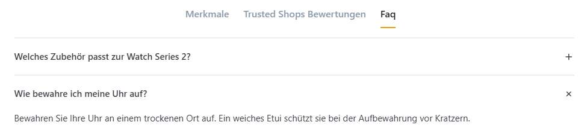
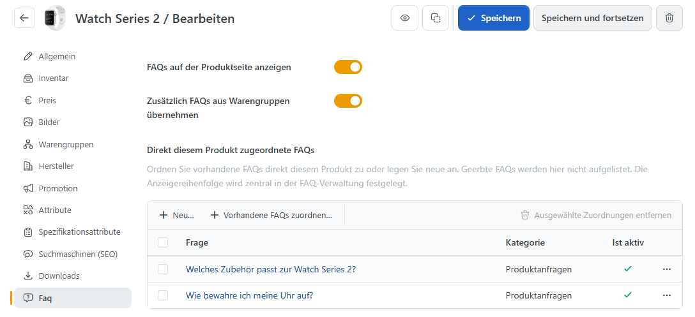

# FAQ

Mit dem Plugin **FAQ** zeigen Sie häufig gestellte Fragen auf Produktdetailseiten oder in einer Story im **Page Builder**. Fragen und Antworten pflegen Sie zentral. Änderungen an einer Frage gelten überall, wo sie verwendet wird.

## Fragen anlegen

Öffnen Sie **CMS > FAQ**. Sie können die FAQ-Verwaltung auch über **Plugins > Plugins verwalten** öffnen. Das lizenzpflichtige Plugin **FAQ** muss installiert und freigeschaltet sein. Eine Anleitung finden Sie unter [Plugins installieren](plugins-installieren.md).

1. Öffnen Sie **Kategorien** und klicken Sie auf **Neu**. Legen Sie eine **FAQ-Kategorie** an, etwa „Produktanfragen“. Schalten Sie **Ist aktiv** ein und speichern Sie.
2. Wechseln Sie zu **Faqs** und klicken Sie auf **Neu…**. Wählen Sie im Feld **Kategorie** die FAQ-Kategorie aus. Geben Sie **Frage** und **Antwort** ein, schalten Sie **Ist aktiv** ein und speichern Sie.

FAQ-Kategorien gruppieren Fragen nach Themen. Warengruppen gehören zum Produktkatalog und können FAQs an Produkte und untergeordnete Warengruppen weitergeben.

Über die **Anzeigereihenfolge** legen Sie fest, in welcher Reihenfolge die FAQ-Kategorien und die Fragen innerhalb einer Kategorie im Shop erscheinen. Kleinere Werte stehen zuerst. Namen, Fragen und Antworten können Sie für die eingerichteten [Shopsprachen](../allgemeine-konzepte/mit-mehreren-sprachen-arbeiten.md) pflegen.

## FAQs auf einer Produktdetailseite anzeigen

Öffnen Sie unter **Katalog > Produkte** das gewünschte [Produkt](../../verwalten/katalog/produkte-verwalten/produkte-erstellen-und-bearbeiten.md) und wechseln Sie zum Tab **Faq**.

- **FAQs auf der Produktseite anzeigen** schaltet den FAQ-Tab auf der Produktdetailseite ein, sobald mindestens eine anzeigbare Frage vorhanden ist.
- **Zusätzlich FAQs aus Warengruppen übernehmen** ergänzt die direkt zugeordneten Fragen um FAQs aus den Warengruppen des Produkts. Gehört ein Produkt zu mehreren Warengruppen, erscheint jede Frage höchstens einmal.

Speichern Sie das Produkt, um Änderungen an den Schaltern zu übernehmen. Über **Vorschau** prüfen Sie, welche Fragen im Shop erscheinen.

## FAQs einer Warengruppe zuordnen

Öffnen Sie unter **Katalog > Warengruppen** die gewünschte [Warengruppe](../../verwalten/katalog/warengruppen-organisieren.md) und wechseln Sie zum Tab **Faq**. Die Liste zeigt die Fragen, die dieser Warengruppe direkt zugeordnet sind.

**FAQs übergeordneter Warengruppen übernehmen** ergänzt diese Fragen um FAQs aus höheren Ebenen. Beispiel: In **Uhren > Automatikuhren > Chronographen** kann **Chronographen** Fragen aus beiden übergeordneten Warengruppen übernehmen. Ist der Schalter bei **Automatikuhren** ausgeschaltet, werden über diesen Pfad nur noch deren eigene Fragen weitergegeben. Bei einer Warengruppe ohne übergeordnete Warengruppe erscheint der Schalter nicht. Speichern Sie die Warengruppe, um die Änderung zu übernehmen.

### Fragen zuordnen oder entfernen

Diese Schritte gelten im FAQ-Tab eines Produkts und einer Warengruppe:

1. Klicken Sie auf **Vorhandene FAQs zuordnen…**. Über den Trichter können Sie die Liste nach **Frage** und **Kategorie** filtern.
2. Markieren Sie die gewünschten Fragen und bestätigen Sie mit **Vorhandene FAQs zuordnen**.

Mit **Neu…** legen Sie eine Frage an und ordnen sie beim Speichern direkt zu. Zum Entfernen wählen Sie im Zeilenmenü **Zuordnung entfernen** oder markieren mehrere Fragen und klicken auf **Ausgewählte Zuordnungen entfernen**. Zuordnungen werden sofort gespeichert. Die Frage selbst bleibt beim Entfernen unter **CMS > FAQ** erhalten.

## FAQs im Page Builder anzeigen

1. Öffnen Sie unter **CMS > Page Builder** eine Story und fügen Sie den [Block **FAQ**](pagebuilder/blocks.md) ein.
2. Wählen Sie unter **Kategorie** eine FAQ-Kategorie oder **Alle**. Legen Sie bei Bedarf eine eigene **Überschrift** fest. Mit **Kategorienamen ausblenden** blenden Sie die Namen der FAQ-Kategorien aus. Die eigene Überschrift bleibt sichtbar.
3. Speichern Sie die Story und prüfen Sie den Block in der Vorschau. Damit er im Shop erscheint, [platzieren und veröffentlichen Sie die Story](pagebuilder.md#story-im-shop-platzieren).

Unter **CMS > FAQ > Einstellungen** können Sie mit **Seiten-Navigation darstellen** eine seitliche Navigation zu den FAQ-Kategorien einblenden. Diese Einstellung gilt für die allgemeine FAQ-Ansicht, etwa im Page Builder. Sie lässt sich [pro Shop festlegen](../konfiguration/einstellungen/den-einstellungsbereich-festlegen.md).

## Wenn eine FAQ am Produkt fehlt

Prüfen Sie, ob **FAQs auf der Produktseite anzeigen** eingeschaltet und das Produkt gespeichert ist. Die Frage und ihre FAQ-Kategorie müssen aktiv sein. Bei übernommenen Fragen muss auch die beitragende Warengruppe für den Besucher im jeweiligen Shop sichtbar sein. Geerbte Fragen sehen Sie in der Produktvorschau. Die Zuordnungsliste im Admin zeigt nur die direkt zugeordneten Fragen.


