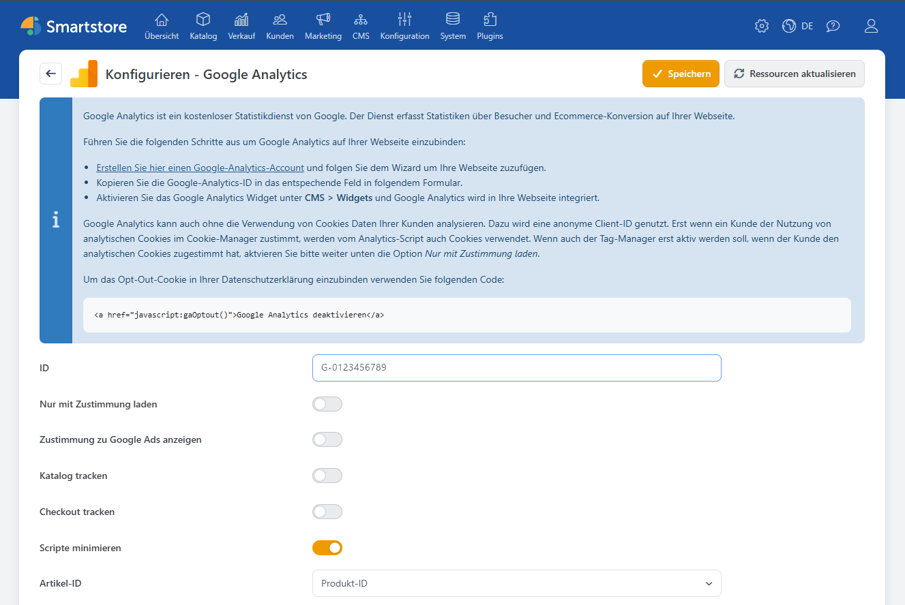

# Google Analytics

Mit dem Plugin **Google Analytics** verbinden Sie Ihren Smartstore-Shop mit Google Analytics und erhalten Einblicke in das Verhalten Ihrer Besucher. Je nach Konfiguration übermittelt das Plugin Seitenaufrufe sowie ausgewählte Ereignisse aus Produktkatalog, Warenkorb und Checkout, damit Sie Nutzung und Kaufverhalten in Google Analytics auswerten können.


Das Plugin übermittelt die in Smartstore aktivierten Ereignisse. Welche Informationen Google Analytics daraus darstellt und wie lange diese gespeichert werden, legen Sie in Ihrem Google-Analytics-Konto fest.


## Voraussetzungen

- ein Google-Analytics-Konto
- eine eingerichtete Google-Analytics-Property mit Web-Datenstream
- die zugehörige Mess-ID
- Zugriff auf die Smartstore-Administration

## Konfiguration

Öffnen Sie unter **Plugins > Plugins verwalten** die Konfiguration des Plugins **Google Analytics**. Hier hinterlegen Sie die Mess-ID, wählen die gewünschten Tracking-Bereiche und legen die Einstellungen für Cookies und Zustimmung fest.



| Einstellung | Beschreibung |
|---|---|
| **ID** | Mess-ID des Web-Datenstreams Ihrer Google-Analytics-Property, zum Beispiel `G-0123456789`. |
| **Nur mit Zustimmung laden** | Erst nachdem der Besucher analytischen Cookies zugestimmt hat, wird das Analytics-Skript geladen. Weitere Informationen finden Sie unter [Datenschutz, Cookies und Opt-out](#datenschutz-cookies-und-opt-out). |
| **Zustimmung zu Google Ads anzeigen** | Ergänzt den [Cookie-Manager](../konfiguration/cookie-manager.md) um Einwilligungen für werbebezogene Daten und personalisierte Werbung. Aktivieren Sie diese Option nur, wenn Sie Google Ads verwenden. |
| **Katalog tracken** | Erfasst unterstützte Aufrufe und Interaktionen im Produktkatalog, beispielsweise Produktdetailseiten, Produktlisten, Suchanfragen, die Auswahl eines Produkts und das Hinzufügen zum Warenkorb. |
| **Checkout tracken** | Erfasst unterstützte Ereignisse aus Warenkorb und Bestellprozess, beispielsweise den Aufruf des Warenkorbs, den Beginn des Checkouts, die Auswahl von Versand- und Zahlungsinformationen sowie den erfolgreichen Kaufabschluss. |
| **Scripte minimieren** | Verkleinert die erzeugten Tracking-Skripte. Diese Option sollte normalerweise aktiviert bleiben. |
| **Artikel-ID** | Bestimmt, mit welcher Kennung Produkte an Google Analytics übertragen werden. Weitere Informationen finden Sie unter [Artikel-ID festlegen](#artikel-id-festlegen). |


Die Einstellungen können über den Einstellungsbereich separat für jeden Shop hinterlegt werden. Weitere Informationen finden Sie unter [Multi-Shop-Konfiguration](../konfiguration/einstellungen/den-einstellungsbereich-festlegen.md).


Unterhalb der Einstellungen befinden sich drei Eingabefelder für die vom Plugin verwendeten Tracking-Code-Fragmente. Für die normale Einrichtung müssen diese Standardwerte nicht bearbeitet werden. Enthält der E-Commerce-Code noch einen Verweis auf das veraltete Skript `analytics.js`, zeigt Smartstore oben auf der Konfigurationsseite eine Warnung an. Mit **Scripte wiederherstellen** setzen Sie alle drei Codefelder auf die aktuellen Standardwerte zurück und überschreiben dabei eigene Änderungen in diesen Feldern.

### Google Analytics verbinden

1. Erstellen Sie in Google Analytics eine Property für Ihren Shop.
2. Richten Sie für die Website einen Web-Datenstream ein.
3. Kopieren Sie die zugehörige Mess-ID.
4. Wechseln Sie zurück zur Smartstore-Administration und öffnen Sie unter **Plugins > Plugins verwalten** die Konfiguration des Plugins **Google Analytics**.
5. Tragen Sie die Mess-ID in das Feld **ID** ein.
6. Aktivieren Sie bei Bedarf [**Katalog tracken** und **Checkout tracken**](#konfiguration).
7. Legen Sie die gewünschten Einstellungen für Cookies und Zustimmung fest.
8. Klicken Sie auf **Speichern**.

Aktivieren Sie anschließend unter **CMS > Widgets** das Widget **Google Analytics**, damit das Plugin die Tracking-Skripte in den Storefront einbindet. Weitere Informationen finden Sie unter [Widgets anordnen](../content-management/widgets-anordnen.md).


Der bei der Installation vorbelegte Wert `UA-0000000-0` gilt als nicht eingerichtete Mess-ID. Solange dieses Feld leer ist oder der vorbelegte Wert verwendet wird, bindet das Plugin kein Tracking ein.


### Artikel-ID festlegen

Die Einstellung **Artikel-ID** bestimmt, wie Produkte in Google Analytics identifiziert werden.

| Auswahl | Verwendung |
|---|---|
| **SKU** | Verwendet die Artikelnummer des Produkts beziehungsweise der ausgewählten Variante. |
| **Produkt-ID** | Verwendet die interne Produkt-ID aus Smartstore. |
| **Produkt-ID mit Varianten-ID** | Kombiniert die Produkt-ID mit der ID der ausgewählten Variante. |

Wenn Sie Google Ads oder einen Google-Merchant-Center-Feed verwenden, sollte die ausgewählte Artikel-ID mit der dort verwendeten Produktkennung übereinstimmen.


Ändern Sie die Artikel-ID nicht ohne Grund. Nach einer Änderung können Produkte in Google Analytics unter einer neuen Kennung erscheinen, wodurch zusammengehörige Statistiken getrennt werden.


## Datenschutz, Cookies und Opt-out

Google Analytics verarbeitet die vom Plugin übermittelten Informationen über Seitenaufrufe und aktivierte Shop-Ereignisse. Informieren Sie Ihre Besucher in den Datenschutzinformationen Ihres Shops über die Verwendung von Google Analytics und die dabei stattfindende Datenverarbeitung.

Mit **Nur mit Zustimmung laden** bestimmen Sie, dass das Analytics-Skript erst geladen wird, nachdem der Besucher analytischen Cookies zugestimmt hat. Wenn Sie zusätzlich Google Ads verwenden, können Sie mit **Zustimmung zu Google Ads anzeigen** weitere Auswahlmöglichkeiten für werbebezogene Daten und personalisierte Werbung im [Cookie-Manager](../konfiguration/cookie-manager.md) bereitstellen.

Für Besucher, die das Google-Analytics-Tracking deaktivieren möchten, stellt das Plugin eine Opt-out-Funktion bereit. Fügen Sie dazu beispielsweise folgenden Link in die Datenschutzseite Ihres Shops ein:

```html
<a href="javascript:gaOptout()">Google Analytics deaktivieren</a>
```

Nach Auswahl des Links wird die Deaktivierung für die konfigurierte Mess-ID im Browser des Besuchers gespeichert. Wie Sie den Link in einer Inhaltsseite einfügen, erfahren Sie unter [Seiten und Inhalte verwalten](../content-management/seiten-inhalte-verwalten.md). Prüfen Sie außerdem die Datenaufbewahrung, Einwilligungseinstellungen und weiteren Datenschutzoptionen direkt in Ihrem Google-Konto.

## Weiterführende Informationen

- [Widgets anordnen](../content-management/widgets-anordnen.md)
- [Cookie-Manager](../konfiguration/cookie-manager.md)
- [Multi-Shop Konfiguration](../konfiguration/einstellungen/den-einstellungsbereich-festlegen.md)
