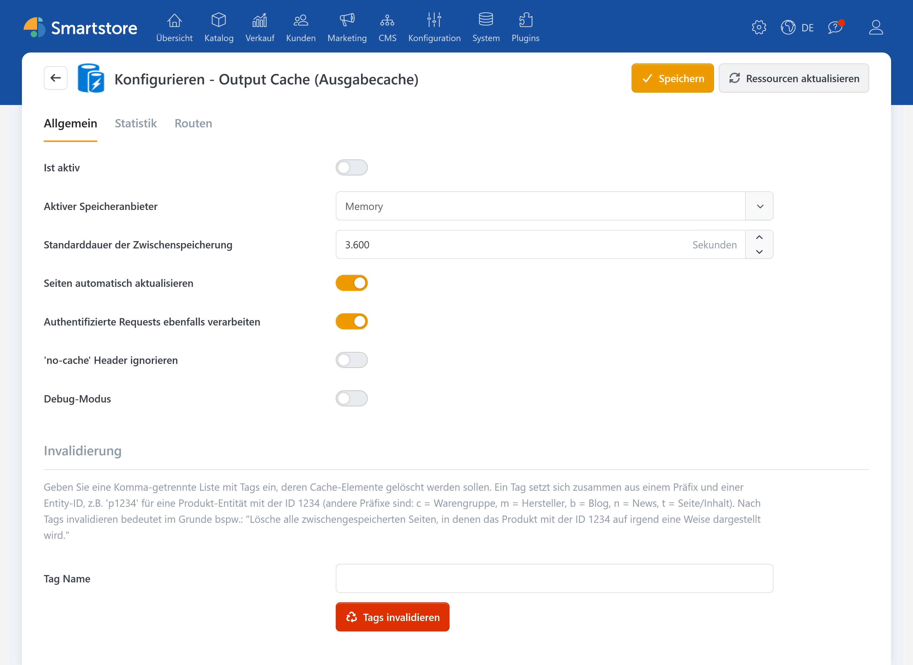
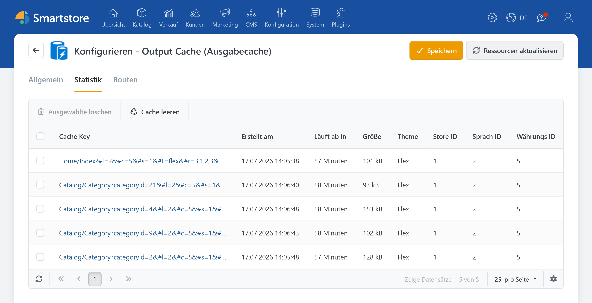

# Output Cache (Ausgabecache)

Der **Output Cache** speichert die erzeugte Ausgabe ausdrücklich dafür vorgesehener Shop-Seiten serverseitig zwischen. Bei passenden Anfragen kann Smartstore die gespeicherten Seitenbestandteile wiederverwenden, statt sie erneut zu erzeugen. Dynamische Bestandteile, etwa kundenspezifische Komponenten, werden bei Bedarf für jeden Aufruf neu erzeugt. Das kann Rechenzeit sparen und Seiten schneller ausliefern, vor allem bei stark frequentierten Kategorien und Übersichtsseiten.

Die automatische Invalidierung kann zwischengespeicherte Seiten entfernen, wenn sich relevante Inhalte im Shop ändern. Beim nächsten passenden Aufruf wird die Ausgabe neu erzeugt und wieder zwischengespeichert.

## Vorteile

### Schnellere Seitenladezeiten

Häufig besuchte Seiten müssen nicht jedes Mal komplett neu erstellt werden. Dadurch wird die Wartezeit insbesondere bei häufig aufgerufenen Seiten spürbar reduziert.

### Weniger Last auf dem System

Smartstore muss weniger Rechenarbeit leisten, weil die fertigen Seiteninhalte wiederverwendet werden. Dadurch fallen weniger wiederholte Verarbeitungsschritte bei jeder Anfrage an, und der Shop bleibt insgesamt _entspannter_ im Betrieb.

### Stabileres Nutzererlebnis bei hohem Traffic

Wenn viele Besucher gleichzeitig im Shop aktiv sind, steigt die Wahrscheinlichkeit, dass einzelne Seiten langsamer laden, da viele Anfragen parallel neu berechnet werden müssen. Nach dem ersten Aufruf können gespeicherte Seitenbestandteile bei weiteren passenden Anfragen wiederverwendet und so die Last bei vielen gleichzeitigen Besuchern gesenkt werden.

### Steuerung der Speicherzeit von Inhalten

Es kann festgelegt werden, wie lange eine Seite im Zwischenspeicher bleibt, bevor sie neu erstellt wird. Dadurch wird bestimmt, wie stark „Geschwindigkeit“ gegenüber „maximaler Aktualität“ priorisiert wird. Kurze Cache-Zeiten sorgen für aktuellere Inhalte, während längere Cache-Zeiten die Performance verbessern.

## Konfiguration

| **Option**                                      | **Beschreibung**                                                                                                                                                                                                                                                    |
| ----------------------------------------------- | ------------------------------------------------------------------------------------------------------------------------------------------------------------------------------------------------------------------------------------------------------------------- |
| Ist aktiv                                       | Legt fest, ob Ausgabespeicherung aktiv ist.                                                                                                                                                                                                                         |
| Aktiver Speicheranbieter                        | Bestimmt, wo die zwischengespeicherten Inhalte gespeichert werden. Der lokale Speicher ist schnell, eignet sich aber nicht für Webfarmen. Verwenden Sie in einer Webfarm eine Datenbank oder einen verteilten Speicheranbieter wie Redis.                           |
| Standarddauer der Zwischenspeicherung           | Legt die Dauer in Sekunden fest, die Seiten standardmäßig auf dem Server zwischengespeichert werden sollen.                                                                                                                                                         |
| Seiten automatisch aktualisieren                | Legt fest, ob zwischengespeicherte Seiten automatisch aktualisiert werden, wenn sich mindestens eine Abhängigkeit ändert. Dazu zählen beispielsweise Produkte, Warengruppen und Blog-Einträge.                                                                      |
| Authentifizierte Requests ebenfalls verarbeiten | Legt fest, ob das Caching auch dann aktiv ist, wenn der Kunde eingeloggt ist. Beachten Sie jedoch, dass lediglich nach Kundengruppen variiert wird, nicht nach einzelnen Kunden. Deaktivieren Sie diese Option, wenn ihr Shop kundenspezifischen Content generiert. |
| 'no-cache' Header ignorieren                    | Legt fest, ob Smartstore den Request-Header `Cache-Control: no-cache` ignoriert und vorhandene Cache-Einträge trotzdem ausliefert.                                                                                                                                  |
| Debug-Modus                                     | Gibt die Header `X-SmartStore-Cached-On` und `X-SmartStore-Cached-Until` in der Antwort aus.                                                                                                                                                                        |

### Invalidierung

Tags kennzeichnen Inhalte, die auf zwischengespeicherten Seiten dargestellt werden. Wenn nach einer Änderung beispielsweise ein Produkt noch mit alten Angaben erscheint, können Sie mit dem Tag der Entität gezielt die betroffenen Cache-Einträge entfernen. Für ein Produkt mit der ID 1234 lautet das Tag `p1234`.


**Achtung**

Die Optionen Routen und Invalidierung sollten nur von erfahrenen Anwendern genutzt / geändert werden.


Geben Sie im Tab Allgemein einen oder mehrere durch Kommas getrennte Tags ein und wählen Sie „Tags invalidieren“. Im Gegensatz zu „Cache leeren“ bleiben Einträge ohne diese Tags erhalten. Die entfernten Seiten werden beim nächsten Aufruf neu erzeugt; dieser Aufruf kann deshalb mehr Zeit und Serverleistung benötigen. Verwenden Sie die Funktion, wenn eine gezielte Aktualisierung nötig ist, etwa weil die automatische Invalidierung nicht gegriffen hat.

## Statistik und Routen

Im Tab Statistik sehen Sie die gespeicherten Cache-Einträge mit Angaben wie Erstellungszeitpunkt, Restlaufzeit und Größe. Über den Cache-Key öffnen Sie die Details eines Eintrags, darunter Route, URL und Tags.

Sie können einzelne oder ausgewählte Einträge löschen oder den gesamten Cache leeren. Das ist hilfreich, wenn noch veraltete Ausgaben angezeigt werden: Beim nächsten Aufruf erzeugt Smartstore die gelöschten Seiten neu. Eine vollständige Leerung betrifft alle Einträge und kann deshalb vorübergehend mehr Serverleistung beanspruchen.

Im Tab Routen sehen Sie, welche Seiten- und Komponentenrouten für den Output Cache vorgesehen sind. Nur ausdrücklich freigegebene Seitenrouten werden zwischengespeichert. Bei Komponentenrouten wird festgelegt, ob ihr Inhalt mit der Seite gespeichert oder bei jedem Aufruf neu erzeugt wird. Eine passende Auswahl hilft, ungeeignete oder veraltete Inhalte im Cache zu vermeiden.

Bei Seitenrouten können Sie die Zwischenspeicherung aktivieren oder deaktivieren, die Speicherdauer festlegen und zugehörige Cache-Einträge gezielt entfernen. Das ist hilfreich, wenn nur Seiten einer bestimmten Route veraltete Ausgaben zeigen. Benutzerdefinierte Routen lassen sich hinzufügen und löschen.


