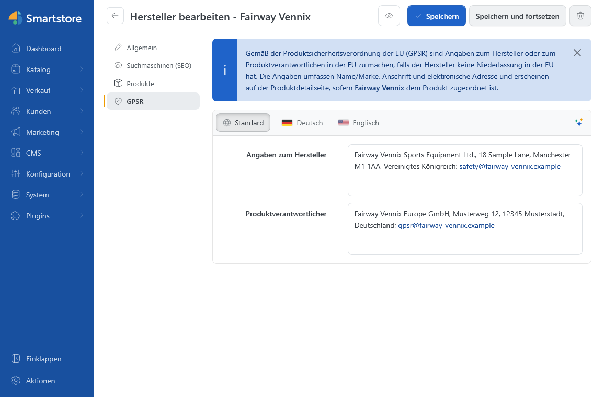
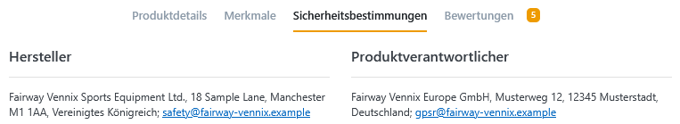
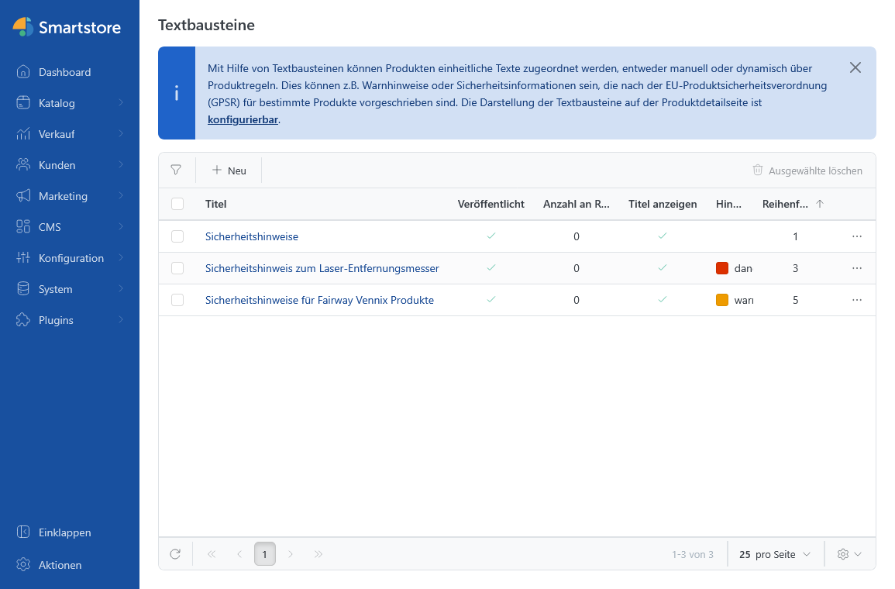
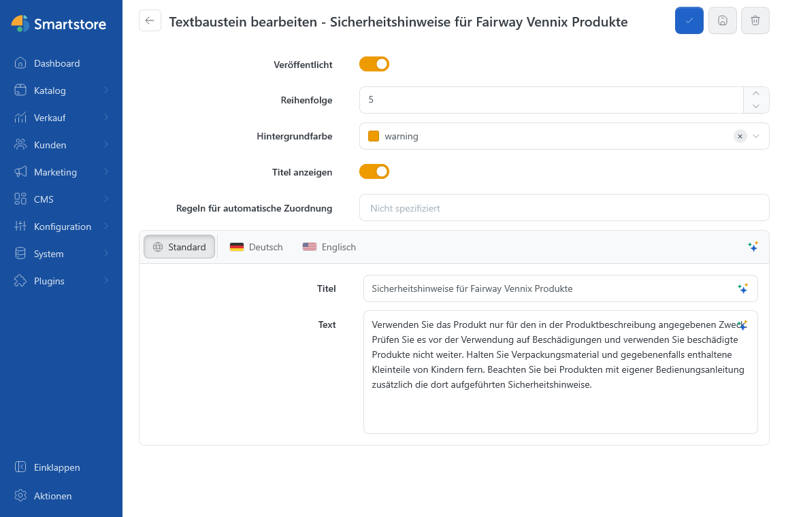
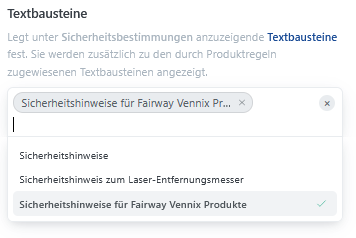
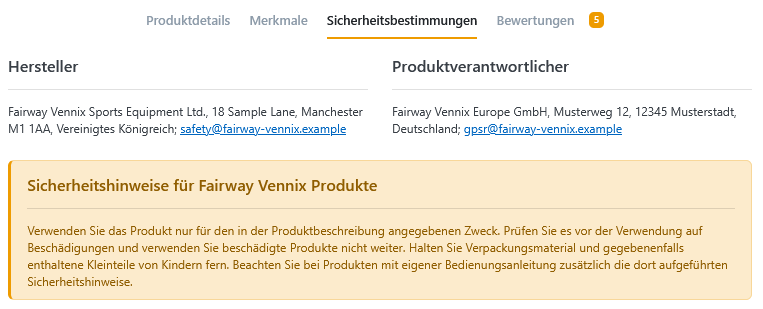
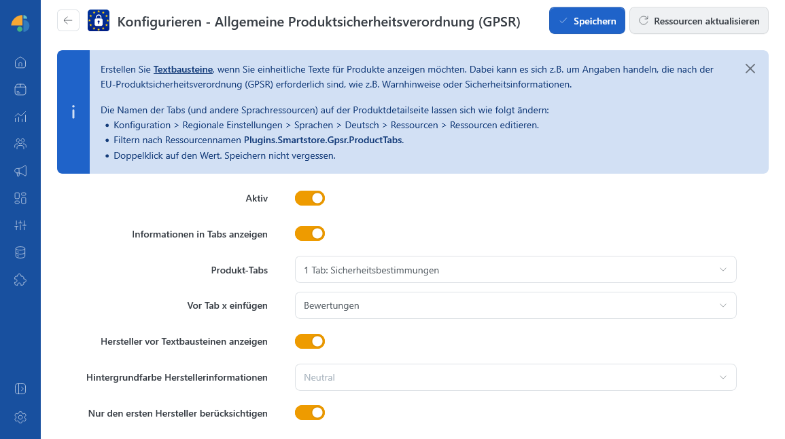

# Produktsicherheitsverordnung (GPSR)

Das GPSR-Plugin ergänzt Smartstore um Funktionen zur Pflege und Anzeige von Produktinformationen im Zusammenhang mit [der Verordnung (EU) 2023/988](https://eur-lex.europa.eu/eli/reg/2023/988/oj/deu) (GPSR).

Es können insbesondere folgende Angaben gepflegt und auf der Produktdetailseite angezeigt werden:

* Angaben zum Hersteller
* Produkthinweise
* Sicherheitshinweise


Die in diesem Artikel angeführten Beispiele sind weder rechtsverbindlich noch rechtskonform. Sie dienen lediglich der Erläuterung und Anwendung.


## Herstellerdaten anzeigen

Die Angaben zum Hersteller hinterlegen Sie im Backend unter **Katalog** → **Hersteller** im Tab **GPSR**.

| **Option**              | **Beschreibung**                                                                                                                           | **Beispiel**                                                                                                                                                                                                                                                 |
| ----------------------- | ------------------------------------------------------------------------------------------------------------------------------------------ | ------------------------------------------------------------------------------------------------------------------------------------------------------------------------------------------------------------------------------------------------------------ |
| Angaben zum Hersteller  | 
- Hersteller- bzw. Markenname - Postanschrift - Elektronische Adresse (E-Mail / Website)
                                      | Fairway Vennix Sports Equipment Ltd., 18 Sample Lane, Manchester M1 1AA, Vereinigtes Königreich; safety@fairway-vennix.example |
| Produktverantwortlicher | 
- Wenn der Hersteller nicht in der EU niedergelassen ist - Name - Postanschrift - Elektronische Adresse (E-Mail / Website)
 | Fairway Vennix Europe GmbH, Musterweg 12, 12345 Musterstadt, Deutschland; gpsr@fairway-vennix.example |

Die hinterlegten GPSR-Angaben eines zugeordneten Herstellers können auf der Produktdetailseite angezeigt werden. Sind einem Produkt mehrere Hersteller zugeordnet, berücksichtigt das Plugin standardmäßig nur den ersten. Diese Einstellung lässt sich in der Plugin-Konfiguration ändern.

## Textbausteine hinzufügen

Warnungs- und Sicherheitshinweise können als Textbausteine manuell, oder automatisch per Regeln hinzugefügt werden. Navigieren Sie dazu im Backend auf **CMS** → **Textbausteine.**

Über **Neu** können weitere Textbausteine hinzugefügt werden.

| **Option**                        | **Beschreibung**                                                                                                               | **Beispiel**                                                                                                                                                                                                                                           |
| --------------------------------- | ------------------------------------------------------------------------------------------------------------------------------ | ------------------------------------------------------------------------------------------------------------------------------------------------------------------------------------------------------------------------------------------------------ |
| Veröffentlicht                    |                                                                                                                                | An                                                                                                                                                                                                                                                     |
| Reihenfolge                       | Legt die Anzeige-Priorität fest. 1 steht bspw. für das erste Element in der Liste.                                             | 5                                                                                                                                                                                                                                                      |
| Hintergrundfarbe                  | Legt die Hintergrundfarbe der Hinweis-Box fest. Leer lassen, wenn der Text nicht in einer Hinweis-Box angezeigt werden soll.   | warning                                                                                                                                                                                                                                                |
| Titel anzeigen                    | Legt fest, ob der Titel angezeigt wird.                                                                                        | An                                                                                                                                                                                                                                                     |
| Regeln für automatische Zuordnung | Der Textbaustein wird automatisch Produkten zugeordnet, wenn diese eine der gewählten Regeln erfüllen und die Regel aktiv ist. | _&lt;Nicht spezifiziert&gt;_                                                                                                                                                                                                                                |
| Titel                             | Der Titel des Textbausteins.                                                                                                   | _Sicherheitshinweise für Fairway Vennix Produkte_ |
| Text                              | Der Textinhalt des Textbausteins.                                                                                              | _Verwenden Sie das Produkt nur für den in der Produktbeschreibung angegebenen Zweck. Prüfen Sie es vor der Verwendung auf Beschädigungen und verwenden Sie beschädigte Produkte nicht weiter. Halten Sie Verpackungsmaterial und gegebenenfalls enthaltene Kleinteile von Kindern fern. Beachten Sie bei Produkten mit eigener Bedienungsanleitung zusätzlich die dort aufgeführten Sicherheitshinweise._ |


Auch Medien, wie Bilder und PDFs lassen sich problemlos über Textbausteine per Link in HTML einbinden.


## Textbausteine zuweisen

Um einem Produkt ein oder mehrere Textbausteine zuzuweisen, navigieren Sie zum gewünschten Produkt und wählen Sie den GPSR-Tab aus.

Wählen Sie die gewünschten Textbausteine aus der Liste aus, um sie auf der Produktdetailseite anzuzeigen.

Die Darstellung der Herstellerdaten und Textbausteine kann in [der Konfiguration](produktsicherheitsverordnung-gpsr.md#konfiguration) geändert werden.

## Konfiguration

| Option                                    | Beschreibung                                                                                                                                                                                     |
| ----------------------------------------- | ------------------------------------------------------------------------------------------------------------------------------------------------------------------------------------------------ |
| Aktiv                                     |                                                                                                                                                                                                  |
| Informationen in Tabs anzeigen            | Legt fest, ob die GPSR-Informationen auf der Produktdetailseite in Tabs angezeigt werden. Falls deaktiviert, werden sie in Blöcken unter dem Langtext angezeigt.                                 |
| Produkt-Tabs                              | Legt die Tabs auf der Produktdetailseite fest, in denen die Informationen zur Produktsicherheit angezeigt werden.                                                                                |
| Vor Tab x einfügen                        | Legt den Namen des Tabs fest, vor den die GPSR-Tabs eingefügt werden sollen. Leer lassen, um sie anzuhängen.                                                                                     |
| Hersteller vor Textbausteinen anzeigen    | Legt fest, ob die Herstellerinformationen vor den Textbausteinen angezeigt werden.                                                                                                               |
| Hintergrundfarbe Herstellerinformationen  | Legt die Hintergrundfarbe der Hinweis-Box fest, in der die Herstellerinformationen angezeigt werden. Leer lassen, wenn der Hersteller nicht in einer Hinweis-Box angezeigt werden soll.          |
| Nur den ersten Hersteller berücksichtigen | Legt fest, ob nur die Informationen des ersten dem Produkt zugeordneten Herstellers angezeigt werden sollen. Wenn deaktiviert, werden die Informationen aller zugeordneten Hersteller angezeigt. |


