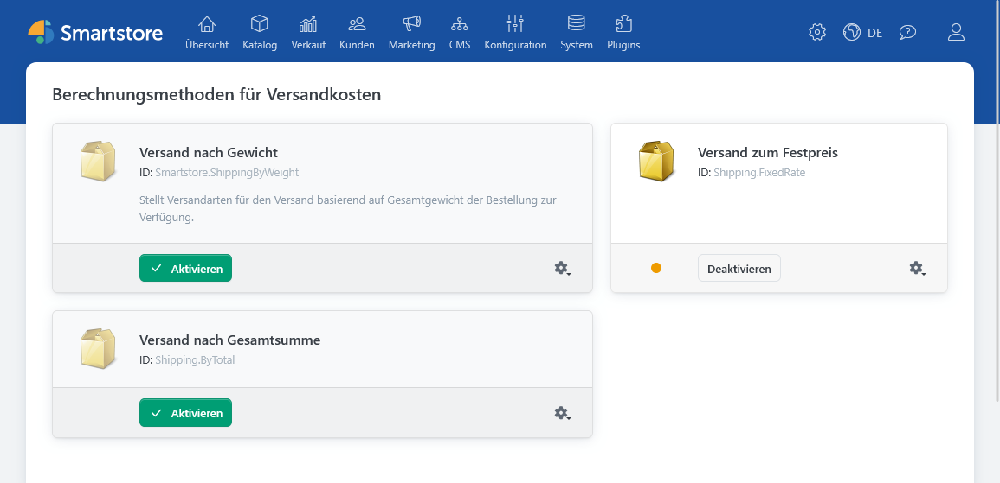
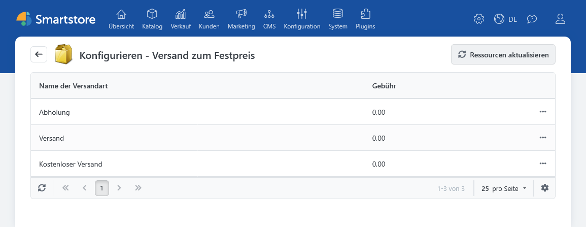
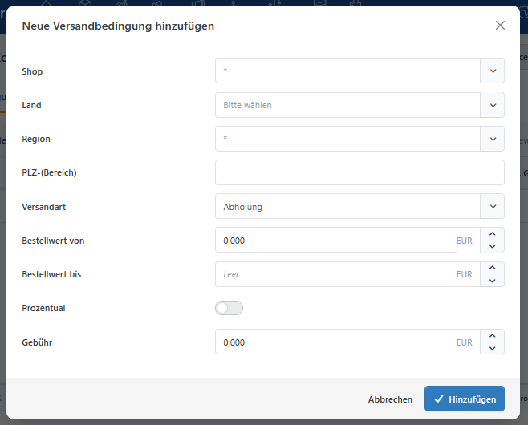
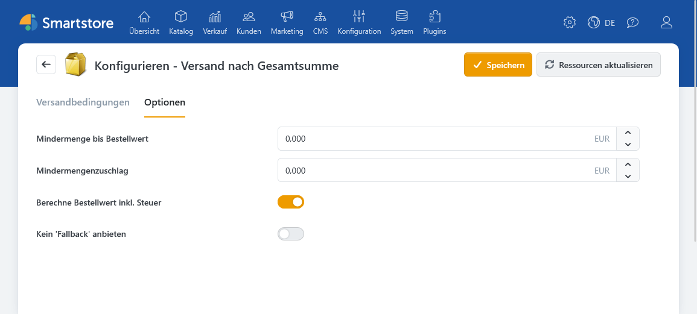

# Versandarten

Das Plugin **Shipping** stellt zwei Berechnungsmethoden für Versandkosten bereit: **Versand zum Festpreis** und **Versand nach Gesamtsumme**. Beide verwenden die im Shop angelegten Versandarten. Die Versandart bestimmt unter anderem Name, Beschreibung und Anzeigereihenfolge; die Berechnungsmethode liefert den Preis.

Wie Sie Versandarten anlegen und einschränken, beschreibt [Versandarten einrichten](../konfiguration/versandarten-einrichten.md). Allgemeine Regeln, etwa kostenlosen Versand ab einem Bestellwert, finden Sie unter [Versand-Einstellungen](../konfiguration/einstellungen/versand-einstellungen.md).

## Einrichtung

1. Legen Sie unter **Konfiguration > Regionale Einstellungen > Versandarten** die benötigten Versandarten an.
2. Öffnen Sie **Konfiguration > Regionale Einstellungen > Berechnungsmethoden für Versandkosten** und aktivieren Sie die gewünschte Methode.
3. Öffnen Sie deren Konfiguration und hinterlegen Sie Festpreise oder Versandbedingungen.
4. Prüfen Sie die angezeigten Optionen im Checkout mit den für Ihren Shop relevanten Lieferadressen und Warenkörben.

Mehrere Berechnungsmethoden können gleichzeitig aktiv sein. Smartstore sammelt ihre Versandoptionen und sortiert diese zunächst nach der Anzeigereihenfolge der Versandart, dann nach dem Preis. Wenn beide Methoden dieselbe Versandart anbieten, können entsprechend mehrere Optionen für sie entstehen.

## Versand zum Festpreis

Bei **Versand zum Festpreis** hinterlegen Sie für jede Versandart eine feste Gebühr. Öffnen Sie die Konfiguration der Berechnungsmethode und bearbeiten Sie den Betrag direkt in der Liste. Die Gebühr bleibt unabhängig vom Bestellwert und vom Gewicht gleich.

Ein typischer Einsatz ist eine Versandart mit gleichbleibenden Kosten für ein bestimmtes Liefergebiet. Die Einschränkung der Versandart selbst richten Sie wie unter [Versandarten einrichten](../konfiguration/versandarten-einrichten.md) beschrieben ein.

## Versand nach Gesamtsumme

Bei **Versand nach Gesamtsumme** legen Sie Versandbedingungen an. Jede Bedingung gehört zu einer Versandart und definiert, bei welchem Bestellwert und gegebenenfalls für welches Zielgebiet eine Gebühr gilt.

| Feld | Bedeutung |
|---|---|
| **Shop** | Beschränkt die Bedingung auf einen Shop. Ohne Auswahl gilt sie shopübergreifend. |
| **Land und Region** | Beschränken die Bedingung auf das Liefergebiet. Ohne Einschränkung gilt sie auch für andere passende Gebiete. |
| **PLZ** | Erlaubt einzelne Postleitzahlen, kommagetrennte Werte und Muster mit `*` oder `?`. Ein leeres Feld schränkt die Postleitzahl nicht ein. |
| **Versandart** | Bestimmt, für welche Versandart die Gebühr berechnet wird. |
| **Bestellwert von / bis** | Legt den gültigen Wertbereich fest. Beide eingetragenen Grenzen zählen zum Bereich. Eine leere Obergrenze bedeutet, dass keine Obergrenze gilt. |
| **Gebühr** | Legt entweder einen festen Betrag oder eine prozentuale Berechnung fest. |

Wenn Sie **Prozentual** aktivieren, können Sie zusätzlich eine **Basisgebühr** und eine **maximale Gebühr** angeben. Ohne diese Option tragen Sie einen festen Gebührenbetrag ein.

Für die Auswahl einer Bedingung gibt es keine fachliche Vorrangregel nach dem Muster „das genaueste Liefergebiet gewinnt“. Vermeiden Sie deshalb überlappende Bedingungen für dieselbe Versandart, denselben Bestellwert und dasselbe Zielgebiet. Das gilt besonders an Wertgrenzen, weil sowohl „von“ als auch „bis“ einschließlich geprüft werden.

### Optionen

Im Reiter **Optionen** bestimmen Sie, ob der maßgebliche Bestellwert **inklusive Steuer** berechnet wird. Produkte mit kostenlosem Versand sowie Produkte ohne Versandpflicht gehen nicht in diesen Bestellwert ein.

Sie können außerdem einen **Mindermengenzuschlag** und den Bestellwert festlegen, bis zu dem er anfällt. Der Zuschlag wird nur zu einer bereits positiven Versandgebühr addiert. Informationen zu versandkostenfreien Produkten und produktbezogenen Transportzuschlägen finden Sie unter [Produkte erstellen und bearbeiten](../../verwalten/katalog/produkte-verwalten/produkte-erstellen-und-bearbeiten.md).


**Prüfen Sie die Einstellung „Kein ‚Fallback‘ anbieten“:** Standardmäßig kann eine Versandart ohne passende Bedingung mit einer Gebühr von `0` als Fallback angeboten werden. Aktivieren Sie die Einstellung, wenn Versandarten ohne passende Bedingung nicht erscheinen sollen.


## Zusammenspiel mit weiteren Versandeinstellungen

Die allgemeinen [Versand-Einstellungen](../konfiguration/einstellungen/versand-einstellungen.md) enthalten unter anderem Regeln für kostenlosen Versand ab einem Bestellwert und für die Versandartauswahl im Checkout. Auch [Kundengruppen](../kunden/kundengruppen-verwalten.md) können kostenlosen Versand gewähren. Berücksichtigen Sie diese Einstellungen, wenn Sie einen berechneten Preis im Checkout prüfen.

Das Shipping-Plugin berechnet Versandoptionen und Gebühren. Das Anlegen und Bearbeiten tatsächlicher Sendungen wird unter [Sendungen verwalten](../../verwalten/verkauf/sendungen-verwalten.md) beschrieben.
