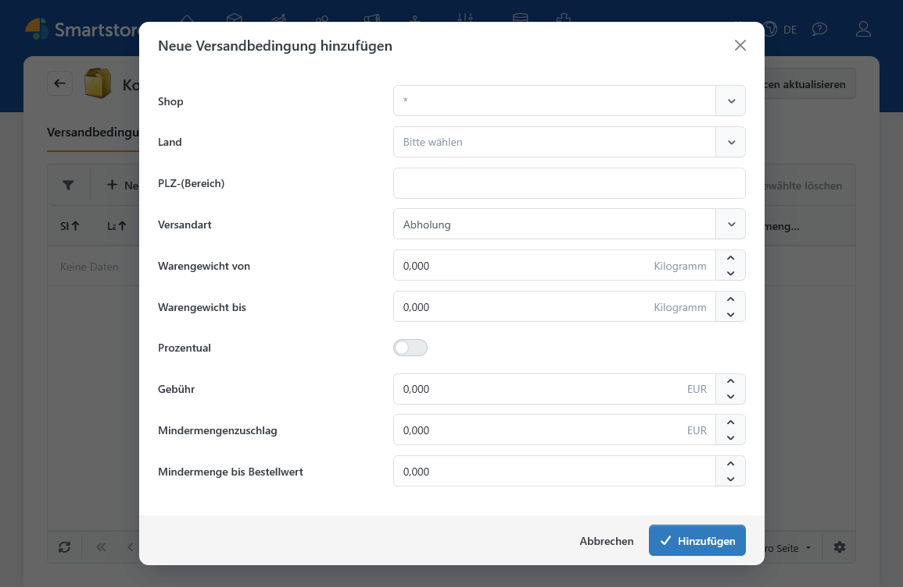
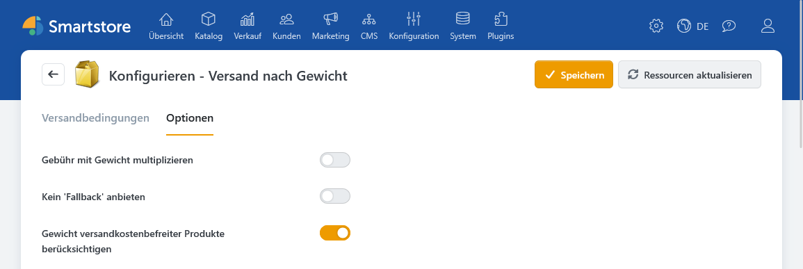

# Versand nach Gewicht (ShippingByWeight)

Mit dem Plugin **Versand nach Gewicht** berechnen Sie Versandkosten anhand des Gesamtgewichts eines Warenkorbs. Dazu legen Sie Versandbedingungen für eine Versandart, einen Gewichtsbereich und bei Bedarf einen Shop oder ein Liefergebiet an. Die Gebühr kann ein fester Betrag, ein Betrag pro Gewichtseinheit oder ein Prozentsatz des Warenwerts sein.

Die Versandarten selbst legen Sie getrennt von ihren Preisen an. Wie das geht und wie Sie eine Versandart für bestimmte Kunden oder Liefergebiete ausschließen, beschreibt [Versandarten einrichten](../konfiguration/versandarten-einrichten.md).

## Einrichtung

1. Legen Sie unter **Konfiguration > Regionale Einstellungen > Versandarten** die benötigten Versandarten an.
2. Öffnen Sie **Konfiguration > Regionale Einstellungen > Berechnungsmethoden für Versandkosten** und aktivieren Sie **Versand nach Gewicht**.
3. Öffnen Sie die Konfiguration der Berechnungsmethode. Erfassen Sie im Reiter **Versandbedingungen** mindestens eine Bedingung für jede Versandart, die Sie mit dem Plugin anbieten möchten.
4. Prüfen Sie im Reiter **Optionen** die Berechnung pro Gewichtseinheit, die Behandlung versandkostenbefreiter Produkte und das Verhalten bei fehlenden Bedingungen.

## Versandbedingung anlegen

Klicken Sie im Reiter **Versandbedingungen** auf **Neue Versandbedingung hinzufügen**. Ein Eintrag gilt für eine Versandart und einen Gewichtsbereich. Mit Shop, Land und Postleitzahl können Sie seinen Geltungsbereich weiter eingrenzen.

| Feld | Bedeutung |
| --- | --- |
| **Shop** | Wählen Sie einen Shop oder `*` für alle Shops. |
| **Land** | Wählen Sie ein Bestimmungsland oder `*` für alle Länder. |
| **PLZ-(Bereich)** | Ein leeres Feld oder `*` schränkt die Postleitzahl nicht ein. Einzelne Werte und Muster mit `*` oder `?` sind möglich; mehrere Angaben trennen Sie durch Kommas. |
| **Versandart** | Bestimmt, für welche angelegte Versandart die Bedingung gilt. |
| **Warengewicht von / bis** | Legt den gültigen Gewichtsbereich in der angezeigten Standardgewichtseinheit fest. **Beide Grenzen zählen mit.** |
| **Prozentual / Gebühr %** | Berechnet die Gebühr als Prozentsatz des berücksichtigten Warenwerts, nicht des Gewichts. |
| **Gebühr** | Fester Betrag. Wenn die Option **Gebühr mit Gewicht multiplizieren** aktiv ist, wird dieser Betrag mit dem Gesamtgewicht multipliziert. |
| **Mindermengenzuschlag / Mindermenge bis Bestellwert** | Zusätzlicher Betrag, wenn der maßgebliche Warenwert unter der eingetragenen Schwelle liegt. Mit `0` als Schwelle fällt kein solcher Zuschlag an. |

Die Gewichtseinheit stammt aus der [Verwaltung der Gewichte und Maßeinheiten](../konfiguration/gewichte-verpackungseinheiten-abmessungen-verwalten.md). Prüfen Sie vor dem Anlegen Ihrer Bereiche auch die Gewichte der Produkte.


Vermeiden Sie überlappende Bedingungen für dieselbe Versandart und dasselbe Zielgebiet. Ein Gewicht genau auf dem Wert **„bis“** gehört noch zum Bereich. Zwei Bereiche wie `0–5` und `5–10` überschneiden sich daher bei `5`.


## Gebühren und Optionen

Bei einer **festen Gebühr** berechnet das Plugin den eingetragenen Betrag einmal. Aktivieren Sie **Gebühr mit Gewicht multiplizieren**, wenn der Betrag je Gewichtseinheit gelten soll. Bei einer **prozentualen Gebühr** dient dagegen der Warenwert als Berechnungsgrundlage. Die Gewichtsoption wirkt sich darauf nicht aus. In die Prozentsumme gehen versandpflichtige Warenkorbpositionen inklusive Steuer ein.

Im Reiter **Optionen** stehen außerdem diese Einstellungen bereit:

| Option | Wirkung |
| --- | --- |
| **Gewicht versandkostenbefreiter Produkte berücksichtigen** | Bestimmt, ob das Gewicht solcher Produkte bei der Auswahl des Gewichtsbereichs und bei einer Gebühr pro Gewichtseinheit mitzählt. Die Option ist standardmäßig aktiviert. |
| **Kein 'Fallback' anbieten** | Ist die Option deaktiviert, kann eine Versandart ohne passende Bedingung mit einer Gebühr von `0` angeboten werden. Ist sie aktiviert, wird diese Versandart in dem Fall nicht angeboten. |

Der **Mindermengenzuschlag** wird hinzugefügt, wenn der maßgebliche Warenwert unter der Schwelle liegt. Für den Vergleich verwendet das Plugin je nach Steueranzeige des Kunden den Warenwert mit oder ohne Steuer.

## Ergebnis im Checkout prüfen

Testen Sie die Bedingungen mit Warenkörben an den Gewichtsgrenzen sowie mit den relevanten Lieferländern und Postleitzahlen. Prüfen Sie auch einen Warenkorb, für den keine Bedingung passt. So sehen Sie, ob das gewünschte Fallback-Verhalten eintritt.

Weitere Einstellungen können den angezeigten Versandpreis beeinflussen:

- Die [Versand-Einstellungen](../konfiguration/einstellungen/versand-einstellungen.md) enthalten allgemeine Regeln für kostenlosen Versand.
- [Kundengruppen](../kunden/kundengruppen-verwalten.md) können kostenlosen Versand erhalten.
- Versandkostenfreie Produkte und produktbezogene Versandzuschläge werden unter [Produkte erstellen und bearbeiten](../../verwalten/katalog/produkte-verwalten/produkte-erstellen-und-bearbeiten.md) erläutert.
