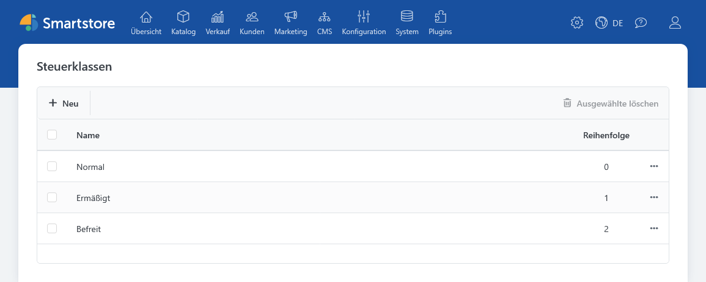
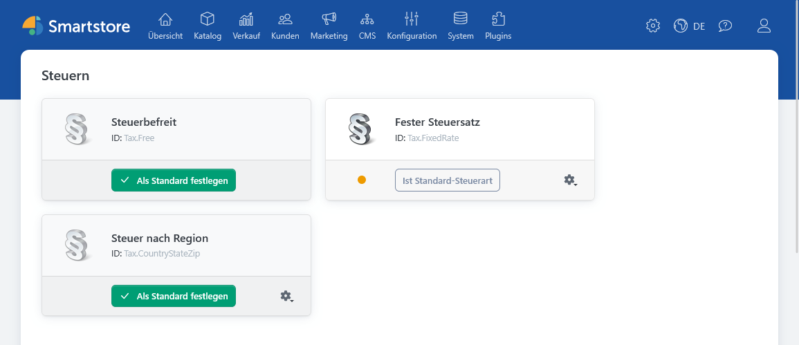
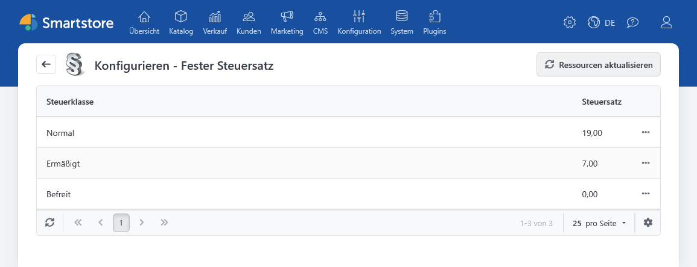
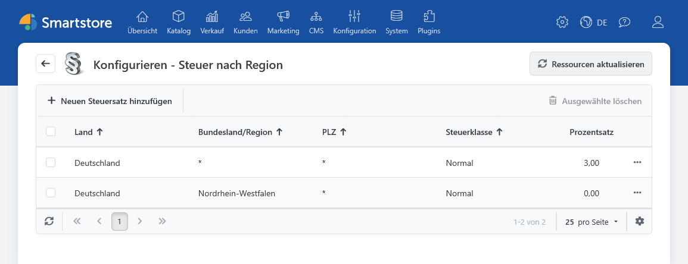
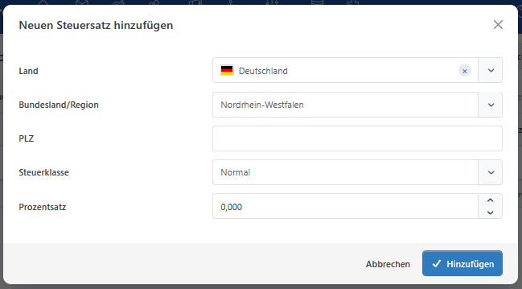

# Tax (Standard-Steuerberechnung)

Das Plugin **Tax** stellt die Steueranbieter **Fester Steuersatz** und **Steuer nach Region** bereit. Beide berechnen Steuersätze für die Steuerklassen, die Sie Ihren Produkten zuordnen. Welcher Anbieter verwendet wird, legen Sie in der Steueranbieterverwaltung fest. Berücksichtigen Sie bei der Einrichtung auch die [allgemeinen Grundlagen der Steuerberechnung](../konfiguration/steuerberechnung-einrichten.md).

## Steuerklassen vorbereiten

Legen Sie unter **Konfiguration > Regionale Einstellungen > Steuerklassen** zunächst die benötigten Steuerklassen an und ordnen Sie sie den steuerpflichtigen Produkten zu. Eine Steuerklasse bezeichnet noch keinen festen Prozentsatz: Den anzuwendenden Satz hinterlegen Sie anschließend beim Steueranbieter. Ein Produkt kann unabhängig davon als **MwSt.-frei** gekennzeichnet werden.

## Steueranbieter auswählen

Öffnen Sie **Konfiguration > Regionale Einstellungen > Steuer > Steuern**. Wählen Sie dort den gewünschten Steueranbieter und legen Sie ihn als primären Anbieter fest. Konfigurieren Sie anschließend die zugehörigen Steuersätze.

### Fester Steuersatz

Beim Anbieter **Fester Steuersatz** tragen Sie für jede Steuerklasse einen Prozentsatz ein. Dieser Satz gilt unabhängig von Land, Region oder Postleitzahl der maßgeblichen Steueradresse.

### Steuer nach Region

Beim Anbieter **Steuer nach Region** erfassen Sie Sätze für eine Kombination aus **Land**, optionaler **Region**, optionaler **Postleitzahl** und **Steuerklasse**.

So können Sie einen allgemeinen Satz für ein Land und speziellere Sätze für einzelne Regionen oder Postleitzahlen pflegen. Ein passender spezieller Eintrag hat Vorrang vor einem allgemeineren Eintrag. Findet der Anbieter keinen passenden Eintrag, beträgt sein Ergebnis 0 %.


Wenn die EU-Umsatzsteuerberechnung aktiviert ist und die maßgebliche Adresse zu einem Land gehört, das in Smartstore nicht der Umsatzsteuer unterliegt, verwendet **Steuer nach Region** als Rückfallwert den *festen Steuersatz* der Steuerklasse. Prüfen Sie deshalb auch diese Sätze, wenn Sie den regionalen Anbieter einsetzen.


Die [Länder und Regionen](../konfiguration/lander-und-regionen-verwalten.md) müssen vor dem Erfassen der regionalen Steuersätze angelegt sein.

## Allgemeine Steuereinstellungen

Unter **Konfiguration > Finanzen** legen Sie in den [Steuer-Einstellungen](../konfiguration/einstellungen/steuer-einstellungen.md) unter anderem fest, ob Sie Produktpreise einschließlich Steuer eingeben und ob der Shop Preise einschließlich oder ausschließlich Steuer anzeigt. Dort steuern Sie auch Steuerhinweise, die Anzeige von Steuersätzen im Warenkorb und die Darstellung von Nullsteuerbeträgen.

Für die Berechnung wählen Sie, ob die **Rechnungsadresse**, die **Lieferadresse** oder eine **Standard-Steueradresse** maßgeblich ist. Fehlt die gewählte Kundenadresse, kann Smartstore auf eine andere verfügbare Adresse beziehungsweise die Standard-Steueradresse zurückgreifen.