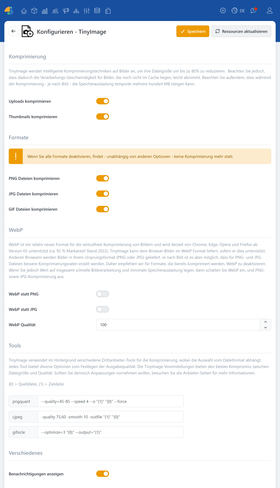

# TinyImage

> Bildkomprimierung bis zu 80 %

TinyImage ist ein Plugin, das die Dateigröße hochgeladener Bilder deutlich reduzieren kann, ohne dass Sie dabei manuell jedes Bild neu komprimieren müssen. Sie bekommen schlankere Mediendateien, geringere Ladezeiten und dadurch ein insgesamt flüssigeres Nutzererlebnis, insbesondere auf Seiten mit vielen Bildern (z. B. Produktlisten, Blogs oder Content-Seiten).

Im Hintergrund arbeitet TinyImage mit intelligenten Komprimierungsstrategien: Je nach Bildformat und Bildinhalt werden passende Verfahren eingesetzt, um die Speichermenge zu verringern. Dadurch kann die Bilddateigröße, je nach Ausgangsbild, spürbar reduziert werden. Dabei werden auch dynamisch generierte Thumbnails berücksichtigt, damit die Optimierung nicht nur für hochgeladene Originale, sondern auch für die in der Darstellung verwendeten Vorschaubilder greift.

## Einsatzbereiche

* **Uploads komprimieren**: Komprimiert Bilder direkt beim Hochladen.
* **Thumbnails komprimieren**: Optimiert dynamisch erzeugte Thumbnails.

## Formate

TinyImage arbeitet formatabhängig und unterstützt die Bildformate [PNG](https://de.wikipedia.org/wiki/Portable_Network_Graphics), [JPG](https://de.wikipedia.org/wiki/JPEG) und [GIF](https://de.wikipedia.org/wiki/Graphics_Interchange_Format).

### WebP

[WebP](https://de.wikipedia.org/wiki/WebP) unterstützt verlustbehaftete und verlustfreie Komprimierung. TinyImage kann PNG- und JPG-Bilder bei der Auslieferung als WebP bereitstellen, wenn der Browser WebP unterstützt. Die Bildqualität lässt sich in der Plugin-Konfiguration einstellen.


Browser, die WebP nicht unterstützen, erhalten weiterhin Bilder im Originalformat (PNG oder JPG).


## Konfiguration

### Komprimierung

TinyImage kann die Dateigröße von Bildern um bis zu 80 % reduzieren. Bei Bildern, die noch nicht im Cache liegen, kann die Verarbeitung länger dauern. Während der Komprimierung kann die Speicherauslastung je nach Bild vorübergehend um mehrere hundert MB steigen.

| **Option**              | **Beschreibung**                           |
| ----------------------- | ------------------------------------------ |
| Uploads komprimieren    | Komprimiert Bilder beim Hochladen.         |
| Thumbnails komprimieren | Komprimiert dynamisch erzeugte Thumbnails. |

### Formate

Die Komprimierung lässt sich für PNG, JPG und GIF getrennt aktivieren. Wenn Sie alle drei Formate deaktivieren, findet keine Komprimierung durch diese Formatwerkzeuge statt. Die WebP-Ausgabe können Sie unabhängig davon aktivieren.

| **Option**               | **Beschreibung**                                                                                                                                               |
| ------------------------ | -------------------------------------------------------------------------------------------------------------------------------------------------------------- |
| PNG Dateien komprimieren | Reduziert die Größe von PNG-Dateien, indem die Anzahl der Farben selektiv verringert wird.                                                                     |
| JPG Dateien komprimieren | Reduziert die Größe von JPG-Dateien. Die Standardeinstellung erzeugt progressive JPEGs. Das Ergebnis wird nur übernommen, wenn die Datei dadurch kleiner wird. |
| GIF Dateien komprimieren | Reduziert die Größe von GIF-Dateien, auch bei animierten Bildern.                                                                                              |

### WebP

Mit den folgenden Optionen legen Sie fest, ob PNG- und JPG-Bilder bei der Auslieferung als WebP bereitgestellt werden. Welche Kombination aus WebP-Ausgabe und Komprimierung der Ausgangsformate die kleineren Dateien liefert, hängt vom Bild und den Qualitätseinstellungen ab.

| **Option**     | **Beschreibung**                                                            |
| -------------- | --------------------------------------------------------------------------- |
| WebP statt PNG | Generiert und liefert WebP- statt PNG-Dateien an WebP-fähige Browser aus.   |
| WebP statt JPG | Generiert und liefert WebP- statt JPG-Dateien an WebP-fähige Browser aus.   |
| WebP Qualität  | Legt die Qualität der erzeugten WebP-Bilder fest. Der Standardwert ist 100. |

### Tools

TinyImage verwendet im Hintergrund verschiedene Drittanbieter-Tools für die Komprimierung, wobei die Auswahl vom Dateiformat abhängt. Jedes Tool bietet diverse Optionen zum Festlegen der Ausgabequalität. Die TinyImage-Voreinstellungen bieten den besten Kompromiss zwischen Dateigröße und Qualität. Sollten Sie dennoch Anpassungen vornehmen wollen, besuchen Sie die Anbieter-Seiten für mehr Informationen. In den Optionen steht {0} für die Quelldatei und {1} für die Zieldatei.

| **Option** | **Beschreibung**                                  |
| ---------- | ------------------------------------------------- |
| pngquant   | Legt die Optionen für die PNG-Komprimierung fest. |
| cjpeg      | Legt die Optionen für die JPG-Komprimierung fest. |
| gifsicle   | Legt die Optionen für die GIF-Komprimierung fest. |

Mit **Benachrichtigungen anzeigen** lassen Sie sich nach einem Datei-Upload eine kurze Zusammenfassung der erzielten Komprimierung anzeigen.


