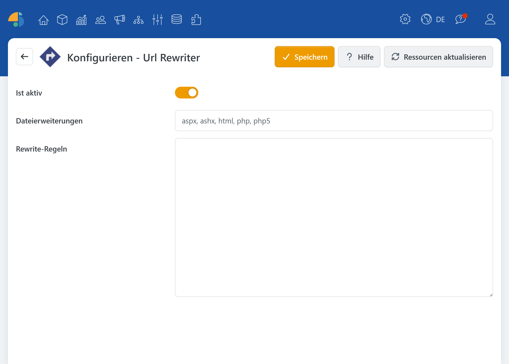

# UrlRewriter

Mit dem UrlRewriter-Plugin definieren Sie im Shop-Backend gezielt URL-Weiterleitungsregeln. Das ist besonders nützlich, wenn Seiten umgezogen sind, Produkt- oder Kategorie-URLs sich geändert haben oder wenn Sie für bestimmte Domains bzw. Stores abweichende Ziele ansteuern möchten (z. B. in einer Multistore-Umgebung).

Das Plugin verwendet eine an **Apache mod\_rewrite** angelehnte Syntax mit reduziertem Funktionsumfang. Jede Regel enthält ein Suchmuster und ein Ziel. Optionale Schalter bestimmen, ob Smartstore eine externe Weiterleitung ausführt oder den Pfad intern umschreibt.

## Regeln

Die Regeln geben Sie in der Konfiguration des Plugins zeilenweise ein:

* Pro Zeile **genau eine** Rewrite-Regel (ohne die `RewriteRule`-Anweisung).
* Kommentare sind erlaubt und beginnen mit `#` oder `//` am Zeilenanfang.

Das Plugin unterstützt eine `mod_rewrite`-kompatible Syntax, jedoch ohne die folgenden Anweisungen: `RewriteBase`, `RewriteCond`, `RewriteRule`, `RewriteMap`, `RewriteEngine`.

Das macht das Tool besonders geeignet für typische Use-Cases wie **301-Weiterleitungen**, **Musterersetzungen** (z. B. Ordner/Unterbereiche) und **host-spezifische Regeln**.

### Beispiele

Die folgenden Regeln zeigen Suchmuster, Zielpfad und optionale Schalter. `R=301` sendet eine dauerhafte HTTP-Weiterleitung. Ohne `R` wird der Pfad intern umgeschrieben; die Adresse im Browser bleibt unverändert. `R` ohne Statuscode verwendet 302.

* **Einfaches Redirect**: Alte URL → neue URL `/alte-seite /neue-seite [R=301,NC]`
* **Muster mit Pfadanteilen**: z. B. für Kategorien/Ordner, sodass der Teil nach dem Ordner beibehalten wird `/pdfs/(.*)$ /dokumente/pdfs/$1 [R=301,NC]`
* **Host-abhängige Regeln**: In Multistore-Setups kann die Ziel-URL je nach Domain variieren `/old-url$ /new-url [R=301, NC, H=^myshop1\.de$]`

Das Suchmuster prüft nur den URL-Pfad, nicht die Query-Parameter nach `?`. Der Host-Filter `H` verwendet einen regulären Ausdruck. Im Beispiel steht `\.` für einen Punkt; `^` und `$` begrenzen den Hostnamen.

### Erweiterte Nutzung

Über die Schaltfläche „Hilfe“ finden Sie weitere Schalter und Hinweise zur Syntax. Zusätzlich können Sie Regeln in den Dateien `mod_rewrite` (Apache-Syntax) oder `rewriterules.config` (IIS-Syntax) im Tenant-Verzeichnis hinterlegen. Die im Backend erfassten Regeln werden zuerst geprüft. Externe Dateien werden unabhängig von „Ist aktiv“ geladen.

## Konfiguration

| **Option**         | **Beschreibung**                                                                                                                                                                                           |
| ------------------ | ---------------------------------------------------------------------------------------------------------------------------------------------------------------------------------------------------------- |
| Ist aktiv          | Aktiviert oder deaktiviert die im Backend erfassten Regeln. Regeln aus externen Dateien werden unabhängig davon geladen.                                                                                   |
| Dateierweiterungen | Kommagetrennte Dateiendungen ohne Punkt, beispielsweise php oder html. Pfade mit anderen Endungen werden von den im Backend erfassten Regeln übersprungen; Pfade ohne Dateiendung bleiben davon unberührt. |
| Rewrite-Regeln     | Eine Regel pro Zeile. Dieses Feld wird shopübergreifend gespeichert; die Shop-Auswahl oben begrenzt die Regeln nicht. Mit dem Schalter H können Sie eine Regel auf bestimmte Hostnamen beschränken.        |
