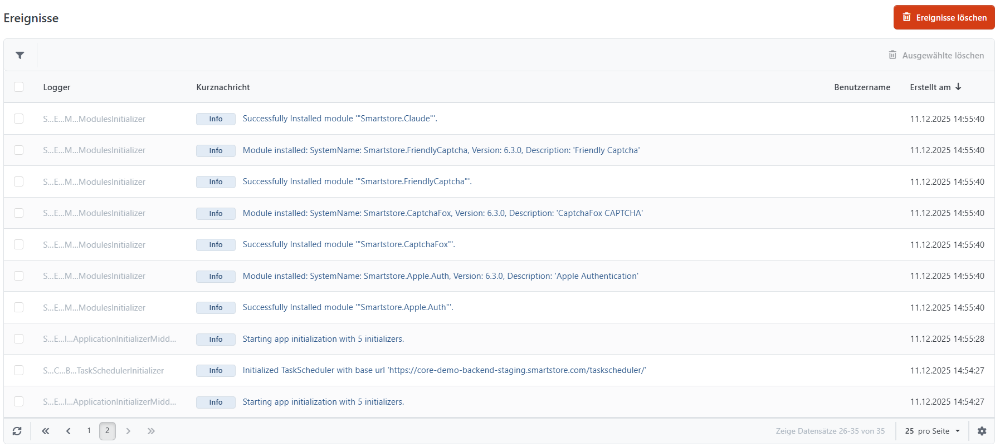

# Den Log der Ereignisse analysieren

Unter **System > Ereignisse** finden Sie technische Meldungen zum Betrieb Ihres Shops. Dazu gehören Fehler, Warnungen und Informationen. Wenn Ihnen oder Ihren Kunden eine Fehlfunktion auffällt, können die gespeicherten Meldungen bei der Suche nach der Ursache helfen. Welche Meldungen aufgezeichnet werden, hängt von der Protokollierungskonfiguration ab.

Für die Fehlersuche können Sie die Meldungen nach **Ereignis-Ebene**, Zeitraum, **Logger** und **Nachricht** eingrenzen. Die Ereignis-Ebene wählt den jeweiligen Schweregrad aus. Die Nachrichtensuche berücksichtigt sowohl die Kurznachricht als auch die komplette Nachricht.

## Detailansicht eines Ereigniseintrags

Die Detailansicht enthält die folgenden Angaben. Kunden-, Benutzer- und Browserinformationen stehen nur zur Verfügung, wenn sie beim Ereignis mitprotokolliert wurden.

| **Information**     | **Beschreibung**                                                                                                                                                                             |
| ------------------- | -------------------------------------------------------------------------------------------------------------------------------------------------------------------------------------------- |
| Ereignis-Ebene      | Schweregrad der Meldung, beispielsweise Debug, Info, Warnung, Fehler oder Schwerwiegend.                                                                                                     |
| Logger              | Quelle der Meldung, zum Beispiel die betroffene Anwendungskomponente oder ein Plugin. Der Name hilft, mehrere Meldungen demselben Bereich zuzuordnen.                                        |
| Kurznachricht       | Kurze Beschreibung des Ereignisses.                                                                                                                                                          |
| IP-Adresse          | Die beim Ereignis protokollierte IP-Adresse, sofern das Ereignis einer Webanfrage zugeordnet ist.                                                                                            |
| Kunde               | Das dem Ereignis zugeordnete Kundenkonto, sofern vorhanden. Auch ein Gastkonto kann zugeordnet sein.                                                                                         |
| Benutzername        | Name des beim Ereignis angemeldeten Benutzers, sofern verfügbar.                                                                                                                             |
| Seiten-URL          | URL der Webanfrage, bei der das Ereignis aufgetreten ist. Daneben steht die HTTP Methode, beispielsweise GET oder POST.                                                                      |
| Bezugs-URL          | Die vom Browser übermittelte vorherige Seite (Referrer), sofern vorhanden.                                                                                                                   |
| UserAgent           | Vom Browser oder einem anderen Client übermittelte Kennung, beispielsweise mit Angaben zu Browser und Betriebssystem.                                                                        |
| Erstellt am         | Zeitpunkt des ersten protokollierten Vorkommens in Ihrer eingestellten Zeitzone. Bei zusammengefassten Meldungen werden zusätzlich die gespeicherten Uhrzeiten weiterer Vorkommen angezeigt. |
| Komplette Nachricht | Technische Details einer Ausnahme einschließlich Stacktrace, sofern eine Ausnahme mitprotokolliert wurde. Dieser Bereich erscheint nur, wenn solche Details vorliegen.                       |

## Wiederholte Meldungen einordnen

Smartstore kann gleichartige Meldungen innerhalb eines Zeitfensters von zehn Minuten zu einem Eintrag zusammenfassen. Eine Anzeige wie **+3** bedeutet, dass zur ersten Meldung drei weitere Vorkommen hinzugekommen sind. In der Detailansicht stehen die gespeicherten Uhrzeiten der weiteren Vorkommen neben **Erstellt am**. Die übrigen Detailangaben stammen vom ersten Vorkommen.

## Ereigniseinträge bereinigen

Sie können einzelne oder ausgewählte Einträge löschen. **Ereignisse löschen** entfernt sämtliche Einträge des Ereignisprotokolls, auch wenn die Liste gerade auf bestimmte Meldungen eingeschränkt ist.

Zusätzlich kann die geplante Aufgabe **Ereignisse löschen** ältere Einträge automatisch bereinigen. Standardmäßig werden Einträge unterhalb der Ebene Fehler nach sieben Tagen entfernt; Fehler und schwerwiegende Meldungen bleiben bei dieser Bereinigung erhalten. Die Verwaltung beschreibt die Seite [Geplante Aufgaben verwalten](geplante-aufgaben-verwalten.md).
