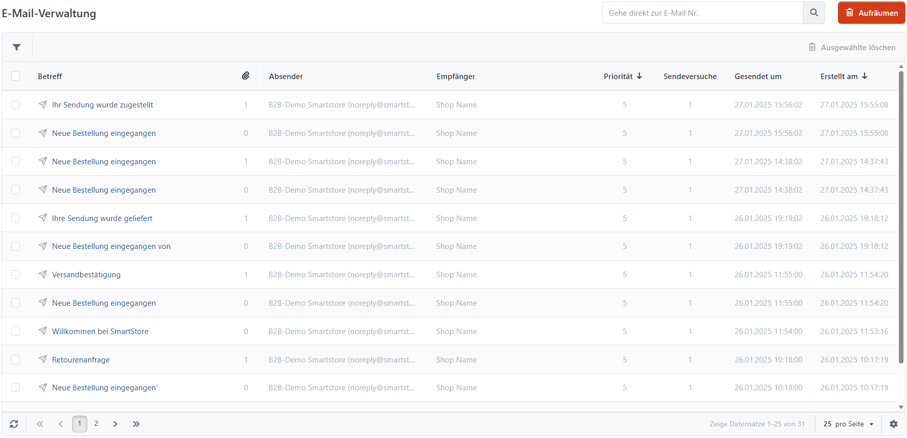

# E-Mail-Korrespondenz analysieren

Unter **System > E-Mail-Verwaltung** prüfen Sie ausgehende E-Mails, die Smartstore in der Versandwarteschlange gespeichert hat, beispielsweise Bestellbestätigungen und E-Mails zur Kontoaktivierung. Sie können den Versandstatus nachvollziehen, gespeicherte Nachrichten bearbeiten und sie erneut für den Versand einreihen.

## Versandstatus prüfen

Standardmäßig ist **Lade nur noch nicht gesendete E-Mails** aktiviert. Deaktivieren Sie diese Einschränkung, um auch bereits versendete Nachrichten zu sehen. Mit **Erstellt am**, Absender, Empfänger, Betreff und **Lade nur manuell zu sendende E-Mails** grenzen Sie die gesuchten Nachrichten weiter ein.

**Maximale Sendeversuche** ist ein Suchfilter: Angezeigt werden nur Nachrichten mit weniger Versandversuchen als dem eingetragenen Wert. Die Vorgabe 10 ändert nicht die Grenze des automatischen Versands.

In der Detailansicht zeigt **Gesendet um**, wann Smartstore den Versandvorgang erfolgreich abgeschlossen hat. Ein leerer Wert bedeutet, dass die Nachricht noch nicht als versendet markiert ist. Der Status ist keine Zustell- oder Lesebestätigung des Empfängers. **E-Mail-Konto** zeigt das zugeordnete Versandkonto.

## Nachricht prüfen und bearbeiten

Die folgenden Angaben können Sie in der Detailansicht ändern:

| **Einstellung**    | **Bedeutung**                                                                                                                                                                          |
| ------------------ | -------------------------------------------------------------------------------------------------------------------------------------------------------------------------------------- |
| Priorität          | Höhere Werte werden beim automatischen Versand zuerst berücksichtigt.                                                                                                                  |
| Absender           | Absenderadresse der Nachricht. Der Versand erfolgt über das bereits zugeordnete E-Mail-Konto.                                                                                          |
| Empfänger          | Empfängeradresse der Nachricht.                                                                                                                                                        |
| CC                 | Weitere sichtbare Empfänger, durch Semikolon getrennt.                                                                                                                                 |
| BCC                | Weitere Empfänger, deren Adressen den übrigen Empfängern verborgen bleiben; durch Semikolon getrennt.                                                                                  |
| Betreff            | Betreff der gespeicherten Nachricht.                                                                                                                                                   |
| Nachricht          | Inhalt der gespeicherten E-Mail.                                                                                                                                                       |
| Nur manuell senden | Nimmt die Nachricht vom automatischen Versand aus. Nach dem Speichern steht Jetzt senden zur Verfügung.                                                                                |
| Sendeversuche      | Bisherige Versandversuche einschließlich eines erfolgreichen Versuchs. Bei einer ungesendeten Nachricht beendet der automatische Versand weitere Versuche, sobald der Wert 3 erreicht. |

Unter **Dateianhänge** können Sie vorhandene Anhänge herunterladen. Neue Anhänge lassen sich hier nicht hinzufügen. Speichern Sie Änderungen, bevor Sie **Wiederholen** oder **Jetzt senden** verwenden; diese Aktionen arbeiten mit dem gespeicherten Stand.

## Versand erneut anstoßen

Die geplante Aufgabe **E-Mail senden** verarbeitet ungesendete Nachrichten, bei denen **Nur manuell senden** deaktiviert ist und **Sendeversuche** kleiner als 3 ist. Nachrichten mit noch nicht fertig erzeugten Dateianhängen werden zunächst zurückgestellt. Hinweise auf Versandfehler finden Sie unter **System > Ereignisse**.

Mit **Wiederholen** erstellen Sie eine neue Nachricht aus den gespeicherten Absender- und Empfängerangaben, CC, BCC, Betreff und Inhalt. Die neue Nachricht erhält ein neues Erstellungsdatum und beginnt mit 0 Sendeversuchen. Die Einstellung **Nur manuell senden** wird übernommen. Die ursprüngliche Nachricht bleibt erhalten.


Wiederholen übernimmt keine Dateianhänge der ursprünglichen Nachricht. Prüfen Sie dies vor einem erneuten Versand, wenn die E-Mail Anhänge enthalten soll.


Bei Nachrichten mit **Nur manuell senden** löst **Jetzt senden** unmittelbar einen Versandversuch aus. Auch hierfür werden zuvor gespeicherte Änderungen verwendet.

## Nachrichten bereinigen

Einzelne oder ausgewählte Nachrichten können Sie löschen. **Aufräumen** entfernt versendete Nachrichten, Nachrichten mit mindestens 3 Sendeversuchen sowie Nachrichten, die vor mehr als einem Jahr erstellt wurden. Die Aktion gilt unabhängig von den aktuellen Suchfiltern. Andere ungesendete Nachrichten bleiben erhalten.

Die geplante Aufgabe **E-Mail Queue bereinigen** verwendet dieselben Kriterien und beschränkt die Bereinigung zusätzlich auf Nachrichten, deren Erstellungsdatum älter als die eingestellte Aufbewahrungsdauer ist. Standardmäßig beträgt diese 14 Tage.
