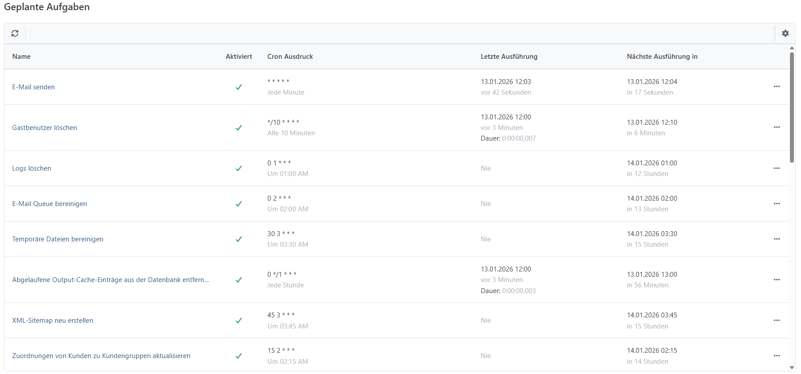
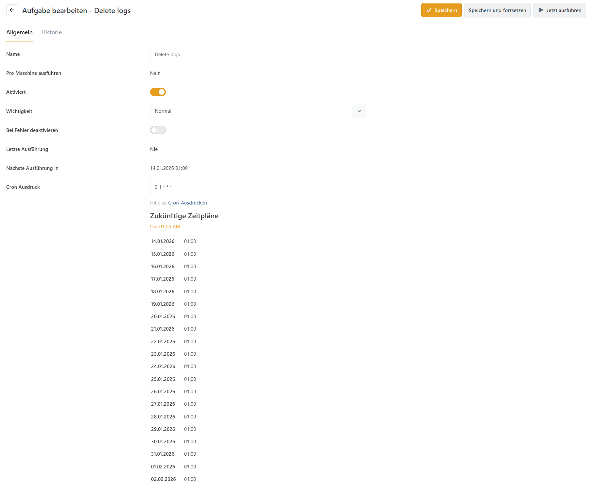

# Geplante Aufgaben verwalten

Geplante Aufgaben führen wiederkehrende Arbeiten automatisch aus, beispielsweise den E-Mail-Versand, Bereinigungen und die Aktualisierung regelbasierter Zuordnungen. Unter **System > Geplante Aufgaben** verwalten Sie die bereits registrierten Aufgaben und deren Zeitpläne.

* Gespeicherte E-Mails versenden
* Obsolet gewordene oder temporäre Dateien aus der Datenbank entfernen
* Temporäre Dateien aus dem Datenordner entfernen
* Cache verwalten
* Wechselkurse aktualisieren
* Feed- oder Exportdateien erstellen

Installierte Plugins können weitere Aufgaben ergänzen. Zeitpläne für Importe und Exporte verwalten Sie in den jeweiligen Profilen. Diese Aufgaben erscheinen nicht in der allgemeinen Aufgabenliste. Weitere Informationen: [Importprofile verwalten](../datenaustausch/import/importprofile-verwalten.md) und [Exportprofile verwalten](../datenaustausch/export/exportprofile-verwalten.md).

## Die Liste der geplanten Aufgaben aufrufen

Die Übersicht zeigt die vorhandenen Aufgaben mit Aktivierungsstatus, Zeitplan sowie Informationen zur letzten und nächsten Ausführung. Laufende Aufgaben können einen Fortschritt oder eine Statusmeldung anzeigen.



## Eine Aufgabe manuell ausführen

Mit **Jetzt ausführen** starten Sie eine Aufgabe unabhängig vom Cron Ausdruck. Das ist auch bei deaktivierten Aufgaben möglich. Eine bereits laufende Aufgabe wird nicht noch einmal parallel gestartet.

Bei einer laufenden Aufgabe fordert **Abbrechen** den Abbruch an. Die Aufgabe endet, sobald ihre Verarbeitung die Anforderung berücksichtigt. Bereits ausgeführte Änderungen werden dadurch nicht zurückgenommen.

## Eine Aufgabe bearbeiten

In der Bearbeitungsansicht stehen unter **Allgemein** die folgenden Angaben zur Verfügung. Speichern Sie Änderungen, bevor Sie die Aufgabe mit Jetzt ausführen starten.



| Feld                    | Beschreibung                                                                                                                                                                                                |
| ----------------------- | ----------------------------------------------------------------------------------------------------------------------------------------------------------------------------------------------------------- |
| Name                    | Bezeichnung der Aufgabe in der Verwaltung. Eine Umbenennung ändert ihre Funktion nicht.                                                                                                                     |
| Pro Maschine ausführen  | Schreibgeschützte Angabe für Installationen mit mehreren Anwendungsservern: Ja bedeutet eine Ausführung je Server, Nein eine gemeinsame Ausführung. Diese Vorgabe stammt aus der Registrierung der Aufgabe. |
| Aktiviert               | Aktiviert die automatische Ausführung nach dem Cron Ausdruck. Deaktivierte Aufgaben können weiterhin mit Jetzt ausführen gestartet werden.                                                                  |
| Wichtigkeit             | Niedrig, Normal oder Hoch. Wenn mehrere Aufgaben fällig sind, werden Aufgaben mit höherer Wichtigkeit zuerst berücksichtigt.                                                                                |
| Bei Fehler deaktivieren | Deaktiviert die Aufgabe nach einem fehlgeschlagenen Lauf. Nach der Fehlerbehebung müssen Sie die automatische Ausführung wieder aktivieren. Ein angeforderter Abbruch löst diese Option nicht aus.          |
| Cron Ausdruck           | Ein Ausdruck, der den Zeitplan für die automatische Ausführung der Aufgabe festlegt. Lesen Sie [unten mehr](geplante-aufgaben-verwalten.md#cron-ausdruck) über Cron Ausdruck.                               |

### Historie

Unter **Historie** prüfen Sie Start, Ende, Dauer, Ergebnis und ausführenden Rechner früherer Läufe. Fehlgeschlagene Läufe enthalten die Fehlermeldung. Einzelne Historieneinträge lassen sich löschen. Die Historie wird regelmäßig bereinigt; standardmäßig bleiben höchstens 100 Einträge je Aufgabe erhalten, die nicht älter als 30 Tage sind.

## Aufgabenarten

Die folgenden Kernaufgaben werden bei einer Neuinstallation angelegt. Die Zeitpläne gelten in der Standardzeitzone des Shops. Bestehende Installationen können andere Namen, Einstellungen und Zeitpläne verwenden.

| Name der Aufgabe                                        | Beschreibung                                                                                                                                                                                                                                                                                                                                                                                                                                                                                                                                           | Standardzeitplan bei Neuinstallation          |
| ------------------------------------------------------- | ------------------------------------------------------------------------------------------------------------------------------------------------------------------------------------------------------------------------------------------------------------------------------------------------------------------------------------------------------------------------------------------------------------------------------------------------------------------------------------------------------------------------------------------------------ | --------------------------------------------- |
| E-Mail senden                                           | <p>Versendet automatisch zu sendende Nachrichten aus der Warteschlange, solange weniger als drei Versandversuche vorliegen. Weitere Informationen: <a href="e-mail-korrespondenz-analysieren.md">E-Mail-Korrespondenz analysieren</a>.<br><br><br>Wenn Sie diese Aufgabe deaktivieren, entfällt der automatische Versand aus der Warteschlange. Manuelles Senden bleibt möglich.</p> | Einmal pro Minute                             |
| E-Mail Queue bereinigen                                 | Bereinigt versendete E-Mails, Nachrichten mit mindestens drei Sendeversuchen und über ein Jahr alte Nachrichten. Standardmäßig werden nur Nachrichten berücksichtigt, deren Erstellung mehr als 14 Tage zurückliegt. Einzelheiten: [E-Mail-Korrespondenz analysieren](e-mail-korrespondenz-analysieren.md).                                                                                                                                                                                                                                            | Täglich um 02:00 Uhr                          |
| Ereignisse löschen                                      | Löscht standardmäßig Ereigniseinträge, die älter als sieben Tage sind und unterhalb der Ebene Fehler liegen. Fehler und schwerwiegende Meldungen bleiben bei dieser Bereinigung erhalten.                                                                                                                                                                                                                                                                                                                                                              | Täglich um 01:00 Uhr                          |
| Gastbenutzer löschen                                    | Löscht standardmäßig vor mehr als 24 Stunden angelegte Gastkonten ohne Bestellungen, Beiträge oder aktive Warenkorb- beziehungsweise Wunschlistenpositionen.                                                                                                                                                                                                                                                                                                                                                                                           | Alle zehn Minuten                             |
| Cache bereinigen                                        | Leert den Anwendungscache.                                                                                                                                                                                                                                                                                                                                                                                                                                                                                                                             | Alle zwölf Stunden; standardmäßig deaktiviert |
| Temporäre Dateien bereinigen                            | Entfernt temporäre Dateien, die älter als fünf Stunden sind, aus den temporären Verzeichnissen der Anwendung und des Mandanten.                                                                                                                                                                                                                                                                                                                                                                                                                        | Täglich um 03:30 Uhr                          |
| Wechselkurse aktualisieren                              | Ruft Wechselkurse beim konfigurierten Anbieter ab und aktualisiert sie im Shop, sofern die automatische Kursaktualisierung in den Währungseinstellungen aktiviert ist.                                                                                                                                                                                                                                                                                                                                                                                 | Alle sechs Stunden; standardmäßig deaktiviert |
| Temporäre Uploads bereinigen                            | Entfernt nicht zugeordnete temporäre Medien und Downloads, deren letzte Änderung mehr als drei Stunden zurückliegt.                                                                                                                                                                                                                                                                                                                                                                                                                                    | Täglich um 01:30 und 13:30 Uhr                |
| XML-Sitemap erneuern                                    | Erstellt die XML-Sitemap für die Shops und ihre aktiven Sprachen neu.                                                                                                                                                                                                                                                                                                                                                                                                                                                                                  | Täglich um 03:45 Uhr                          |
| Zuordnungen von Kunden zu Kundengruppen aktualisieren   | Berechnet die automatischen Kundengruppenzuordnungen anhand aktiver Regeln neu.                                                                                                                                                                                                                                                                                                                                                                                                                                                                        | Täglich um 02:15 Uhr                          |
| Zuordnungen von Produkten zu Warengruppen aktualisieren | Berechnet die automatischen Produktzuordnungen zu Warengruppen anhand aktiver Regeln neu.                                                                                                                                                                                                                                                                                                                                                                                                                                                              | Täglich um 02:20 Uhr                          |

### Plugin-Funktionen

**Suchindex aktualisieren** gehört zum kostenpflichtigen Enterprise-Plugin [MegaSearch](../plugins/megasearch.md). Die Aufgabe aktualisiert dessen Suchindex und ist bei der Plugin-Installation standardmäßig alle 30 Minuten aktiviert. Sie wird pro Anwendungsserver ausgeführt.

## Cron Ausdruck

Ein Cron Ausdruck besteht aus fünf durch Leerzeichen getrennten Feldern. Diese legen Minute, Stunde, Tag des Monats, Monat und Wochentag fest. Sekunden sind kein eigenes Feld.

Nachfolgende Darstellung zeigt, woraus ein Cron Ausdruck besteht:


```
* * * * *
| | | | |
| | | | +---- Wochentag (0-6 oder SUN-SAT; 0 = Sonntag)
| | | +------ Monat (1-12 oder JAN-DEC)
| | +-------- Tag des Monats (1-31)
| +---------- Stunde (0-23)
+------------ Minute (0-59)
```


* Ein Stern (\*) steht für alle zulässigen Werte eines Feldes, beispielsweise jede Minute.
* Kommas bilden Listen, etwa **1,3,5**. Ein Bindestrich beschreibt einen Bereich, etwa **1-5**. Innerhalb eines Feldes stehen keine Leerzeichen.
* Ein Schrägstrich legt die Schrittweite fest. **\*/15** im Minutenfeld bedeutet die Minuten 0, 15, 30 und 45. **10-16/2** im Tagesfeld bedeutet die Tage 10, 12, 14 und 16.
* Für Monate und Wochentage sind englische Kürzel möglich, beispielsweise **JAN**, **DEC**, **MON** und **SUN**.

Die Planung richtet sich nach der **Standardzeitzone des Shops**. Ausführungszeiten im Backend werden dagegen in Ihrer Benutzerzeitzone angezeigt. Die Vorschau unter dem Cron Ausdruck nennt kommende Termine und hilft, den Zeitplan vor dem Speichern zu prüfen. Ungültige Ausdrücke werden beim Speichern abgewiesen.

### Beispiele für einen Cron Ausdruck

Die folgenden Beispiele verwenden gültige Ausdrücke mit genau fünf Feldern.

| Ausdruck                  | Bedeutung                                                                                    |
| ------------------------- | -------------------------------------------------------------------------------------------- |
| \* \* \* \* \*            | Jede Minute.                                                                                 |
| 5 \* \* \* \*             | Stündlich um fünf Minuten nach der vollen Stunde, beispielsweise 00:05 und 01:05 Uhr.        |
| \*/15 \* \* \* \*         | Alle 15 Minuten, jeweils zur Minute 0, 15, 30 und 45.                                        |
| 0 \*/2 \* \* \*           | Alle zwei Stunden zur vollen Stunde, beginnend um 00:00 Uhr.                                 |
| 0 1 \* \* \*              | Täglich um 01:00 Uhr.                                                                        |
| \* 12 \* \* 1             | Montags jede Minute von 12:00 bis 12:59 Uhr.                                                 |
| 59 11 \* \* 1,2,3,4,5     | Montag bis Freitag jeweils um 11:59 Uhr.                                                     |
| 59 11 \* \* 1-5           | Montag bis Freitag jeweils um 11:59 Uhr, wie im vorherigen Beispiel.                         |
| \*/15 9-17 \* \* \*       | Täglich alle 15 Minuten zwischen 09:00 und 17:45 Uhr.                                        |
| \* 12 10-16/2 \* \*       | Am 10., 12., 14. und 16. jedes Monats jede Minute von 12:00 bis 12:59 Uhr.                   |
| \* 12 1-15,17,20-25 \* \* | Am 1. bis 15., am 17. sowie am 20. bis 25. jedes Monats jede Minute von 12:00 bis 12:59 Uhr. |
