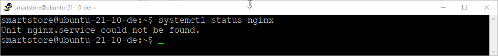
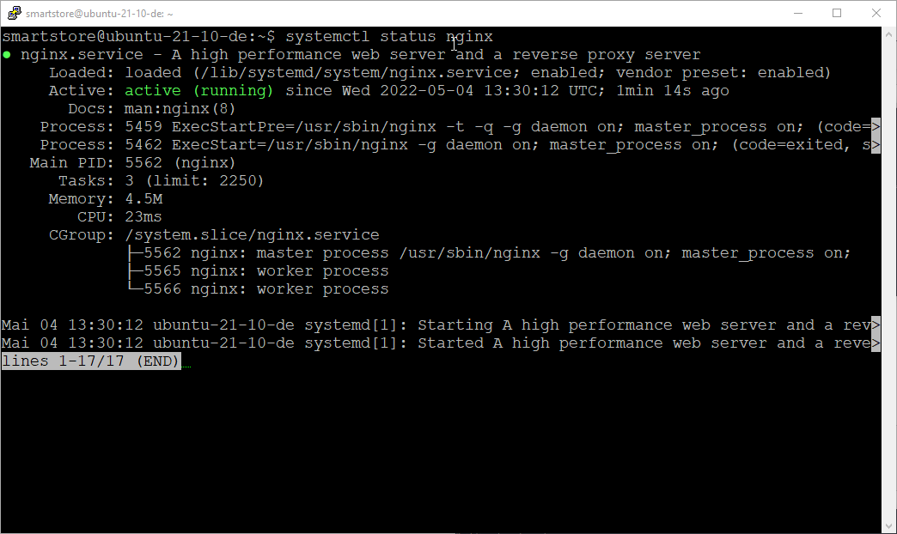
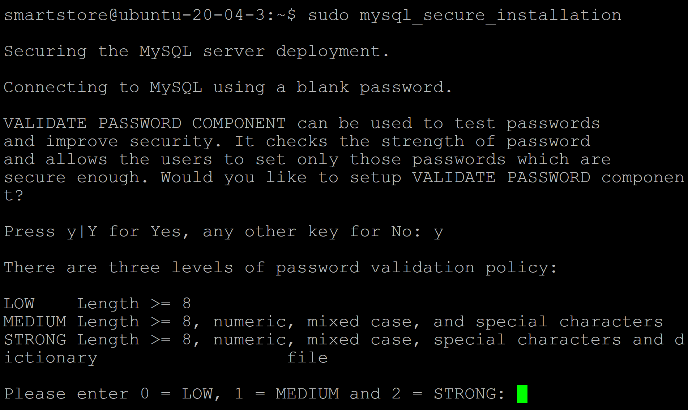
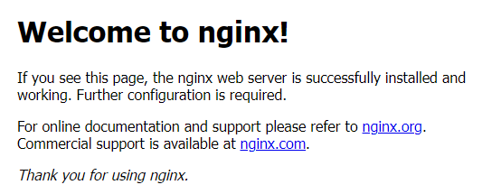

# Linux Server vorbereiten

Diese Anleitung zeigt, wie Sie Smartstore auf einem Ubuntu-Server mit NGINX als Reverse Proxy bereitstellen. Als Beispiel dient ein offizielles, eigenständig ausführbares Smartstore-Release für Linux x64. Die Datenbank kann auf demselben oder einem anderen Server liegen. Passen Sie Pfade, Domäne und Datenbankzugang an Ihre Umgebung an.

***

## Anforderungen

* Ubuntu Server 22.04 oder neuer, vorzugsweise eine LTS-Version
* Smartstore-Release für Linux x64 (eigenständig ausführbar)
* Benutzerkonto mit sudo-Rechten und eine passende Datenbank
* Domäne und TLS-Zertifikat für den produktiven Betrieb

## Ablauf

* Voraussetzungen und gegebenenfalls ASP.NET Core Runtime prüfen
* NGINX installieren und Firewall konfigurieren
* Datenbank vorbereiten
* Smartstore-Dateien übertragen und Berechtigungen setzen
* Smartstore als systemd-Dienst einrichten und NGINX als Reverse Proxy konfigurieren

## Laufzeit und weitere Voraussetzungen


Für das offizielle eigenständig ausführbare Linux-Release ist keine separate .NET-Installation erforderlich. Nur bei einem selbst erstellten frameworkabhängigen Release muss die zur Smartstore-Version passende ASP.NET Core Runtime installiert sein.


Für die aktuelle Version auf Ubuntu finden Sie Paketquellen und Installationsbefehle in der [Microsoft-Anleitung zur .NET-Installation unter Ubuntu](https://learn.microsoft.com/de-de/dotnet/core/install/linux-ubuntu-install). Verwenden Sie bei einer frameworkabhängigen Webanwendung die ASP.NET Core Runtime, nicht nur die .NET Runtime.

PDF-Funktionen benötigen unter Linux eine passende native wkhtmltopdf-Bibliothek. Smartstore versucht, diese bei der ersten Verwendung bereitzustellen. Prüfen Sie bei Problemen die Ausgabe der Anwendung und installieren Sie die Bibliothek nur dann manuell in einer passenden Version.

## NGINX installieren

NGINX nimmt Webanfragen entgegen und leitet sie an Smartstore weiter. Prüfen Sie zunächst, ob der Dienst bereits installiert ist:

Prüfen Sie, ob NGINX bereits installiert ist:

`systemctl status nginx`





Ist NGINX bereits installiert, fahren Sie mit der Firewall-Konfiguration fort.

#### Paketquellen aktualisieren und NGINX installieren

Aktualisieren Sie die Paketinformationen:

`sudo apt-get update`

Installieren Sie NGINX:

`sudo apt-get install nginx`

#### Installation prüfen

Prüfen Sie die Installation mit diesem Befehl:

`nginx -v`


#### NGINX-Dienst zum Systemstart hinzufügen

Aktivieren Sie den NGINX-Dienst, damit er nach einem Server-Neustart automatisch gestartet wird.

`sudo systemctl enable nginx`

## Firewall-Regeln konfigurieren

Wenn die Firewall auf dem Server mit ufw verwaltet wird, geben Sie die benötigten Dienste frei. Bei einer extern verwalteten Firewall richten Sie die entsprechenden Regeln dort ein.

Prüfen Sie zunächst die verfügbaren ufw-Profile:

`sudo ufw app list`


Falls ufw nicht installiert ist, richten Sie die Freigaben mit der Firewall Ihrer Umgebung ein. Aktivieren Sie ufw nur, wenn Sie den SSH-Zugang zuvor freigegeben haben.


Üblicherweise sind drei NGINX-Profile verfügbar:

* **Nginx Full**: Dieses Profil öffnet Port 80 und 443 für NGINX.
* **Nginx HTTP**: Dieses Profil öffnet nur Port 80 für NGINX.
* **Nginx HTTPS**: Dieses Profil öffnet nur Port 443 für NGINX.

Geben Sie zunächst SSH frei, wenn Sie den Server darüber verwalten:

`sudo ufw allow 'OpenSSH'`

Öffnen Sie anschließend HTTP für den ersten Funktionstest. Für den produktiven Betrieb richten Sie HTTPS mit einem Zertifikat ein und geben Port 443 frei.

`sudo ufw allow 'Nginx HTTP'`

Prüfen Sie die aktuellen Regeln und aktivieren Sie ufw, falls es noch nicht aktiv ist:

`sudo ufw status`


Nun kann die Firewall mit dem folgenden Befehl aktiviert werden:

`sudo ufw enable`

## Datenbank vorbereiten

Smartstore unterstützt MySQL, Microsoft SQL Server, PostgreSQL und SQLite. Wählen Sie den passenden Datenbanktyp im Installationsassistenten. Die folgenden Schritte zeigen beispielhaft eine lokale MySQL-Datenbank. Wenn Sie bereits eine Datenbank verwenden, benötigen Sie deren Verbindungsdaten und ausreichende Rechte für die Installation.

### MySQL installieren

Aktualisieren Sie die Paketinformationen und installieren Sie MySQL:

`sudo apt update`

`sudo apt install mysql-server`

### MySQL absichern

Nach der Installation können Sie mit mysql\_secure\_installation die Grundeinstellungen des MySQL-Servers prüfen. Je nach MySQL-Version fragt das Programm nach einer Passwortrichtlinie und bietet an, anonyme Konten und die Testdatenbank zu entfernen sowie den Root-Zugriff aus dem Netzwerk zu sperren. Lesen Sie jede Frage, bevor Sie eine Option bestätigen.

`sudo mysql_secure_installation`



Für Smartstore ist kein Wechsel der Authentifizierung des MySQL-Root-Kontos erforderlich. Auf Ubuntu können Sie die folgenden Datenbankbefehle mit sudo mysql ausführen.

### Datenbank und Benutzer für Smartstore anlegen

Öffnen Sie die MySQL-Konsole mit dem administrativen Systemkonto:

`sudo mysql`

Legen Sie eine eigene Datenbank und einen Benutzer für Smartstore an. Ersetzen Sie den Platzhalter durch ein sicheres Passwort. Bei einer externen Datenbank muss der erlaubte Host an die tatsächliche Verbindung angepasst werden.


```
CREATE DATABASE smartstore CHARACTER SET utf8mb4;
CREATE USER 'smartstore'@'localhost' IDENTIFIED BY '<sicheres-passwort>';
GRANT ALL PRIVILEGES ON smartstore.* TO 'smartstore'@'localhost';
SHOW GRANTS FOR 'smartstore'@'localhost';
exit
```


Tragen Sie später im Smartstore-Installationsassistenten den Datenbanknamen, den Benutzer und das Passwort ein. Der Benutzer erhält Rechte für diese Datenbank, nicht für andere Datenbanken auf dem Server.

Für Microsoft SQL Server auf Ubuntu folgen Sie der [Installationsanleitung von Microsoft](https://learn.microsoft.com/de-de/sql/linux/quickstart-install-connect-ubuntu?view=sql-server-ver17). PostgreSQL und SQLite benötigen eine entsprechend vorbereitete Datenbank beziehungsweise einen beschreibbaren Speicherort.

## Smartstore bereitstellen

### Dateien übertragen

Übertragen Sie die Dateien des Linux-Releases nach /var/www/html, beispielsweise verschlüsselt mit SFTP über Ihren bestehenden SSH-Zugang. Entpacken Sie das Release dort. Ein zusätzlicher FTP-Server ist dafür nicht erforderlich.

### FTP-Server mit vsftpd einrichten (optional)

Wenn Ihr Übertragungsprozess einen FTP-Client voraussetzt, können Sie vsftpd verwenden. Richten Sie dafür FTPS mit TLS ein: Einfaches FTP überträgt Zugangsdaten und Dateien unverschlüsselt. SFTP aus dem vorherigen Absatz verwendet dagegen SSH und benötigt keinen zusätzlichen FTP-Server.

#### Dienst installieren und Upload-Benutzer anlegen

Installieren Sie vsftpd und legen Sie einen eigenen Benutzer an. Der Benutzer lädt die Dateien in ein separates Verzeichnis hoch. Dessen übergeordnetes Verzeichnis bleibt für ihn nicht beschreibbar, damit die Verzeichnisbeschränkung von vsftpd funktioniert.


```
sudo apt install vsftpd
sudo adduser ftpuser
sudo install -d -o root -g root -m 755 /srv/smartstore-ftps
sudo install -d -o ftpuser -g ftpuser -m 750 /srv/smartstore-ftps/upload
sudo usermod -d /srv/smartstore-ftps ftpuser
```


Das mit adduser erstellte Systemkonto kann je nach SSH-Konfiguration auch für SSH verwendet werden. Soll ftpuser ausschließlich über FTPS zugreifen, sperren Sie das Konto zusätzlich für SSH und prüfen Sie die SSH-Konfiguration, bevor Sie den SSH-Dienst neu laden.

#### FTPS und passive Verbindungen konfigurieren

Bearbeiten Sie die vorhandene Konfigurationsdatei. Setzen Sie die folgenden Optionen auf die angegebenen Werte und vermeiden Sie doppelte Einträge. Ersetzen Sie die Zertifikatpfade durch ein für Ihren Server gültiges Zertifikat und den zugehörigen privaten Schlüssel.

`sudo nano /etc/vsftpd.conf`


```
listen=YES
listen_ipv6=NO
anonymous_enable=NO
local_enable=YES
write_enable=YES
chroot_local_user=YES
local_root=/srv/smartstore-ftps
userlist_enable=YES
userlist_deny=NO
userlist_file=/etc/vsftpd.user_list
ssl_enable=YES
force_local_logins_ssl=YES
force_local_data_ssl=YES
ssl_tlsv1=NO
ssl_tlsv1_1=NO
ssl_tlsv1_2=YES
ssl_tlsv1_3=YES
rsa_cert_file=/pfad/zum/serverzertifikat.pem
rsa_private_key_file=/pfad/zum/privaten-schluessel.pem
pasv_min_port=40000
pasv_max_port=40100
```


Erlauben Sie nur dem angelegten Benutzer die Anmeldung an vsftpd. Wenn ufw aktiv ist, öffnen Sie Port 21 und den konfigurierten Bereich für passive Datenverbindungen. Für dieses explizite FTPS-Beispiel ist Port 990 nicht erforderlich.


```
printf 'ftpuser\n' | sudo tee /etc/vsftpd.user_list
sudo ufw allow 21/tcp
sudo ufw allow 40000:40100/tcp
sudo systemctl restart vsftpd
sudo systemctl status vsftpd
```


Verbinden Sie Ihren FTP-Client mit „Explizites FTP über TLS“ und prüfen Sie das Zertifikat. Übertragen Sie die entpackten Dateien des Linux-Releases in den Ordner upload. Kopieren Sie die Dateien anschließend mit administrativen Rechten in das Anwendungsverzeichnis; setzen Sie danach die im nächsten Abschnitt beschriebenen Dateirechte.

`sudo cp -a /srv/smartstore-ftps/upload/. /var/www/html/`

Weitere Optionen für Benutzerzugang und TLS beschreibt die [Ubuntu-Anleitung für vsftpd](https://documentation.ubuntu.com/server/how-to/networking/ftp/index.html).

### Berechtigungen einrichten

Der Dienst läuft im folgenden Beispiel als www-data. Dieses Konto benötigt Leserechte auf die Anwendung und Schreibrechte für App\_Data, Modules und wwwroot/exchange. Smartstore prüft die erforderlichen Zugriffsrechte während der Installation. Verwenden Sie bei abweichendem Installationspfad oder Dienstkonto die entsprechenden Werte.


```
sudo chgrp -R www-data /var/www/html
sudo chmod -R g+rX,o-rwx /var/www/html
sudo chmod -R g+rwX /var/www/html/App_Data /var/www/html/Modules /var/www/html/wwwroot/exchange
sudo chmod +x /var/www/html/Smartstore.Web
```



Auch App\_Data/Tenants/Default/Media und das Verzeichnis runtimes/\<Linux-RID>/native müssen für den Dienst beschreibbar sein, sofern sie in Ihrem Release vorhanden sind. Für Linux x64 lautet die Runtime-ID linux-x64. Prüfen Sie diese Pfade, falls der Installationsassistent fehlende Schreibrechte meldet.


### systemd-Dienst einrichten

Richten Sie Smartstore als systemd-Dienst ein, damit die Anwendung nach einem Neustart automatisch startet. Das Beispiel verwendet das eigenständig ausführbare Linux-Release und bindet Kestrel nur an die lokale Adresse, die NGINX anschließend anspricht.

Erstellen Sie eine Dienstdefinitionsdatei für `systemd`:

`sudo nano /etc/systemd/system/kestrel-smartstore.service`

Fügen Sie den folgenden Codeauszug ein und speichern Sie ihn:


```
[Unit]
Description=Smartstore

[Service]
WorkingDirectory=/var/www/html
ExecStart=/var/www/html/Smartstore.Web
User=www-data
Environment=ASPNETCORE_ENVIRONMENT=Production
Environment=ASPNETCORE_URLS=http://127.0.0.1:5000
Restart=always
RestartSec=10

[Install]
WantedBy=multi-user.target
```


Passen Sie WorkingDirectory und ExecStart an, wenn Sie Smartstore in einem anderen Verzeichnis installiert haben. Bei einem frameworkabhängigen Release muss ExecStart stattdessen die passende dotnet-Anwendung starten.

### Dienst starten und prüfen

Laden Sie die neue Dienstdefinition und aktivieren Sie den Dienst:


```
sudo systemctl daemon-reload
sudo systemctl enable --now kestrel-smartstore.service
sudo systemctl status kestrel-smartstore.service
```


## NGINX als Reverse Proxy einrichten

Prüfen Sie zunächst über die IP-Adresse des Servers, ob NGINX erreichbar ist:

`hostname -I`

Öffnen Sie die Startseite beispielsweise über die IP-Adresse:

`http://ip-address`

Die Standard-Startseite für NGINX wird angezeigt:



NGINX leitet Anfragen an den lokal laufenden Smartstore-Dienst weiter. Bearbeiten Sie die Standardkonfiguration und ersetzen Sie example.com durch Ihre Domäne:

`sudo nano /etc/nginx/sites-available/default`

Verwenden Sie zum Einstieg dieses Beispiel für HTTP:


```
server {
	listen        80;
	server_name   example.com *.example.com;
	location / {
			proxy_pass         http://127.0.0.1:5000;
			proxy_http_version 1.1;
			proxy_set_header   Upgrade $http_upgrade;
			proxy_set_header   Connection keep-alive;
			proxy_set_header   Host $host;
			proxy_cache_bypass $http_upgrade;
			proxy_set_header   X-Forwarded-For $proxy_add_x_forwarded_for;
			proxy_set_header   X-Forwarded-Proto $scheme;
    		   }
       }
```


Prüfen Sie die NGINX-Konfiguration und laden Sie den Dienst anschließend neu:


```
sudo nginx -t
sudo systemctl reload nginx
```



Die Beispielkonfiguration verwendet nur HTTP. Richten Sie vor dem produktiven Einsatz ein TLS-Zertifikat und HTTPS für Ihre Domäne ein. Geben Sie danach Port 443 in der Firewall frei und leiten Sie HTTP auf HTTPS um.


Rufen Sie anschließend Ihre Domäne auf und schließen Sie die Einrichtung im [Smartstore-Installationsassistenten](smartstore-installieren.md) ab.
