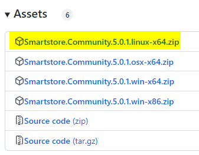
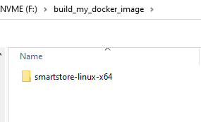
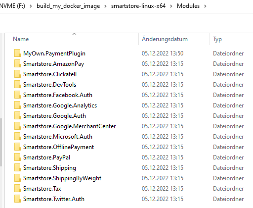
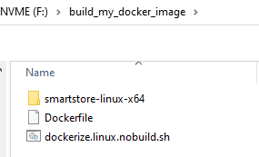
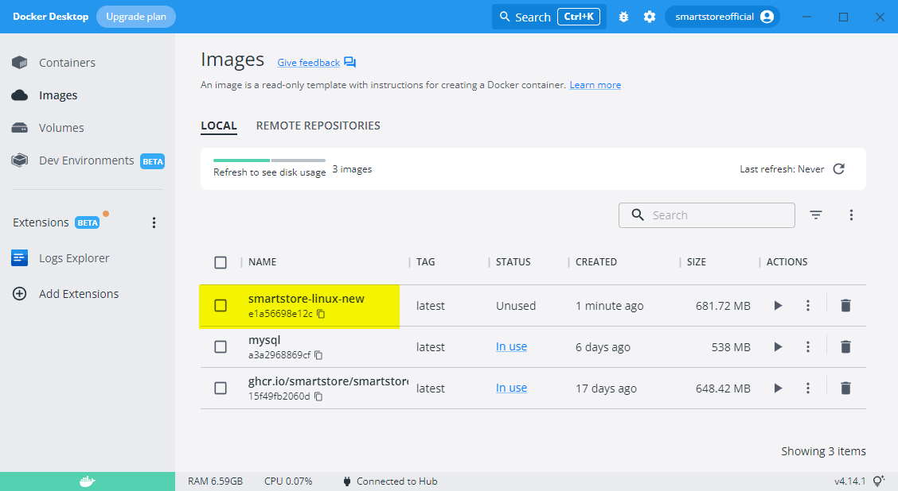

# Modifiziertes Docker-Image erstellen

Ein eigenes Docker-Image ermöglicht es, Smartstore zusammen mit zusätzlichen Dateien bereitzustellen. Diese Anleitung zeigt den Ablauf am Beispiel eines Plugins: Sie ergänzen das [Linux-x64-Artefakt eines Smartstore-Releases](https://github.com/smartstore/Smartstore/releases) um die Plugin-Dateien und bauen daraus ein neues Image. Das Plugin ist damit im Container vorhanden. Ob es im Shop installiert ist, prüfen Sie nach dem Start.

Das Plugin muss zum verwendeten Smartstore-Release passen. Prüfen Sie vor dem Build auch seine Lizenz und benötigte Abhängigkeiten.

### Voraussetzungen

* Docker Engine oder Docker Desktop ist installiert und gestartet.
* Ein mit dem gewählten Smartstore-Release kompatibles Plugin ist verfügbar.


Das Beispiel wird unter Windows mit einer Unix-kompatiblen Shell ausgeführt. Unter Linux ist das Vorgehen identisch.


### Smartstore und Plugin vorbereiten

Laden Sie das Linux-x64-Artefakt der passenden Smartstore Community Edition von [GitHub](https://github.com/smartstore/Smartstore/releases) herunter. Verwenden Sie die Dockerdateien aus demselben Release und ein dazu kompatibles Plugin.



1. Erstellen Sie den Arbeitsordner `build_my_docker_image`.
2. Erstellen Sie darin den Unterordner `smartstore-linux-x64`.
3. Entpacken Sie das Smartstore-Linux-x64-Artefakt vollständig in diesen Unterordner.



Entpacken Sie das Plugin in den Ordner `smartstore-linux-x64/Modules`. Legen Sie dort den vollständigen Pluginordner ab, nicht die ZIP-Datei.



### Dockerdateien erstellen

Kopieren Sie zusätzlich `install-wkhtmltopdf.sh` aus dem Quellarchiv desselben Smartstore-Releases in den Ordner `build_my_docker_image`. Das Skript installiert die native Bibliothek, die Smartstore für die PDF-Erzeugung benötigt.

Erstellen Sie anschließend in diesem Ordner eine Datei namens `Dockerfile`. Das Beispiel verwendet ASP.NET Core 10 auf Ubuntu 24.04, weil das mitgelieferte `install-wkhtmltopdf.sh` diese Ubuntu-Version voraussetzt. Prüfen Sie bei einem späteren Smartstore-Release, ob Runtime-Tag und Installationsskript weiterhin zusammenpassen.

```
# Creates a Docker image from an existing Smartstore Linux artifact
ARG ASPNET_TAG=10.0-noble

FROM mcr.microsoft.com/dotnet/aspnet:${ASPNET_TAG}
EXPOSE 80
EXPOSE 443
ENV ASPNETCORE_URLS="http://+:80;https://+:443"

WORKDIR /app
COPY smartstore-linux-x64 ./

COPY install-wkhtmltopdf.sh /tmp/
RUN chmod +x /tmp/install-wkhtmltopdf.sh && \
    /tmp/install-wkhtmltopdf.sh && \
    rm /tmp/install-wkhtmltopdf.sh

ENTRYPOINT ["./Smartstore.Web", "--urls", "http://0.0.0.0:80"]
```

Erstellen Sie anschließend im selben Ordner die Datei `dockerize.linux.nobuild.sh`. Ersetzen Sie `<SMARTSTORE-VERSION>` durch die Version des verwendeten Smartstore-Artefakts und `<PLUGIN-VERSION>` durch die Version des eingebundenen Plugins.

```
docker build \
  -t smartstore-linux-custom:<SMARTSTORE-VERSION>-plugin-<PLUGIN-VERSION> \
  -f Dockerfile .
```

Der Schalter `-t` vergibt einen eindeutigen Namen und Tag. Verwenden Sie für jeden Smartstore- oder Pluginstand einen neuen Tag, damit Builds unterscheidbar und reproduzierbar bleiben.

Der Arbeitsordner sollte anschließend wie folgt aussehen:



### Image erstellen und prüfen

Führen Sie `bash dockerize.linux.nobuild.sh` im Ordner `build_my_docker_image` aus. Prüfen Sie danach mit `docker image ls smartstore-linux-custom`, ob das neue Image mit dem erwarteten Tag vorhanden ist.



Starten Sie aus dem Image zunächst einen Container in einer Testumgebung. Für eine vollständige Installation benötigen Sie eine erreichbare Datenbank und persistent eingebundene Shopdaten. Nutzen Sie dafür beispielsweise die [Docker-Compose-Anleitung](smartstore-und-datenbank-zusammen-als-docker-container-betreiben.md) und ersetzen Sie dort im Dienst `web` den Image-Namen durch den Tag Ihres eigenen Images.

Prüfen Sie nach dem Start unter **Plugins > Plugins verwalten**, ob das Plugin angezeigt wird, und installieren Sie es bei Bedarf. Bei einem Smartstore- oder Plugin-Update erstellen und testen Sie ein neues Image; verändern Sie keinen bereits laufenden Container nachträglich.
