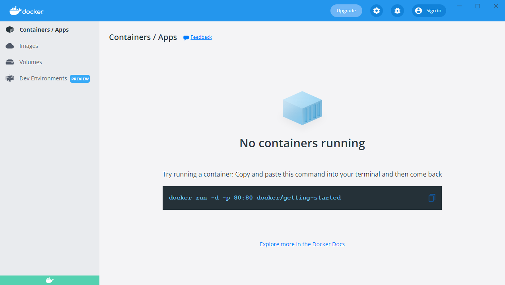
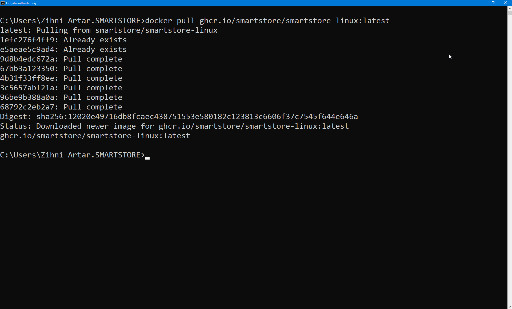
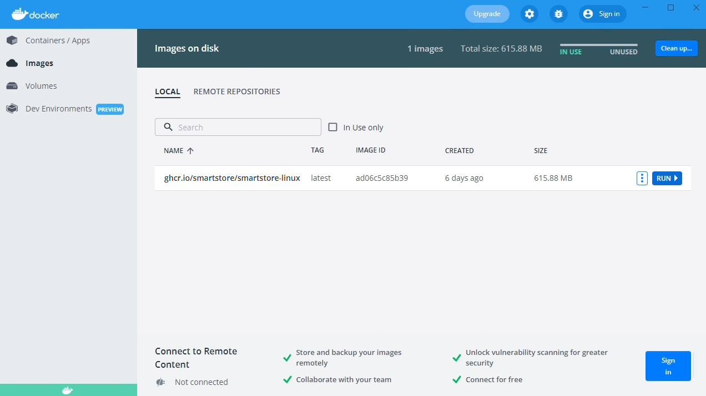
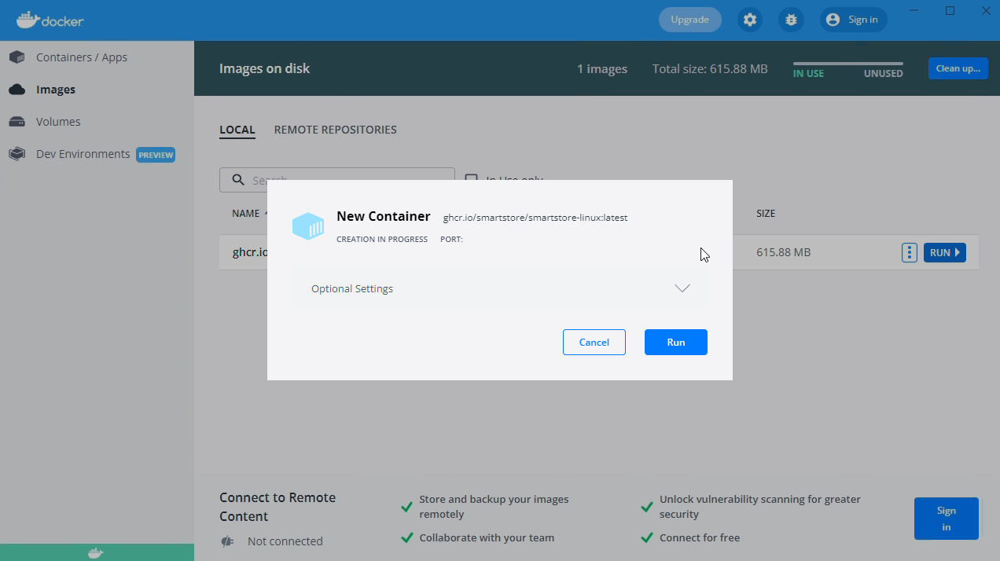
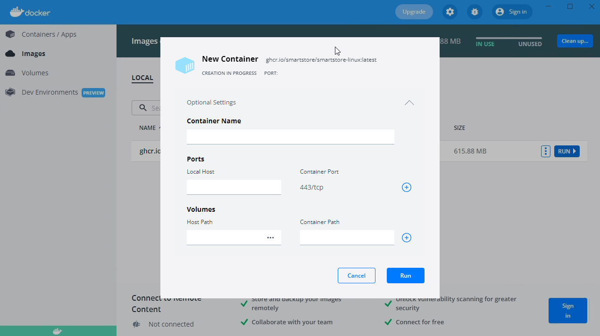
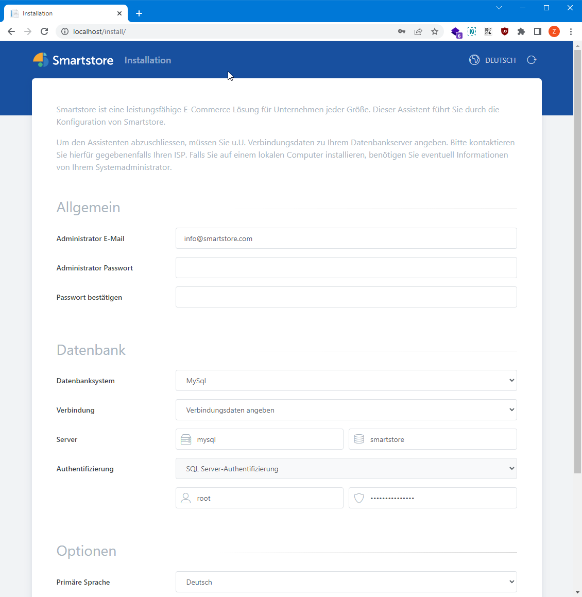

# Smartstore Docker-Images unter Windows ausführen

Mit Docker Desktop können Sie das Smartstore-Linux-Image auf einem Windows-PC herunterladen, als Container starten und anschließend die Installation im Browser aufrufen.

## Docker Desktop installieren <a href="#docker-desktop-installieren" id="docker-desktop-installieren"></a>

Laden Sie [Docker Desktop für Windows](https://www.docker.com/products/docker-desktop/) herunter und installieren Sie die Anwendung. Beachten Sie die [aktuellen Systemvoraussetzungen und Installationshinweise von Docker](https://docs.docker.com/desktop/setup/install/windows-install/). Starten Sie Docker Desktop nach der Installation und verwenden Sie Linux-Container, beispielsweise mit dem WSL-2-Backend. Falls Docker Desktop im Windows-Container-Modus läuft, wechseln Sie über das Docker-Menü zu **Switch to Linux containers**.



Das Smartstore-Image enthält keinen Datenbankserver. Für Microsoft SQL Server, MySQL oder PostgreSQL benötigen Sie eine vom Container erreichbare Datenbank. Wenn Sie Shop und Datenbank zusammen starten möchten, verwenden Sie die Anleitung [Smartstore und Datenbank zusammen als Docker-Container betreiben](smartstore-und-datenbank-zusammen-als-docker-container-betreiben.md). Die Auswahl des Datenbanksystems beschreibt [Smartstore installieren](../smartstore-installieren.md).

## Smartstore-Docker-Image herunterladen <a href="#smartstore-docker-image-herunterladen" id="smartstore-docker-image-herunterladen"></a>

Der folgende Befehl lädt den als `latest` veröffentlichten Stand. Für eine festgelegte Version ersetzen Sie `latest` durch den gewünschten Release-Tag aus dem [offiziellen Smartstore-Linux-Paket](https://github.com/smartstore/Smartstore/pkgs/container/smartstore-linux).

1. Öffnen Sie mit der Tastenkombination `Windows-Taste + R` das Dialogfeld **Ausführen**.
2. Geben Sie `cmd` ein und bestätigen Sie mit der `Eingabetaste`.
3. Führen Sie den folgenden Befehl aus:


```
docker pull ghcr.io/smartstore/smartstore-linux:latest
```




Das Smartstore-Docker-Image ist nun in Docker Desktop unter **Images** verfügbar.

## Container erstellen und starten <a href="#container-erstellen-und-starten" id="container-erstellen-und-starten"></a>

1.  Bewegen Sie den Mauszeiger über den Eintrag des Smartstore-Images und klicken Sie rechts auf **Run**.

    
2.  Der Dialog zum Erstellen eines neuen Containers wird geöffnet.

    
3. Öffnen Sie Optional settings, um Containername, Portzuordnung und Datenspeicher festzulegen.
4.  Ordnen Sie unter Ports den lokalen Host-Port `80` dem Container-Port `80` zu.

    Ist Port `80` bereits belegt, verwenden Sie einen anderen freien Host-Port, beispielsweise `8080`. Der Container-Port bleibt `80`.

    
5. Legen Sie auf Windows einen Ordner für die Mandantendaten an, beispielsweise `C:\Smartstore\Tenants`. Tragen Sie ihn unter **Volumes** als **Host path** ein und verwenden Sie `/app/App_Data/Tenants` als **Container path**. Der Ordner muss für Docker beschreibbar sein.
6. Starten Sie den Container mit einem Klick auf **Run**.


Durch diese Zuordnung bleiben die Mandantendateien beim Entfernen oder Ersetzen des Containers im Windows-Ordner erhalten. Sichern Sie diesen Ordner und die verwendete Datenbank. Dateien außerhalb dieses eingebundenen Verzeichnisses werden dadurch nicht gesichert.


## Smartstore-Installation aufrufen <a href="#smartstore-installation-aufrufen" id="smartstore-installation-aufrufen"></a>

Öffnen Sie einen Browser und rufen Sie [http://localhost](http://localhost) auf dem Windows-PC auf. Bei einem abweichenden Host-Port ergänzen Sie diesen in der Adresse, beispielsweise http://localhost:8080. Nach dem ersten Start kann es etwas dauern, bis die Installationsseite erreichbar ist.




Läuft die Datenbank auf demselben Windows-PC, verwenden Sie im Installer `host.docker.internal` als Serveradresse und den Port des Datenbankservers. `localhost` bezeichnet aus Sicht des Smartstore-Containers den Container selbst. Der Datenbankserver muss Verbindungen aus Docker zulassen; verwenden Sie ein geeignetes Datenbankkonto statt der Windows-Authentifizierung des Host-PCs.


Fahren Sie mit [Smartstore installieren](../smartstore-installieren.md) fort. Wenn die Seite nicht erreichbar ist, prüfen Sie unter **Containers**, ob der Container läuft, und öffnen Sie dessen **Logs**. Kontrollieren Sie außerdem die Zuordnung von Host- und Container-Port.
