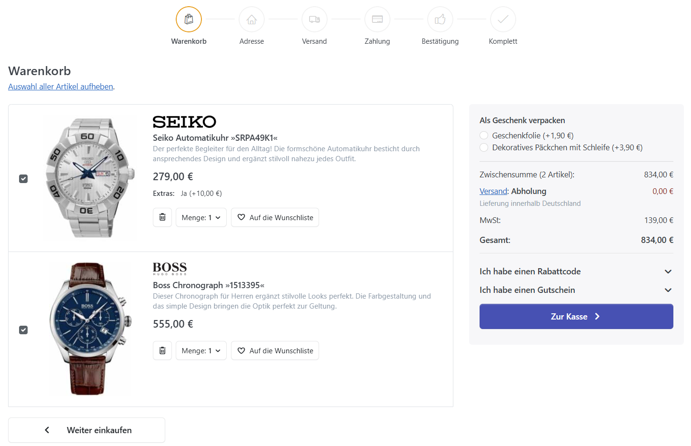
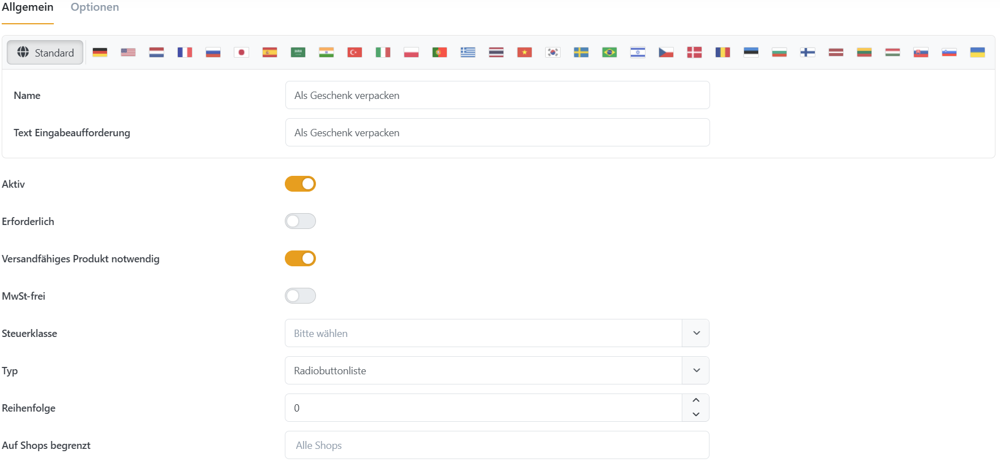

# Checkout Attribute verwalten

Checkout-Attribute erfassen zusätzliche Angaben oder kostenpflichtige Optionen für den gesamten Warenkorb. Sie verwalten sie unter **Katalog > Checkout Attribute**.

## Anwendungsszenario

Verkaufen Sie häufig Produkte, die verschenkt werden, können Sie beispielsweise eine systemweite Geschenkverpackung anbieten. Ein **Checkout-Attribut** erscheint bereits in der Warenkorbübersicht, sodass Kunden die Option vor Beginn des eigentlichen Checkout-Vorgangs auswählen können.

## Ein Checkout Attribut erstellen

Legen Sie unter **Katalog > Checkout Attribute** ein neues Attribut an, wählen Sie den Typ und speichern Sie es mit **Speichern und fortsetzen**. Bei Dropdown-Listen, Optionsfeldern, Kontrollkästchen und Farb- und Bildmustern legen Sie anschließend auf der Registerkarte **Werte** die auswählbaren Optionen an. Textfelder, mehrzeilige Textfelder, Datumsauswahl und Datei-Upload erfassen die Eingabe des Kunden direkt und benötigen keine vordefinierten Werte.

### Allgemein Eigenschaften

| **Feld**                          | **Beschreibung**                                                                                                                            |
| --------------------------------- | ------------------------------------------------------------------------------------------------------------------------------------------- |
| Name                              | Name des Checkout-Attributs. Name und Anzeigename können je Shopsprache übersetzt werden.                                                   |
| Anzeigename                       | Abweichende Beschriftung im Warenkorb. Bleibt das Feld leer, wird der Name des Attributs angezeigt.                                         |
| Aktiv                             | Legt fest, ob das Checkout-Attribut in Ihrem Shop aktiv ist.                                                                                |
| Erforderlich                      | Legt fest, ob ein Kunde einen Wert angeben muss, bevor der Bestellprozess fortgesetzt werden kann.                                          |
| Versandfertiges Produkt notwendig | Legt fest, ob zur Anzeige des Attributs versandfähige Produkte im Warenkorb liegen müssen.                                                  |
| MwSt.-frei                        | Bestimmt, ob die Preisanpassungen dieses Attributs steuerfrei sind. Die Einstellung betrifft nicht die übrigen Warenkorbpositionen.         |
| Steuerkategorie                   | Steuerkategorie für die Preisanpassungen der Attributwerte. Das Feld erscheint, wenn **MwSt.-frei** deaktiviert ist.                        |
| Typ                               | Bestimmt den Steuerelementtyp für die Erfassung der Attribut-Werte.                                                                         |
| Reihenfolge                       | Bestimmt die Sortierung der Checkout-Attribute. Kleinere Werte erscheinen zuerst; auch 0 ist zulässig.                                      |
| Beschränkt auf Shops              | Beschränkt das Attribut auf die ausgewählten Shops. Ohne Auswahl ist es in allen Shops verfügbar.                                           |
| Voraussetzungen                   | Legt anhand zugewiesener Warenkorb-Regelsätze fest, wann das Checkout-Attribut angezeigt wird. Bei mehreren Regelsätzen genügt ein Treffer. |

### Farb- und Bildmuster

Mit dem Typ **Farb- und Bildmuster** machen Sie die angebotenen Optionen im Warenkorb anschaulich. Für eine Geschenkverpackung können Sie beispielsweise verschiedene Papierfarben oder Bilder der Verpackungen anbieten. Hinterlegen Sie dazu an jedem Attributwert die passenden Farben oder ein Bild. Die Einstellungen für die gemeinsame Darstellung finden Sie am Checkout-Attribut unterhalb der Voraussetzungen.

Wählen Sie zunächst eine passende **Mustergröße** zwischen XS und XXL. Kleine Muster eignen sich für eine kompakte Farbauswahl. Wenn Sie zusätzlich Namen oder Preisanpassungen direkt bei den Mustern zeigen möchten, wählen Sie mindestens Größe L. Lassen Sie die Größe unverändert auf dem Standardwert, übernimmt das Attribut die Vorgabe aus den Katalogeinstellungen.

Ab Größe L können die Optionen als Karten erscheinen, die neben dem Muster auch den Namen oder eine Preisanpassung zeigen. Dafür muss jede Option eine Farbe oder ein Bild besitzen und die Namens- oder Preisanzeige aktiviert sein. Mit dem **Muster-Seitenverhältnis** bestimmen Sie das Verhältnis von Höhe zu Breite dieser Karten. Der Standardwert 1:1 ergibt eine quadratische Darstellung; auf kleinere Muster ohne Karten wirkt sich diese Einstellung nicht aus.

Über die **Musterform** legen Sie fest, ob die Auswahl abgerundet, rechteckig oder rund dargestellt wird. Ohne eigene Festlegung gilt die Standardform aus den Katalogeinstellungen. Bei Karten verwendet der Shop anstelle der runden Form eine abgerundete Darstellung. Das gilt auch dann, wenn einer Option sowohl eine Farbe als auch ein Bild fehlen.

Aktivieren Sie **Optionsnamen anzeigen**, wenn Kunden die Bezeichnungen direkt in den Karten lesen sollen, beispielsweise „Geschenkpapier Rot“ oder „Geschenkbox“. Sobald Sie Preisinformationen in den Karten einblenden, wird der jeweilige Optionsname ebenfalls angezeigt.

Unter **Preisanzeige im Muster** wählen Sie zwischen **Keine** und **Preisanpassung**. Mit **Preisanpassung** können Kunden einen hinterlegten Auf- oder Abschlag direkt an der Option erkennen. Bei Checkout-Attributen zeigt diese Einstellung die Preisanpassung des Attributwerts an; ein berechneter Produktendpreis steht hier nicht zur Auswahl.


Die Darstellung als Karten mit Namen oder Preisanpassungen setzt mindestens Mustergröße L sowie ein Bild oder eine Farbe bei jeder Option voraus. Preisanpassungen werden nur ausgegeben, wenn der Kunde Preise sehen darf.


### Regelbasierte Voraussetzungen

Im Bereich **Voraussetzungen** können Sie dem Checkout-Attribut einen oder mehrere Warenkorb-Regelsätze zuweisen. Damit lässt sich die Anzeige beispielsweise von der Kundenrolle, enthaltenen Produkten oder dem Warenkorbwert abhängig machen. So können Sie Angaben zur elektronischen Rechnungsstellung ausschließlich für B2B-Kunden einblenden und als erforderlich kennzeichnen.

Ohne zugewiesenen Regelsatz bleibt das bisherige Verhalten unverändert. Bei mehreren Regelsätzen wird das Attribut angezeigt, sobald mindestens ein Regelsatz zutrifft. Wie die Regeln und Gruppen innerhalb eines Regelsatzes verknüpft werden, bestimmt dessen logischer Operator.

Shop-Einschränkungen und die Option **Versandfertiges Produkt notwendig** gelten zusätzlich. Ein erforderliches Attribut wird nur geprüft, solange seine Voraussetzungen erfüllt sind. Ändert sich der Warenkorb und kein zugewiesener Regelsatz trifft mehr zu, wird das Attribut ausgeblendet und ein zuvor ausgewählter Wert nicht weiter verwendet.


Bitte beachten Sie, dass einige Angaben, wie beispielsweise die Lieferanschrift oder die Versandart, erst während des Checkouts festgelegt werden. Regeln, die sich auf diese Angaben beziehen, greifen daher unter Umständen nicht.


### Attribut-Wert Eigenschaften

Speichern Sie das Attribut zuerst. Über **Neu** auf der Registerkarte **Werte** öffnen Sie den Dialog für einen neuen Wert; vorhandene Werte bearbeiten Sie über ihren Namen. Änderungen direkt in der Wertetabelle übernehmen Sie mit **Änderungen speichern**. Nicht mehr benötigte Werte können Sie einzeln oder über die Auswahl löschen.

| **Feld**           | **Beschreibung**                                                                                                                                                                                                                                                 |
| ------------------ | ---------------------------------------------------------------------------------------------------------------------------------------------------------------------------------------------------------------------------------------------------------------- |
| Name               | Der Name des Checkout-Attributwerts.                                                                                                                                                                                                                             |
| Bild               | Optionales Bild für die Darstellung des Werts als Farb- und Bildmuster.                                                                                                                                                                                          |
| Farben             | Eine oder mehrere Farben für die Darstellung des Werts als Farbmuster.                                                                                                                                                                                           |
| Preis anpassen     | Auf- oder Abschlag bei Auswahl dieses Werts, eingegeben in der am Feld angezeigten primären Shopwährung. Positive Werte erhöhen, negative Werte verringern den Betrag. Die Steuerbehandlung folgt den Steuereinstellungen und der Steuerkategorie des Attributs. |
| Gewicht anpassen   | Ändert das Gesamtgewicht des Warenkorbs um den angegebenen Betrag in der am Feld angezeigten Gewichtseinheit. Die Anpassung wird je ausgewähltem Attributwert berücksichtigt, nicht je Stück eines Produkts.                                                     |
| Ist Voreinstellung | Legt fest, ob dieser Attributwert für den Kunden vorausgewählt wird.                                                                                                                                                                                             |
| Reihenfolge        | Bestimmt die Sortierung der Werte innerhalb des Attributs. Kleinere Werte erscheinen zuerst; auch 0 ist zulässig.                                                                                                                                                |
