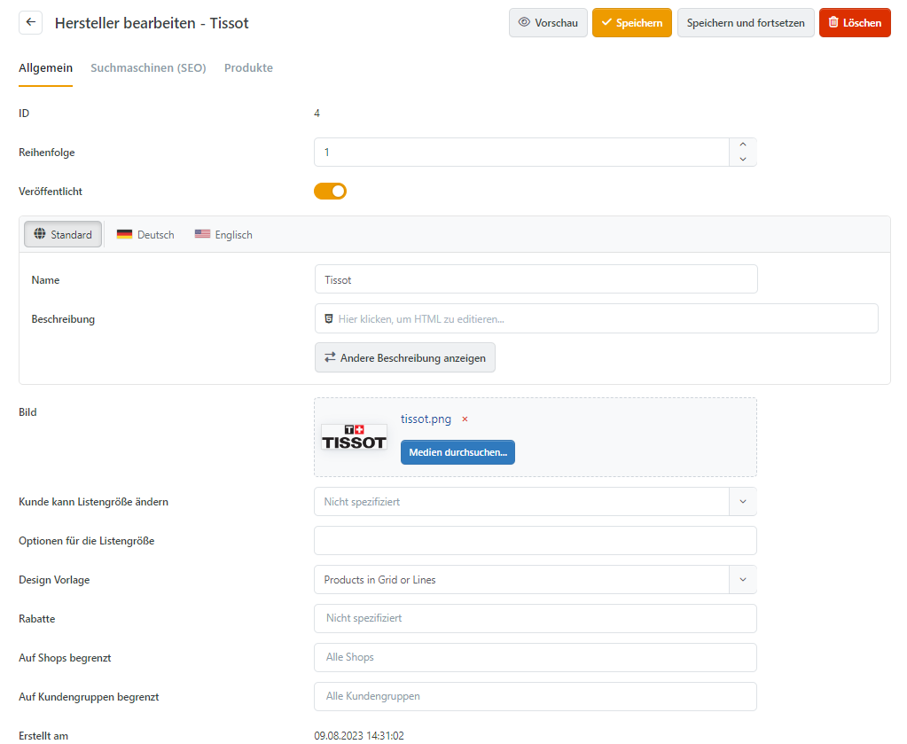

# Hersteller verwalten

Hersteller lassen sich Produkten zuordnen und auf der Produktdetailseite anzeigen. Jeder Hersteller erhält außerdem eine eigene Seite mit Beschreibung und zugeordneten Produkten. Eine nach Reihenfolge sortierte Auswahl wichtiger Hersteller kann auf der Startseite erscheinen. Kunden können den Katalog zudem nach Herstellern filtern; weitere Informationen dazu finden Sie unter [Mit dem Filter Sidebar Widget arbeiten](produkte-verwalten/mit-dem-filter-sidebar-widget-arbeiten.md).

Öffnen Sie **Admin > Katalog > Hersteller**, um Hersteller anzulegen oder zu bearbeiten. Über **Bearbeiten** gelangen Sie zur jeweiligen Detailansicht.

## Allgemein

| **Eingabefeld**               | **Beschreibung**                                                                                                                                                                                                                           |
| ----------------------------- | ------------------------------------------------------------------------------------------------------------------------------------------------------------------------------------------------------------------------------------------ |
| Reihenfolge                   | Bestimmt die Position des Herstellers in sortierten Herstellerlisten.                                                                                                                                                                      |
| Veröffentlicht                | Legt fest, ob der Hersteller im Shop angezeigt wird.                                                                                                                                                                                       |
| Name                          | Name des Herstellers. Sie können für weitere Sprachen eigene Namen eingeben.                                                                                                                                                               |
| Beschreibung                  | Text oberhalb der Produkte auf der Herstellerseite. Für weitere Sprachen kann eine eigene Beschreibung hinterlegt werden.                                                                                                                  |
| Untere Beschreibung           | Optionaler Text unterhalb der Produkte auf der Herstellerseite. Das Feld erscheint über die Umschaltfläche für Beschreibungen.                                                                                                             |
| Bild                          | Bild des Herstellers.                                                                                                                                                                                                                      |
| Kunde kann Listengröße ändern | Ermöglicht Kunden, die Anzahl angezeigter Produkte pro Seite aus vorgegebenen Werten auszuwählen.                                                                                                                                          |
| Listengröße                   | Anzahl der Produkte pro Seite, wenn Kunden die Listengröße nicht selbst ändern können.                                                                                                                                                     |
| Optionen für die Listengröße  | Kommagetrennte Auswahlwerte für die Listengröße, wenn Kunden diese selbst ändern können. Der erste Wert ist die Vorgabe.                                                                                                                   |
| Design Vorlage                | Bestimmt eine Vorlage, mit der der Hersteller und seine Produkte dargestellt werden.                                                                                                                                                       |
| Rabatte                       | Ordnet dem Hersteller bereits eingerichtete Rabatte zu. Weitere Informationen zur Rabattzuordnung finden Sie unter [Mit Rabatten arbeiten](../../benutzer-handbuch/marketing-promotion/rabatte-verwalten.md).                              |
| Auf Shop begrenzt             | Begrenzt die Sichtbarkeit des Herstellers auf die ausgewählten Shops. Weitere Informationen zur Shopbegrenzung finden Sie unter [Mit mehreren Shops arbeiten](../../benutzer-handbuch/allgemeine-konzepte/mit-mehreren-shops-arbeiten.md). |
| Auf Kundengruppen begrenzt    | Begrenzt die Sichtbarkeit des Herstellers auf die ausgewählten Kundengruppen.                                                                                                                                                              |

## Suchmaschinen (SEO)

Für Hersteller können Sie in dieser Registerkarte einen eigenen Seitentitel, eine Meta-Beschreibung, Meta-Keywords und einen URL-Alias festlegen. Die Bedeutung der Felder, Sprachvarianten und früheren URL-Aliase erläutert die Seite [SEO](../../benutzer-handbuch/allgemeine-konzepte/seo.md).

## Produkte

Diese Registerkarte zeigt die zugeordneten Produkte. Sie erscheint erst, nachdem Sie den Hersteller gespeichert haben. Über **Produkt hinzufügen** ordnen Sie ein weiteres Produkt zu. Für jede Zuordnung können Sie festlegen, ob das Produkt auf der Herstellerseite hervorgehoben wird, und seine Reihenfolge bestimmen. Bestehende Zuordnungen können Sie bearbeiten oder entfernen.
