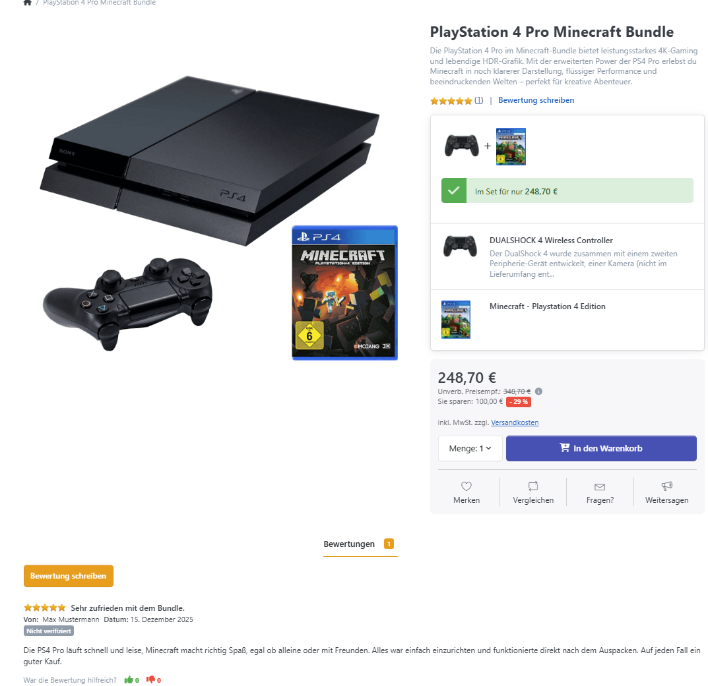

# Produkt Rezensionen verwalten

Produktrezensionen unterstützen Kunden bei der Kaufentscheidung. Unter **Katalog > Produkt Rezensionen** prüfen und bearbeiten Sie eingegangene Rezensionen. Die Darstellung im Shop, die Freigabepflicht und Bewertungen durch Gäste konfigurieren Sie in den [Katalogeinstellungen](../../benutzer-handbuch/konfiguration/einstellungen/katalogeinstellungen.md) unter **Kunden > Produktbewertungen**. Am Produkt bestimmt **Kundenbewertungen erlauben**, ob es bewertet werden darf.


Beim Anlegen eines Produkts im Backend ist Kundenbewertungen erlauben bereits aktiviert. Sie müssen die Option daher nicht für jedes neue Produkt einschalten. Deaktivieren Sie sie bei Produkten, für die Sie keine Rezensionen zulassen möchten.


## Rezensionen bearbeiten

In der Detailansicht sehen Sie das bewertete Produkt, den Verfasser und die Rezension. Bearbeitbar sind folgende Felder:

| **Feld**        | **Beschreibung**                                                                                                                                                        |
| --------------- | ----------------------------------------------------------------------------------------------------------------------------------------------------------------------- |
| Titel           | Überschrift der Rezension.                                                                                                                                              |
| Text            | Inhalt der Rezension.                                                                                                                                                   |
| Ist genehmigt   | Gibt die Rezension für die Anzeige im Shop frei oder nimmt ihre Freigabe zurück.                                                                                        |
| Ist verifiziert | Legt den Kaufnachweis manuell fest oder verwendet bei Automatisch die Prüfung anhand der zugeordneten Bestellungen. Die Unterschiede beschreibt der folgende Abschnitt. |

Die vom Kunden vergebene Sternebewertung, die Hilfreich-Stimmen und das Erstellungsdatum werden angezeigt und können hier nicht geändert werden. Speichern Sie die Rezension nach der Bearbeitung.

## Produkt Rezensionen freischalten

Mit **Produktbewertungen müssen genehmigt werden** legen Sie in den [Katalogeinstellungen](../../benutzer-handbuch/konfiguration/einstellungen/katalogeinstellungen.md) fest, ob neue Rezensionen sofort erscheinen oder zunächst freigegeben werden müssen. Dort aktivieren Sie bei Bedarf auch die E-Mail-Benachrichtigung für neue Bewertungen.

Einzelne Rezensionen geben Sie über **Ist genehmigt** frei. Für mehrere Rezensionen stehen **Ausgewählte genehmigen** und **Ausgewählte ablehnen** zur Verfügung. Ablehnen nimmt die Freigabe zurück; die Rezension bleibt zur weiteren Bearbeitung gespeichert.

Nur genehmigte Rezensionen werden im Shop angezeigt und in die angezeigte Durchschnittsbewertung einbezogen. Änderungen der Freigabe aktualisieren die Bewertungsstatistik des Produkts.

Wenn Bonuspunkte für Rezensionen eingerichtet sind, führt die Genehmigung zu einer Gutschrift. Beim Zurücknehmen der Genehmigung werden die Punkte wieder abgezogen. Weitere Informationen: [Mit Bonuspunkten arbeiten](../../benutzer-handbuch/kunden/mit-bonuspunkten-arbeiten.md).

## Verifizierte Produkt Rezensionen

Das Feld **Ist verifiziert** kennzeichnet, ob die Rezension einem Käufer des Produkts zugeordnet wird. Es ist von **Ist genehmigt** unabhängig: Eine Rezension kann freigegeben sein, ohne als verifizierter Kauf gekennzeichnet zu sein.

Bei **Automatisch** wird für die Anzeige im Shop geprüft, ob dem Kundenkonto eine Bestellung zugeordnet ist, die das bewertete Produkt enthält. Eine Zahlung, ein abgeschlossener Auftrag oder ein Kauf vor dem Verfassen der Rezension werden dabei nicht vorausgesetzt.

Mit **Ja** kennzeichnen Sie die Rezension ausdrücklich als verifizierten Kauf, mit **Nein** als nicht verifiziert. Diese Auswahl hat Vorrang vor der automatischen Prüfung. Die Sammelaktion zum Verifizieren setzt die ausgewählten Rezensionen direkt auf Ja; sie führt keine erneute Kaufprüfung durch.

Mit **Zeige Badge für verifizierte Käufe** in den Katalogeinstellungen aktivieren Sie die entsprechende Kennzeichnung im Shop.


**Über die Prüfung von Bewertungen informieren**

Wenn Sie Verbraucherbewertungen veröffentlichen, müssen Sie Ihren Besuchern erklären, ob und wie Sie deren Herkunft von tatsächlichen Käufern oder Nutzern prüfen. Beschreiben Sie dafür das Prüfverfahren, das Sie in Ihrem Shop verwenden. Stellen Sie diese Information direkt bei den Bewertungen oder über einen dort deutlich sichtbaren, eindeutig bezeichneten Link bereit. Grundlage ist [§ 5b Abs. 3 UWG](https://www.gesetze-im-internet.de/uwg_2004/__5b.html).


## Im Frontend anzeigen

Kunden bewerten Produkte mit 1 bis 5 Sternen und ergänzen einen Titel sowie ihren Rezensionstext. Ob Gäste Rezensionen schreiben dürfen, legen die Katalogeinstellungen fest. Ist die Freigabepflicht aktiv, erscheint die neue Rezension erst nach Ihrer Genehmigung.

In den Katalogeinstellungen schalten Sie Bewertungen in Produktlisten und auf der Produktdetailseite getrennt ein. Auf der Produktdetailseite zeigt der Bereich **Bewertungen** die neuesten genehmigten Rezensionen. Bei mehr als zehn Einträgen führt **Alle Bewertungen lesen** zur vollständigen Bewertungsseite. Über **Bewertung schreiben** beziehungsweise **Geben Sie die erste Bewertung ab** gelangen Kunden zum Bewertungsformular.

Kunden können Rezensionen außerdem als hilfreich oder nicht hilfreich einstufen. Eigene Rezensionen können sie nicht bewerten. Diese Stimmen sind von der Sternebewertung des Produkts getrennt.

## Rezensionen löschen

Löschen entfernt die Rezension und ihre Hilfreich-Stimmen. Die Bewertungsstatistik des Produkts wird anschließend neu berechnet. Wenn Sie eine Rezension nur ausblenden möchten, nehmen Sie stattdessen die Genehmigung zurück.


Beim Löschen werden zuvor für die Rezension gutgeschriebene Bonuspunkte nicht automatisch abgezogen. Sollen diese Punkte zurückgenommen werden, entziehen Sie der Rezension vor dem Löschen die Genehmigung, solange die Bonuspunktevergabe für Rezensionen aktiviert ist.

