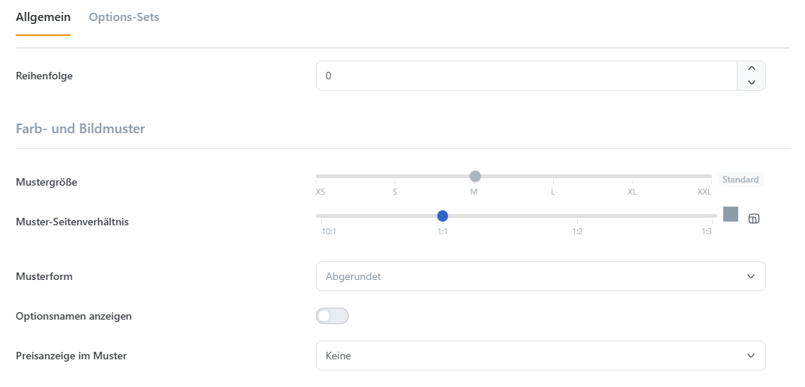
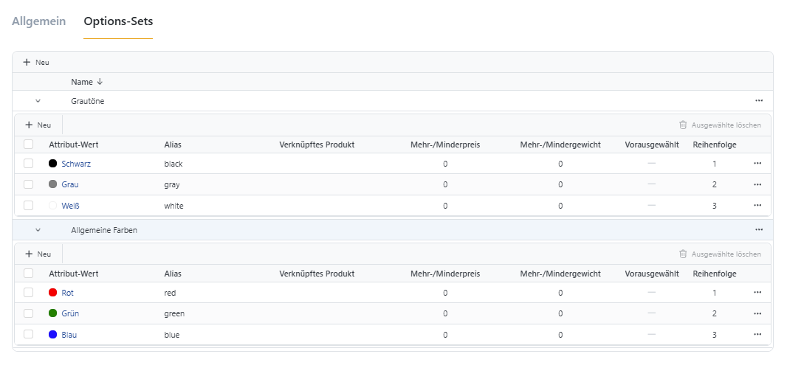

# Produktattribute vorbereiten

Unter **Katalog > Produkt Attribute** legen Sie Produktattribute wie Farbe oder Größe zentral an. So können Sie dasselbe Attribut mehreren Produkten zuweisen und seine allgemeinen Einstellungen an einer Stelle pflegen. Für häufig verwendete Werte bereiten Sie Options-Sets vor. Welche Werte Kunden bei einem bestimmten Produkt auswählen können und ob einzelne Ausführungen eigene Daten erhalten, legen Sie anschließend in der Produktbearbeitung fest.

Einen Überblick über Attribute, Werte und Varianten finden Sie unter [Produktattribute und Varianten](produkte-verwalten/wie-funktionieren-produktvarianten.md). Wie Sie vorbereitete Attribute und Werte einem Produkt zuweisen, erfahren Sie unter [Attribute am Produkt einrichten](produkte-verwalten/wie-funktionieren-produktvarianten/produktvarianten-einrichten.md).

## Attribute anlegen und bearbeiten

In der Übersicht können Sie die vorhandenen Produktattribute anhand von **Name**, **Alias** und **Filtern zulassen** eingrenzen. Klicken Sie auf den Namen eines Attributs, um dessen Einstellungen zu bearbeiten. Über **Neu** legen Sie ein weiteres Attribut an. Wenn Sie Attribute entfernen möchten, markieren Sie die betreffenden Einträge und wählen **Ausgewählte löschen**. Prüfen Sie vorher, ob diese Attribute bereits Produkten zugewiesen sind.

1. Öffnen Sie **Katalog > Produkt Attribute** und klicken Sie auf **Neu**.
2. Geben Sie unter **Allgemein** einen **Namen** ein und ergänzen Sie bei Bedarf **Alias** und **Beschreibung**. Bei mehreren Shopsprachen können Sie für diese Felder Übersetzungen hinterlegen.
3. Prüfen Sie **Reihenfolge** und die gewünschten Anzeigeeinstellungen. Klicken Sie auf **Speichern und fortsetzen**, wenn Sie anschließend Options-Sets anlegen möchten.

<figure><figcaption>
Einstellungen für Farb- und Bildmuster unter Allgemein
</figcaption></figure>


Mit dem [AI-Plugin](../../benutzer-handbuch/plugins/ai.md#translations) können Sie die sprachabhängigen Felder automatisch übersetzen lassen.


## Allgemein 

Unter **Allgemein** pflegen Sie die Bezeichnung und Beschreibung des Attributs sowie Einstellungen für seine Anzeige und Verwendung. Sprachabhängige Angaben können Sie für jede Shopsprache einzeln hinterlegen.

| **Einstellung**                  | **Beschreibung**                                                                                                    |
| -------------------------------- | ------------------------------------------------------------------------------------------------------------------- |
| **Name**                         | Name des Attributs, beispielsweise Farbe oder Größe.                                                                |
| **Alias**                        | Optionaler URL-Alias für Suchfilter, der je Sprache gepflegt werden kann.                                           |
| **Beschreibung**                 | Beschreibung des Attributs, die Sie je Sprache hinterlegen können.                                                  |
| **Reihenfolge**                  | Anzeigepriorität des Attributs. Am einzelnen Produkt legen Sie die Reihenfolge der dort verwendeten Attribute fest. |
| **Zuordnungen zu Exportfeldern** | Ordnet Attributwerte Feldern eines Exportformats zu, beispielsweise die Farbe dem Feld `gmc:color`.                |

Wie Sie Produktattribute für den Export von Attributkombinationen zuordnen, erfahren Sie unter [Google Merchant Center Feed](../../benutzer-handbuch/plugins/googlemerchantcenter.md#attribute-und-varianten-zuordnen).

Die Darstellung von Farb- und Bildmustern legen Sie ebenfalls unter **Allgemein** fest. Die Einstellungen gelten für dieses Attribut und können an einzelnen Produkten überschrieben werden. Wie Sie Größe, Form, Bildkarten, mehrfarbige Muster und die Preisanzeige einstellen, erfahren Sie unter [Farb- und Bildmuster verwenden](produkte-verwalten/wie-funktionieren-produktvarianten/farb-und-bildmuster-verwenden.md).

### MegaSearch Felder

Mit dem kostenpflichtigen Plugin **MegaSearch Plus** können Kunden Produkte anhand von Attributwerten finden und Suchergebnisse nach diesen Werten filtern. Aktivieren Sie beispielsweise **Filtern zulassen** für das Attribut Farbe, damit Kunden die Ergebnisse auf Produkte mit einer gewünschten Farbe eingrenzen können.

Die folgenden Einstellungen finden Sie unter **Allgemein**. Änderungen wirken nach der nächsten Aktualisierung des Suchindex. Weitere Informationen finden Sie unter [MegaSearch](../../benutzer-handbuch/plugins/megasearch.md).

| **Einstellung**             | **Beschreibung**                                                                               |
| --------------------------- | ---------------------------------------------------------------------------------------------- |
| **Filtern zulassen**        | Erlaubt Kunden, Suchergebnisse nach diesem Attribut einzugrenzen.                              |
| **Suchfilter Darstellung**  | Darstellung des Attributfilters. Das Feld erscheint bei aktiviertem **Filtern zulassen**.      |
| **Optionsnamen indexieren** | Nimmt Optionsnamen in den Suchindex auf, damit Kunden Produkte über diese Werte finden können. |

## Options-Sets pflegen

Ein Options-Set bündelt häufig verwendete Attributwerte, die Sie später in Produkte kopieren können. Für Größe können Sie beispielsweise ein Set mit S, M, L und XL anlegen. Für dasselbe Attribut sind mehrere Sets möglich, etwa unterschiedliche Farbpaletten für verschiedene Produktgruppen.

1. Speichern Sie das Attribut und öffnen Sie die Registerkarte **Options-Sets**.
2. Legen Sie über **Neu** ein Set mit einem aussagekräftigen Namen an und speichern Sie die Tabellenänderung.
3. Klappen Sie das Set auf und legen Sie seine Optionen an. Über den **Namen** einer Option öffnen Sie deren Bearbeitung.

<figure><figcaption>
Mehrere Options-Sets als Farbpaletten hinterlegt
</figcaption></figure>

### Optionen im Set bearbeiten

Jede Option ist ein Wert, den Sie später am Produkt anbieten können. Beim Anlegen wählen Sie zwischen **Einfach** und **Produkt**. Mit **Einfach** erstellen Sie einen eigenständigen Attributwert, beispielsweise Blau. Dazu können Sie **Name**, **Alias** und deren Übersetzungen, **Bild** und **Farben**, **Mehr-/Minderpreis**, **Mehr-/Mindergewicht**, **Vorausgewählt** und **Reihenfolge** pflegen.

Mit **Produkt** verknüpfen Sie stattdessen ein vorhandenes Produkt als auswählbare Option, beispielsweise ein Zubehörteil. Wählen Sie dafür das **verknüpfte Produkt** und legen Sie seine **Menge** fest. Wie einfache und verknüpfte Werte am Produkt wirken, erfahren Sie unter [Attribute am Produkt einrichten](produkte-verwalten/wie-funktionieren-produktvarianten/produktvarianten-einrichten.md#attributwerte).

### Options-Sets am Produkt verwenden

Weisen Sie dem Produkt unter **Attribute** das zentrale Attribut zu und öffnen Sie dessen **Werte**. Dort können Sie ein **Options-Set** auswählen und seine Optionen als Attributwerte in das Produkt kopieren. Bei der Übernahme entscheiden Sie, ob die bereits am Produkt vorhandenen Werte erhalten bleiben oder vorher gelöscht werden. Bleiben sie erhalten, werden gleichnamige Werte nicht ein zweites Mal angelegt.


Die kopierten Werte werden anschließend am Produkt gepflegt. Spätere Änderungen am Options-Set aktualisieren sie nicht automatisch.


Die weiteren Einstellungen am Produkt finden Sie unter [Attribute am Produkt einrichten](produkte-verwalten/wie-funktionieren-produktvarianten/produktvarianten-einrichten.md). Wenn eine Ausführung eigene Daten wie eine SKU oder einen getrennten Bestand benötigt, legen Sie dafür eine Attributkombination an. Die Schritte finden Sie unter [Attributkombinationen verwalten](produkte-verwalten/wie-funktionieren-produktvarianten/attributkombinationen-verwalten.md).
