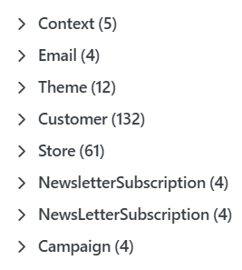

# Produktattribute verwalten

Unter Katalog > Produkt Attribute legen Sie Produktattribute zentral an, beispielsweise Farbe oder Größe. Ein Attribut kann mehreren Produkten zugewiesen werden. Hier pflegen Sie seine allgemeinen Einstellungen und wiederverwendbare Options-Sets; die Zuordnung zu einem Produkt und dessen Varianten erfolgt in der Produktbearbeitung.

Wie Sie Attribute einem Produkt zuweisen, Eingabetypen und Werte festlegen und Attributkombinationen mit eigenen Preisen oder Beständen erstellen, erfahren Sie unter [Wie funktionieren Produktvarianten?](produkte-verwalten/wie-funktionieren-produktvarianten.md).

## Attribute anlegen und bearbeiten

In der Übersicht filtern Sie nach Name, Alias und Filtern zulassen. Über den Namen öffnen Sie ein vorhandenes Attribut; mit Neu legen Sie ein neues an. Ausgewählte löschen entfernt die markierten Attribute. Prüfen Sie vor dem Löschen, an welchen Produkten die Attribute verwendet werden.

1. Öffnen Sie Katalog > Produkt Attribute und klicken Sie auf Neu.
2. Geben Sie unter Allgemein einen Namen ein und ergänzen Sie bei Bedarf Alias und Beschreibung. Bei mehreren Shopsprachen können Sie eigene Übersetzungen hinterlegen.
3. Prüfen Sie Reihenfolge und die gewünschten Anzeigeeinstellungen. Speichern Sie das Attribut mit Speichern und fortsetzen, wenn Sie anschließend Options-Sets anlegen möchten.

## Registerkarte Allgemein

| **Einstellung**              | **Beschreibung**                                                                                                                                                                                                                                                                                                                             |
| ---------------------------- | -------------------------------------------------------------------------------------------------------------------------------------------------------------------------------------------------------------------------------------------------------------------------------------------------------------------------------------------- |
| Name                         | Name des Attributs, beispielsweise Farbe oder Größe.                                                                                                                                                                                                                                                                                         |
| Alias                        | Optionaler SEO-konformer URL-Alias für Suchfilter. Er kann je Sprache gepflegt werden.                                                                                                                                                                                                                                                       |
| Beschreibung                 | Beschreibung des Attributs. Sie können sie je Sprache hinterlegen.                                                                                                                                                                                                                                                                           |
| Reihenfolge                  | Anzeigepriorität des Attributs. Die Reihenfolge innerhalb eines einzelnen Produkts wird bei dessen Attributzuordnung festgelegt.                                                                                                                                                                                                             |
| Mustergröße                  | Größe der Farb- und Bildmuster. Namen und Preise können ab Größe L im Muster erscheinen, wenn jede Option eine Farbe oder ein Bild besitzt. Mit Standard übernehmen Sie die vorgegebene Mustergröße.                                                                                                                                         |
| Muster-Seitenverhältnis      | Höhen-Breiten-Verhältnis im Kartenformat. Dieses wird ab Größe L mit aktivierter Namens- oder Preisanzeige verwendet, wenn jede Option eine Farbe oder ein Bild besitzt.                                                                                                                                                                     |
| Musterform                   | Form der Muster. Rund wird durch Abgerundet ersetzt, wenn Namen oder Preise im Muster erscheinen oder eine Option weder Farbe noch Bild besitzt.                                                                                                                                                                                             |
| Optionsnamen anzeigen        | Zeigt den Namen im Muster. Bei eingeblendeten Preisinformationen wird der Name immer angezeigt. Das Kartenformat setzt mindestens Größe L und eine Farbe oder ein Bild je Option voraus.                                                                                                                                                     |
| Preisanzeige im Muster       | Legt fest, welche verfügbaren Preisinformationen im Muster erscheinen. Dazu müssen Preise sichtbar sein, mindestens Größe L eingestellt sein und alle Optionen eine Farbe oder ein Bild besitzen.                                                                                                                                            |
| Zuordnungen zu Exportfeldern | Ordnet Attributwerte den Feldern eines Exportformats zu. Geben Sie pro Zeile eine Zuordnung im Format Formatpräfix:Export-Feldname ein. Beispielsweise überträgt gmc:color die Farbwerte beim Google-Merchant-Center-Export. Die Zuordnung wirkt nur beim Export von Attributkombinationen; der passende Exportanbieter muss verfügbar sein. |

### Suchfunktionen mit MegaSearch Plus

Die folgenden Felder stehen ebenfalls unter Allgemein. Sie wirken nur mit dem kostenpflichtigen Enterprise-Plugin MegaSearch Plus; Änderungen werden nach der nächsten Aktualisierung des Suchindex wirksam. Weitere Informationen finden Sie unter [MegaSearch](../../benutzer-handbuch/plugins/megasearch.md).

| **Einstellung**         | **Beschreibung**                                                                               |
| ----------------------- | ---------------------------------------------------------------------------------------------- |
| Filtern zulassen        | Erlaubt Kunden, Suchergebnisse nach diesem Attribut einzugrenzen.                              |
| Suchfilter Darstellung  | Darstellung des Attributfilters. Das Feld erscheint bei aktiviertem Filtern zulassen.          |
| Optionsnamen indexieren | Nimmt Optionsnamen in den Suchindex auf, damit Kunden Produkte über diese Werte finden können. |

## Options-Sets pflegen

Ein Options-Set bündelt wiederkehrende Attributwerte als Vorlage. Für Größe können Sie beispielsweise ein Set mit S, M, L und XL anlegen. Sie können mehrere Sets für unterschiedliche Produktgruppen pflegen.

1. Speichern Sie das Attribut und öffnen Sie die Registerkarte Options-Sets.
2. Legen Sie über Neu ein Set mit einem aussagekräftigen Namen an und speichern Sie die Tabellenänderung.
3. Klappen Sie das Set auf und legen Sie seine Optionen an. Über den Namen einer Option öffnen Sie deren Bearbeitung.

Optionen enthalten dieselben Grunddaten wie Attributwerte am Produkt: Name und Alias einschließlich Übersetzungen, Bild und Farben, Mehr-/Minderpreis, Mehr-/Mindergewicht, Vorauswahl und Reihenfolge. Bei einer Produktverknüpfung wählen Sie stattdessen das verknüpfte Produkt und dessen Menge. Die Wirkung dieser Werte ist auf der Seite Wie funktionieren Produktvarianten? beschrieben.

### Options-Sets am Produkt verwenden

Weisen Sie dem Produkt unter Attribute das zentrale Attribut zu. Wählen Sie anschließend bei diesem Attribut das gewünschte Options-Set zum Kopieren der Werte aus. Dabei entscheiden Sie, ob vorhandene Werte beibehalten oder vor dem Kopieren gelöscht werden sollen.


Die Werte werden in das Produkt kopiert. Eine spätere Änderung des zentralen Options-Sets aktualisiert bereits kopierte Produktwerte nicht automatisch. Beim Ergänzen bleiben vorhandene Werte mit gleichem Namen bestehen; wählen Sie das Ersetzen nur, wenn die bisherigen Werte entfallen sollen.


Für die anschließende Produktkonfiguration und die Erstellung von Kombinationen wechseln Sie zu [Wie funktionieren Produktvarianten?](produkte-verwalten/wie-funktionieren-produktvarianten.md).
