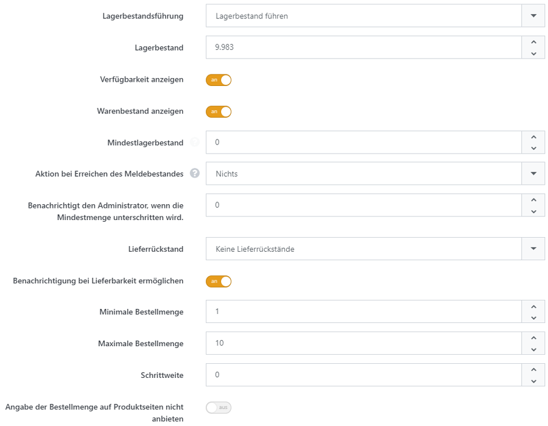
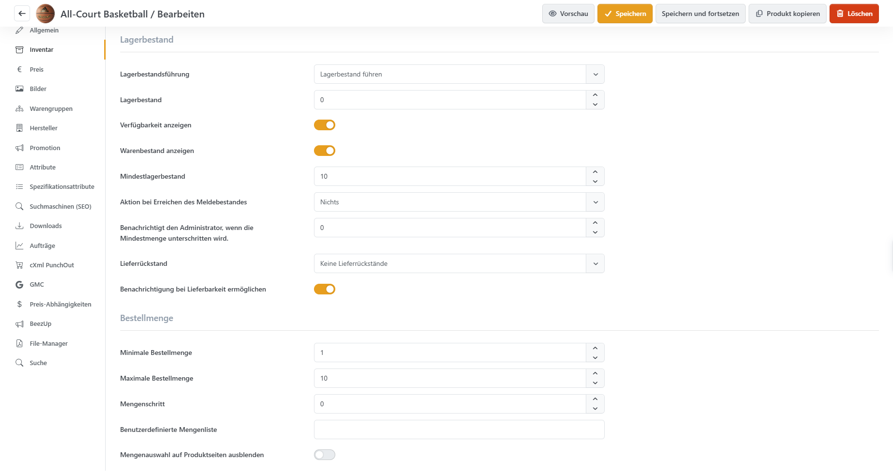

# Lagerbestand führen

In der Registerkarte **Inventar** der Produktbearbeitung legen Sie fest, wie Smartstore den Lagerbestand eines Produkts verwaltet. Außerdem bestimmen Sie, welche Mengen Kunden bestellen dürfen.

## Lagerbestandsführung wählen

Mit **Lagerbestandsführung** wählen Sie eine der folgenden Methoden:

| Methode                            | Verwendung                                                                                                        |
| ---------------------------------- | ----------------------------------------------------------------------------------------------------------------- |
| Keine Lagerbestandsführung         | Smartstore verwaltet keinen Bestand für das Produkt.                                                              |
| Lagerbestand führen                | Das Produkt hat einen gemeinsamen Lagerbestand, den Smartstore bei Bestellungen automatisch anpasst.              |
| Lagerbestand mit Attributen führen | Smartstore verwaltet den Bestand je Attributkombination, beispielsweise für jede Kombination aus Farbe und Größe. |

Bei **Lagerbestand mit Attributen führen** pflegen Sie die Bestände unter **Attribute** an den jeweiligen Kombinationen. Dort legen Sie auch fest, ob eine Kombination ohne ausreichenden Lagerbestand bestellt werden darf. Weitere Informationen finden Sie unter [Wie funktionieren Produktvarianten?](wie-funktionieren-produktvarianten.md).

## Lagerbestand und Verfügbarkeit einstellen

Die folgenden Einstellungen erscheinen abhängig von der gewählten **Lagerbestandsführung**.

| Einstellung                                                                  | Beschreibung                                                                                                                                                                                                                                                              |
| ---------------------------------------------------------------------------- | ------------------------------------------------------------------------------------------------------------------------------------------------------------------------------------------------------------------------------------------------------------------------- |
| Lagerbestand                                                                 | Aktueller Bestand des Produkts. Bei Bestandsführung über Attribute hinterlegen Sie diesen an den einzelnen Attributkombinationen.                                                                                                                                         |
| Verfügbarkeit anzeigen                                                       | Zeigt Kunden die Warenverfügbarkeit auf der Produktseite an.                                                                                                                                                                                                              |
| Warenbestand anzeigen                                                        | Zeigt zusätzlich die verfügbare Bestandsmenge an. Die Option erscheint, wenn Verfügbarkeit anzeigen aktiviert ist.                                                                                                                                                        |
| Mindestlagerbestand                                                          | Bestandsgrenze, bei deren Erreichen oder Unterschreiten die konfigurierte Aktion ausgeführt wird. Diese Grenze gilt bei Lagerbestand führen.                                                                                                                              |
| Aktion bei Erreichen des Meldebestandes                                      | Nichts führt keine zusätzliche Maßnahme aus. Kaufen-Button deaktivieren deaktiviert die Kauf- und Wunschzettelfunktion. Nicht veröffentlicht nimmt das Produkt aus der Veröffentlichung.                                                                                  |
| Benachrichtigt den Administrator, wenn die Mindestmenge unterschritten wird. | Eigener Schwellenwert für die E-Mail-Benachrichtigung des Shopbetreibers. Sinkt der Bestand unter diesen Wert, wird eine Benachrichtigung ausgelöst. Der Wert ist unabhängig vom Mindestlagerbestand.                                                                     |
| Lieferrückstand                                                              | Bestimmt, ob Kunden mehr Einheiten bestellen dürfen, als auf Lager sind. Die verfügbaren Möglichkeiten sind unten beschrieben.                                                                                                                                            |
| Benachrichtigung bei Lieferbarkeit ermöglichen                               | Ermöglicht registrierten Kunden, bei ausverkauften Produkten eine E-Mail-Benachrichtigung zu abonnieren. Sie werden benachrichtigt, sobald wieder ein positiver Bestand vorhanden ist. Die Option steht bei Lagerbestand führen und Keine Lieferrückstände zur Verfügung. |

**Mindestlagerbestand**, Meldebestandsaktion, Administratorbenachrichtigung und Lieferrückstand werden nur bei **Lagerbestand führen** eingestellt.

### Lieferrückstände

| Einstellung                                                         | Verhalten                                                                                                                                        |
| ------------------------------------------------------------------- | ------------------------------------------------------------------------------------------------------------------------------------------------ |
| Keine Lieferrückstände                                              | Kunden können höchstens die vorhandene Bestandsmenge bestellen.                                                                                  |
| Menge kleiner als 0 zulassen                                        | Bestellungen dürfen den vorhandenen Bestand überschreiten. Dadurch kann der Bestand negativ werden.                                              |
| Menge kleiner als 0 zulassen. Wird nachgeliefert, sobald auf Lager. | Erlaubt ebenfalls negative Bestände und zeigt bei fehlendem Bestand einen Nachlieferungshinweis an, sofern Verfügbarkeit anzeigen aktiviert ist. |

Eine konfigurierte Meldebestandsaktion kann den Kauf trotzdem verhindern, etwa wenn das Produkt bei Erreichen des Mindestlagerbestands nicht mehr veröffentlicht wird.

## Bestellmengen festlegen

Diese Einstellungen stehen unabhängig von der **Lagerbestandsführung** zur Verfügung.

| Einstellung                                | Beschreibung                                                                                                                                                                                                                                                                                                         |
| ------------------------------------------ | -------------------------------------------------------------------------------------------------------------------------------------------------------------------------------------------------------------------------------------------------------------------------------------------------------------------- |
| Minimale Bestellmenge                      | Kleinste bestellbare Menge des Produkts.                                                                                                                                                                                                                                                                             |
| Maximale Bestellmenge                      | Größte bestellbare Menge des Produkts.                                                                                                                                                                                                                                                                               |
| Mengenschritt                              | Beschränkt die Bestellmenge auf Vielfache dieses Werts.                                                                                                                                                                                                                                                              |
| Benutzerdefinierte Mengenliste             | Kommagetrennte Liste erlaubter Bestellmengen, beispielsweise 5, 10, 20. Kunden wählen daraus eine Menge aus. Eine hinterlegte Mengenliste ersetzt die Vorgaben für minimale und maximale Bestellmenge sowie den Mengenschritt.                                                                                       |
| Mengenauswahl auf Produktseiten ausblenden | Blendet die Mengenauswahl auf der Produktseite aus. Ohne benutzerdefinierte Mengenliste bestimmt die minimale Bestellmenge die Menge, die dem Warenkorb hinzugefügt wird.                                                                                                                                            |
| Menge pro Hauptprodukt                     | Für Produkte, die als zusätzlich erforderliches Produkt mitbestellt werden: Ein Wert größer als 0 legt die benötigte Menge je Einheit des Hauptprodukts fest. Smartstore passt die Menge im Warenkorb automatisch an; Kunden können sie dort nicht manuell ändern. Bei 0 erfolgt diese automatische Anpassung nicht. |

## Produkte mit niedrigen Beständen finden

Unter **Katalog > Lagerbestände** finden Sie Produkte, deren Lagerbestand den **Mindestlagerbestand** erreicht oder unterschritten hat. Bei **Lagerbestand mit Attributen führen** erscheint ein Produkt, sobald mindestens eine Attributkombination einen Bestand von 0 oder weniger hat.

Über den Produktnamen öffnen Sie die Produktbearbeitung. Bei Variantenbestandsführung prüfen Sie dort unter **Attribute**, welche Kombination betroffen ist. Die Übersicht zeigt jedes Produkt nur einmal und führt die Variantenbestände nicht einzeln auf.

