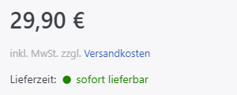
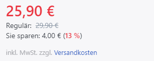
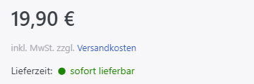
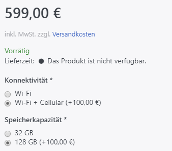
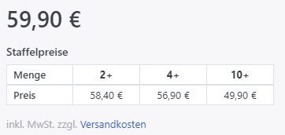
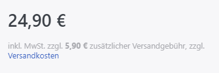
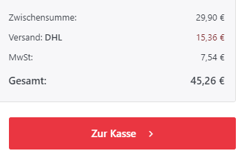

# Preisregeln verstehen

Der im Shop angezeigte Produktpreis entsteht aus mehreren Einstellungen. Ausgangspunkt ist der Preis am Produkt. Auswahl und Menge, gültige Aktionen und Rabatte sowie Steuer- und Währungseinstellungen bestimmen den Preis für den jeweiligen Kunden.

Diese Seite erklärt das Zusammenspiel. Wo Sie die einzelnen Werte eingeben und Staffelpreise anlegen, beschreibt [Produktpreis festlegen](produktpreis-festlegen.md).

## Preis

Der in der Registerkarte **Preis** eingetragene Wert ist der reguläre Stückpreis. Ist für die ausgewählte Attributkombination ein eigener Preis hinterlegt, ersetzt dieser den regulären Produktpreis als Ausgangspreis.

Im Feld **Vergleichspreis** hinterlegen Sie beispielsweise die UVP des Herstellers oder einen früheren Verkaufspreis. Smartstore kann diesen Preis zusätzlich zum aktuellen Verkaufspreis anzeigen. Der eingetragene Vergleichspreis verändert den Verkaufspreis nicht. Ob und wie er angezeigt wird, hängt von seiner Beschriftung, seiner Höhe und den Einstellungen zur Preisdarstellung ab.

## Aktionspreis

Ein gültiger **Aktionspreis** ersetzt den Ausgangspreis während seines Gültigkeitszeitraums. Weitere Anpassungen, etwa für ausgewählte Attribute oder zulässige Rabatte, können danach hinzukommen. Ein Aktionspreis ist deshalb nicht zwingend schon der endgültige Preis.


Ein eingetragener Aktionspreis wird auch dann verwendet, wenn er höher als der reguläre Preis ist. Smartstore wählt an dieser Stelle nicht automatisch den niedrigeren der beiden Werte.


## Produktattribute

Bei ausgewählten Attributwerten erhöht ein positiver **Mehr-/Minderpreis** den Preis, ein negativer vermindert ihn. Ein eigener Preis der aktiven **Attributkombination** ersetzt den regulären Ausgangspreis; vorhandene Auf- und Abschläge der gewählten Attributwerte werden weiterhin berücksichtigt. Ein gültiger Aktionspreis des Produkts kann auch diesen Ausgangspreis ersetzen.

Ist ein Attributwert mit einem anderen Produkt verknüpft, wird dessen berechneter Stückpreis mit der hinterlegten Menge multipliziert und als Aufpreis einbezogen. Ob dabei Rabatte und Staffelpreise des verknüpften Produkts berücksichtigt werden, steuert **Rabatte von verknüpften Produkten anwenden** in den [Katalogeinstellungen](../../../benutzer-handbuch/konfiguration/einstellungen/katalogeinstellungen.md).

Die Einrichtung und die Unterschiede zwischen Attributwerten und Kombinationen erläutert [Wie funktionieren Produktvarianten?](wie-funktionieren-produktvarianten.md).

## Staffelpreise

Für die bestellte Menge werden zunächst die zum Shop und zur Kundengruppe passenden Staffeln berücksichtigt. Es gilt die Staffel mit der höchsten erreichten Mindestbestellmenge: Bei 12 bestellten Stück und Staffeln ab 5, 10 und 20 Stück ist das die Staffel ab 10 Stück. Der Wert dieser Staffel wird entsprechend ihrer Berechnungsmethode als Stückpreis oder als Abzug vom regulären Ausgangspreis berechnet.

Der so berechnete Staffelpreis wird mit dem Preis nach Aktionspreis und Rabatt verglichen. Er wird nur übernommen, wenn er diesen Preis nicht erhöht. Auf- und Abschläge der Attributwerte werden bei diesem Vergleich herausgerechnet und anschließend wieder berücksichtigt.

Ein prozentualer Staffelabzug bezieht sich damit grundsätzlich auf den regulären Ausgangspreis, nicht auf einen bereits reduzierten Aktionspreis. Die Berechnungsmethoden und die Eingabe sind unter [Produktpreis festlegen](produktpreis-festlegen.md) beschrieben.

## Rabatte

Für den Produktpreis kommen gültige Rabatte am Produkt sowie über zugeordnete Warengruppen und Hersteller infrage. Sind mehrere anwendbar, wählt Smartstore den Rabatt mit dem höchsten Rabattbetrag. Diese Rabatte werden nicht einfach addiert.

Bei einem Aktionspreis entscheidet die Einstellung **Produktrabatte bei Aktionspreisen ignorieren**, ob direkt am Produkt zugeordnete Rabatte entfallen. Rabatte über Warengruppen und Hersteller werden dadurch nicht pauschal ausgeschlossen.

Mit **Prozentuale Rabatte auf Staffelpreise anwenden** kann ein prozentualer Rabatt zusätzlich auf einen Staffelpreis angewendet werden. Das ist keine allgemeine Kombination aller Rabattarten: Der prozentuale Rabatt wird für den Staffelpreis vorbereitet und kommt zusammen mit ihm zur Anwendung, wenn der Staffelpreis übernommen wird.

Für positive Aufpreise einfacher Attributwerte gibt es zusätzlich die Einstellung **Staffelrabatt auf Variantenauf- und -abschläge anwenden**. Sie berücksichtigt prozentuale Staffeln bei Mengen größer als 1; Attributwerte mit Produktverknüpfung sind davon ausgenommen.

Die Einstellungen zur Kombination von Rabatten mit Aktionspreisen, Staffelpreisen und Attributaufpreisen finden Sie in den [Katalogeinstellungen](../../../benutzer-handbuch/konfiguration/einstellungen/katalogeinstellungen.md) unter Preise > Rabatte. Gültigkeitszeiträume, Rabattcodes und weitere Bedingungen richten Sie unter [Rabatte verwalten](../../../benutzer-handbuch/marketing-promotion/rabatte-verwalten.md) ein. Rabatte auf Versandkosten oder die Auftragssumme werden separat berechnet und verändern nicht den hier ermittelten Produkt-Stückpreis.

## Beispiele für das Zusammenspiel

Die folgenden Fälle sind unabhängig voneinander. Ausgangspreis sind jeweils 100 €. Es gelten dieselbe Währung und Steuerdarstellung; außer den jeweils genannten Bedingungen gibt es keine weiteren Anpassungen.

| **Fall**                                          | **Berechnung**                                                                                                                                  | **Stückpreis** |
| ------------------------------------------------- | ----------------------------------------------------------------------------------------------------------------------------------------------- | -------------- |
| Aktionspreis und Attributaufpreis                 | Aktionspreis 80 € plus 10 € für den gewählten Attributwert.                                                                                     | 90 €           |
| Aktionspreis und Staffelpreis                     | Aktionspreis 80 €, für die bestellte Menge gilt ein fester Staffelpreis von 75 €. Der günstigere Staffelpreis wird übernommen.                  | 75 €           |
| Aktionspreis und Produktrabatt                    | Aktionspreis 80 € minus 10 % Produktrabatt. Produktrabatte werden bei Aktionspreisen nicht ignoriert; es gibt keinen Staffelpreis.              | 72 €           |
| Staffelpreis und zusätzlicher prozentualer Rabatt | Fester Staffelpreis 75 € minus 10 % Produktrabatt. „Prozentuale Rabatte auf Staffelpreise anwenden“ ist aktiviert; es gibt keinen Aktionspreis. | 67,50 €        |

## Besondere Preisarten

* **Kundenpreiseingabe:** Bei **Preisvorschlag ermöglichen** verwendet Smartstore den vom Kunden eingegebenen Betrag innerhalb der hinterlegten Grenzen. Die normale Berechnung mit Aktionspreis, Attributaufpreisen, Staffelpreisen und Produktrabatten wird dafür übersprungen.
* **Preis auf Anfrage:** Anstelle eines bezifferten Produktpreises erscheint ein Anfragehinweis. Ein direkter Kauf über den Warenkorb ist damit nicht möglich.
* **Gruppenprodukte:** Der Preis stammt von den verknüpften Einzelprodukten. Welche Preisvorschau die Gruppe zeigt, hängt von der eingestellten Preisdarstellung ab. Siehe [Wie funktionieren Gruppenprodukte?](wie-funktionieren-gruppenprodukte.md).
* **Produkt-Bundles:** Ohne Einzelpreisberechnung wird der am Bundle gepflegte Preis verwendet. Bei Einzelpreisberechnung werden die berechneten Preise der Bestandteile mit ihren Mengen addiert und etwaige Bundle-Bestandteilrabatte berücksichtigt. Der Aktionspreis und die normalen Produktrabatte des Bundle-Hauptprodukts werden dann nicht zusätzlich angewendet. Siehe [Wie funktionieren Produkt-Bundles?](wie-funktionieren-produkt-bundles.md).

## Listenpreis und Warenkorbpreis

In Produktlisten kann Smartstore je nach Konfiguration den Preis ohne Rabatte und Attribute, den Preis der Vorauswahl oder einen Ab-Preis darstellen. Ein Ab-Preis kann beispielsweise eine günstigere Variante oder eine Mengenstaffel berücksichtigen. Er ist deshalb nicht automatisch der Stückpreis für ein einzelnes Produkt in der später gewählten Ausführung.

Außerdem werden Rabatt-Nutzungsgrenzen und Warenkorbregeln in Produktlisten nur geprüft, wenn die entsprechenden Optionen aktiviert sind. Im Warenkorb stehen die konkrete Auswahl, Menge und die zu prüfenden Bedingungen fest. Dadurch kann sich der Preis ändern. Die Anzeige und die zusätzlichen Prüfungen konfigurieren Sie unter [Katalogeinstellungen](../../../benutzer-handbuch/konfiguration/einstellungen/katalogeinstellungen.md).

## Steuern

Nach der Ermittlung des Produktpreises berücksichtigt Smartstore die Steuerklasse, die geltenden Steuervorgaben und die gewählte Shop-Währung. Auch die Rundung kann beeinflussen, ob eine Positionssumme exakt dem angezeigten Stückpreis mal Menge entspricht. Die Eingabe- und Anzeigevorgaben erläutert [Steuerberechnung einrichten](../../../benutzer-handbuch/konfiguration/steuerberechnung-einrichten.md).

## Grundpreis gemäß PAnGV berechnen

Der Grundpreis verändert den Verkaufspreis nicht. Er rechnet den ermittelten Preis auf eine Bezugsmenge um, damit Kunden Packungsgrößen vergleichen können. Bei Varianten können eigene Mengenangaben der Attributkombination gelten. Die Einrichtung mit Beispiel finden Sie unter [Produktpreis festlegen](produktpreis-festlegen.md).

## Transportzuschlag

Der **Transportzuschlag** gehört zur Versandkostenberechnung. Er wird nicht zum Produkt-Stückpreis addiert und ist damit auch kein Aufpreis für die Grundpreisberechnung. Sie hinterlegen ihn unter [Produktdetails](produkte-erstellen-und-bearbeiten.md) in der Registerkarte **Allgemein**.

Ob der Zuschlag zu den Versandkosten hinzukommt, hängt unter anderem von Versandkostenfreiheit, der gewählten Versandart und den Versandeinstellungen ab. Eine Versandart kann Produktzuschläge ignorieren; außerdem kann festgelegt werden, nur den höchsten Produktzuschlag zu berechnen.

## Streichpreise und PAngV 

Bei der Bekanntgabe einer Preisermäßigung für Waren gegenüber Verbrauchern verlangt [§ 11 PAngV](https://www.gesetze-im-internet.de/pangv_2022/__11.html) grundsätzlich die Angabe des niedrigsten Gesamtpreises der vorangegangenen 30 Tage. Ein UVP-Vergleich und eine Ermäßigung gegenüber dem eigenen früheren Preis sind dabei unterschiedliche Bezugsgrößen.


Das Preislabel **Zuletzt niedrigster Preis** beschreibt die Bedeutung des angezeigten Referenzpreises. Es ermittelt keinen historischen 30-Tage-Preis. Hinterlegen Sie den zutreffenden Vergleichspreis und wählen Sie die passende Beschriftung. Allein die Auswahl des Labels gewährleistet keine korrekte Preisermäßigungsanzeige.


Welche Vergleichs- und Streichpreise Smartstore zusätzlich zum aktuellen Preis zeigt, hängt auch von den [Katalogeinstellungen](../../../benutzer-handbuch/konfiguration/einstellungen/katalogeinstellungen.md) ab. Die Option **Aktionspreis ersetzt regulären Preis** beeinflusst die zusätzliche Anzeige des regulären Preises, nicht die Gültigkeit des Aktionspreises.

## Plugin-Funktionen

Das kostenpflichtige Enterprise-Plugin [DependingPrices](../../../benutzer-handbuch/plugins/dependingprices.md) ergänzt kunden-, shop- oder sprachabhängige Preisbedingungen und kann die Standardberechnung verändern. Seine Einrichtung und Besonderheiten werden auf der verlinkten Seite beschrieben.
