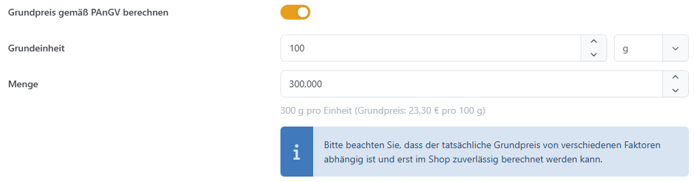

# Produktpreis festlegen

In der Registerkarte **Preis** konfigurieren Sie den regulären Preis, Vergleichspreis, Einkaufspreis, Aktionspreis, Staffelpreise und weitere preisbezogene Optionen. Wie Smartstore daraus den endgültigen Produktpreis ermittelt, erfahren Sie unter [Preisregeln verstehen](preisregeln-verstehen.md).

Öffnen Sie das Produkt unter **Katalog > Produktverwaltung**, wechseln Sie zu **Preis** und speichern Sie Ihre Änderungen.

Bei [Gruppenprodukten](wie-funktionieren-gruppenprodukte.md) gibt es keine eigene Registerkarte Preis. Die Preise pflegen Sie an den verknüpften Einzelprodukten.


Geldbeträge pflegen Sie in der Basiswährung des Shops. Ob Verkaufspreise inklusive oder exklusive Mehrwertsteuer eingegeben werden, bestimmen die [Steuereinstellungen](../../../benutzer-handbuch/konfiguration/steuerberechnung-einrichten.md). Die Steuerklasse des Produkts wählen Sie unter **Allgemein**.


## Preise und Rabatte

| **Feld**                      | **Bedeutung**                                                                                                                                                                                                                                        |
| ----------------------------- | ---------------------------------------------------------------------------------------------------------------------------------------------------------------------------------------------------------------------------------------------------- |
| Preis                         | Regulärer Stückpreis des Produkts und Ausgangswert für die Preisberechnung.                                                                                                                                                                          |
| Vergleichspreis               | Referenz für die Preisdarstellung, beispielsweise eine UVP oder ein früherer Preis. Er verändert den Verkaufspreis nicht. Ob er zusätzlich angezeigt wird, hängt von seiner Höhe, seiner Beschriftung und den Einstellungen zur Preisdarstellung ab. |
| Label für den Vergleichspreis | Wählen Sie neben dem Vergleichspreis dessen Beschriftung. Ohne eigene Auswahl gilt die zentrale Vorgabe aus den Katalogeinstellungen.                                                                                                                |
| Aktionspreis                  | Abweichender Verkaufspreis während des angegebenen Zeitraums. Ein leeres Feld deaktiviert den Aktionspreis.                                                                                                                                          |
| Aktionspreis Anfangsdatum     | Beginn der Aktion einschließlich Uhrzeit. Ohne Anfangsdatum gilt der Aktionspreis sofort, sofern das Enddatum noch nicht überschritten ist.                                                                                                          |
| Aktionspreis Enddatum         | Ende der Aktion einschließlich Uhrzeit. Ohne Enddatum bleibt der Aktionspreis ab dem gewählten Beginn gültig. Sind beide Datumsfelder leer, ist er zeitlich unbeschränkt.                                                                            |
| Rabatte                       | Ordnen Sie vorhandene Produktrabatte zu. Für Bundles mit Einzelpreisberechnung wird dieses Feld ausgeblendet.                                                                                                                                        |
| Einkaufspreis                 | Interner Kostenwert, beispielsweise für Auswertungen. Er ersetzt im Standard den Verkaufspreis nicht.                                                                                                                                                |

Rabatte und ihre Bedingungen legen Sie unter [Rabatte verwalten](../../../benutzer-handbuch/marketing-promotion/rabatte-verwalten.md) an. Zentrale Vorgaben für Preisbeschriftungen, Streichpreise und Angebote finden Sie unter [Katalogeinstellungen](../../../benutzer-handbuch/konfiguration/einstellungen/katalogeinstellungen.md).

## Kaufmöglichkeiten und Preiseingabe

| **Option**                 | **Wirkung**                                                                                                                                                                                               |
| -------------------------- | --------------------------------------------------------------------------------------------------------------------------------------------------------------------------------------------------------- |
| "Kaufen"-Button verbergen  | Blendet den Kaufen-Button aus und verhindert, dass das Produkt in den Warenkorb gelegt wird.                                                                                                              |
| Wunschliste deaktivieren   | Verhindert, dass das Produkt auf die Wunschliste gesetzt wird.                                                                                                                                            |
| Vorbestellung möglich      | Zeigt am Warenkorb-Button „Vorbestellen“ an. Lagerbestands- und Verfügbarkeitsregeln gelten weiterhin.                                                                                                    |
| Preis auf Anfrage          | Ersetzt die Preisanzeige durch „Preis auf Anfrage“. Das Produkt kann damit nicht direkt in den Warenkorb gelegt werden.                                                                                   |
| Preisvorschlag ermöglichen | Der Kunde gibt auf der Produktdetailseite selbst einen Preis ein. Ein zulässiger Betrag wird unmittelbar als Produktpreis für den Warenkorb übernommen; es gibt keinen anschließenden Freigabeschritt.    |
| Mindestbetrag              | Untergrenze für den vom Kunden eingegebenen Preis. Wird bei aktiviertem Preisvorschlag eingeblendet.                                                                                                      |
| Höchstbetrag               | Obergrenze für den vom Kunden eingegebenen Preis. Wird bei aktiviertem Preisvorschlag eingeblendet. Legen Sie die gewünschte Obergrenze ausdrücklich fest; ein leeres Feld hebt die Begrenzung nicht auf. |

## Grundpreis gemäß PAngV berechnen

Mit dem Grundpreis können Kunden Produkte mit unterschiedlichen Verpackungsgrößen leichter vergleichen. Dazu wird der Verkaufspreis auf eine gemeinsame Mengeneinheit umgerechnet.

1. Aktivieren Sie **Grundpreis gemäß PAnGV berechnen**.
2. Tragen Sie unter **Grundeinheit** den Bezugswert ein und wählen Sie daneben die Maßeinheit, beispielsweise **1 kg**.
3. Geben Sie unter **Menge** den tatsächlichen Inhalt einer Verpackung in derselben Maßeinheit ein. Für 200 g Tee sind das bei der Maßeinheit kg **0,2**.

Die Berechnung lautet: **Grundpreis = Verkaufspreis ÷ Menge × Grundeinheit**. Kostet die 200-g-Packung 6 €, ergibt sich bei einer Grundeinheit von 1 kg ein Grundpreis von 30 € je kg.


Die Vorschau in der Administration verwendet den gespeicherten Produktpreis. Prüfen Sie den tatsächlichen Grundpreis im Shop, insbesondere nach Änderungen am Preis oder bei Aktionen und Varianten.


Für nach Gewicht oder Volumen angebotene verpackte Waren sieht [§ 5 PAngV](https://www.gesetze-im-internet.de/pangv_2022/__5.html) grundsätzlich 1 kg bzw. 1 l als Bezugsgröße vor.

## Staffelpreise

Mit Staffelpreisen gewähren Sie abhängig von der bestellten Menge unterschiedliche Preisnachlässe. Die Einträge können auf einen Shop und eine Kundengruppe begrenzt werden.

1. Speichern Sie ein neu angelegtes Produkt zunächst. Erst danach können Sie Staffelpreise bearbeiten.
2. Klicken Sie im Bereich **Staffelpreise** auf **Neu**.
3. Tragen Sie die Werte in der neuen Tabellenzeile ein. Die **Menge** ist die Mindestbestellmenge, ab der dieser Eintrag berücksichtigt wird.
4. Übernehmen Sie den Eintrag mit **Änderungen speichern** in der Staffelpreistabelle.

| **Spalte**         | **Bedeutung**                                                                                              |
| ------------------ | ---------------------------------------------------------------------------------------------------------- |
| Menge              | Mindestbestellmenge für diese Staffel. Der Wert muss mindestens 1 sein.                                    |
| Wert               | Stückpreis, Abzugsbetrag oder Prozentsatz, abhängig von der Berechnungsmethode.                            |
| Berechnungsmethode | Bestimmt, wie der Wert auf den regulären Produktpreis angewendet wird. Die Methoden sind unten erläutert.  |
| Shop               | Begrenzt den Eintrag auf einen Shop. Ohne Einschränkung gilt er für alle Shops.                            |
| Kundengruppe       | Begrenzt den Eintrag auf Mitglieder einer Kundengruppe. Ohne Einschränkung gilt er für alle Kundengruppen. |

| **Berechnungsmethode** | **Bedeutung**                                                                                                                                                            |
| ---------------------- | ------------------------------------------------------------------------------------------------------------------------------------------------------------------------ |
| Fester Wert            | Der Wert ist der Stückpreis für die Staffel, beispielsweise 9 € pro Stück ab 10 Stück.                                                                                   |
| Auf-/Abpreis           | Der Wert wird vom regulären Produktpreis abgezogen. Ein positiver Wert von 2 vermindert den rechnerischen Stückpreis um 2 €; ein negativer Wert erhöht ihn entsprechend. |
| Prozentual             | Der Wert wird als prozentualer Abzug vom regulären Produktpreis berechnet. Bei 10 und einem regulären Preis von 100 € beträgt der rechnerische Stückpreis 90 €.          |

Die Mengenstaffel gilt für alle Stücke der betreffenden Warenkorbposition. Zehn Stück zu je 9 € ergeben somit 90 €; der niedrigere Stückpreis gilt nicht erst für das zehnte Stück.

Vorhandene Zeilen bearbeiten oder löschen Sie über die Zeilenaktionen. Mehrere Einträge können Sie markieren und gemeinsam löschen. Noch nicht gespeicherte Tabellenänderungen können Sie mit **Abbrechen** verwerfen.

Ein Staffelpreis wird nicht anstelle eines günstigeren Aktions- oder Rabattpreises angewendet. Ein rechnerischer Aufpreis in einer Staffel erzwingt daher keinen höheren Verkaufspreis.


Bei Bundles mit Einzelpreisberechnung ist die Staffelpreistabelle ausgeblendet. Wie Staffelpreise mit Aktionspreisen, Rabatten und Varianten zusammenwirken und welcher Preis tatsächlich angewendet wird, erläutert [Preisregeln verstehen](preisregeln-verstehen.md).


## Plugin-Funktionen

Für kundenindividuelle Preise und weitere Preisbedingungen gibt es das kostenpflichtige Enterprise-Plugin [DependingPrices](../../../benutzer-handbuch/plugins/dependingprices.md). Es ergänzt einen eigenen Bereich in der Produktbearbeitung; seine Konfiguration wird auf der verlinkten Seite beschrieben.
