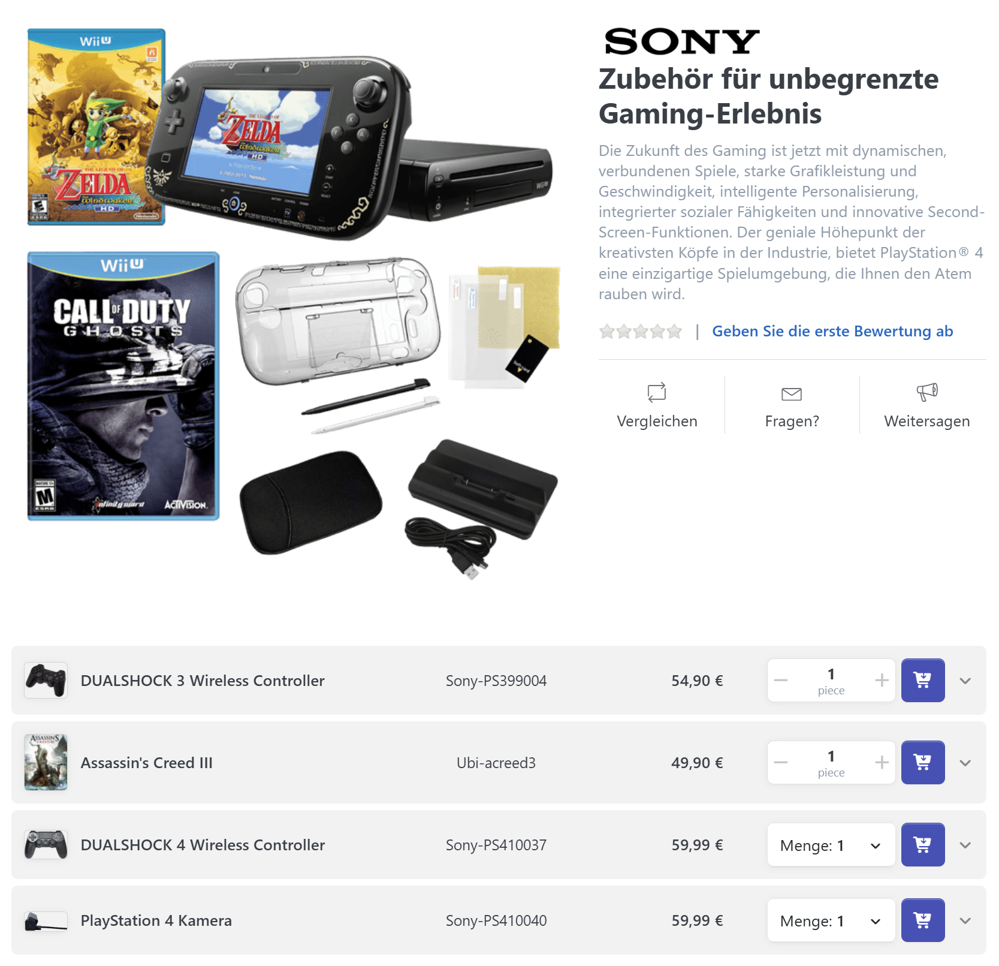

# Wie funktionieren Gruppenprodukte?

Mit Gruppenprodukten präsentieren Sie zusammengehörige Einzelprodukte auf einer gemeinsamen Produktdetailseite. Jedes verknüpfte Produkt bleibt dabei ein eigener Warenkorb-Bestandteil. Das bietet folgende Vorteile:

* Bessere, kundenfreundlichere Strukturierung Ihrer Katalogdaten.
* Leichteres Auffinden ähnlicher Produkte und somit mehr Verkäufe.
* Mehr Verkäufe, wenn der Kunde nützliche, notwendige oder wünschenswerte Produkte auf der gleichen Seite entdeckt.

Das Gruppenprodukt dient als gemeinsame Präsentationsseite und wird nicht selbst in den Warenkorb gelegt. Kunden wählen die verknüpften Produkte einzeln aus. Preise, Bestände und Kaufoptionen pflegen Sie an diesen Produkten; die Gruppierung erzeugt keinen gemeinsamen Bundle-Preis.


Die Einstellung **Sichtbarkeit** am verknüpften Produkt bestimmt, wo es eigenständig erscheint. Mit **Nicht sichtbar** wird es nicht in Produktlisten oder Suchergebnissen angezeigt, bleibt aber auf der Gruppenproduktseite verfügbar. Ein direkter Aufruf seiner Produkt-URL führt zur Gruppenproduktseite. Die Zuordnung allein ändert die Sichtbarkeit nicht.


## Anwendungsszenario

Stellen Sie sich vor, Sie möchten eine Videospielkonsole verkaufen. Wenn jemand daran interessiert ist, diese online zu kaufen, ist er vielleicht auch an folgenden Produkten interessiert:

* Ein oder mehrere Spiele
* Ein Gamepad
* Ein Headset
* Ein USB-Ladekabel

## Ein Gruppenprodukt hinzufügen

1. Gehen Sie zu **Katalog > Produktverwaltung** und klicken Sie auf **Neu**.
2. Wählen Sie **Gruppenprodukt** als **Produkttyp**.
3. Geben Sie einen **Produktnamen** ein und klicken Sie auf **Speichern und fortsetzen.** 

Produkte einem Gruppenprodukt zuweisen

1. Gehen Sie zur Registerkarte **Verknüpfte Produkte** Ihres Gruppenprodukts und klicken Sie auf **Neu**.
2. Wählen Sie eines oder mehrere Produkte mit einem Mausklick aus. Sie können die Suche nutzen, um Produkte, die Sie verknüpfen wollen, schneller zu finden.
3. Klicken Sie auf **Übernehmen**. Die ausgewählten Produkte erscheinen nun in der Tabelle der verknüpften Produkte.
4. Um eine Verknüpfung aufzuheben, klicken Sie beim entsprechenden Produkt in der Tabelle auf **Löschen**. Dabei wird nur die Zuordnung entfernt; das Produkt selbst bleibt erhalten. Mehrere Zuordnungen können Sie markieren und mit „Ausgewählte löschen“ gemeinsam entfernen.
5. Um die Anzeigereihenfolge auf der Gruppenproduktseite zu ändern, klicken Sie auf **Bearbeiten** und passen den Wert „Reihenfolge“ an. Kleinere Werte erscheinen zuerst. Übernehmen Sie die Änderung mit „Änderungen speichern“. Der Wert entspricht der allgemeinen Sortierpriorität des verknüpften Produkts.


Ein Produkt kann nur mit einem Gruppenprodukt verbunden werden. Wenn Sie es einer anderen Gruppe zuordnen, wird die bisherige Zuordnung ersetzt. Andere Gruppenprodukte können nicht verknüpft werden; einfache Produkte und Produkt-Bundles sind zulässig. Prüfen Sie nach dem Entfernen einer Zuordnung die Sichtbarkeit des Produkts: Ein „Nicht sichtbar“ eingestelltes Produkt ohne Gruppe hat keine erreichbare eigene Produktseite.


Damit ein verknüpftes Produkt im Shop erscheint, muss es veröffentlicht und für den jeweiligen Shop und Kunden verfügbar sein. Shop- und Kundengruppenbeschränkungen werden durch die Gruppenzuordnung nicht automatisch vom Gruppenprodukt übernommen.

## Darstellung der verknüpften Produkte einstellen

Öffnen Sie bei einem gespeicherten Gruppenprodukt unter „Allgemein“ die Schaltfläche „Einstellungen…“ neben „Produkttyp“. Im Dialog „Gruppenprodukt bearbeiten“ können Sie die Katalogvorgaben für dieses Produkt überschreiben. Nicht gesetzte Werte verwenden die allgemeinen Vorgaben.

* **Listentitel der verknüpften Produkte:** Überschrift der Produktliste. Sie können den Titel auch je Sprache hinterlegen.
* **Listengröße der verknüpften Produkte:** Anzahl der verknüpften Produkte pro Listenseite. Der Wert muss größer als null sein; bei mehr Produkten erscheint eine Seitennavigation.
* **Minimale Produktanzahl für Suche:** Ab dieser Anzahl verknüpfter Produkte wird ein Suchfeld innerhalb der Gruppe angezeigt.
* **Aufklappbare verknüpfte Produkte:** Legt fest, ob die Produktdetails durch Klick auf die Kopfzeile auf- und zugeklappt werden. Ohne diese Darstellung werden die Details untereinander angezeigt.
* **Felder für die Kopfzeile:** Zusätzliche Angaben in der Kopfzeile aufklappbarer Produkte, beispielsweise Bild, Produktnummer oder Preis. Der Produktname wird immer angezeigt.

Die allgemeinen Vorgaben finden Sie in den [Katalogeinstellungen](../../../benutzer-handbuch/konfiguration/einstellungen/katalogeinstellungen.md) im Bereich „Gruppenprodukt“. Speichern Sie Ihre Anpassungen im Dialog mit „Speichern“.
