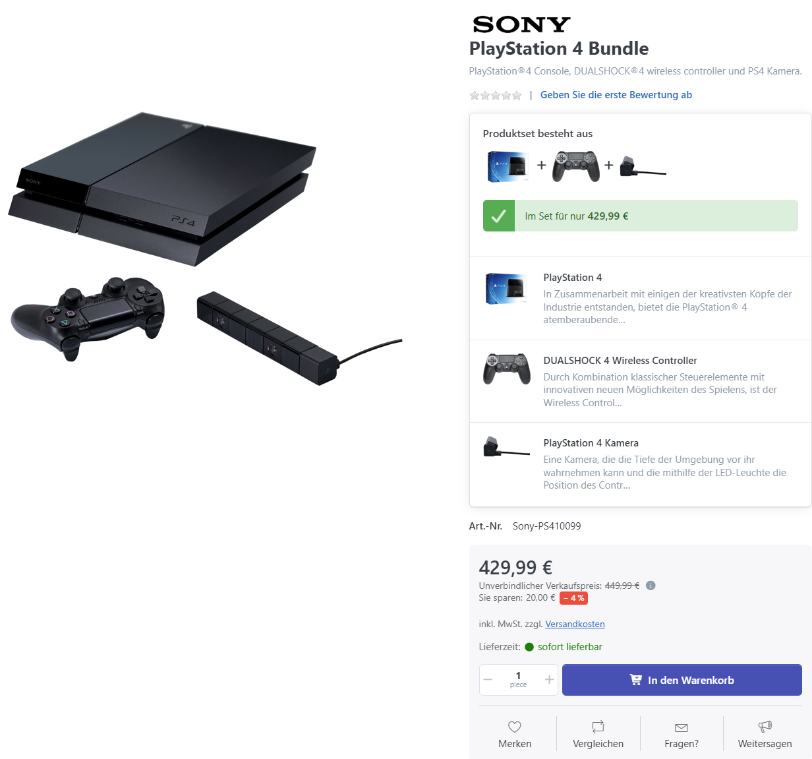

# Wie funktionieren Produkt-Bundles?

Ein Produkt-Bundle fasst mehrere Produkte zu einem festen, nicht aufteilbaren Set zusammen. Stellt der Hersteller das Set zusammen, handelt es sich um ein Hersteller-Bundle; bei einer Zusammenstellung durch den Verkäufer um ein Händler-Bundle. Kunden kaufen das Bundle als Ganzes. Die darin festgelegten Mengen lassen sich im Warenkorb nicht einzeln ändern. Die enthaltenen Produkte können zusätzlich als eigenständige Produkte angeboten werden.

## Anwendungsszenario

Angenommen, Sie möchten eine Videospielkonsole zusammen mit zwei drahtlosen Gamepads und einem Spiel anbieten. Legen Sie dafür in der Registerkarte **Allgemein** ein neues Produkt mit dem **Produkttyp Produkt-Bundle** an. Nach dem Speichern erscheint die Registerkarte **Stückliste**. Dort fügen Sie dem Bundle vorhandene Katalogprodukte hinzu.


Um Verkaufsanreize zu schaffen, sollte der Preis des Bundles natürlich niedriger sein als der Preis, den der Kunde zahlen würde, wenn er die Bestandteile des Bundles einzeln kaufen würde.


## Produkte einem Bundle zuordnen

Ein Produkt, das einem Bundle zugeordnet wurde, wird als Bundle-Bestandteil bezeichnet.

1. Öffnen Sie im Produkt-Bundle **Stückliste** und fügen Sie über **Hinzufügen** die gewünschten Katalogprodukte hinzu.
2. Bearbeiten Sie die zugeordneten Bestandteile und legen Sie die Menge pro Bundle fest. Für das Beispiel erhält die Konsole die Menge 1, das Gamepad die Menge 2 und das Spiel die Menge 1.
3. Um einen Bestandteil vorübergehend nicht zu berücksichtigen, deaktivieren Sie ihn über Aktiv. Um ihn dauerhaft aus der Stückliste zu entfernen, löschen Sie seine Zuordnung. Das Katalogprodukt selbst bleibt erhalten.


Als Bestandteile sind einfache Produkte zulässig, die weder Downloads noch wiederkehrende Zahlungen verwenden. Gruppenprodukte, andere Bundles und Produkte mit Attributwerten vom Typ **Produkt** können nicht hinzugefügt werden. Ein Produkt-Bundle hat keine eigenen Attribute. Sie können dasselbe Produkt mehrfach zuordnen und jeden Eintrag gesondert konfigurieren, beispielsweise für zwei Gamepads mit unterschiedlichen Farben.


## Möglichkeiten, ein Bundle zu steuern

Die Einstellungen oberhalb der Stückliste steuern die Darstellung, Preisberechnung und Versandkosten sowie die Bestandsbuchung. Sie sind voneinander unabhängig.

### Bundle Titeltext 

Optionaler Titel über den Bestandteilen auf der Produktseite, beispielsweise „Dieses Set enthält“. Der Text kann übersetzt werden.

### Preis per Bundle-Bestandteil 

Ist **Preis per Bundle-Bestandteil** deaktiviert, legen Sie den Gesamtpreis direkt am Bundle fest. Preisänderungen und Rabatte der Bestandteile verändern diesen Preis nicht. Kunden können in diesem Modus keine Attribute der Bestandteile auswählen.

Ist die Option aktiviert, ergibt sich der Bundlepreis aus den Preisen der Bestandteile, jeweils multipliziert mit der in der Stückliste festgelegten Menge.

Dabei werden gültige Aktionspreise der Bestandteile, Preisänderungen durch ausgewählte Attributwerte und der direkt am jeweiligen Bundle-Bestandteil eingetragene Rabatt berücksichtigt. Staffelpreise und die sonstigen Produkt-, Warengruppen- und Herstellerrabatte der Bestandteile gehen nicht in diese Berechnung ein. Am Bundle selbst hinterlegte Preise, Aktionspreise und Produktrabatte werden in diesem Modus nicht zusätzlich angewendet.

**Beispiel:** Die Konsole kostet 300 €, ein Gamepad 40 € und das Spiel 30 €. Bei zwei Gamepads ergibt sich ein Bundlepreis von 410 €. Tragen Sie am Bestandteil „Gamepad“ einen Rabatt von 10 % ein, kostet jedes Gamepad im Bundle 36 €. Der Bundlepreis beträgt dann 402 €.

Die Grundlagen der Preisberechnung beschreibt [Preisregeln verstehen](preisregeln-verstehen.md). Ob bei Bestandteilen Grundpreise angezeigt werden, legen Sie in den [Katalogeinstellungen](../../../benutzer-handbuch/konfiguration/einstellungen/katalogeinstellungen.md) unter **Grundpreis bei Bundle-Bestandteilen** fest.

### Versand per Bundle-Bestandteil

Ist **Versand per Bundle-Bestandteil** deaktiviert, gelten die Versandeinstellungen des Bundleprodukts. Ist die Option aktiviert, werden für die Versandkosten die Angaben **Versand aktiv**, **Kostenloser Versand** und **Zusätzliche Versandkosten** der enthaltenen Produkte berücksichtigt. Der konkrete Betrag hängt außerdem von der gewählten Versandkostenberechnung ab.


Das Gesamtgewicht hinterlegen Sie am Bundleprodukt. Die Gewichte der Bestandteile und Gewichtsanpassungen ihrer Attribute werden nicht zum Bundlegewicht addiert.


Die Einstellung für den Versand ist unabhängig davon, ob der Preis pauschal oder pro Bestandteil berechnet wird.

### Bundle-Bestandteil einzeln in den Warenkorb

Mit **Bundle-Bestandteil einzeln in den Warenkorb** verknüpfen Sie die Bestandsbuchung mit den enthaltenen Produkten. Bei einer Bestellung werden deren Bestände entsprechend der enthaltenen Mengen verändert. Ist die Option deaktiviert, wird stattdessen der Bestand des Bundleprodukts verändert. Das Preismodell entscheidet darüber nicht.

Bei zusätzlicher Aktivierung von **Preis per Bundle-Bestandteil** werden auch die Einzelpreise und Mengen im Warenkorb ausgewiesen. Das Bundle bleibt ein gemeinsamer Artikel: Kunden können die Bestandteile dort nicht einzeln entfernen oder ihre Mengen ändern.

Wie Sie die Bestandsführung der Produkte einrichten, beschreibt [Lagerbestand führen](lagerbestand-fuhren.md).

## Ein Bundle-Bestandteil bearbeiten

Klicken Sie in der Stückliste bei dem jeweiligen Artikel auf **Bearbeiten**.

### Allgemein 

|                             |                                                                                                                                                                                                                                                                    |
| --------------------------- | ------------------------------------------------------------------------------------------------------------------------------------------------------------------------------------------------------------------------------------------------------------------ |
| **Produktname**             | Bietet die Möglichkeit, in der Stückliste einen abweichenden Produktnamen anzuzeigen.                                                                                                                                                                              |
| **Kurzbeschreibung**        | Abweichende Kurzbeschreibung für diesen Bestandteil im Bundle. Bleibt das Feld leer, wird die Kurzbeschreibung des Katalogprodukts verwendet. Geben Sie ein Leerzeichen ein, um die Kurzbeschreibung für diesen Bestandteil auszublenden.                          |
| **Menge**                   | Anzahl dieses Produkts pro Bundle. Zwei Bundles mit je zwei Gamepads enthalten insgesamt vier Gamepads.                                                                                                                                                            |
| **Rabatt**                  | Preisnachlass pro Stück dieses Bestandteils, nur bei aktivierter Option „Preis per Bundle-Bestandteil“. Er gilt ausschließlich innerhalb dieses Bundles.                                                                                                           |
| **Rabatt in Prozent**       | Aktiviert: Der eingetragene Rabatt wird prozentual berechnet. Deaktiviert: Der Rabatt ist ein fester Betrag pro Stück. Dieses Feld erscheint nur bei „Preis per Bundle-Bestandteil“.                                                                               |
| **Vorschaubild ausblenden** | Blendet das Vorschaubild des Produkts in der Bundle-Bestandteil-Liste aus.                                                                                                                                                                                         |
| **Sichtbar**                | Blendet den Bestandteil auf der Produktseite ein oder aus. Ein ausgeblendeter Bestandteil bleibt im Bundle enthalten.                                                                                                                                              |
| **Aktiv**                   | Legt fest, ob der Bestandteil im Bundle berücksichtigt wird. Deaktivierte Bestandteile werden beim Hinzufügen des Bundles zum Warenkorb ausgelassen und blockieren dessen Kauf nicht. Auch das zugeordnete Katalogprodukt muss veröffentlicht und bestellbar sein. |
| **Reihenfolge im Bundle**   | Die Position des Produkts im Bundle.                                                                                                                                                                                                                               |

### Attribute 

Hier legen Sie fest, welche Attributwerte eines Bestandteils innerhalb dieses Bundles zur Auswahl stehen. Die Attribute und Werte müssen bereits am enthaltenen Produkt angelegt sein. Eine Auswahl durch Kunden ist nur möglich, wenn am Bundle **Preis per Bundle-Bestandteil** aktiviert ist.

1. Aktivieren Sie **Attribute ausschließen**.
2. Markieren Sie bei jedem Auswahlfeld die Werte, die im Bundle **weiterhin verfügbar bleiben** sollen. Nicht markierte Werte werden ausgeschlossen. Markieren Sie bei einem Auswahlfeld keinen Wert, wird es im Bundle ausgeblendet. Freitextfelder werden durch diesen Filter nicht eingeschränkt.
3. Speichern Sie mit **Speichern und fortfahren**. Unter **Vorausgewählt** können Sie anschließend aus den zugelassenen Werten die anfängliche Auswahl festlegen. Speichern Sie erneut.

**Beispiel:** Ein Gamepad ist einzeln in Schwarz, Weiß und Rot erhältlich. Für das Bundle soll es nur Schwarz und Weiß geben. Aktivieren Sie den Filter und markieren Sie Schwarz und Weiß. Rot steht dann in diesem Bundle nicht zur Auswahl. Für das einzeln angebotene Gamepad bleiben alle drei Farben erhalten.

Ohne **Attribute ausschließen** gelten die am enthaltenen Produkt verfügbaren Attributwerte und deren Vorauswahl. Die Einrichtung dieser Attribute beschreibt [Attribute am Produkt einrichten](wie-funktionieren-produktvarianten/produktvarianten-einrichten.md).
