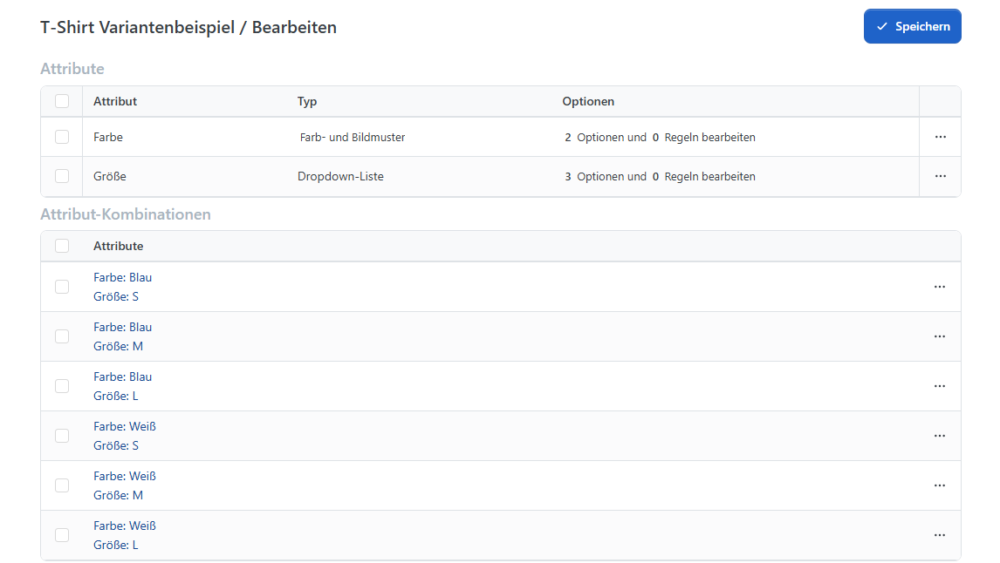
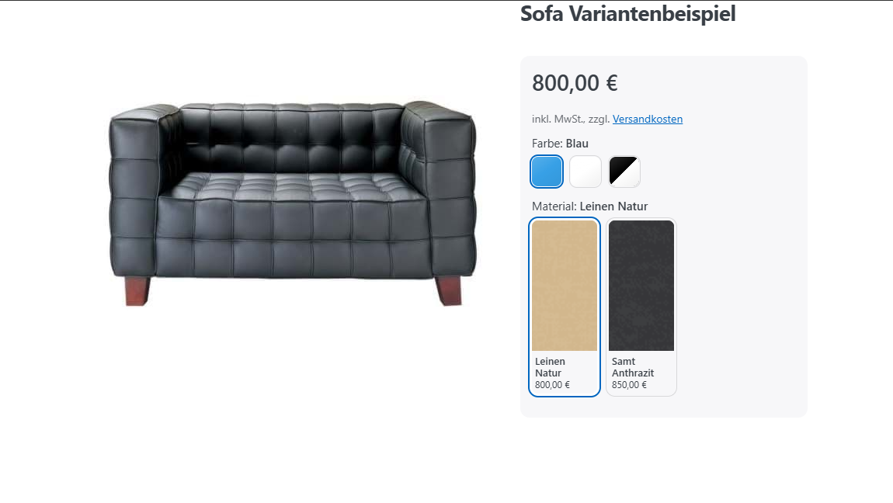

# Produktattribute und Varianten

Viele Produkte werden in mehreren Ausführungen angeboten, beispielsweise in unterschiedlichen Größen, Farben oder Materialien. Sie können Kunden diese Auswahl am Produkt ermöglichen und für einzelne Ausführungen eigene Produktnummern, Preise oder Lagerbestände hinterlegen.


Produktattribute sind nicht mit Merkmalen zu verwechseln, die durch Spezifikationsattribute festgelegt werden. Diese werden unter [Spezifikationsattribute verwalten](../spezifikationsattribute-verwalten.md) erklärt.


Die folgenden Abschnitte zeigen die Zusammenhänge am Beispiel eines T-Shirts.

## Ein Produkt, mehrere Ausführungen 

Angenommen, Sie verkaufen dasselbe T-Shirt in Blau und Weiß sowie in den Größen S, M und L. Daraus ergeben sich sechs mögliche Ausführungen. Sie benötigen dafür in Smartstore nur **ein** Produkt und ergänzen die Auswahl von Farbe und Größe mit Attributen.

Ob Sie zusätzlich eigene Daten für alle sechs Ausführungen hinterlegen müssen, hängt von Ihrem Sortiment ab. Ein gemeinsamer Preis kann für alle Größen genügen. Getrennte Bestände oder unterschiedliche Produktnummern müssen Sie dagegen den jeweiligen Ausführungen zuordnen.

### Attribute und Werte 

**Farbe** und **Größe** sind in diesem Beispiel die Attribute. Sie bezeichnen die Merkmale, nach denen der Kunde auswählt. **Blau**, **Weiß**, **S**, **M** und **L** sind die zugehörigen Attributwerte. Die Auswahl **Blau und M**, zweier Attribute, ist eine Attributkombination.

Attribute können auch individuelle Angaben erfassen. Für einen Gravurtext verwenden Sie beispielsweise ein Textfeld, für ein Druckmotiv einen Datei-Upload. Der Kunde gibt dann selbst einen Wert ein, statt aus vorbereiteten Werten zu wählen.

<figure><figcaption>
Sechs T-Shirt-Ausführungen mit Farb- und Größenauswahl
</figcaption></figure>

Mit dem Plugin [AttributeRules](../../../benutzer-handbuch/plugins/attributerules-regeln-fur-produktattribute.md) können Sie weitere Attribute abhängig von der Auswahl einblenden, beispielsweise ein Gravurfeld nur dann, wenn der Kunde eine Gravur wählt.

### Auswahlelement festlegen 

Am einzelnen Produkt bestimmen Sie, welche Attribute und Werte Kunden wählen können. Dazu gehören die Darstellung als Auswahlliste, Kontrollkästchen, Textfeld oder Farb- und Bildmuster sowie die Frage, welche Angaben vor dem Kauf erforderlich sind.

Für das T-Shirt könnten Sie die Größe als Dropdown-Liste und die Farbe als anklickbares Muster anbieten. Eine vorausgewählte Größe kann den Einstieg erleichtern; ein Pflichtfeld stellt sicher, dass der Kunde die benötigte Auswahl vor dem Kauf trifft. Unter [Attribute am Produkt einrichten](wie-funktionieren-produktvarianten/produktvarianten-einrichten.md) erfahren Sie, wie Sie Attribute zuweisen, Werte hinterlegen und die Eingabe einstellen.

### Kombinationen flexibel ergänzen 

Soll das blaue T-Shirt in Größe M eine eigene SKU wie **SHIRT-BL-M** erhalten, legen Sie dafür eine Attributkombination an. An derselben Kombination können Sie beispielsweise einen Preis von 24 € und einen Lagerbestand von zwölf Stück hinterlegen. Für Blau und L legen Sie bei Bedarf eine weitere Kombination mit eigenen Angaben an.

Wenn Kunden lediglich eine Farbe wählen sollen und alle gemeinsamen Produktdaten ausreichen, müssen Sie dafür keine eigenen Kombinationen erfassen. Kombinationen werden außerdem wichtig, wenn Sie gezielt festlegen möchten, welche Zusammenstellungen angeboten werden: etwa Weiß nur in S und M, Blau dagegen auch in L. Unter [Attributkombinationen verwalten](wie-funktionieren-produktvarianten/attributkombinationen-verwalten.md) erfahren Sie, wie Sie Kombinationen anlegen, ergänzen und für den Verkauf freigeben.

Jeder Kombination können Sie gezielt Bilder aus den Produktbildern zuweisen. Wählt der Kunde eine Ausführung, passt sich die Produktgalerie an die zugeordneten Bilder an. Das Bild eines Attributwerts gestaltet dagegen dessen Auswahlfeld. Die Zuordnung der Galeriebilder finden Sie unter [Attributkombinationen verwalten](wie-funktionieren-produktvarianten/attributkombinationen-verwalten.md#variantendaten).


Wenn Sie ein Attribut wie Farbe oder Größe für mehrere Produkte verwenden, legen Sie es einmal zentral an und weisen es den Produkten zu. Häufig benötigte Werte wie die Größen S bis XL können Sie in einem Options-Set vorbereiten und bei Bedarf in ein Produkt kopieren. Wie Sie Attribute und Options-Sets anlegen, erfahren Sie unter [Produktattribute vorbereiten](../produktattribute-verwalten.md).


## Farben und Muster 

Eine Farbbezeichnung allein vermittelt nicht immer, wie ein Produkt aussieht. Mit Farb- und Bildmustern können Kunden beispielsweise eine T-Shirt-Farbe direkt erkennen oder die Struktur verschiedener Sofastoffe vergleichen. Je nach Darstellung erscheinen kleine Farbflächen, Materialbilder oder größere Auswahlkarten mit Namen und Preisinformationen.

<figure><figcaption>
Diverse Farben und Muster als Auswahl
</figcaption></figure>

Die Darstellung eines Attributs lässt sich zentral für seine Verwendung an vielen Produkten festlegen. Für ein einzelnes Produkt können Sie davon abweichen, beispielsweise größere Stoffbilder verwenden. Die Einstellungen für Bilder, mehrfarbige Muster, Auswahlkarten und die Preisvorschau finden Sie unter [Farb- und Bildmuster verwenden](wie-funktionieren-produktvarianten/farb-und-bildmuster-verwenden.md).

## Kombinationspreis festlegen 

Bei Produktvarianten können Sie sowohl Aufpreise für einzelne Attributwerte als auch individuelle Preise für bestimmte Ausführungen festlegen. Wie Sie Aufpreise direkt an Attributwerten hinterlegen, erfahren Sie unter [Attribute am Produkt einrichten](wie-funktionieren-produktvarianten/produktvarianten-einrichten.md). Möchten Sie einer bestimmten Ausführung einen eigenen Preis zuweisen, nutzen Sie die [Attributkombinationen](wie-funktionieren-produktvarianten/attributkombinationen-verwalten.md).

Wie die individuellen Preise mit Aktionspreisen, Staffelpreisen und Rabatten zusammenspielen, erfahren Sie unter [Preisregeln verstehen](preisregeln-verstehen.md). Die allgemeinen Preisangaben eines Produkts finden Sie unter [Produktpreis festlegen](produktpreis-festlegen.md).

Das Plugin [DependingPrices](../../../benutzer-handbuch/plugins/dependingprices.md) ergänzt kunden- und shopabhängige Preise. Es unterstützt eigene Kombinationspreise. Auf- und Abschläge einzelner Attributwerte werden zusammen mit DependingPrices allerdings nicht unterstützt.

## Bestände je Ausführung verwalten 

Wenn Sie zwölf blaue T-Shirts in M und fünf in L auf Lager haben, können Sie diese Bestände an den beiden Kombinationen getrennt führen. Dafür wählen Sie am Produkt die passende Methode der Lagerbestandsführung. Wie das genau funktioniert, erfahren Sie unter [Lagerbestand führen](lagerbestand-fuhren.md).

Unabhängig vom Bestand können Sie eine bestimmte Kombination vollständig vom Verkauf ausschließen. Wie sich aktive und fehlende Kombinationen auf die Auswahl im Shop auswirken, erfahren Sie unter [Attributkombinationen verwalten](wie-funktionieren-produktvarianten/attributkombinationen-verwalten.md#bestellbare-kombinationen).

## Weiterführende Themen 

* [Produktattribute vorbereiten](../produktattribute-verwalten.md): Merkmale wie Farbe und Größe zentral anlegen, gemeinsame Einstellungen pflegen und wiederkehrende Werte als Options-Sets vorbereiten.
* [Attribute am Produkt einrichten](wie-funktionieren-produktvarianten/produktvarianten-einrichten.md): Attribute zuweisen, Eingabetypen wählen und die angebotenen Werte einschließlich Aufpreisen festlegen.
* [Attributkombinationen verwalten](wie-funktionieren-produktvarianten/attributkombinationen-verwalten.md): Eigene SKUs, Preise, Bilder oder Bestände je Ausführung hinterlegen und bestellbare Kombinationen festlegen.
* [Farb- und Bildmuster verwenden](wie-funktionieren-produktvarianten/farb-und-bildmuster-verwenden.md): Die Auswahl mit Farbfeldern, Materialbildern oder größeren Auswahlkarten gestalten.
* [Produktpreis festlegen](produktpreis-festlegen.md): Die allgemeinen Preise und Preisoptionen eines Produkts pflegen.
* [Preisregeln verstehen](preisregeln-verstehen.md): Das Zusammenspiel von Produktpreis, Kombinationspreis, Aufpreisen und Rabatten verstehen.
* [Lagerbestand führen](lagerbestand-fuhren.md): Gemeinsame oder nach Ausführungen getrennte Bestände verwalten.
* [AttributeRules](../../../benutzer-handbuch/plugins/attributerules-regeln-fur-produktattribute.md): Attribute abhängig von der Produktauswahl einblenden.
* [DependingPrices](../../../benutzer-handbuch/plugins/dependingprices.md): Kunden- und shopabhängige Preise sowie ihr Zusammenspiel mit Kombinationspreisen einrichten.
