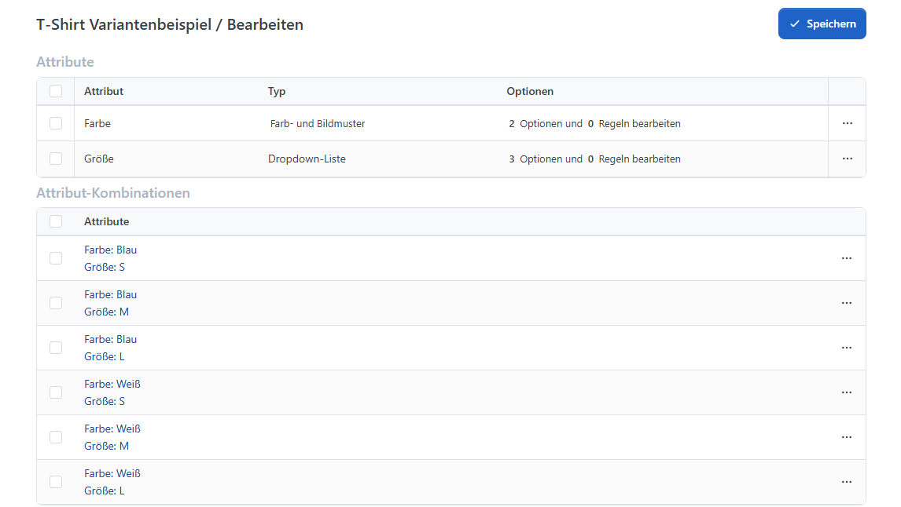

# Produktattribute und Varianten

Viele Produkte werden in mehreren Ausführungen angeboten, beispielsweise in unterschiedlichen Größen, Farben oder Materialien. Sie können Kunden diese Auswahl am Produkt ermöglichen und für einzelne Ausführungen eigene Produktnummern, Preise oder Lagerbestände hinterlegen.

## Weiterführende Themen 

* [Produktattribute vorbereiten](../../produktattribute-verwalten.md): Merkmale wie Farbe und Größe zentral anlegen, gemeinsame Einstellungen pflegen und wiederkehrende Werte als Options-Sets vorbereiten.
* [Attribute am Produkt einrichten](produktvarianten-einrichten.md): Attribute zuweisen, Eingabetypen wählen und die angebotenen Werte einschließlich Aufpreisen festlegen.
* [Attributkombinationen verwalten](attributkombinationen-verwalten.md): Eigene SKUs, Preise, Bilder oder Bestände je Ausführung hinterlegen und bestellbare Kombinationen festlegen.
* [Farb- und Bildmuster verwenden](farb-und-bildmuster-verwenden.md): Die Auswahl mit Farbfeldern, Materialbildern oder größeren Auswahlkarten gestalten.
* [Produktpreis festlegen](../produktpreis-festlegen.md): Die allgemeinen Preise und Preisoptionen eines Produkts pflegen.
* [Preisregeln verstehen](../preisregeln-verstehen.md): Das Zusammenspiel von Produktpreis, Kombinationspreis, Aufpreisen und Rabatten verstehen.
* [Lagerbestand führen](../lagerbestand-fuhren.md): Gemeinsame oder nach Ausführungen getrennte Bestände verwalten.

Die folgenden Abschnitte erklären die Zusammenhänge am Beispiel eines T-Shirts und helfen Ihnen, die passende Anleitung auszuwählen.

## Ein Produkt, mehrere Ausführungen 

Angenommen, Sie verkaufen dasselbe T-Shirt in Blau und Weiß sowie in den Größen S, M und L. Daraus ergeben sich sechs mögliche Ausführungen. Sie legen dafür ein Produkt an und ergänzen die Auswahl von Farbe und Größe.

Ob Sie zusätzlich eigene Daten für alle sechs Ausführungen hinterlegen müssen, hängt von Ihrem Sortiment ab. Ein gemeinsamer Preis kann für alle Größen genügen. Getrennte Bestände oder unterschiedliche Produktnummern müssen Sie dagegen den jeweiligen Ausführungen zuordnen.

## Attribute und Werte unterscheiden 

**Farbe** und **Größe** sind in diesem Beispiel die Attribute. Sie bezeichnen die Merkmale, nach denen der Kunde auswählt. **Blau**, **Weiß**, **S**, **M** und **L** sind die zugehörigen Attributwerte. Die Auswahl **Blau + M** ist eine Attributkombination.

Attribute können auch individuelle Angaben erfassen. Für einen Gravurtext verwenden Sie beispielsweise ein Textfeld, für ein Druckmotiv einen Datei-Upload. Der Kunde gibt dann selbst einen Wert ein, statt aus vorbereiteten Werten zu wählen.

<figure><figcaption>
Zusammenhang zwischen Attributen, Werten und Kombinationen: Zwei Farben und drei Größen ergeben sechs T-Shirt-Ausführungen.
</figcaption></figure>

## Wiederkehrende Attribute und Werte vorbereiten 

Ein Attribut wie Farbe lässt sich für viele Produkte verwenden. Deshalb legen Sie es zentral an und weisen es anschließend den betreffenden Produkten zu. So können unterschiedliche T-Shirts dasselbe Attribut verwenden, aber jeweils andere Farben anbieten.

Häufig benötigte Werte können Sie als Options-Set vorbereiten, beispielsweise die Größen S bis XL. Die Werte werden aus diesem Set in das Produkt kopiert und können dort angepasst werden. Spätere Änderungen der Vorlage verändern bereits kopierte Werte nicht automatisch.

Die zentrale Anlage und die Arbeit mit solchen Vorlagen beschreibt [Produktattribute vorbereiten](../../produktattribute-verwalten.md).

## Die Auswahl am Produkt einrichten 

Am einzelnen Produkt bestimmen Sie, welche Attribute und Werte Kunden wählen können. Dazu gehören die Darstellung als Auswahlliste, Kontrollkästchen, Textfeld oder Farb- und Bildmuster sowie die Frage, welche Angaben vor dem Kauf erforderlich sind.

Für das T-Shirt könnten Sie die Größe als Dropdown-Liste und die Farbe als anklickbares Muster anbieten. Eine vorausgewählte Größe kann den Einstieg erleichtern; ein Pflichtfeld stellt sicher, dass der Kunde die benötigte Auswahl vor dem Kauf trifft.

Wie Sie Attribute zuweisen, Werte hinterlegen und die Eingabe einstellen, erfahren Sie unter [Attribute am Produkt einrichten](produktvarianten-einrichten.md).

## Eigene SKU, Preise oder Bestände je Ausführung hinterlegen 

Soll das blaue T-Shirt in Größe M eine eigene SKU wie **SHIRT-BL-M** erhalten, legen Sie dafür eine Attributkombination an. An derselben Kombination können Sie beispielsweise einen Preis von 24 € und einen Lagerbestand von zwölf Stück hinterlegen. Blau + L erhält bei Bedarf eine weitere Kombination mit eigenen Angaben.

Wenn Kunden lediglich eine Farbe wählen sollen und alle gemeinsamen Produktdaten ausreichen, müssen Sie dafür keine eigenen Kombinationen erfassen. Kombinationen werden außerdem wichtig, wenn Sie gezielt festlegen möchten, welche Zusammenstellungen angeboten werden: etwa Weiß nur in S und M, Blau dagegen auch in L.

Das Anlegen und Ergänzen von Kombinationen sowie die Freigabe bestellbarer Ausführungen erläutert [Attributkombinationen verwalten](attributkombinationen-verwalten.md).

## Die Auswahl durch Farben und Bilder verständlich machen 

Eine Farbbezeichnung allein vermittelt nicht immer, wie ein Produkt aussieht. Mit Farb- und Bildmustern können Kunden beispielsweise eine T-Shirt-Farbe direkt erkennen oder die Struktur verschiedener Sofastoffe vergleichen. Je nach Darstellung erscheinen kleine Farbflächen, Materialbilder oder größere Auswahlkarten mit Namen und Preisinformationen.

### Die Darstellung gemeinsam oder je Produkt festlegen 

Die Darstellung eines Attributs lässt sich zentral für seine Verwendung an vielen Produkten festlegen. Für ein einzelnes Produkt können Sie davon abweichen, beispielsweise größere Stoffbilder verwenden. Bilder, mehrfarbige Muster, Auswahlkarten und die Preisvorschau erklärt [Farb- und Bildmuster verwenden](farb-und-bildmuster-verwenden.md).

## Preise für die Auswahl festlegen 

Manchmal genügt ein gemeinsamer Produktpreis. In anderen Fällen soll Weiß einen Aufpreis von 2 € kosten oder Blau + M einen eigenen Preis erhalten. Wo Sie Aufpreise an Attributwerten eintragen, beschreibt [Attribute am Produkt einrichten](produktvarianten-einrichten.md). Den eigenen Preis einer Ausführung hinterlegen Sie unter [Attributkombinationen verwalten](attributkombinationen-verwalten.md). Wie diese Beträge mit Aktionspreisen, Staffelpreisen und Rabatten zusammenwirken, erläutert [Preisregeln verstehen](../preisregeln-verstehen.md). Die allgemeinen Preisfelder des Produkts finden Sie unter [Produktpreis festlegen](../produktpreis-festlegen.md).

## Bestände und Bestellbarkeit unterscheiden 

Wenn Sie zwölf blaue T-Shirts in M und fünf in L auf Lager haben, können Sie diese Bestände an den beiden Kombinationen getrennt führen. Dafür wählen Sie am Produkt die passende Methode der Lagerbestandsführung. Die Einstellungen und Bestandsbuchungen beschreibt [Lagerbestand führen](../lagerbestand-fuhren.md).

Unabhängig vom Bestand können Sie eine bestimmte Kombination vollständig vom Verkauf ausschließen. Wie aktive Kombinationen, fehlende Kombinationen und die Auswahl im Shop zusammenspielen, erklärt [Attributkombinationen verwalten](attributkombinationen-verwalten.md#bestellbare-kombinationen).
